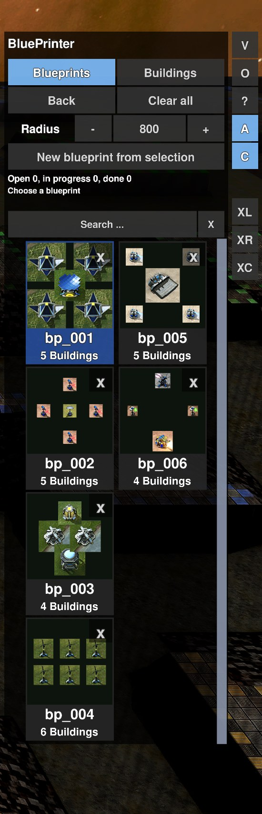
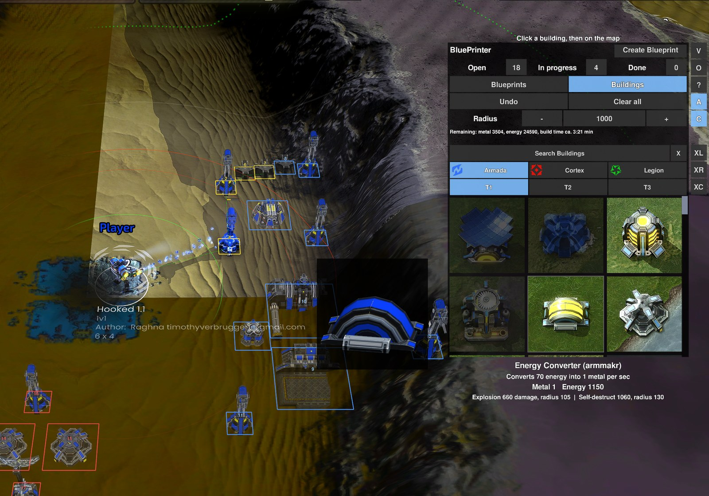

# BluePrinter

[Start page](../README.md) · [Short version](../docs/blueprinter-usage.md) · [Specification](../specs/blueprinter.md)

A widget for the **official** Beyond All Reason: queue building blueprints on the map as build plans.

- Idle builders nearby pick the plans up on their own.
- Buildings only (units can only be placed in the Level Editor).
- Nothing is cheated: these are normal build orders with normal cost and build time.

| Blueprints | Buildings |
|---|---|
|  |  |

## Setup

| Step | What to do |
|---|---|
| Install | keep the folders `BluePrinter` and `shared` next to each other, run `install_blueprinter.bat` |
| Switch on | in the game: settings > "Allow user widgets", then BluePrinter in the widget list (F11) |
| Start | `start_blueprinter.bat` (updates the widget when files changed, then starts BAR), or start BAR as usual |
| Try it | `start_blueprinter_test.bat ["Map Name"]`: a small test game against a passive AI |
| Update | run `install_blueprinter.bat` again, or use the start files |
| Remove | `uninstall_blueprinter.bat` (asks first; blueprints stay; `-WithSettings` also deletes the settings, `-Yes` skips the question) |

- A running game keeps the old files until a new start or `/luaui reload`.

## Place a blueprint

1. Click a blueprint in the menu (on the right; `/bp_side left` moves it).
2. Left click on the map queues it, any number of times. Green = free, red = blocked.
3. Right click ends.

| Action | How |
|---|---|
| Rotate | `[` and `]`, or Alt + mouse wheel |
| Choose with the wheel | **Ctrl + mouse wheel** on the map: next / previous blueprint |
| Row / rectangle | **Shift + drag** / **Shift + Alt + drag**; **Shift + wheel** changes the spacing |
| Paint (single buildings) | hold the left button and move |
| Search | the field above the tiles (Enter = done, Esc or X = clear) |

- A tile shows a picture, the name, the number of buildings, the total cost and the **Eco time**.
- **Eco time:** how long your stable income needs to pay for it (worst case, your stock is not counted; `-` without income).
- Before placing, numbers at the buildings show the build order, and 3D models show the result.
- Placing **on top of other plans replaces them** (Undo brings them back). A building that would lie on a real building or on bad ground is left out.

## Your blueprints

| Action | How |
|---|---|
| Create | select buildings, then **Create Blueprint** in the title row (Ctrl+Alt+P or `/bp_create`) |
| Sort | drag a tile |
| Rename | double click on the name, type, Enter |
| Delete | x on the tile, click twice (goes to `_trash`) |

- Blueprints are files in `BluePrinter\blueprints`. The blueprints of the Level Editor are shown too when its folder lies next to `BluePrinter`.
- Units in a blueprint are skipped. The team in it does not matter: it is built for you.
- **Faction (button F, on by default):** a blueprint is built with the buildings of your builders' faction (`armsolar` becomes `corsolar` or `legsolar`).
  - Buildings the faction does not have are left out; a message says how many.
  - Sizes differ between factions, so a blueprint may not fit exactly. Switch F off to build it as it is.

## Single buildings

- **Buildings** at the top of the menu switches to the catalog: choose faction and tech tier, click a building, then every left click on the map queues one.
- Buildings your builders cannot build right now are dimmed (queueing works anyway).

## Who builds what

- Only **idle** builders that can build the building take part, within the radius set in the menu.
- A builder takes up to four plans in a row; when all are taken it helps with one in progress.
- Colors: blue = planned, yellow = a builder works on it, red = blocked right now (tried again later).
- **Right click on a plan** with builders selected: exactly these builders build it now (Shift = after their current orders).
- Plans are kept for the same match (also after `/luaui reload` or a rejoin).

**Buttons next to the menu**

| Button | Effect |
|---|---|
| **V** | collapse the menu |
| **O** | settings: columns and rows of the grid |
| **?** | help board with all keys |
| **A** | auto-build on / off |
| **Q** | queue order: off = builders take the nearest plan, on = the lowest number first |
| **C** | the commander helps (it stops and fights when an enemy comes near) |
| **F** | faction of your builders |
| **XL XR XC XS XF** | [experimental attacks](../docs/experimental-attacks.md) |

- In the menu: **Undo**, **Clear all** and the **radius** field.
- Drag the title to move the menu; right click on the title puts it back.

## Manage the queued plans

| Action | How |
|---|---|
| Select a plan | left click; **double click** = the whole blueprint; **Shift+click** adds or removes; **Ctrl+drag** = rectangle |
| Remove | **Del** (stops its builder; a started building is reclaimed) |
| Rotate | **[** and **]** (not the ones being built) |
| Reorder | **Page up / Page down** one place, **Home / End** to the front or back (matters with **Q** on) |
| Undo | the **Undo** button takes every step back |

- A plan with another building on its spot leaves the queue by itself.

## Chat commands

`/bp_menu`, `/bp_rotate`, `/bp_undo`, `/bp_clear`, `/bp_com`, `/bp_side left|right`, `/bp_scan` (re-read the list), `/bp_create`, `/bp_mode bp|units`, `/bp_carpet [line|rect|circle|split|focus]`, `/bp_spacing <n|+|->`, `/bp_ghost [gl|wg|auto]`.

## Note for ranked games

Automatic building may count as automation in some ranked or tournament games. If in doubt, switch auto-build off (button **A**).
