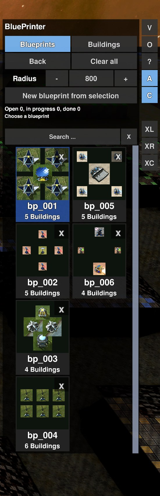
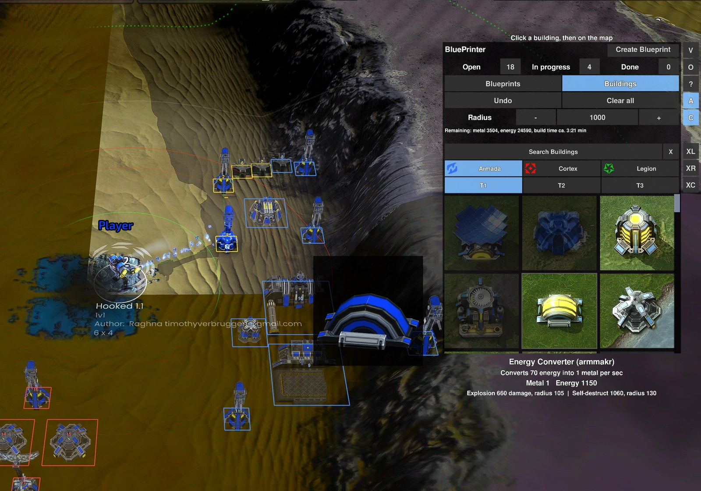

# BluePrinter

Widget for the official Beyond All Reason. Building blueprints are queued on the map as build plans.
Idle own builders nearby then get the build orders for them on their own. The widget cannot place units directly
(that is only possible in the Level Editor); it works with buildings only.

Nothing in the game is changed and nothing is cheated: these are normal build orders (`GiveOrderToUnit`),
cost and build time apply as usual.

| Blueprints | Buildings |
|---|---|
|  |  |

## Installing
1. BAR must be installed (launcher started once).
2. Run `install_blueprinter.bat`. It copies `bluePrinter.lua` to `data\LuaUI\Widgets`, the shared code
   `shared/editor_common.lua` and `shared/bar_rules.lua` to `data\LuaUI\Include` and creates the junctions `data\LuaUI\Config\BluePrinter` -> `blueprints` and `data\LuaUI\Config\LevelEditorBlueprints` -> blueprints of the Level Editor (BAR only allows user widgets to write under `LuaUI\Config` and to read under `LuaUI`). 
   The folder `shared` must lie next to `BluePrinter`.
3. In the game switch on "Allow user widgets" in the settings, then switch BluePrinter on in the widget list (F11).
After a change to `bluePrinter.lua` run the installation again.

**Removing:** run `uninstall_blueprinter.bat` (it asks first). It removes the widget, the shared code in `data\LuaUI\Include` and the two junctions; the blueprints stay. With `-WithSettings` the settings file `LuaUI\Config\BluePrinterUI.lua` is deleted too, with `-Yes` the confirmation is skipped.

## Trying it out
**`start_blueprinter.bat`** makes sure the newest BluePrinter is installed (it compares the files with the installed ones and runs the setup when they differ) and then starts the normal Beyond All Reason. The BluePrinter is a widget: once it is installed and switched on (see above) it is active in every normal game, you can also start BAR in the usual way, but then nobody checks that the installed version is the newest. **`start_blueprinter_test.bat`** does the same check and then starts a small test game (one player against a passive AI on the first installed map), so you can look at the menu after a change. Start it from a command line with a map name to choose the map: `start_blueprinter_test.bat "Map Name"`.

## Blueprints
Files `<name>.lua` are read from `data\LuaUI\Config\BluePrinter` (that is from `BluePrinter\blueprints`) and from
`data\LuaUI\Config\LevelEditorBlueprints` (the blueprints of the Level Editor, if the folder `LevelEditor` lies next to `BluePrinter`). Only buildings are used,
units in a blueprint are skipped. The team in the blueprint does not matter, it is built for you.

## Usage
- Menu on the right (with `/bp_side left` to the left): click a blueprint in the list, then left click on the map = queue it
  (several times possible), right click ends. Green = free, red = blocked.
- The list shows thumbnails (buildings as unit pictures from above) with the name, the number of buildings and the total cost of the whole blueprint (`M` metal, `E` energy). With the large x at the top right of the tile
  (click twice) a blueprint goes to the trash (`_trash`).
- The tiles stand in a grid that grows from top to bottom: first a column with up to 4 tiles, then the next column (up to 3 columns), after that the mouse wheel scrolls (three times as fast).
- The button **O** (in the column next to the menu) opens the settings: columns and rows of the grid (default 3 and 4) with - and +. They are stored in `LuaUI\Config\BluePrinterUI.lua` in the game folder.
- Drag a tile with the mouse button held down = sort (a yellow mark shows the place, the order is remembered).
  Double click on the name = rename (type, Enter accepts, Esc cancels).
- **Painting:** with an armed building hold the left mouse button and move: a plan is queued after every footprint of mouse movement (plus the spacing); spots where the building cannot be placed are left out. The whole stroke is one step for Undo.
- **Rows and rectangles:** with an armed blueprint or building hold **Shift** and drag (a row) or **Shift + Alt** and drag (a rectangle); all copies are queued on release as one step for Undo. **Shift + mouse wheel** changes the spacing.
- **Create Blueprint** (button at the top right of the title row, Ctrl+Alt+P or `/bp_create`): the selected buildings are saved as `bp_001`, `bp_002` ... in `BluePrinter\blueprints`
  and made ready for placing right away.
- When placing, the widget shows the 3D models of the buildings in addition to the frames (semi-transparent, for large blueprints the 150 closest to the center). With `/bp_ghost` you check the mode (`gl` or `wg`, if the models are missing).
- A **search field** sits above the blueprint tiles (and in the building catalog): type words of the description or the code, the list filters at once (Enter = done, Esc or X = clear; sorting is off while searching). The lists have a **scrollbar** at the right edge.
- Rotate: the BAR keys `[` and `]` (build rotation), or Alt + mouse wheel (there is no button; the direction is visible in the 3D preview at the mouse pointer).
- Blue = planned, yellow = a builder is working on it, red = blocked right now (tried again later). Every open plan also shows a semi-transparent 3D ghost of the building (the 150 closest to the mouse pointer if there are more).
- **Right click on a plan** with builders selected: exactly these builders build exactly this plan now (Shift = add it behind their current orders). Builders that cannot build it give a message; without a selected builder the click keeps its normal meaning.
- **Moving the menu:** drag the title ("BluePrinter") with the left mouse button, the menu moves with its button column. A right click on the title puts it back. The position is remembered.
- Buttons at the screen edge next to the menu: **V** collapse, **O** settings, **?** help, **A** auto-build on/off, **C** commanders help build yes/no (hover for a tooltip). In the menu: Undo, Clear all and the radius field (builders react to plans within this radius; click the number to type one, or use - and +).
- Only builders that are idle and can build the building take part (e.g. no T2 buildings with a T1 builder).
  If a builder has several plans nearby, it gets up to four in a row. When all plans are taken,
  it helps with one in progress.
- Queued plans are kept when you quit the game, on the same map.

## Area attack (experimental)
Spreads the bombs and shots of all selected units evenly over an area. Select bombers, artillery, rocket launchers or nukes and press one of the buttons next to the menu: **XL** (a line), **XR** (a rectangle) or **XC** (a circle; drag from the center outwards). Then drag the shape on the map. Each unit gets its own target inside the shape: the bombers first form up side by side (for the line: beside it, facing it) and, once all are in position, attack at the same moment as a front; artillery and rockets fire at their target. Right click cancels. Also Ctrl+Alt+K (= XL) or `/bp_carpet [line|rect|circle]`.

## Chat commands
`/bp_menu` menu on/off (auto-build and radius are buttons in the menu), `/bp_rotate`, `/bp_undo`, `/bp_clear`, `/bp_com`, `/bp_side left|right`, `/bp_scan` (re-read the list), `/bp_create` (blueprint from the selection), `/bp_mode bp|units` (switch the view), `/bp_carpet [line|rect|circle]`, `/bp_spacing <n|+|->`, `/bp_ghost [gl|wg|auto]` (state of the 3D preview).

## Note
Automatic building may count as automation in some ranked or tournament games. If in doubt, switch auto-build off (button **A**).

## Queueing single buildings
At the top of the menu use **Buildings** to switch to the catalog view: choose the faction (preselected by your builders; only factions your builders can build for are shown) and the tech tier,
click a building, then every left click on the map queues one (hold the button and move to paint more, right click ends, `[` and `]` rotate). Buildings that
your builders cannot build right now are dimmed (queueing works anyway). The builders work through them like all plans.
An installed BluePrinter is updated by itself every time `LevelEditor\start_level_editor.bat` runs (and by `BluePrinter\start_blueprinter.bat` and `start_blueprinter_test.bat`); otherwise run `install_blueprinter.bat` again after a change. A game that is already running keeps the old files until a new start or `/luaui reload`.

**Managing the queued plans:** a left click on a plan in the world selects it (a plan of a blueprint selects the whole blueprint copy; **Ctrl+click** only that building, **Shift+click** adds, **Ctrl+drag** a rectangle). Then **Del** removes the plans from the queue, **[** and **]** rotate them (not the ones already being built), **Page up / Page down** move them one place forward or back in the queue (the numbers in the world change), **Home / End** to the very front or back. **Undo** takes every one of these steps back. A removed plan also stops the builder that had it, and a building that was already started is reclaimed.

The toggle **Queue order** in the title row (next to Create Blueprint) decides who builds what first: off (default) = idle builders take the nearest plan, on = they take the plan with the lowest number first. Only with it on the reordering matters. Without auto-build (button **A**) you can select builders and **right click on a plan**: they go there and build it, a plan of a blueprint sends them to build the whole blueprint copy. The commander helps with plans too (button **C**), but stops building and fights when an enemy comes near.

You set the display (columns/rows) with the **O** button. Under the 3D preview the info of the building under the mouse pointer is shown (name and code, description, metal and energy with the **Eco time**, damage per second, explosion), the same as in the Level Editor. **Eco time** is how long your current income needs to produce the metal and energy of the building (or of a whole blueprint); it counts the worst case, the stock in your store is not counted, and it shows `-` without income.

## Shared code
The blueprint view (grid, dragging, renaming, trash, settings, 3D preview) comes from `shared/editor_common.lua`
and is the same as in the Level Editor.

## Help
The menu has a **?** button. It shows the keys and short explanations as a board on the screen; a click closes it.
