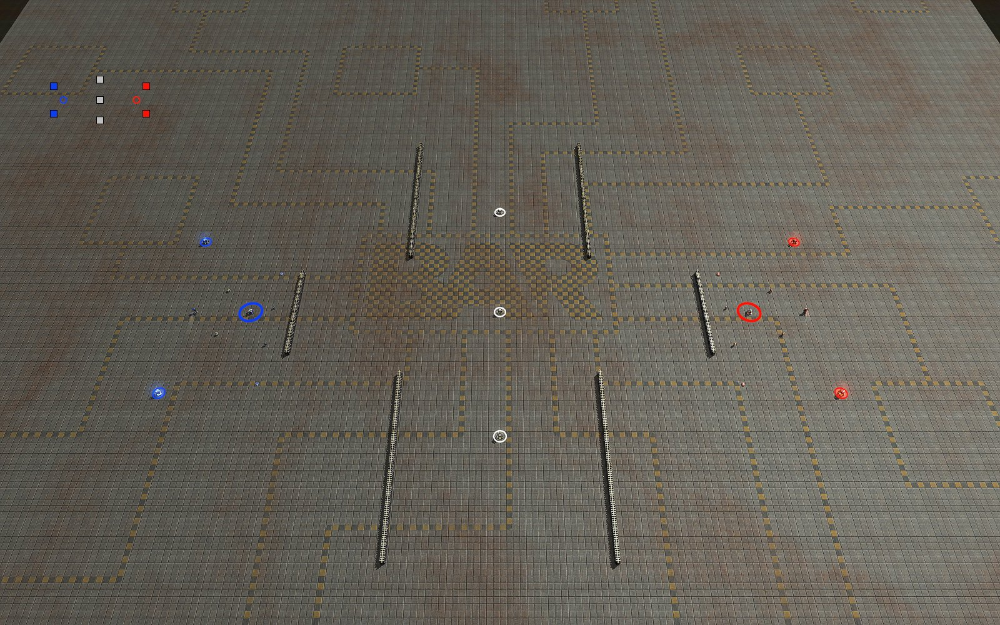

# Capture the Flag

[Level Editor manual](../README.md) · [Specification](../../specs/capture-the-flag.md) · [Scenario builder](../scenario/README.md) · [Start page](../../README.md)

Flags lie on the map. Units pick them up, carry them to their collection point and earn metal. For human against human, computer opponents do not play it.

## In short

- **Menu:** click the button **CF** in the button column at the right edge of the editor (below **TD**)
- Tick **Capture the Flag** to mark the level (the button turns green)
- Place collection points and flag points per team
- Excludes Tower Defense and Reclaim the Fame in the same level
- **Start** runs it in the editor
- Demo level: `demo_ctf_crossroads` (two bases, three neutral flags, hold 4 to win)

## Build the level

**Places on the map**
- Choose the team in the strip at the left
- **Collection point**: click on the map, as many as you like per team
- **Flag point**: belongs to the chosen team, **neutral** with **G** in the strip
- Own flags in a team's area, neutral flags in the middle
- Right click ends, **Del** removes, **Alt + drag** moves, **Ctrl+Z / Y** undo and redo
- Rings show the radius: thick = collection point, thin = flag point, white = neutral

**Rules**
- **Income**: every flag at your collection point pays metal per second
- **Flags to win**: how many an alliance (the teams that play together) must hold at once (0 = never ends); allied teams count together and deliver at each other's collection points
- **Capture radius**: pick up, deliver and bring back
- **Return time**: a dropped flag goes back after this time (0 = stays)
- **Carrier speed**: default 50 Elmo per second
- **Flags always visible** on the map and minimap (on by default)

## How it plays

- Other teams take your flag; you only bring it back when it was dropped
- The carrier **cannot shoot** and is slowed down
- A transport may carry a flag carrier, but then it is as slow as a carrier; the flags and collection points themselves cannot be loaded
- A destroyed carrier drops the flag where it died
- A delivered flag stays at the collection point and can be stolen
- Holding enough flags wins: all units of the other teams blow up
- A team whose flags are all in other bases has lost

## Test and play

- **Start** / **Stop**: runs the game, the level comes back as before
- The score of every team is shown at the top
- Scenario package (start menu key `3`): settings are packed
- The game runs in the gadget `ctf_game.lua`
