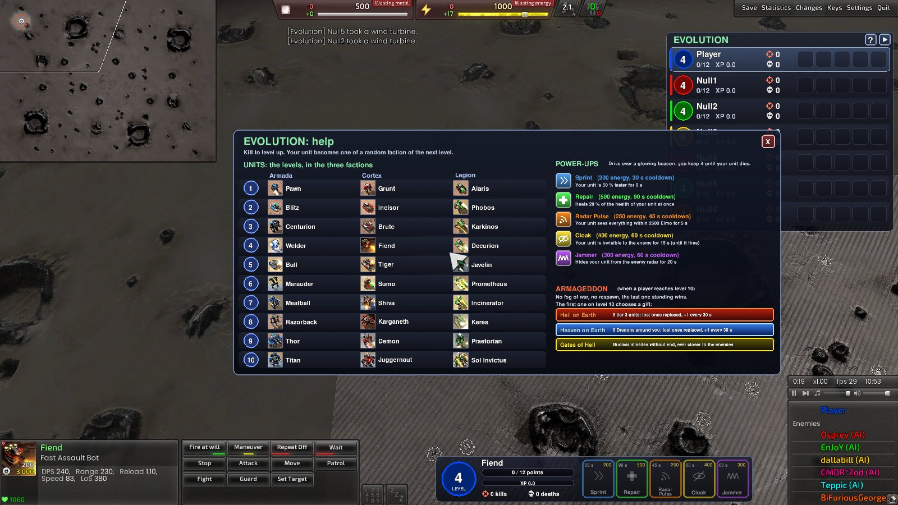

# Evolution

[LAN Play](../../docs/lan-play.md) · [Specification](../../specs/evolution.md) · [Start page](../../README.md)

- Every player starts with **one weak unit** instead of the commander.
- Kills give **points**; enough points **evolve** the unit into a stronger one: 10 levels, from a Pawn up to a tier 3 giant.
- A lost unit comes back somewhere else, one level lower.
- The first unit on level 10 brings **Armageddon**: no fog of war, no coming back, the last one standing wins.
- A mode of **LAN Play** on any map: no level and no editor needed.

## Start it

1. In the **LAN Play** room the host presses the green button **LAN Play** (title row, next to "Leave Lobby"), then **Evolution**, then **On**.
2. Start the game as usual. Humans and computer players all play; the start positions of the map are used.

- Everybody in the room sees the setting, and the rules appear in the chat of the room.
- Best on a small map: size **M or smaller** (up to 16 x 16, e.g. Comet Catcher Remake, Trefoil Remake, Argent Strata).
- Legion and the Extra Units Pack are switched on by themselves.
- A joiner without the extra game "Level Editor Scenarios" gets it from the host.
- **Quick test without the lobby:** `LevelEditor\start_evolution.bat` (you against one SimpleAI on Hooked 1.1, debug mode on). Other map or computer player: `start_evolution.bat "Comet Catcher Remake 1.8" SimpleDefenderAI`.

**Settings** (the submenu **Evolution**; every button has a tooltip)

| Setting | Values | Effect |
|---|---|---|
| **On / Off** | Off by default | green = on, red = off |
| **Unit multiplier** | 1x to 10x | so many times the normal number of wild units and towers |
| **Unit health** | **Auto** (default), or 10 % to 100 % | the health wild units start with; Auto = 10 % on level 1, 30 % on levels 2 to 4, 40 % on levels 5 to 7, 50 % from level 8 |
| **Regeneration** | On (default) / Off | the units of the players heal by themselves |
| **Long range** | On / Off (default) | nine units with a range of 850 Elmo or more can appear too: Sharpshooter, Arquebus, Deadeye, Starlight, Siegebreaker, Daedalus, Thermite, Mukade, Apollyon |
| **All Be Gods** | On / Off (default) | Off = only the **first** player on level 10 chooses a gift; On = every player who reaches level 10 |
| **Debug mode** | On / Off (default) | test buttons above your panel: Armageddon, Level Up / Down, XP Up / Down, one per power-up, a star (random values for every player) and Hide |

## Your unit

- Every team starts with one level 1 unit where its commander would stand.
- Every new unit is of a **random faction** (Armada, Cortex or Legion) and a random unit of its level: a Pawn can become a Brute and then a Karkinos.
- When it evolves, the new unit:
  - stands where the old one stood
  - has the health share of the old unit plus 20 % (not a full heal)
  - keeps its orders and is selected again

## Points

| Level | Points to the next level | Kill of a wild unit or tower | Kill of an enemy player |
|---|---|---|---|
| 1 | 3 | 1 | 3 |
| 2 | 5 | 2 | 5 |
| 3 | 8 | 3 | 8 |
| 4 | 12 | 4 | 12 |
| 5 | 20 | 7 | 20 |
| 6 | 31 | 10 | 31 |
| 7 | 50 | 17 | 50 |
| 8 | 81 | 27 | 81 |
| 9 | 129 | 43 | 129 |
| 10 | | 69 | 206 |

- The level in the kill columns is the level of the unit you killed.
- About three wild units of your own level bring you up.
- **Catching up:** half the points more for every level you are below the best player (level 1 next to a player on level 5: three times the points).
- **An enemy player above your level** is worth more: times (1 + the levels it is above you). A level 1 unit that kills a level 3 unit gets 8 x 3 = 24 points and jumps to level 4.
- **Experience:** every kill of another player gives your unit 0.1 experience (the game's own bonus: a little more health and damage, faster reloading). You keep it when you level up; every death costs 0.1.

## Death

- Your unit comes back after **5 seconds** at a random place far from the others, **one level lower** (never below 1). The points of the level are lost.
- All units appear on the land the commanders stand on, so on a map with water or islands everybody can reach everybody.

## Level 10: Armageddon

- The first player on level 10 brings Armageddon: a message to everybody, big letters on the screen.
- The **fog of war is gone**: everybody sees everybody.
- A lost unit **does not come back**: that player is out.
- **Everybody else allies against level 10** and hunts that player together.
  - When nobody on level 10 is left, everybody fights alone again; a new player on level 10 brings the alliance back.
- The **last one standing wins** (allies of the start together).

**Before that: levels 8 and 9**

- A player on level 8 or 9 shows on the **radar and the minimap of everybody**, also in the fog of war, so the others can team up. The chat says so.
- Not while that player is cloaked or has the Jammer on.

**The gift of level 10**

The first player on level 10 chooses one of three gifts (with **All Be Gods**: every player on level 10).

| Gift | What happens |
|---|---|
| **Hell on Earth** | 8 tier 3 units rise all over the map and are yours. A lost one is replaced, and one more rises every 30 seconds. |
| **Heaven on Earth** | 8 Dragons (heavy gunships) come down around your unit and are yours. A lost one is replaced near you, and one more comes down at a random place every 30 seconds. |
| **Gates of Hell** | Nuclear missiles, see below. |

- Choose with a click or the keys 1, 2, 3. After 30 seconds a random one is taken; a computer player chooses at once.
- Hell on Earth and Heaven on Earth also give **+1000 energy per second** for good (the heavy lasers need it).
- What the gift kills counts for you. When you are out, the units of your gift blow up.
- The chat says who chose what, with a saying.
- **Gates of Hell** in detail:
  - First a barrage all at once at random places (10 missiles per player, at least 20). Red rings warn everybody 5 seconds before.
  - Then missiles follow every human enemy: one at first, two after two minutes, one more every two minutes.
  - The volleys come every 10 seconds, after four minutes every 3 seconds.
  - They start 2000 Elmo from the enemy and come closer and closer.
  - Computer players are not followed. Your own unit and your allies are never hit.

## The map

**Wild units and towers**

- Units of nobody stand around the map with reduced health (setting **Unit health**; the health bar shows it). About one in seven is a **tower** (it does half of its normal damage).
- Most of them walk around, about one in five stands still. They **only shoot back**.
- **They grow with the weakest player:** a new one has the level of the weakest player who is still in.
  - A wild unit above that level, or two or more levels below it, is replaced (one every 3 seconds).
  - Never one that a player sees or that is within 900 Elmo of a player's unit.
- **How many:** one per 1024 x 1024 Elmo of land, at least 12, at most 100; the **Unit multiplier** raises the number. A killed one comes back 10 seconds later somewhere else.

**Energy**

- You get **5 energy per second plus 3 for every level** (level 1: 8, level 8: 29) and can store **1000** (2000 on level 10).
- Laser weapons and the abilities need it.
- **More energy:** solar collectors and wind turbines of nobody stand around the map. Stand next to one for 5 seconds ("Taking 3/5") and it is yours (a solar collector about 20 per second, a wind turbine as much as the wind gives).

**Radars**

- Radars of nobody stand all over the map. Stand next to one for **5 seconds** and it is **yours**: you see where the others go.
- Radars, solar collectors and wind turbines cannot be destroyed. An enemy takes yours the same way.
- When the first player reaches **level 6** they become their **T2 versions** one by one (larger range, more energy), and go back when nobody is on level 6 or higher. Only buildings that no player sees are changed.
- When a player is out, their radars belong to nobody again.

**Healing**

- **Regeneration:** 1 % of the health every 5 seconds, when your unit has not been hit for 5 seconds.
- **Reclaim by itself:** your unit reclaims the trees and wrecks within 100 Elmo, as long as no enemy player's unit is within 700 Elmo.
  - Trees give **energy** 1 to 1 (at most 60 per second), while your storage is not full.
  - The metal of a wreck **heals** your unit 1 to 1 while it is hurt: 1 % of its maximum health per second (at least 1, at most 150). A green "+number" shows it.

## Beacons and abilities

- Glowing beacons in five colors lie around the map (you see them where your unit sees).
- Drive over one to get its **ability** until your unit dies. Evolving keeps it.

| Color | Ability | What it does | Energy | Cooldown |
|---|---|---|---|---|
| Blue | Sprint | 50 % faster for 8 s | 200 | 30 s |
| Green | Repair | heals 20 % of the health at once (at full health: "not needed") | 500 | 60 s |
| Orange | Radar Pulse | your unit sees everything within 2500 Elmo for 5 s | 250 | 45 s |
| Yellow | Cloak | invisible to the enemy for 15 s, even right next to it; firing ends it; your unit is on Hold Fire meanwhile and on Fire at Will afterwards | 400 | 60 s |
| Violet | Jammer | hidden from enemy radar and sonar, and jams radar, for 20 s | 300 | 60 s |

- **The buttons:** five colored buttons in your panel at the bottom, grey until you have the ability. Click one to use it.
  - While it works, a fill in its color runs down and the number counts the seconds.
  - Then the cooldown: a grey fill runs down and the number counts down.
  - Hold the mouse over a button to read what it does.
- **The beacons:** 2 to 6 of every color at the start, more on a bigger map and with more players. A taken beacon comes back 45 seconds later somewhere else.
  - A beacon of an ability you already have stays for the others.
  - Exception: while that ability cools down, driving over the beacon uses it up and the cooldown is gone at once.
- **Together with the game mode [Renegade](renegade.md)** (you steer the unit from the inside):
  - The keys **1 to 5** use the abilities in the order of the table (the bar shows the numbers).
  - After a Cloak the unit stays on Hold Fire (you fire yourself).
  - After a Radar Pulse the unit keeps the larger sight of Renegade.

## Computer players

- Every team without a human is steered by the game mode.
- It picks up the beacons it drives over and uses its abilities.
- It takes radars, solar collectors and wind turbines, but not more than its share.
- It attacks only enemies of its **own level or higher** and wild units of its level or lower (in Armageddon every enemy). Otherwise it only shoots back and walks around.

## The units of the levels

| Level | Armada | Cortex | Legion |
|---|---|---|---|
| 1 | Pawn | Grunt | Alaris |
| 2 | Blitz | Incisor | Phobos |
| 3 | Centurion | Brute | Karkinos |
| 4 | Welder | Fiend | Decurion |
| 5 | Bull | Tiger | Javelin |
| 6 | Marauder | Sumo | Prometheus |
| 7 | Meatball | Shiva | Incinerator |
| 8 | Razorback | Karganeth | Keres |
| 9 | Thor | Demon | Praetorian |
| 10 | Titan | Juggernaut | Sol Invictus |

- The table shows one example per faction and level. Every level has more units: 77 in all (bots, vehicles, hovercraft), nine more with **Long range**.
- Left out: artillery, rocket launchers, aircraft, water units, constructors, scouts and units without a ground weapon.
- All of them: [unit table](evolution-units.md).

## On the screen

- **Overview** (right edge): one row per team, the highest level on top.
  - Level badge, name, points now and needed ("4/12"), experience ("XP 0.3"), kills above deaths, the abilities. Your own row is lighter; "out" in Armageddon.
  - The arrow button at its top right folds the list away. With many players it scrolls with the mouse wheel.
  - The button **?** opens the help window.
- **Your panel** (bottom, left of the music player): level, unit, points bar, a violet **XP bar**, kills, deaths and the buttons of your abilities.
- **Help window:** shown for 40 seconds at the start: the power-ups, example units of every level, Armageddon. A click outside closes it.
- After a respawn the camera jumps to your new unit.
- Everything scales with the size of the window.

## Tips

- Hunt the wild units first, then pick fights with enemies of your level or above.
- Take the radars near you early: you see the others coming.
- A small map keeps the fights coming.

## Unit candidates

The table of all units that can be used for Evolution, with their type, tech level, damage per second and the level they would get: [Unit candidates](evolution-units.md) (also as [evolution_units.csv](evolution_units.csv) for Excel).
