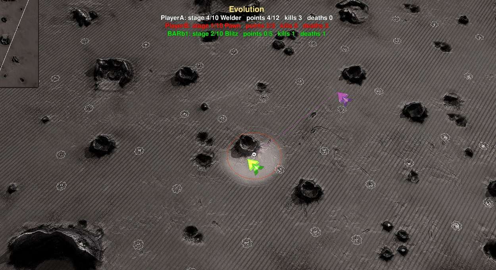
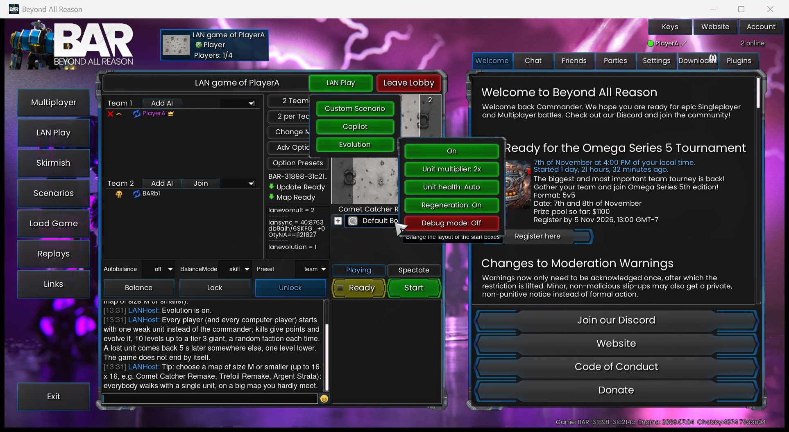
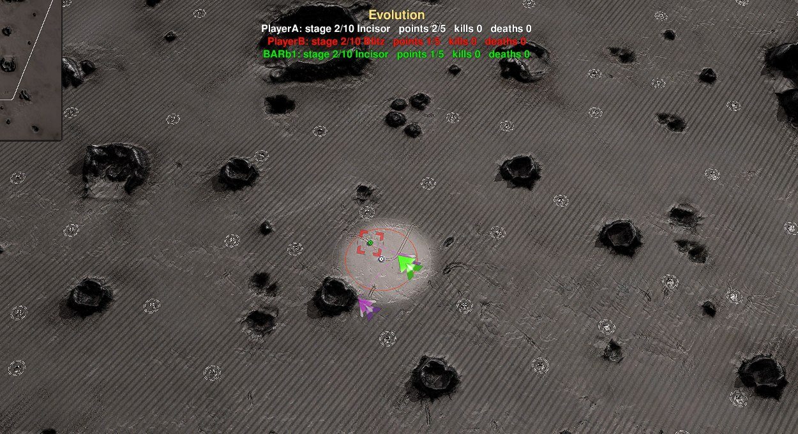
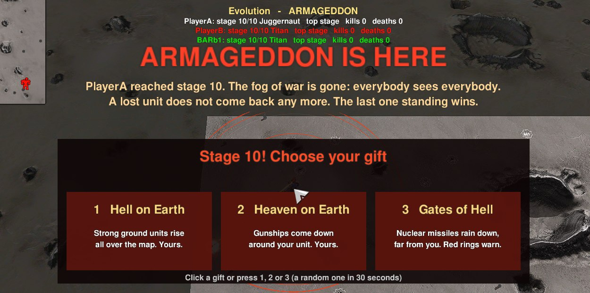
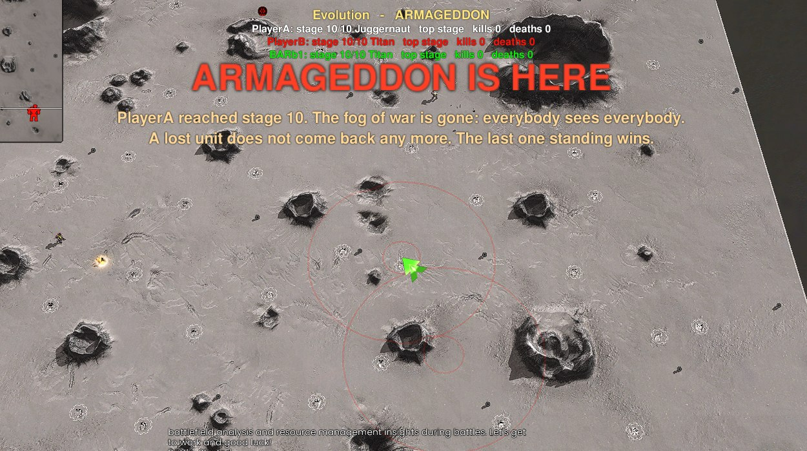

# Evolution

[LAN Play](../../docs/lan-play.md) · [Specification](../../specs/evolution.md) · [Start page](../../README.md)

Every player starts with **one weak unit** instead of the commander. Kills give **points**, and enough points **evolve** the unit into a stronger one: 10 stages, from a Pawn up to a tier 3 giant. A lost unit comes back somewhere else, one stage lower. The first unit on stage 10 brings **Armageddon**: no more fog of war, no more coming back, the last one standing wins. A mode of **LAN Play** on any map: no level, no editor needed.

## In short

- **LAN Play** room: the host presses the green button **LAN Options** in the title row of the room (next to "Leave Lobby"), then **Evolution** in its menu (it then reads "Evolution on"); everybody in the room sees it
- The host gets a window with the rules and a tip: a map of size **M or smaller** (up to 16 x 16)
- Start the game as usual: humans and computer players all play
- The start positions of the map are used (nobody has to place one)

## Rules

**Your unit**
- Every team starts with one stage 1 unit where its commander would stand; all other units are gone
- Every new unit is of a **random faction** (Armada, Cortex or Legion): a Pawn can become a Brute and then a Karkinos
- The new unit replaces the old one where it stands, with full health; it keeps its orders and is selected again by itself

**Points**
- A wild unit: **1** point
- An enemy player of stage *v*: the points that stage costs (3 for stage 1, 5, 8, 12, 20, 31, 50, 81, 129 up to stage 9, 206 for stage 10)
- An enemy **above** your stage is worth more: times (1 + the stages it is above you). A stage 1 unit that kills a stage 3 unit gets 8 x 3 = 24 points and jumps to stage 4
- Points to the next stage: 3, 5, 8, 12, 20, 31, 50, 81, 129 (every stage 1.6 times the one before)

**Death**
- Before Armageddon: the unit comes back after **5 seconds** at a random place far from the others, **one stage lower** (never below 1); the points of the stage are lost
- Every unit spawns on the land the commanders stand on: on a map with water or islands all of them are on the same piece of land and can reach each other

**Stage 10: Armageddon**
- The first player on stage 10 brings Armageddon: a message to everybody, big letters on the screen
- The **fog of war is gone**: everybody sees everybody
- From now on a lost unit **does not come back**: that player is out
- The **last one standing wins** (allies together); others may still reach stage 10 in the meantime

**The gift of stage 10**
- Every player who reaches stage 10 chooses a gift in a window (click, or the keys 1, 2, 3; a random one after 30 seconds; a computer player chooses at once):
  - **Hell on Earth**: 8 strong ground units rise all over the map; they are yours
  - **Heaven on Earth**: 8 gunships come down around your unit; they are yours
  - **Gates of Hell**: 12 nuclear missiles rain on the map, one every 4 seconds, far from your unit; red rings warn 5 seconds before where they come down
- What the gift kills counts for you; when you are out, the units of your gift blow up

**Wild units**
- Stage 1 units of nobody (Gaia) with a tenth of their health stand around the map
- They hold their position and **only shoot back**
- One per 1024 x 1024 Elmo of the land (a 16 x 16 map without water has 64), at least 12, at most 100; a killed one comes back 10 seconds later somewhere else

**Computer players**
- Every team without a human is steered by the game (its own AI is switched off for this unit)
- It attacks only enemies of its **own stage or higher** (at stage 1 also the wild units; in Armageddon everybody) and otherwise only shoots back; with nothing to attack it walks around

## The ladders

| Stage | Armada | Cortex | Legion |
|---|---|---|---|
| 1 | Pawn | Grunt | Alaris |
| 2 | Blitz | Incisor | Phobos |
| 3 | Centurion | Brute | Karkinos |
| 4 | Welder | Fiend | Decurion |
| 5 | Bull | Tiger | Javelin |
| 6 | Marauder | Sumo | Prometheus |
| 7 | Meatball | Shiva | Incinerator |
| 8 | Razorback | Karganeth | Keres |
| 9 | Thor | Demon | Praetorian |
| 10 | Titan | Juggernaut | Sol Invictus |

Chosen by damage per second times health; artillery, units for water and the bomb bots are left out. Legion units only come with the game option for the Legion faction; without it a stage picks Armada or Cortex.

## On the screen

- At the top: one line per team with stage, unit, points, kills and deaths (your own line in white; "out" in Armageddon)
- After a respawn the camera jumps to your new unit

## Tips

- Hunt the wild units first, then pick fights with enemies of your stage or above
- A small map keeps the fights coming: size M or smaller (up to 16 x 16, e.g. Comet Catcher Remake, Trefoil Remake, Argent Strata)
- The game runs in the gadget `evo_game.lua` and the window of the gift in `evo_gift.lua` of the extra game "Level Editor Scenarios" (installed with the Level Editor; a joiner without it gets it from the host)
