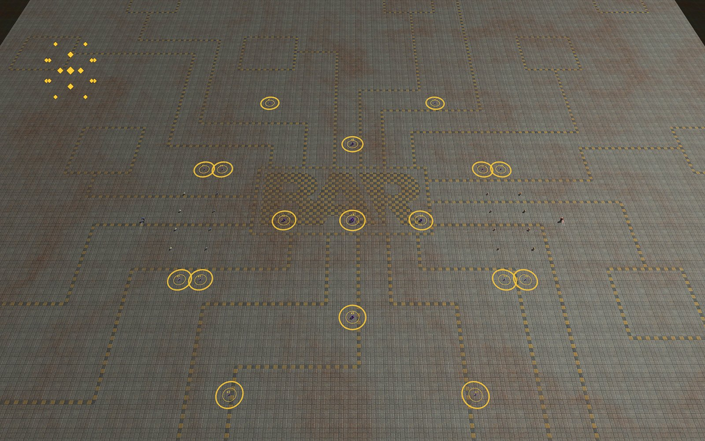

# Reclaim the Fame

[Level Editor manual](../README.md) · [Specification](../../specs/reclaim-the-fame.md) · [Scenario builder](../scenario/README.md) · [Start page](../../README.md)

Crystals stand on the map. Construction units earn **points** for their team by reclaiming them. The first team at the score limit wins. For human against human, computer opponents do not play it. Idea and discussion: [issue 2](https://github.com/Ralf1108/BARLevelEditor/issues/2).

## In short

- **Menu:** click the button **RF** in the button column at the right edge of the editor (below **CF**)
- Tick **Reclaim the Fame** to mark the level (the button turns green)
- Place crystals with the tiles at the bottom of the page
- Excludes Tower Defense and Capture the Flag in the same level
- **Start** runs it in the editor
- Demo level: `demo_rtf_crystal_fields` (large crystal in the middle, first to 3000 points)

## Build the level

**Crystals**
- Click a tile, then the map; right click ends, **Del** deletes, **Alt + drag** moves
- Also in the Place menu: tab **Features**, kind **Crystals**
- Small, medium and large, in eleven colors (the color is only the look)
- Filter: **All / Small / Medium / Large**
- Use an **odd number**, scattered around the middle third of the map

**Points**
- 1 point per second for every 100 build power of a reclaiming unit
- **Factor** per size: small / medium / large, default 100 / 200 / 400 %
- **Rate**: scales everything, 100 % = basic rate
- **Score limit**: default 100000, 0 = never ends; allies add up

**Who scores**
- Only units that are actively reclaiming
- **Ground** and **Ships**: on
- **Buildings** (nano turrets) and **Air**: off by default
- Crystals are never used up and give no resources

**Visibility**
- **Crystals always visible** on the map and minimap (on by default)
- Off: only what a unit or a radar sees (scouting)

## How it plays

- Farm the crystals in the middle, defend your builders, hunt the enemy's
- Scout with radar, jammers and spies

## Test and play

- **Start** / **Stop**: runs the game, the level comes back as before
- Gold rings show the reach of a builder, numbers show the factor ("x4")
- The score of every team and its points per second are shown at the top
- Scenario package (start menu key `3`): settings are packed (at least one crystal needed)
- The game runs in the gadget `rtf_game.lua`
