# Renegade: weapon categories for the pictures of the panel

[Renegade](renegade.md) · [Weapon table](renegade-weapons.md) · [Start page](../../README.md)

910 weapons on a mouse button (and the anti-nuke launchers, which fire by themselves), 831 different weapon definitions, grouped into **39 categories** (a picture each, 39 drawn so far). Made by `test-data/tools/weapon_categories.py` from `renegade_weapons.csv`; the columns Category, Weapon image, Tech and DPS of `renegade_weapons.csv` hold the result for every weapon; the pictures are drawn by `weapon_art_build.py` (folder `weapon-images`).

## Overview of all pictures

The pictures as the panel shows them (the name is the one in the game). Where the family has sizes, the last column tells for which damage per second (DPS = damage of one shot / reload) a weapon gets this picture, by the tech level of its unit; the limits are explained below.

| Name | Picture | Valid for | Weapons |
|---|---|---|---|
| **Anti-Air Missile** `aa-missile` | 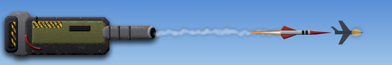 | no limits (one picture for the whole family) | 14 |
| **Anti-Nuke Missile** `anti-nuke` | 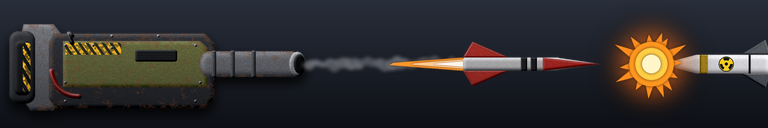 | no limits (one picture for the whole family) | 12 |
| **Artillery** `artillery` | 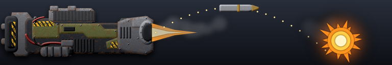 | no limits (one picture for the whole family) | 8 |
| **Bomb** `bomb` | 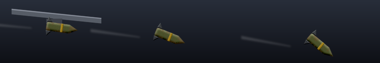 | no limits (one picture for the whole family) | 11 |
| **Light Cannon** `cannon-light` | 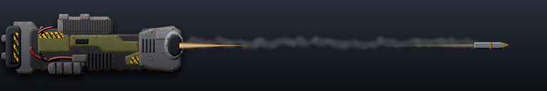 | damage per second, by the tech level of the unit: T1: up to 250; T2: up to 60 | 24 |
| **Medium Cannon** `cannon-medium` | 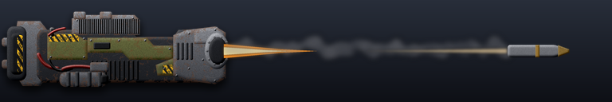 | damage per second, by the tech level of the unit: T1: 250 to 550; T2: 60 to 250; T3 and T4: up to 60 | 17 |
| **Heavy Cannon** `cannon-heavy` | 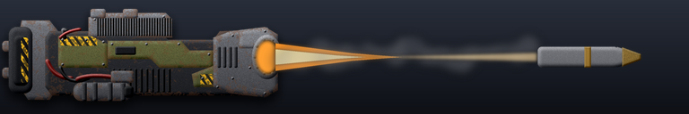 | damage per second, by the tech level of the unit: T2: 250 to 550; T3 and T4: 60 to 550 | 7 |
| **Ultra Cannon** `cannon-ultra` | 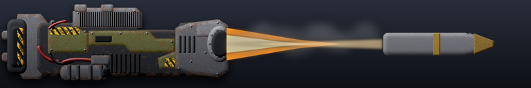 | **551 DPS and more** (above 550, whatever the unit is) | 3 |
| **D-Gun** `d-gun` | 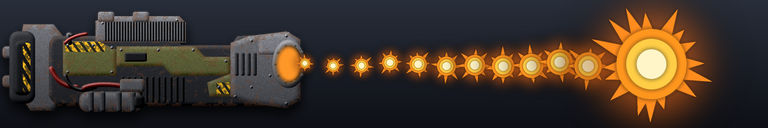 | no limits (one picture for the whole family) | 68 |
| **Depth Charge** `depth-charge` | 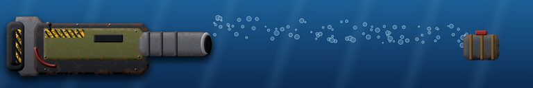 | no limits (one picture for the whole family) | 17 |
| **EMP Grenade** `emp-grenade` | 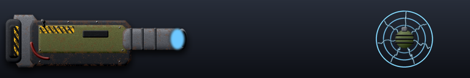 | no limits (one picture for the whole family) | 6 |
| **Flak** `flak` | 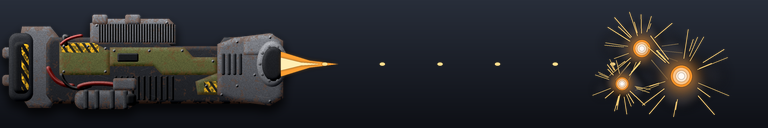 | no limits (one picture for the whole family) | 22 |
| **Flamethrower** `flamethrower` | 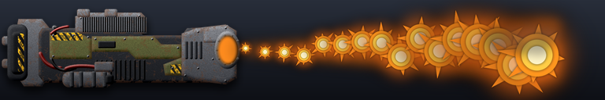 | no limits (one picture for the whole family) | 22 |
| **Gauss** `gauss` | 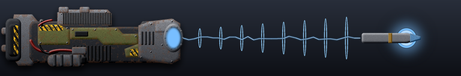 | no limits (one picture for the whole family) | 14 |
| **Heatray** `heatray` | 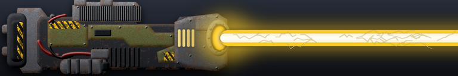 | no limits (one picture for the whole family) | 27 |
| **Heavy Rocket** `heavy-rocket` | 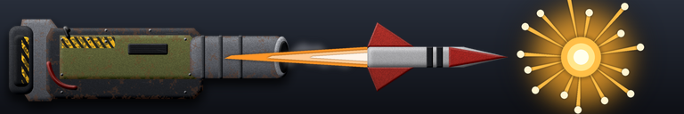 | no limits (one picture for the whole family) | 36 |
| **Light Laser** `laser-light` | 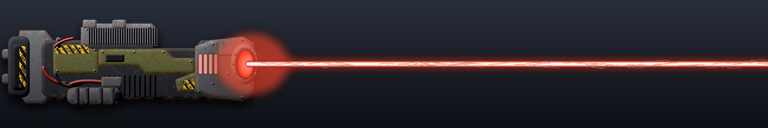 | damage per second, by the tech level of the unit: T1: up to 600; T2: up to 100 | 66 |
| **Medium Laser** `laser-medium` | 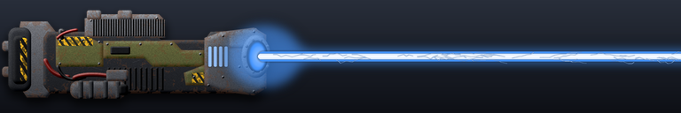 | damage per second, by the tech level of the unit: T1: 600 to 1500; T2: 100 to 600; T3 and T4: up to 100 | 51 |
| **Heavy Laser** `laser-heavy` | 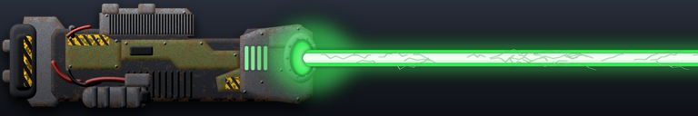 | damage per second, by the tech level of the unit: T2: 600 to 1500; T3 and T4: 100 to 1500 | 25 |
| **Ultra Laser** `laser-ultra` | 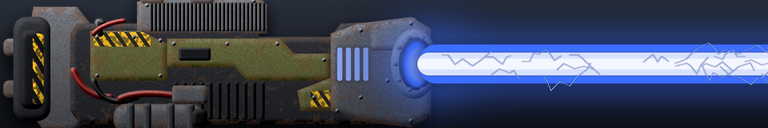 | **1501 DPS and more** (above 1500, whatever the unit is) | 40 |
| **Lightning** `lightning` | 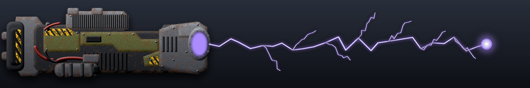 | no limits (one picture for the whole family) | 19 |
| **Light Machine Gun** `machine-gun-light` | 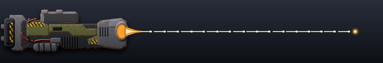 | damage per second, by the tech level of the unit: T1: up to 80; T2: up to 20 | 16 |
| **Medium Machine Gun** `machine-gun-medium` | 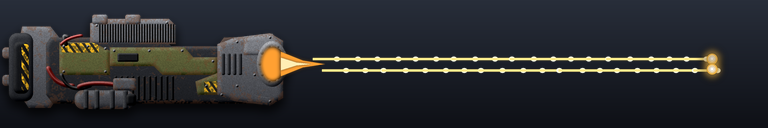 | damage per second, by the tech level of the unit: T1: above 80; T2: 20 to 80; T3 and T4: up to 20 | 15 |
| **Heavy Machine Gun** `machine-gun-heavy` | 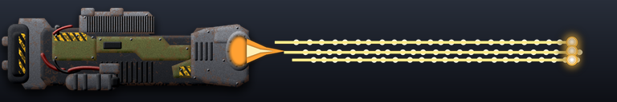 | damage per second, by the tech level of the unit: T2: above 80; T3 and T4: above 20 | 12 |
| **Light Missile** `missile-light` | 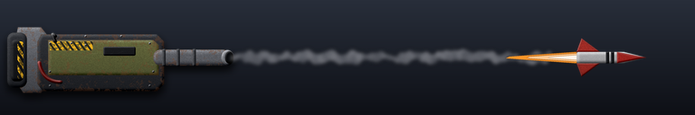 | damage per second, by the tech level of the unit: T1: up to 150; T2: up to 40 | 37 |
| **Medium Missile** `missile-medium` | 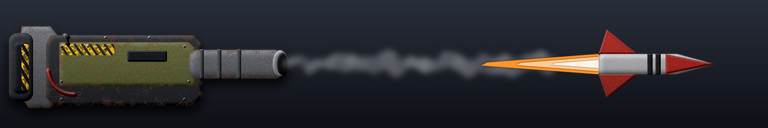 | damage per second, by the tech level of the unit: T1: 150 to 800; T2: 40 to 150; T3 and T4: up to 40 | 17 |
| **Heavy Missile** `missile-heavy` | 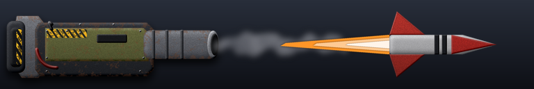 | damage per second, by the tech level of the unit: T2: 150 to 800; T3 and T4: 40 to 800 | 15 |
| **Ultra Missile** `missile-ultra` | 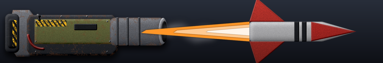 | **801 DPS and more** (above 800, whatever the unit is) | 1 |
| **Nuclear** `nuclear` | 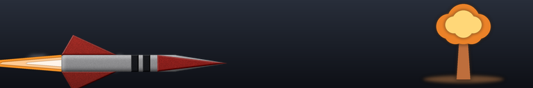 | no limits (one picture for the whole family) | 8 |
| **Light Plasma** `plasma-light` | 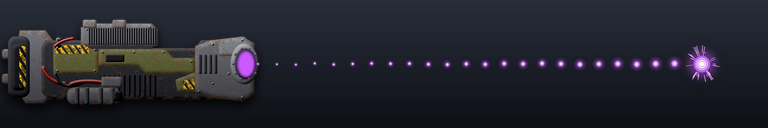 | damage per second, by the tech level of the unit: T1: up to 400; T2: up to 60 | 34 |
| **Medium Plasma** `plasma-medium` | 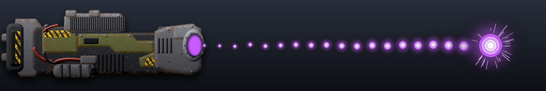 | damage per second, by the tech level of the unit: T1: 400 to 1500; T2: 60 to 400; T3 and T4: up to 60 | 42 |
| **Heavy Plasma** `plasma-heavy` | 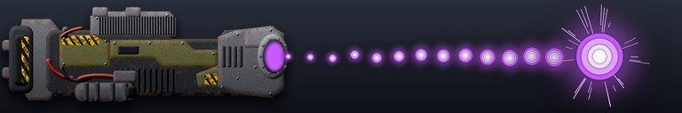 | damage per second, by the tech level of the unit: T2: 400 to 1500; T3 and T4: 60 to 1500 | 24 |
| **Ultra Plasma** `plasma-ultra` | 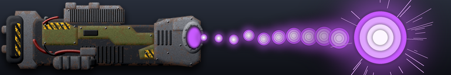 | **1501 DPS and more** (above 1500, whatever the unit is) | 8 |
| **Railgun** `railgun` | 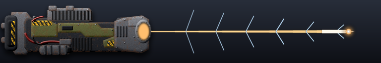 | no limits (one picture for the whole family) | 32 |
| **Rocket Salvo** `rocket-salvo` | 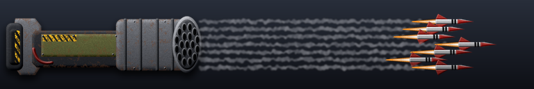 | no limits (one picture for the whole family) | 34 |
| **Self-Destruct** `self-destruct` | 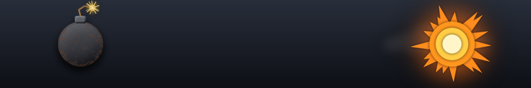 | no limits (one picture for the whole family) | 5 |
| **Shotgun** `shotgun` | 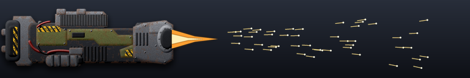 | no limits (one picture for the whole family) | 8 |
| **Stun Beam** `stun-beam` | 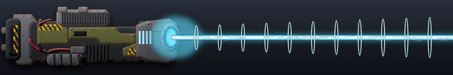 | no limits (one picture for the whole family) | 33 |
| **Torpedo** `torpedo` | 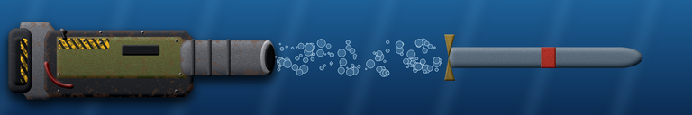 | no limits (one picture for the whole family) | 60 |

## How a weapon gets its category

1. **Family** from the type and the description of the weapon: laser, plasma, cannon, missile, machine gun, torpedo, bomb, flak, d-gun ... and so on (the table below). The heat rays (description with "heat ray") are the family heatray (yellow).
2. **Size** (light, medium, heavy, ultra) only for the families laser, plasma, cannon, missile and machine-gun (all other families have one picture):
   - the base size comes from the **tech level of the unit** that carries the weapon: T1 light, T2 medium, T3 and T4 heavy (`renegade_unit_tech.csv`; a unit that is not in it counts as T2);
   - the damage per second (DPS: damage of one shot / reload) moves it: up to *Weak up to* one size down (a weak weapon), up to *Normal up to* it stays, up to *Strong up to* one size up (a strong weapon); never beyond heavy;
   - a weapon above *Strong up to* is **ultra** whatever the unit is. For the lasers also the tachyon and ion beams and every weapon with the word "ultra" in its description are ultra (laser-ultra: blue, very thick).
3. The limits are in `renegade_weapon_limits.csv` (change them in Excel, then run `update_renegade_weapons.bat`... or `python test-data/tools/weapon_categories.py`):

| Family | Weak up to | Normal up to | Strong up to | Ultra above |
|---|---|---|---|---|
| laser | 100 | 600 | 1500 | above 1500 |
| plasma | 60 | 400 | 1500 | above 1500 |
| cannon | 60 | 250 | 550 | above 550 |
| missile | 40 | 150 | 800 | above 800 |
| machine-gun | 20 | 80 |  | none |

(damage per second: a weapon with up to 100 DPS is weak, up to 600 normal, up to 1500 strong (laser example), above that ultra; an empty *Strong up to* means: no ultra size by damage)

## The categories

| Category | Picture | Weapons | Units | Examples |
|---|---|---|---|---|
| aa-missile |  | 14 | 12 | Legion Commander: Anti-Air Missile Launcher; Legion Commander Level 2: Anti-Air Missile Launcher; Legion Commander Level 3: Anti-Air Missile Launcher |
| anti-nuke |  | 12 | 12 | Haven: ICBM intercepting missile launcher; Oasis: ICBM intercepting missile launcher; Citadel: ICBM intercepting missile launcher |
| artillery |  | 8 | 5 | Corinth: Heavy Artillery Cluster Plasma Cannon; Octeres: Long-Range Naval Cluster Artillery Cannon; Tremor: RapidArtillery |
| bomb |  | 11 | 11 | Blizzard: Heavy a2g impulse warheads; Epic Stormbringer: Ultra Heavy Bombs; Stiletto: Heavy a2g EMP warheads |
| cannon-light |  | 24 | 24 | Cortex Commander Level 4: HeavyCannon; Cortex Commander Level 5: HeavyCannon; Cortex Commander Level 6: HeavyCannon |
| cannon-medium |  | 17 | 15 | Despot: BattleshipCannon; Cortex Commander Level 7: HeavyCannon; Cortex Commander Level 8: HeavyCannon |
| cannon-heavy |  | 7 | 6 | Sol Invictus: Ultra Heavy Riot Autocannon; Lunkhead: Heavy ballistic underwater cannon; Flying Black Hydra: BattleshipCannon |
| cannon-ultra |  | 3 | 3 | Cortex Commander Level 10: HeavyCannon; Perdition: Long-Range Tactical Hellfire Napalm Shell |
| d-gun |  | 68 | 68 | Armada Commander: Disintegrator; Armada Commander Level 10: Disintegrator; Armada Commander Level 2: Disintegrator |
| depth-charge |  | 17 | 16 | Depth Charge Drone: Depthcharge launcher; Epic Skater: Depthcharge launcher; Anemone: Depthcharge launcher |
| emp-grenade |  | 6 | 6 | Shockwave: Medium EMP turret; Combat Commander: EMP Grenade; Economy Commander: EMP Grenade |
| flak |  | 22 | 20 | Black Prince: Anti-Air Flak Cannons; Apollyon: Dual Rotary Microflak Cannons; Arbalest: Heavy g2a flak cannon |
| flamethrower |  | 22 | 22 | Cortex Commander Level 10: Long range AoE flamethrower; Cortex Commander Level 5: Anti-swarm AoE flamethrower; Cortex Commander Level 6: Anti-swarm AoE flamethrower |
| gauss |  | 14 | 14 | Cauteriser: Dual Medium Plasma Gauss Cannons; Gorgon: Rapid-fire gauss cannon; Gremlin: Light close-quarters gauss cannon |
| heatray |  | 27 | 26 | Adjudicator: Ultra Heavy Juggernaut-Spec Heatray; Attack Drone: HeatRay; Legion Commander: Close-Quarters Heatray |
| heavy-rocket |  | 36 | 36 | Armada Commander Level 10: HeavyRockets; Armada Commander Level 3: HeavyRockets; Armada Commander Level 4: HeavyRockets |
| laser-light |  | 66 | 55 | Armada Commander: Light close-quarters g2g/g2a laser; Armada Commander: Light underwater-combat laser; Armada Commander Level 2: Scatter Beamer |
| laser-medium |  | 51 | 35 | Dragon: HighEnergyLaser; Quad Guard: Close-quarters light g2g laser; Black Hydra: HighEnergyLaser |
| laser-heavy |  | 25 | 13 | Archaic Sol Invictus: Experimental Thermal Ordnance Generators; Behemoth: LightLaser; Flying Black Hydra: HighEnergyLaser |
| laser-ultra |  | 40 | 35 | Epic Dragon: Ultra HighEnergyLaser; Armada Commander Level 10: UWSupernovaBeam; Armada Commander Level 5: UltravioletRayBeam |
| lightning |  | 19 | 19 | Armada Commander Level 10: Short-Range Lightning Discharge; Armada Commander Level 5: Short-Range Lightning Discharge; Armada Commander Level 6: Short-Range Lightning Discharge |
| machine-gun-light |  | 16 | 16 | Legion Commander Level 2: Rapid-Fire Machine Gun; Legion Commander Level 3: Rapid-Fire Machine Gun; Attack Drone: Rapid-fire a2g machine guns |
| machine-gun-medium |  | 15 | 12 | Tyrannus: Burst-fire Machine Gun; Chimera: Dual Rotary Machine Guns; Legion Commander Level 4: Rapid-Fire Machine Gun |
| machine-gun-heavy |  | 12 | 4 | Apollyon: Heavy rotary cannon; Keres: Heavy rotary cannon; Mukade: Rapid-fire a2g machine guns |
| missile-light |  | 37 | 32 | Bat: Guided a2a missile launcher; Cyclone: Guided a2a missile launcher; Janus: Heavy g2g dual-missile launcher |
| missile-medium |  | 17 | 17 | Dragonslayer: Long-range g2a guided missile launcher; Hornet: Heavy a2g armor-piercing sabot missile launcher; Jaguar: Light g2a missile launcher |
| missile-heavy |  | 15 | 12 | Vesuvius: Banisher; Apollyon: CatapultRockets; Marauder: Guided g2a missile launcher |
| missile-ultra |  | 1 | 1 | Epic Karganeth: KarganethMissiles |
| nuclear |  | 8 | 8 | Armageddon: Intercontinental ballistic nuclear warhead; Epic Liche: Intercontinental ballistic nuclear warhead; Liche: Tactical nuclear homing missile |
| plasma-light |  | 34 | 29 | Dolphin: Rapid-fire close-quarters plasma turret; Ellysaw: Light long-range plasma cannon; Gauntlet: Heavy g2g long range plasma cannon |
| plasma-medium |  | 42 | 28 | Epoch: Secondary rapid-fire heavy plasma cannon; Black Prince: Long-Range Plasma Bombardment Cannons; Cerberus: Heavy g2g barrage plasma battery |
| plasma-heavy |  | 24 | 13 | Flying Epoch: Secondary rapid-fire heavy plasma cannon; Epic Tyrannus: scav rapid fire plasma gun; Epic Dolphin: Mini Rapid-fire long-range plasma cannon |
| plasma-ultra |  | 8 | 8 | Legion Commander Level 10: Rapid-Fire Plasma Cannon; Legion Commander Level 8: Rapid-Fire Plasma Cannon; Ragnarok: Rapid-fire long-range plasma cannon |
| railgun |  | 32 | 25 | Neptune: Dual Naval-Series Rail Accelerators; Daedalus: Siege Rail Accelerator; Lance: Railgun |
| rocket-salvo |  | 34 | 27 | Epoch: Pop-up rapid-fire g2a missile launcher; Flying Epoch: Pop-up rapid-fire g2a missile launcher; Black Hydra: Pop-up rapid-fire g2a missile launcher |
| self-destruct |  | 5 | 3 | Epic Tumbleweed: Crawlingbomb Dummy Weapon; Epic Tumbleweed: Self-destruction; Tumbleweed: Self-destruction |
| shotgun |  | 8 | 7 | Scylla: Medium Shotgun; Alaris: Dual-Feed Medium Shotgun; Cardea: Medium Shotgun |
| stun-beam |  | 33 | 17 | Armada Commander Level 10: Arcing Stun Beam; Armada Commander Level 10: EMP Damage-Mitigating Flashbang; Armada Commander Level 3: Arcing Stun Beam |
| torpedo |  | 60 | 53 | Epic Serpent: Heavy guided torpedo launcher; Serpent: Heavy guided torpedo launcher; Aesacus: Medium Homing Torpedo Launcher |
