# Renegade: the weapons of all units

[Renegade](renegade.md) · [Specification](../../specs/renegade.md) · [Start page](../../README.md)

Which weapon of a unit is fired with which mouse button in Renegade. **Change the last two columns in `renegade_weapons.csv`** (and nothing else): the rest is read from the game. The table below is made from the csv (between the two comment lines `BEGIN TABLE` and `END TABLE`: do not edit it); the text around it, like this, may be edited.

- **Group**: a letter per unit; weapons with the same letter belong together (they are fired together, like the three medium plasma guns of the Epoch). empty = the weapon is not fired by a button (footsteps, script dummies).
- **Fire button**: `LMB` (left mouse button), `RMB` (right), `MMB` (middle) or empty (no button). A group has one button: the button of the first row of the group counts. Several groups may share a button.
- **Picture** (only on this page, not in the csv): the picture of the category of the weapon (see [weapon categories](renegade-weapon-categories.md)) as the panel shows it, linked to the file; empty when the category has no picture yet. To check the assignment of the pictures by eye.
- **Target**: what the weapon can hit (Ground, Air, Water; All = everything). Anti-air weapons cannot take a ground point: they fire at the aircraft you look at.
- The proposal: weapons with the same weapon definition are one group; missiles (missile launchers, starburst, torpedoes, anti-air weapons) and all other groups are sorted by range. Short range on LMB, long range on RMB, missiles on MMB (with two groups only: the short on LMB, the other on RMB; with three or more of the same kind: the shortest on LMB, the next on RMB, all further on MMB).
- A unit that is not in the table (and the Scavenger copies of the units: they use the entry of the normal unit) gets the proposal worked out in the game (`slotsFor` in `renegade_game.lua`).

**How to change it:** the source is `renegade_weapons.csv` (open it in Excel, columns separated by semicolons): change **Group** and **Fire button**, save, then double-click `update_renegade_weapons.bat` (in this folder). It writes this page (only the table between the markers `BEGIN TABLE` and `END TABLE` is rewritten, the text around it stays) and the block between `-- BEGIN WEAPONS` and `-- END WEAPONS` in `renegade_game.lua` (do not edit that by hand either); the game takes the new file as usual (`start_renegade.bat`). New units or changed weapons: run `pve_test.ps1 -Ren -Widget zz_weapondump.lua` and `python renegade_weapons.py table <infolog.txt>`; your entries stay.

<!-- BEGIN TABLE (made from renegade_weapons.csv by test-data/generators/renegade_weapons.py: change the csv, not what stands between the markers; the text around may be edited) -->
1035 weapons of 497 units.

| Faction | Unit | Code | # | Picture | Weapon | Type | Target | Range | Reload | Damage | Weapon name | Fire button | Category | Tech | DPS |
|---|---|---|---|---|---|---|---|---|---|---|---|---|---|---|---|
| Armada | Abductor | armdfly | 1 | [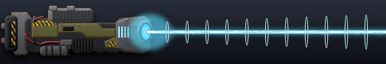](weapon-images/weapon_stun-beam.png) | Heavy a2g EMP beam | Beam laser | Ground | 520 | 8.0 s | 10500 | armdfly_armdfly_paralyzer | LMB | stun-beam | 2 | 1312 |
| Armada | Ambassador | armmerl | 1 | [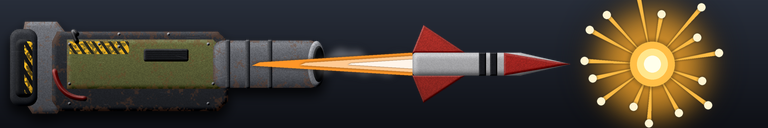](weapon-images/weapon_heavy-rocket.png) | Heavy long-range g2g high-trajectory starburst rocket launcher | Starburst missile | Ground | 1300 | 18.0 s | 2000 | armmerl_armtruck_rocket | LMB | heavy-rocket | 2 | 111 |
| Armada | Anemone | armdl | 1 | [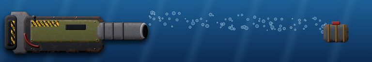](weapon-images/weapon_depth-charge.png) | Depthcharge launcher | Torpedo | All | 600 | 1.5 s | 225 | armdl_coax_depthcharge | LMB | depth-charge | 1 | 150 |
| Armada | Arbalest | armflak | 1 | [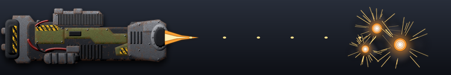](weapon-images/weapon_flak.png) | Heavy g2a flak cannon | Cannon | Air | 850 | 0.5 s | 250 (air) | armflak_armflak_gun | LMB | flak | 2 | 500 |
| Armada | Archangel | armaak | 1 | [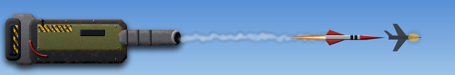](weapon-images/weapon_aa-missile.png) | Long-Range Anti-Air Missile Launcher | Missile | Air | 1200 | 1.3 s | 150 (air) | armaak_longrangemissile | RMB | aa-missile | 2 | 115 |
| Armada | Archangel | armaak | 2 |  | Medium-Range Anti-Air Missile Launcher | Missile | Air | 880 | 0.7 s | 100 (air) | armaak_shortrangemissile | LMB | aa-missile | 2 | 143 |
| Armada | Armada Commander | armcom | 1 | [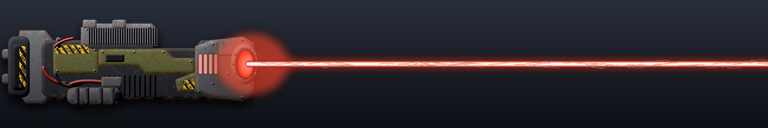](weapon-images/weapon_laser-light.png) | Light close-quarters g2g/g2a laser | Beam laser | Air+Ground | 300 | 0.4 s | 75 | armcom_armcomlaser | LMB | laser-light | 1 | 188 |
| Armada | Armada Commander | armcom | 2 |  | Light underwater-combat laser | Beam laser | All | 300 | 1.0 s | 200 | armcom_armcomsealaser | MMB | laser-light | 1 | 200 |
| Armada | Armada Commander | armcom | 3 | [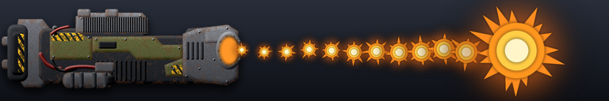](weapon-images/weapon_d-gun.png) | Disintegrator | D-gun | All | 250 | 0.9 s | 99999 | armcom_disintegrator | RMB | d-gun | 1 | 111110 |
| Armada | Armada Commander | armcomcon | 1 |  | Light close-quarters g2g/g2a laser | Beam laser | Air+Ground | 300 | 0.4 s | 75 | armcomcon_armcomlaser | LMB | laser-light | 1 | 188 |
| Armada | Armada Commander | armcomcon | 2 |  | Light underwater-combat laser | Beam laser | All | 300 | 1.0 s | 200 | armcomcon_armcomsealaser | MMB | laser-light | 1 | 200 |
| Armada | Armada Commander | armcomcon | 3 |  | Disintegrator | D-gun | All | 250 | 0.9 s | 99999 | armcomcon_disintegrator | RMB | d-gun | 1 | 111110 |
| Armada | Armada Commander Level 10 | armcomlvl10 | 1 |  | HeavyRockets | Starburst missile | Air+Ground | 870 | 2.0 s | 4400 | armcomlvl10_backlauncher | MMB | heavy-rocket | 1 | 2200 |
| Armada | Armada Commander Level 10 | armcomlvl10 | 2 | [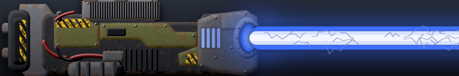](weapon-images/weapon_laser-ultra.png) | UWSupernovaBeam | Beam laser | All | 500 | 0.3 s | 1400 | armcomlvl10_armcomsealaser | MMB | laser-ultra | 1 | 4667 |
| Armada | Armada Commander Level 10 | armcomlvl10 | 3 |  | Disintegrator | D-gun | All | 250 | 0.9 s | 99999 | armcomlvl10_disintegrator | RMB | d-gun | 1 | 111110 |
| Armada | Armada Commander Level 10 | armcomlvl10 | 4 |  | Arcing Stun Beam | Beam laser | Air+Ground | 600 | 8.0 s | 60000 | armcomlvl10_longgun | MMB | stun-beam | 1 | 7500 |
| Armada | Armada Commander Level 10 | armcomlvl10 | 5 | [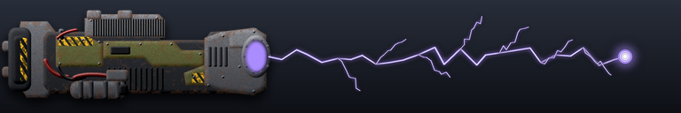](weapon-images/weapon_lightning.png) | Short-Range Lightning Discharge | Lightning | Air+Ground | 500 | 0.1 s | 118 | armcomlvl10_shortgun | MMB | lightning | 1 | 1180 |
| Armada | Armada Commander Level 10 | armcomlvl10 | 6 |  | EMP Damage-Mitigating Flashbang | Laser | Air+Ground | 3 | 0.2 s | 20000 | armcomlvl10_empflashbang | LMB | stun-beam | 1 | 100000 |
| Armada | Armada Commander Level 10 | armdecomlvl10 | 1 |  | HeavyRockets | Starburst missile | Air+Ground | 870 | 2.0 s | 4400 | armdecomlvl10_backlauncher | MMB | heavy-rocket | 1 | 2200 |
| Armada | Armada Commander Level 10 | armdecomlvl10 | 2 |  | UWSupernovaBeam | Beam laser | All | 500 | 0.3 s | 1400 | armdecomlvl10_armcomsealaser | MMB | laser-ultra | 1 | 4667 |
| Armada | Armada Commander Level 10 | armdecomlvl10 | 3 |  | Disintegrator | D-gun | All | 250 | 0.9 s | 40 | armdecomlvl10_disintegrator | RMB | d-gun | 1 | 44 |
| Armada | Armada Commander Level 10 | armdecomlvl10 | 4 |  | Arcing Stun Beam | Beam laser | Air+Ground | 600 | 8.0 s | 60000 | armdecomlvl10_longgun | MMB | stun-beam | 1 | 7500 |
| Armada | Armada Commander Level 10 | armdecomlvl10 | 5 |  | Short-Range Lightning Discharge | Lightning | Air+Ground | 500 | 0.1 s | 118 | armdecomlvl10_shortgun | MMB | lightning | 1 | 1180 |
| Armada | Armada Commander Level 10 | armdecomlvl10 | 6 |  | EMP Damage-Mitigating Flashbang | Laser | Air+Ground | 3 | 0.2 s | 20000 | armdecomlvl10_empflashbang | LMB | stun-beam | 1 | 100000 |
| Armada | Armada Commander Level 2 | armcomlvl2 | 1 |  | Scatter Beamer | Beam laser | Air+Ground | 300 | 0.1 s | 14 | armcomlvl2_shortgun | LMB | laser-light | 1 | 140 |
| Armada | Armada Commander Level 2 | armcomlvl2 | 2 |  | Light underwater-combat laser | Beam laser | All | 300 | 1.0 s | 400 | armcomlvl2_armcomsealaser | MMB | laser-light | 1 | 400 |
| Armada | Armada Commander Level 2 | armcomlvl2 | 3 |  | Disintegrator | D-gun | All | 250 | 0.9 s | 99999 | armcomlvl2_disintegrator | RMB | d-gun | 1 | 111110 |
| Armada | Armada Commander Level 2 | armdecomlvl2 | 1 |  | Scatter Beamer | Beam laser | Air+Ground | 300 | 0.1 s | 14 | armdecomlvl2_shortgun | LMB | laser-light | 1 | 140 |
| Armada | Armada Commander Level 2 | armdecomlvl2 | 2 |  | Light underwater-combat laser | Beam laser | All | 300 | 1.0 s | 400 | armdecomlvl2_armcomsealaser | MMB | laser-light | 1 | 400 |
| Armada | Armada Commander Level 2 | armdecomlvl2 | 3 |  | Disintegrator | D-gun | All | 250 | 0.9 s | 40 | armdecomlvl2_disintegrator | RMB | d-gun | 1 | 44 |
| Armada | Armada Commander Level 3 | armcomlvl3 | 1 |  | HeavyRockets | Starburst missile | Air+Ground | 435 | 3.3 s | 550 | armcomlvl3_backlauncher | MMB | heavy-rocket | 1 | 167 |
| Armada | Armada Commander Level 3 | armcomlvl3 | 2 | [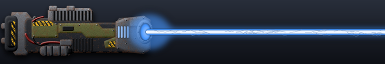](weapon-images/weapon_laser-medium.png) | J7NSLaser | Beam laser | All | 450 | 0.4 s | 300 | armcomlvl3_armcomsealaser | MMB | laser-medium | 1 | 750 |
| Armada | Armada Commander Level 3 | armcomlvl3 | 3 |  | Disintegrator | D-gun | All | 250 | 0.9 s | 99999 | armcomlvl3_disintegrator | RMB | d-gun | 1 | 111110 |
| Armada | Armada Commander Level 3 | armcomlvl3 | 4 |  | Arcing Stun Beam | Beam laser | Air+Ground | 410 | 8.0 s | 16000 | armcomlvl3_longgun | MMB | stun-beam | 1 | 2000 |
| Armada | Armada Commander Level 3 | armcomlvl3 | 5 |  | Scatter Beamer | Beam laser | Air+Ground | 350 | 0.1 s | 15 | armcomlvl3_shortgun | MMB | laser-light | 1 | 150 |
| Armada | Armada Commander Level 3 | armcomlvl3 | 6 |  | EMP Damage-Mitigating Flashbang | Laser | Air+Ground | 3 | 0.2 s | 20000 | armcomlvl3_empflashbang | LMB | stun-beam | 1 | 100000 |
| Armada | Armada Commander Level 3 | armdecomlvl3 | 1 |  | HeavyRockets | Starburst missile | Air+Ground | 435 | 3.3 s | 550 | armdecomlvl3_backlauncher | MMB | heavy-rocket | 1 | 167 |
| Armada | Armada Commander Level 3 | armdecomlvl3 | 2 |  | J7NSLaser | Beam laser | All | 450 | 0.4 s | 300 | armdecomlvl3_armcomsealaser | MMB | laser-medium | 1 | 750 |
| Armada | Armada Commander Level 3 | armdecomlvl3 | 3 |  | Disintegrator | D-gun | All | 250 | 0.9 s | 40 | armdecomlvl3_disintegrator | RMB | d-gun | 1 | 44 |
| Armada | Armada Commander Level 3 | armdecomlvl3 | 4 |  | Arcing Stun Beam | Beam laser | Air+Ground | 410 | 8.0 s | 16000 | armdecomlvl3_longgun | MMB | stun-beam | 1 | 2000 |
| Armada | Armada Commander Level 3 | armdecomlvl3 | 5 |  | Scatter Beamer | Beam laser | Air+Ground | 350 | 0.1 s | 15 | armdecomlvl3_shortgun | MMB | laser-light | 1 | 150 |
| Armada | Armada Commander Level 3 | armdecomlvl3 | 6 |  | EMP Damage-Mitigating Flashbang | Laser | Air+Ground | 3 | 0.2 s | 20000 | armdecomlvl3_empflashbang | LMB | stun-beam | 1 | 100000 |
| Armada | Armada Commander Level 4 | armcomlvl4 | 1 |  | HeavyRockets | Starburst missile | Air+Ground | 550 | 3.3 s | 800 | armcomlvl4_backlauncher | MMB | heavy-rocket | 1 | 242 |
| Armada | Armada Commander Level 4 | armcomlvl4 | 2 |  | J7NSLaser | Beam laser | All | 450 | 0.3 s | 400 | armcomlvl4_armcomsealaser | MMB | laser-medium | 1 | 1333 |
| Armada | Armada Commander Level 4 | armcomlvl4 | 3 |  | Disintegrator | D-gun | All | 250 | 0.9 s | 99999 | armcomlvl4_disintegrator | RMB | d-gun | 1 | 111110 |
| Armada | Armada Commander Level 4 | armcomlvl4 | 4 |  | Arcing Stun Beam | Beam laser | Air+Ground | 500 | 8.0 s | 22000 | armcomlvl4_longgun | MMB | stun-beam | 1 | 2750 |
| Armada | Armada Commander Level 4 | armcomlvl4 | 5 |  | Scatter Beamer | Beam laser | Air+Ground | 350 | 0.1 s | 25 | armcomlvl4_shortgun | MMB | laser-light | 1 | 250 |
| Armada | Armada Commander Level 4 | armcomlvl4 | 6 |  | EMP Damage-Mitigating Flashbang | Laser | Air+Ground | 3 | 0.2 s | 20000 | armcomlvl4_empflashbang | LMB | stun-beam | 1 | 100000 |
| Armada | Armada Commander Level 4 | armdecomlvl4 | 1 |  | HeavyRockets | Starburst missile | Air+Ground | 550 | 3.3 s | 800 | armdecomlvl4_backlauncher | MMB | heavy-rocket | 1 | 242 |
| Armada | Armada Commander Level 4 | armdecomlvl4 | 2 |  | J7NSLaser | Beam laser | All | 450 | 0.3 s | 400 | armdecomlvl4_armcomsealaser | MMB | laser-medium | 1 | 1333 |
| Armada | Armada Commander Level 4 | armdecomlvl4 | 3 |  | Disintegrator | D-gun | All | 250 | 0.9 s | 40 | armdecomlvl4_disintegrator | RMB | d-gun | 1 | 44 |
| Armada | Armada Commander Level 4 | armdecomlvl4 | 4 |  | Arcing Stun Beam | Beam laser | Air+Ground | 500 | 8.0 s | 22000 | armdecomlvl4_longgun | MMB | stun-beam | 1 | 2750 |
| Armada | Armada Commander Level 4 | armdecomlvl4 | 5 |  | Scatter Beamer | Beam laser | Air+Ground | 350 | 0.1 s | 25 | armdecomlvl4_shortgun | MMB | laser-light | 1 | 250 |
| Armada | Armada Commander Level 4 | armdecomlvl4 | 6 |  | EMP Damage-Mitigating Flashbang | Laser | Air+Ground | 3 | 0.2 s | 20000 | armdecomlvl4_empflashbang | LMB | stun-beam | 1 | 100000 |
| Armada | Armada Commander Level 5 | armcomlvl5 | 1 |  | HeavyRockets | Starburst missile | Air+Ground | 620 | 2.5 s | 1200 | armcomlvl5_backlauncher | MMB | heavy-rocket | 1 | 480 |
| Armada | Armada Commander Level 5 | armcomlvl5 | 2 |  | UltravioletRayBeam | Beam laser | All | 475 | 0.7 s | 1200 | armcomlvl5_armcomsealaser | MMB | laser-ultra | 1 | 1714 |
| Armada | Armada Commander Level 5 | armcomlvl5 | 3 |  | Disintegrator | D-gun | All | 250 | 0.9 s | 99999 | armcomlvl5_disintegrator | RMB | d-gun | 1 | 111110 |
| Armada | Armada Commander Level 5 | armcomlvl5 | 4 |  | Arcing Stun Beam | Beam laser | Air+Ground | 550 | 8.0 s | 30000 | armcomlvl5_longgun | MMB | stun-beam | 1 | 3750 |
| Armada | Armada Commander Level 5 | armcomlvl5 | 5 |  | Short-Range Lightning Discharge | Lightning | Air+Ground | 425 | 0.1 s | 42 | armcomlvl5_shortgun | MMB | lightning | 1 | 420 |
| Armada | Armada Commander Level 5 | armcomlvl5 | 6 |  | EMP Damage-Mitigating Flashbang | Laser | Air+Ground | 3 | 0.2 s | 20000 | armcomlvl5_empflashbang | LMB | stun-beam | 1 | 100000 |
| Armada | Armada Commander Level 5 | armdecomlvl5 | 1 |  | HeavyRockets | Starburst missile | Air+Ground | 620 | 2.5 s | 1200 | armdecomlvl5_backlauncher | MMB | heavy-rocket | 1 | 480 |
| Armada | Armada Commander Level 5 | armdecomlvl5 | 2 |  | UltravioletRayBeam | Beam laser | All | 475 | 0.7 s | 1200 | armdecomlvl5_armcomsealaser | MMB | laser-ultra | 1 | 1714 |
| Armada | Armada Commander Level 5 | armdecomlvl5 | 3 |  | Disintegrator | D-gun | All | 250 | 0.9 s | 40 | armdecomlvl5_disintegrator | RMB | d-gun | 1 | 44 |
| Armada | Armada Commander Level 5 | armdecomlvl5 | 4 |  | Arcing Stun Beam | Beam laser | Air+Ground | 550 | 8.0 s | 30000 | armdecomlvl5_longgun | MMB | stun-beam | 1 | 3750 |
| Armada | Armada Commander Level 5 | armdecomlvl5 | 5 |  | Short-Range Lightning Discharge | Lightning | Air+Ground | 425 | 0.1 s | 42 | armdecomlvl5_shortgun | MMB | lightning | 1 | 420 |
| Armada | Armada Commander Level 5 | armdecomlvl5 | 6 |  | EMP Damage-Mitigating Flashbang | Laser | Air+Ground | 3 | 0.2 s | 20000 | armdecomlvl5_empflashbang | LMB | stun-beam | 1 | 100000 |
| Armada | Armada Commander Level 6 | armcomlvl6 | 1 |  | HeavyRockets | Starburst missile | Air+Ground | 730 | 2.5 s | 1350 | armcomlvl6_backlauncher | MMB | heavy-rocket | 1 | 540 |
| Armada | Armada Commander Level 6 | armcomlvl6 | 2 |  | UltravioletRayBeam | Beam laser | All | 475 | 0.5 s | 1200 | armcomlvl6_armcomsealaser | MMB | laser-ultra | 1 | 2400 |
| Armada | Armada Commander Level 6 | armcomlvl6 | 3 |  | Disintegrator | D-gun | All | 250 | 0.9 s | 99999 | armcomlvl6_disintegrator | RMB | d-gun | 1 | 111110 |
| Armada | Armada Commander Level 6 | armcomlvl6 | 4 |  | Arcing Stun Beam | Beam laser | Air+Ground | 550 | 8.0 s | 40000 | armcomlvl6_longgun | MMB | stun-beam | 1 | 5000 |
| Armada | Armada Commander Level 6 | armcomlvl6 | 5 |  | Short-Range Lightning Discharge | Lightning | Air+Ground | 425 | 0.1 s | 50 | armcomlvl6_shortgun | MMB | lightning | 1 | 500 |
| Armada | Armada Commander Level 6 | armcomlvl6 | 6 |  | EMP Damage-Mitigating Flashbang | Laser | Air+Ground | 3 | 0.2 s | 20000 | armcomlvl6_empflashbang | LMB | stun-beam | 1 | 100000 |
| Armada | Armada Commander Level 6 | armdecomlvl6 | 1 |  | HeavyRockets | Starburst missile | Air+Ground | 730 | 2.5 s | 1350 | armdecomlvl6_backlauncher | MMB | heavy-rocket | 1 | 540 |
| Armada | Armada Commander Level 6 | armdecomlvl6 | 2 |  | UltravioletRayBeam | Beam laser | All | 475 | 0.5 s | 1200 | armdecomlvl6_armcomsealaser | MMB | laser-ultra | 1 | 2400 |
| Armada | Armada Commander Level 6 | armdecomlvl6 | 3 |  | Disintegrator | D-gun | All | 250 | 0.9 s | 40 | armdecomlvl6_disintegrator | RMB | d-gun | 1 | 44 |
| Armada | Armada Commander Level 6 | armdecomlvl6 | 4 |  | Arcing Stun Beam | Beam laser | Air+Ground | 550 | 8.0 s | 40000 | armdecomlvl6_longgun | MMB | stun-beam | 1 | 5000 |
| Armada | Armada Commander Level 6 | armdecomlvl6 | 5 |  | Short-Range Lightning Discharge | Lightning | Air+Ground | 425 | 0.1 s | 50 | armdecomlvl6_shortgun | MMB | lightning | 1 | 500 |
| Armada | Armada Commander Level 6 | armdecomlvl6 | 6 |  | EMP Damage-Mitigating Flashbang | Laser | Air+Ground | 3 | 0.2 s | 20000 | armdecomlvl6_empflashbang | LMB | stun-beam | 1 | 100000 |
| Armada | Armada Commander Level 7 | armcomlvl7 | 1 |  | HeavyRockets | Starburst missile | Air+Ground | 730 | 2.5 s | 1800 | armcomlvl7_backlauncher | MMB | heavy-rocket | 1 | 720 |
| Armada | Armada Commander Level 7 | armcomlvl7 | 2 |  | UltravioletRayBeam | Beam laser | All | 500 | 0.4 s | 1200 | armcomlvl7_armcomsealaser | MMB | laser-ultra | 1 | 3000 |
| Armada | Armada Commander Level 7 | armcomlvl7 | 3 |  | Disintegrator | D-gun | All | 250 | 0.9 s | 99999 | armcomlvl7_disintegrator | RMB | d-gun | 1 | 111110 |
| Armada | Armada Commander Level 7 | armcomlvl7 | 4 |  | Arcing Stun Beam | Beam laser | Air+Ground | 550 | 8.0 s | 56000 | armcomlvl7_longgun | MMB | stun-beam | 1 | 7000 |
| Armada | Armada Commander Level 7 | armcomlvl7 | 5 |  | Short-Range Lightning Discharge | Lightning | Air+Ground | 425 | 0.1 s | 57 | armcomlvl7_shortgun | MMB | lightning | 1 | 570 |
| Armada | Armada Commander Level 7 | armcomlvl7 | 6 |  | EMP Damage-Mitigating Flashbang | Laser | Air+Ground | 3 | 0.2 s | 20000 | armcomlvl7_empflashbang | LMB | stun-beam | 1 | 100000 |
| Armada | Armada Commander Level 7 | armdecomlvl7 | 1 |  | HeavyRockets | Starburst missile | Air+Ground | 730 | 2.5 s | 1800 | armdecomlvl7_backlauncher | MMB | heavy-rocket | 1 | 720 |
| Armada | Armada Commander Level 7 | armdecomlvl7 | 2 |  | UltravioletRayBeam | Beam laser | All | 500 | 0.4 s | 1200 | armdecomlvl7_armcomsealaser | MMB | laser-ultra | 1 | 3000 |
| Armada | Armada Commander Level 7 | armdecomlvl7 | 3 |  | Disintegrator | D-gun | All | 250 | 0.9 s | 40 | armdecomlvl7_disintegrator | RMB | d-gun | 1 | 44 |
| Armada | Armada Commander Level 7 | armdecomlvl7 | 4 |  | Arcing Stun Beam | Beam laser | Air+Ground | 550 | 8.0 s | 56000 | armdecomlvl7_longgun | MMB | stun-beam | 1 | 7000 |
| Armada | Armada Commander Level 7 | armdecomlvl7 | 5 |  | Short-Range Lightning Discharge | Lightning | Air+Ground | 425 | 0.1 s | 57 | armdecomlvl7_shortgun | MMB | lightning | 1 | 570 |
| Armada | Armada Commander Level 7 | armdecomlvl7 | 6 |  | EMP Damage-Mitigating Flashbang | Laser | Air+Ground | 3 | 0.2 s | 20000 | armdecomlvl7_empflashbang | LMB | stun-beam | 1 | 100000 |
| Armada | Armada Commander Level 8 | armcomlvl8 | 1 |  | HeavyRockets | Starburst missile | Air+Ground | 800 | 2.0 s | 2300 | armcomlvl8_backlauncher | MMB | heavy-rocket | 1 | 1150 |
| Armada | Armada Commander Level 8 | armcomlvl8 | 2 |  | UWSupernovaBeam | Beam laser | All | 500 | 0.4 s | 1400 | armcomlvl8_armcomsealaser | MMB | laser-ultra | 1 | 3500 |
| Armada | Armada Commander Level 8 | armcomlvl8 | 3 |  | Disintegrator | D-gun | All | 250 | 0.9 s | 99999 | armcomlvl8_disintegrator | RMB | d-gun | 1 | 111110 |
| Armada | Armada Commander Level 8 | armcomlvl8 | 4 |  | Arcing Stun Beam | Beam laser | Air+Ground | 600 | 8.0 s | 60000 | armcomlvl8_longgun | MMB | stun-beam | 1 | 7500 |
| Armada | Armada Commander Level 8 | armcomlvl8 | 5 |  | Short-Range Lightning Discharge | Lightning | Air+Ground | 500 | 0.1 s | 72 | armcomlvl8_shortgun | MMB | lightning | 1 | 720 |
| Armada | Armada Commander Level 8 | armcomlvl8 | 6 |  | EMP Damage-Mitigating Flashbang | Laser | Air+Ground | 3 | 0.2 s | 20000 | armcomlvl8_empflashbang | LMB | stun-beam | 1 | 100000 |
| Armada | Armada Commander Level 8 | armdecomlvl8 | 1 |  | HeavyRockets | Starburst missile | Air+Ground | 800 | 2.0 s | 2300 | armdecomlvl8_backlauncher | MMB | heavy-rocket | 1 | 1150 |
| Armada | Armada Commander Level 8 | armdecomlvl8 | 2 |  | UWSupernovaBeam | Beam laser | All | 500 | 0.4 s | 1400 | armdecomlvl8_armcomsealaser | MMB | laser-ultra | 1 | 3500 |
| Armada | Armada Commander Level 8 | armdecomlvl8 | 3 |  | Disintegrator | D-gun | All | 250 | 0.9 s | 40 | armdecomlvl8_disintegrator | RMB | d-gun | 1 | 44 |
| Armada | Armada Commander Level 8 | armdecomlvl8 | 4 |  | Arcing Stun Beam | Beam laser | Air+Ground | 600 | 8.0 s | 60000 | armdecomlvl8_longgun | MMB | stun-beam | 1 | 7500 |
| Armada | Armada Commander Level 8 | armdecomlvl8 | 5 |  | Short-Range Lightning Discharge | Lightning | Air+Ground | 500 | 0.1 s | 72 | armdecomlvl8_shortgun | MMB | lightning | 1 | 720 |
| Armada | Armada Commander Level 8 | armdecomlvl8 | 6 |  | EMP Damage-Mitigating Flashbang | Laser | Air+Ground | 3 | 0.2 s | 20000 | armdecomlvl8_empflashbang | LMB | stun-beam | 1 | 100000 |
| Armada | Armada Commander Level 9 | armcomlvl9 | 1 |  | HeavyRockets | Starburst missile | Air+Ground | 870 | 2.0 s | 3600 | armcomlvl9_backlauncher | MMB | heavy-rocket | 1 | 1800 |
| Armada | Armada Commander Level 9 | armcomlvl9 | 2 |  | UWSupernovaBeam | Beam laser | All | 500 | 0.3 s | 1400 | armcomlvl9_armcomsealaser | MMB | laser-ultra | 1 | 4667 |
| Armada | Armada Commander Level 9 | armcomlvl9 | 3 |  | Disintegrator | D-gun | All | 250 | 0.9 s | 99999 | armcomlvl9_disintegrator | RMB | d-gun | 1 | 111110 |
| Armada | Armada Commander Level 9 | armcomlvl9 | 4 |  | Arcing Stun Beam | Beam laser | Air+Ground | 600 | 8.0 s | 60000 | armcomlvl9_longgun | MMB | stun-beam | 1 | 7500 |
| Armada | Armada Commander Level 9 | armcomlvl9 | 5 |  | Short-Range Lightning Discharge | Lightning | Air+Ground | 500 | 0.1 s | 88 | armcomlvl9_shortgun | MMB | lightning | 1 | 880 |
| Armada | Armada Commander Level 9 | armcomlvl9 | 6 |  | EMP Damage-Mitigating Flashbang | Laser | Air+Ground | 3 | 0.2 s | 20000 | armcomlvl9_empflashbang | LMB | stun-beam | 1 | 100000 |
| Armada | Armada Commander Level 9 | armdecomlvl9 | 1 |  | HeavyRockets | Starburst missile | Air+Ground | 870 | 2.0 s | 3600 | armdecomlvl9_backlauncher | MMB | heavy-rocket | 1 | 1800 |
| Armada | Armada Commander Level 9 | armdecomlvl9 | 2 |  | UWSupernovaBeam | Beam laser | All | 500 | 0.3 s | 1400 | armdecomlvl9_armcomsealaser | MMB | laser-ultra | 1 | 4667 |
| Armada | Armada Commander Level 9 | armdecomlvl9 | 3 |  | Disintegrator | D-gun | All | 250 | 0.9 s | 40 | armdecomlvl9_disintegrator | RMB | d-gun | 1 | 44 |
| Armada | Armada Commander Level 9 | armdecomlvl9 | 4 |  | Arcing Stun Beam | Beam laser | Air+Ground | 600 | 8.0 s | 60000 | armdecomlvl9_longgun | MMB | stun-beam | 1 | 7500 |
| Armada | Armada Commander Level 9 | armdecomlvl9 | 5 |  | Short-Range Lightning Discharge | Lightning | Air+Ground | 500 | 0.1 s | 88 | armdecomlvl9_shortgun | MMB | lightning | 1 | 880 |
| Armada | Armada Commander Level 9 | armdecomlvl9 | 6 |  | EMP Damage-Mitigating Flashbang | Laser | Air+Ground | 3 | 0.2 s | 20000 | armdecomlvl9_empflashbang | LMB | stun-beam | 1 | 100000 |
| Armada | Armageddon | armsilo | 1 |  | Intercontinental ballistic nuclear warhead | Starburst missile | Air+Ground | 72000 | 30.0 s | 12500 | armsilo_nuclear_missile | LMB | nuclear | 2 | 417 |
| Armada | Armageddon | armsilo | 2 | not shown | Nuclear Launch | Cannon |  | 0 | 30.0 s | 0 | armsilo_nuclear_launch |  |  | 2 |  |
| Armada | Assimilator | armassimilator | 1 | [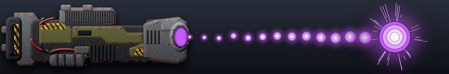](weapon-images/weapon_plasma-heavy.png) | scav rapid fire plasma gun | Laser | Air+Ground | 800 | 0.1 s | 33 | armassimilator_machinegun | LMB | plasma-heavy | 3 | 330 |
| Armada | Asylum | armgatet3 | 1 | not shown | PlasmaRepulsor | Shield |  | 710 | 1.0 s | 0 | armgatet3_repulsor |  |  | 3 |  |
| Armada | Attack Drone | armdrone | 1 | [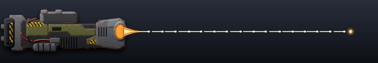](weapon-images/weapon_machine-gun-light.png) | Rapid-fire a2g machine guns | Laser | Ground | 350 | 1.8 s | 11 | armdrone_med_emg | LMB | machine-gun-light | 1 | 6 |
| Armada | Attack Drone | armdroneold | 1 | [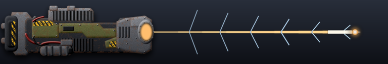](weapon-images/weapon_railgun.png) | Railgun | Laser | Air+Ground | 350 | 6.0 s | 100 | armdroneold_railgun | LMB | railgun | 1 | 17 |
| Armada | Aurora | armfgate | 1 | not shown | NavalPlasmaRepulsor | Shield |  | 10 | 1.0 s | 0 | armfgate_sea_repulsor |  |  | 2 |  |
| Armada | Banshee | armkam | 1 | [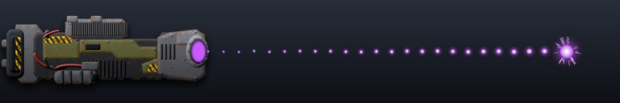](weapon-images/weapon_plasma-light.png) | Rapid-fire close-quarters a2g plasma guns | Plasma | Ground | 350 | 0.7 s | 9 | armkam_emg | LMB | plasma-light | 1 | 13 |
| Armada | Barracuda | armsubk | 1 | [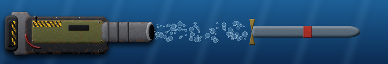](weapon-images/weapon_torpedo.png) | Rapid armor-piercing torpedoes | Torpedo | All | 400 | 2.0 s | 350 | armsubk_armsmart_torpedo | LMB | torpedo | 2 | 175 |
| Armada | Basilica | armbrtha | 1 | [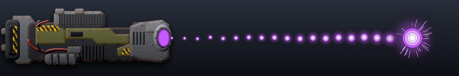](weapon-images/weapon_plasma-medium.png) | Long-range plasma cannon | Plasma | Air+Ground | 4650 | 13.2 s | 1625 | armbrtha_lrpc | LMB | plasma-medium | 2 | 123 |
| Armada | Beamer | armbeamer | 1 |  | Anti-swarm constant wave g2g laser | Beam laser | Ground | 490 | 0.1 s | 27 | armbeamer_armbeamer_weapon | LMB | laser-light | 1 | 270 |
| Armada | Blitz | armflash | 1 |  | Rapid-fire close-quarters plasma gun | Plasma | Ground | 180 | 0.3 s | 9 | armflash_emgx | LMB | plasma-light | 1 | 30 |
| Armada | Blizzard | armpnix | 1 | [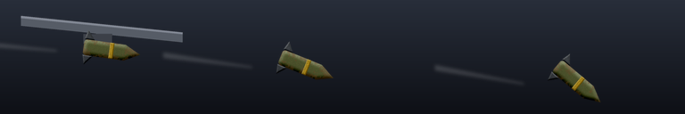](weapon-images/weapon_bomb.png) | Heavy a2g impulse warheads | Bomb | Ground | 1280 | 7.0 s | 266 | armpnix_armadvbomb | LMB | bomb | 2 | 38 |
| Armada | Bull | armbull | 1 |  | Heavy g2g plasma cannon | Plasma | Ground | 460 | 1.1 s | 270 | armbull_arm_bull | LMB | plasma-medium | 2 | 245 |
| Armada | Cauteriser | armnavaldefturret | 1 | [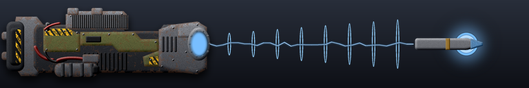](weapon-images/weapon_gauss.png) | Dual Medium Plasma Gauss Cannons | Plasma | Air+Ground | 730 | 0.9 s | 200 | armnavaldefturret_arm_medium_gauss_cannon | LMB | gauss | 1 | 222 |
| Armada | Centurion | armwar | 1 |  | Dual close-quarters g2g laser | Beam laser | Ground | 325 | 0.3 s | 55 | armwar_armwar_laser | LMB | laser-light | 1 | 183 |
| Armada | Chainsaw | armcir | 1 | [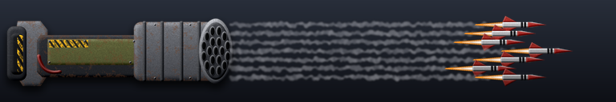](weapon-images/weapon_rocket-salvo.png) | Rapid-fire long-range g2a missile barrel | Missile | Air | 1200 | 1.6 s | 250 (air) | armcir_arm_cir | LMB | rocket-salvo | 1 | 156 |
| Armada | Citadel | armamd | 1 | [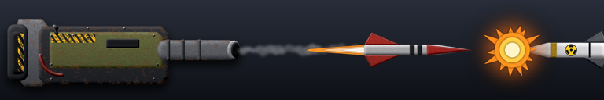](weapon-images/weapon_anti-nuke.png) | ICBM intercepting missile launcher | Starburst missile | Air+Ground | 72000 | 2.0 s | 1500 | armamd_amd_rocket |  | anti-nuke | 2 | 750 |
| Armada | Commander | armdecom | 1 |  | Light close-quarters g2g laser | Beam laser | Ground | 300 | 0.4 s | 75 | armdecom_armcomlaser | MMB | laser-medium | 2 | 188 |
| Armada | Commander | armdecom | 2 |  | J7NSLaser | Beam laser | All | 260 | 1.0 s | 63 | armdecom_armcomsealaser | LMB | laser-light | 2 | 63 |
| Armada | Commander | armdecom | 3 |  | Decoy-disintegrator | D-gun | All | 250 | 0.9 s | 40 | armdecom_disintegrator | RMB | d-gun | 2 | 44 |
| Armada | Cormorant | armlance | 1 |  | Light homing torpedo launcher | Torpedo | All | 400 | 6.0 s | 375 | armlance_armair_torpedo | LMB | torpedo | 2 | 62 |
| Armada | Corsair | armroy | 1 |  | Heavy long-range plasma cannon | Plasma | Air+Ground | 700 | 1.6 s | 235 | armroy_plasma | LMB | plasma-light | 1 | 147 |
| Armada | Corsair | armroy | 2 |  | Depthcharge launcher | Torpedo | All | 400 | 2.0 s | 225 | armroy_depthcharge | RMB | depth-charge | 1 | 112 |
| Armada | Crocodile | armanac | 1 |  | Medium g2g plasma cannon | Plasma | Ground | 370 | 1.4 s | 98 | armanac_armanac_weapon | LMB | plasma-light | 1 | 70 |
| Armada | Crossbow | armjeth | 1 | [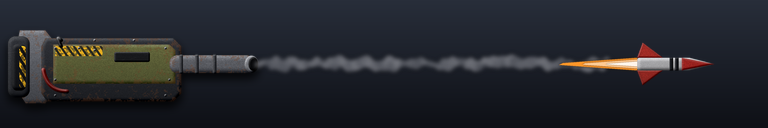](weapon-images/weapon_missile-light.png) | Light g2a missile launcher | Missile | Air | 760 | 2.0 s | 110 (air) | armjeth_armbot_missile | LMB | missile-light | 1 | 55 |
| Armada | Cyclone | armsfig | 1 |  | Guided a2a missile launcher | Missile | Air | 710 | 0.8 s | 12 | armsfig_armsfig_weapon | LMB | missile-light | 1 | 15 |
| Armada | Cyclone | armsfig2 | 1 |  | Guided a2a missile launcher | Missile | Air | 710 | 0.8 s | 12 | armsfig2_armsfig_weapon | LMB | missile-light | 1 | 15 |
| Armada | Depth Charge Drone | armtdrone | 1 |  | Depthcharge launcher | Torpedo | All | 200 | 6.0 s | 215 | armtdrone_td_depthcharge | LMB | depth-charge | 1 | 36 |
| Armada | Dolphin | armdecade | 1 |  | Rapid-fire close-quarters plasma turret | Plasma | Ground | 280 | 0.4 s | 9 | armdecade_emg | LMB | plasma-light | 1 | 22 |
| Armada | Dolphin | armdecade | 2 |  | Rapid-fire close-quarters plasma turret | Plasma | Ground | 280 | 0.4 s | 9 | armdecade_emg | LMB | plasma-light | 1 | 22 |
| Armada | Dragon's Claw | armclaw | 1 |  | Close-quarters g2g lightning turret | Lightning | Ground | 430 | 1.1 s | 18 | armclaw_dclaw | LMB | lightning | 1 | 16 |
| Armada | Dragon's Fury | armlwall | 1 |  | Medium Lightning Cannon | Lightning | Air+Ground | 315 | 1.3 s | 64 | armlwall_lightning | LMB | lightning | 2 | 49 |
| Armada | Dragonslayer | armaas | 1 | not shown | Missiles | Cannon |  | 800 | 0.5 s | 0 | armaas_bogus_missile |  |  | 2 |  |
| Armada | Dragonslayer | armaas | 2 | [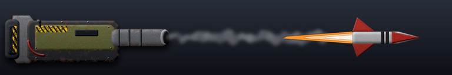](weapon-images/weapon_missile-medium.png) | Long-range g2a guided missile launcher | Missile | Air | 840 | 0.8 s | 63 (air) | armaas_ga2 | RMB | missile-medium | 2 | 79 |
| Armada | Dragonslayer | armaas | 3 |  | Heavy g2a flak cannon | Cannon | Air | 790 | 0.7 s | 200 (air) | armaas_mobileflak | LMB | flak | 2 | 286 |
| Armada | Dreadnought | armbats | 1 |  | Heavy long-range g2g plasma cannon | Plasma | Ground | 880 | 1.0 s | 300 | armbats_arm_bats | LMB | plasma-medium | 2 | 300 |
| Armada | Dreadnought | armbats | 2 |  | Heavy long-range g2g plasma cannon | Plasma | Ground | 880 | 1.0 s | 300 | armbats_arm_bats | LMB | plasma-medium | 2 | 300 |
| Armada | Eel | armsub | 1 |  | Light torpedo launcher | Torpedo | All | 500 | 4.0 s | 342 | armsub_torpedo | LMB | torpedo | 1 | 86 |
| Armada | Ellysaw | armpship | 1 |  | Light long-range plasma cannon | Plasma | Air+Ground | 470 | 1.2 s | 70 | armpship_plasma | LMB | plasma-light | 1 | 58 |
| Armada | Ellysaw | armpship | 2 |  | Light long-range plasma cannon | Plasma | Air+Ground | 470 | 1.2 s | 70 | armpship_plasma | LMB | plasma-light | 1 | 58 |
| Armada | Epic Commander - Final Boss | armcomboss | 1 |  | J8Laser | Beam laser | Air+Ground | 1250 | 0.0 s | 1000 | armcomboss_armcomlaserboss | LMB | laser-ultra | 4 | 10000 |
| Armada | Epic Commander - Final Boss | armcomboss | 2 |  | J8NSLaser | Beam laser | All | 1250 | 0.0 s | 1000 | armcomboss_armcomsealaserboss | MMB | laser-ultra | 4 | 10000 |
| Armada | Epic Commander - Final Boss | armcomboss | 3 |  | Darkmatter Photon-Disruptor | D-gun | Air+Ground | 1250 | 0.0 s | 999999 | armcomboss_disintegratorxl | RMB | d-gun | 4 | 9999990 |
| Armada | Epic Dolphin | armdecadet3 | 1 |  | Mini Rapid-fire long-range plasma cannon | Plasma | Air+Ground | 1300 | 0.4 s | 210 | armdecadet3_armminivulc_weapon | LMB | plasma-heavy | 3 | 525 |
| Armada | Epic Dolphin | armdecadet3 | 2 |  | Mini Rapid-fire long-range plasma cannon | Plasma | Air+Ground | 1300 | 0.4 s | 210 | armdecadet3_armminivulc_weapon | LMB | plasma-heavy | 3 | 525 |
| Armada | Epic Ellysaw | armpshipt3 | 1 | [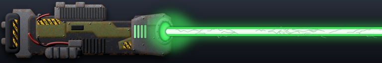](weapon-images/weapon_laser-heavy.png) | Rapid-fire close quarters g2g armor-piercing laser | Beam laser | Ground | 475 | 0.6 s | 116 | armpshipt3_mech_rapidlaser | LMB | laser-heavy | 3 | 193 |
| Armada | Epic Ellysaw | armpshipt3 | 2 |  | Rapid-fire close quarters g2g armor-piercing laser | Beam laser | Ground | 475 | 0.6 s | 116 | armpshipt3_mech_rapidlaser | LMB | laser-heavy | 3 | 193 |
| Armada | Epic Liche | armlichet4 | 1 |  | Intercontinental ballistic nuclear warhead | Bomb | Air+Ground | 800 | 120.0 s | 9500 | armlichet4_nuclear_missile | LMB | nuclear | 3 | 79 |
| Armada | Epic Pawn | armpwt4 | 1 |  | Rapid-fire huge g2g plasma guns | Plasma | Ground | 450 | 0.2 s | 200 | armpwt4_emg | LMB | plasma-heavy | 3 | 1000 |
| Armada | Epic Pulsar | armannit3 | 1 |  | Heavy long-range g2g tachyon accelerator beam | Beam laser | Ground | 1800 | 15.0 s | 48000 | armannit3_ata | LMB | laser-ultra | 3 | 3200 |
| Armada | Epic Recluse | armsptkt4 | 1 |  | Parabolic trajectory g2g multi-rocket launcher | Missile | Ground | 1000 | 10.0 s | 500 | armsptkt4_adv_rocket | LMB | rocket-salvo | 3 | 50 |
| Armada | Epic Serpent | armserpt3 | 1 |  | Heavy guided torpedo launcher | Torpedo | All | 800 | 6.0 s | 1650 | armserpt3_armserp_weapon | LMB | torpedo | 3 | 275 |
| Armada | Epic Serpent | armserpt3 | 2 |  | Heavy guided torpedo launcher | Torpedo | All | 800 | 6.0 s | 1650 | armserpt3_armserp_weapon_sub | RMB | torpedo | 3 | 275 |
| Armada | Epic Serpent | armserpt3 | 3 |  | Heavy guided torpedo launcher | Torpedo | All | 800 | 6.0 s | 1650 | armserpt3_armserp_weapon_sub | RMB | torpedo | 3 | 275 |
| Armada | Epic Serpent | armserpt3 | 4 |  | Heavy guided torpedo launcher | Torpedo | All | 800 | 6.0 s | 1650 | armserpt3_armserp_weapon_sub | RMB | torpedo | 3 | 275 |
| Armada | Epic Serpent | armserpt3 | 5 |  | Heavy guided torpedo launcher | Torpedo | All | 800 | 6.0 s | 1650 | armserpt3_armserp_weapon_sub | RMB | torpedo | 3 | 275 |
| Armada | Epic Skater | armptt2 | 1 |  | Depthcharge launcher | Torpedo | All | 600 | 1.0 s | 225 | armptt2_coax_depthcharge | LMB | depth-charge | 2 | 225 |
| Armada | Epic Skater | armptt2 | 2 |  | Depthcharge launcher | Torpedo | All | 600 | 1.0 s | 225 | armptt2_coax_depthcharge | LMB | depth-charge | 2 | 225 |
| Armada | Epic Skater | armptt2 | 3 |  | Rapid-fire long-range g2a missile barrel | Missile | Air | 1125 | 1.6 s | 170 (air) | armptt2_arm_cir | RMB | rocket-salvo | 2 | 106 |
| Armada | Epic Stormbringer | armthundt4 | 1 |  | Ultra Heavy Bombs | Bomb | Air+Ground | 2480 | 4.0 s | 900 | armthundt4_armbomb | LMB | bomb | 3 | 225 |
| Armada | Epic Tumbleweed | armvadert4 | 1 |  | Crawlingbomb Dummy Weapon | Melee | All | 47 | 0.1 s | 20000 | armvadert4_crawl_dummy | RMB | self-destruct | 3 | 200000 |
| Armada | Epic Tumbleweed | armvadert4 | 2 |  | Self-destruction | Cannon | Air+Ground | 1 | 0.1 s | 2000 | armvadert4_crawl_detonator | LMB | self-destruct | 3 | 20000 |
| Armada | Epoch | armepoch | 1 |  | Primary rapid-fire heavy long-range plasma cannon | Plasma | Air+Ground | 2450 | 3.5 s | 500 | armepoch_heavyplasma | RMB | plasma-medium | 2 | 143 |
| Armada | Epoch | armepoch | 2 |  | Secondary rapid-fire heavy plasma cannon | Plasma | Air+Ground | 830 | 1.2 s | 270 | armepoch_mediumplasma | LMB | plasma-medium | 2 | 225 |
| Armada | Epoch | armepoch | 3 |  | Primary rapid-fire heavy long-range plasma cannon | Plasma | Air+Ground | 2450 | 3.5 s | 500 | armepoch_heavyplasma | RMB | plasma-medium | 2 | 143 |
| Armada | Epoch | armepoch | 4 |  | Secondary rapid-fire heavy plasma cannon | Plasma | Air+Ground | 830 | 1.2 s | 270 | armepoch_mediumplasma | LMB | plasma-medium | 2 | 225 |
| Armada | Epoch | armepoch | 5 |  | Secondary rapid-fire heavy plasma cannon | Plasma | Air+Ground | 830 | 1.2 s | 270 | armepoch_mediumplasma | LMB | plasma-medium | 2 | 225 |
| Armada | Epoch | armepoch | 6 |  | Pop-up rapid-fire g2a missile launcher | Missile | Air | 840 | 1.7 s | 150 (air) | armepoch_ferret_missile | MMB | rocket-salvo | 2 | 88 |
| Armada | Epoch | armepoch | 7 |  | Pop-up rapid-fire g2a missile launcher | Missile | Air | 840 | 1.7 s | 150 (air) | armepoch_ferret_missile | MMB | rocket-salvo | 2 | 88 |
| Armada | Excalibur | armexcalibur | 1 |  | Caliburn s2g tachyon accelerator beam | Beam laser | Ground | 600 | 6.0 s | 800 | armexcalibur_exata | LMB | laser-ultra | 2 | 133 |
| Armada | Falcon | armfig | 1 |  | Light a2a missile launcher | Missile | Air | 680 | 0.9 s | 12 | armfig_armvtol_missile | LMB | missile-light | 1 | 13 |
| Armada | Fatboy | armfboy | 1 |  | Heavy AoE g2g plasma cannon | Plasma | Ground | 700 | 7.0 s | 800 | armfboy_arm_fatboy_notalaser | LMB | plasma-medium | 2 | 114 |
| Armada | Ferret | armferret | 1 |  | Pop-up rapid-fire g2a missile launcher | Missile | Air | 950 | 0.6 s | 125 (air) | armferret_ferret_missile | LMB | rocket-salvo | 1 | 208 |
| Armada | Flying Epoch | armfepocht4 | 1 |  | Primary rapid-fire heavy long-range plasma cannon | Plasma | Air+Ground | 2450 | 3.5 s | 500 | armfepocht4_heavyplasma | RMB | plasma-heavy | 3 | 143 |
| Armada | Flying Epoch | armfepocht4 | 2 |  | Secondary rapid-fire heavy plasma cannon | Plasma | Air+Ground | 830 | 1.2 s | 270 | armfepocht4_mediumplasma | LMB | plasma-heavy | 3 | 225 |
| Armada | Flying Epoch | armfepocht4 | 3 |  | Primary rapid-fire heavy long-range plasma cannon | Plasma | Air+Ground | 2450 | 3.5 s | 500 | armfepocht4_heavyplasma | RMB | plasma-heavy | 3 | 143 |
| Armada | Flying Epoch | armfepocht4 | 4 |  | Secondary rapid-fire heavy plasma cannon | Plasma | Air+Ground | 830 | 1.2 s | 270 | armfepocht4_mediumplasma | LMB | plasma-heavy | 3 | 225 |
| Armada | Flying Epoch | armfepocht4 | 5 |  | Secondary rapid-fire heavy plasma cannon | Plasma | Air+Ground | 830 | 1.2 s | 270 | armfepocht4_mediumplasma | LMB | plasma-heavy | 3 | 225 |
| Armada | Flying Epoch | armfepocht4 | 6 |  | Pop-up rapid-fire g2a missile launcher | Missile | Air | 840 | 1.7 s | 150 (air) | armfepocht4_ferret_missile | MMB | rocket-salvo | 3 | 88 |
| Armada | Flying Epoch | armfepocht4 | 7 |  | Pop-up rapid-fire g2a missile launcher | Missile | Air | 840 | 1.7 s | 150 (air) | armfepocht4_ferret_missile | MMB | rocket-salvo | 3 | 88 |
| Armada | Gauntlet | armguard | 1 |  | Heavy g2g long range plasma cannon | Plasma | Ground | 1220 | 2.8 s | 300 | armguard_plasma | LMB | plasma-light | 1 | 107 |
| Armada | Gauntlet | armguard | 2 |  | Heavy g2g long range plasma cannon | Plasma | Ground | 1220 | 2.8 s | 300 | armguard_plasma_high | RMB | plasma-light | 1 | 107 |
| Armada | Gauntlet | armguard | 3 | not shown | Heavy g2g long range plasma cannon | Plasma | Ground | 1220 | 2.8 s | 0 | armguard_smart_trajectory_dummy |  |  | 1 |  |
| Armada | Ghost | armspy | 1 | not shown | Dummy Weapon | Melee | Water | 100 | 0.1 s | 0 | armspy_crawl_dummy |  |  | 2 |  |
| Armada | Gorgon | armkraken | 1 |  | Rapid-fire gauss cannon | Cannon | Air+Ground | 800 | 0.3 s | 180 | armkraken_armmech_cannon | LMB | gauss | 2 | 600 |
| Armada | Gremlin | armgremlin | 1 |  | Light close-quarters gauss cannon | Cannon | Air+Ground | 220 | 3.0 s | 263 | armgremlin_armgremlin_gauss | LMB | gauss | 2 | 88 |
| Armada | Groundhog | armmlv | 1 | [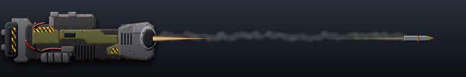](weapon-images/weapon_cannon-light.png) | Seismic charge | Cannon | Air+Ground | 220 | 3.0 s | 15 | armmlv_minesweep | LMB | cannon-light | 1 | 5 |
| Armada | Gun Platform | armgplat | 1 |  | Light g2g plasma cannon | Plasma | Ground | 520 | 0.5 s | 97 | armgplat_gun | LMB | plasma-light | 1 | 194 |
| Armada | Gunslinger | armmav | 1 |  | Anti-swarm g2g gauss-impulse guns | Cannon | Ground | 365 | 1.0 s | 265 | armmav_armmav_weapon | LMB | gauss | 2 | 265 |
| Armada | Harpoon | armtl | 1 |  | Level1TorpedoLauncher | Torpedo | All | 500 | 1.5 s | 280 | armtl_torpedo | LMB | torpedo | 1 | 187 |
| Armada | Haven | armantiship | 1 |  | ICBM intercepting missile launcher | Starburst missile | Air+Ground | 72000 | 2.0 s | 1500 | armantiship_amd_rocket |  | anti-nuke | 2 | 750 |
| Armada | Haven | armcarry | 1 |  | ICBM intercepting missile launcher | Starburst missile | Air+Ground | 72000 | 2.0 s | 1500 | armcarry_amd_rocket |  | anti-nuke | 2 | 750 |
| Armada | Heavy Mine | armfmine3 | 1 | not shown | Crawlingbomb Dummy Weapon | Melee |  | 64 | 1.0 s | 0 | armfmine3_minerange |  |  | 1 |  |
| Armada | Heavy Mine | armmine3 | 1 | not shown | Crawlingbomb Dummy Weapon | Melee |  | 64 | 1.0 s | 0 | armmine3_minerange |  |  | 1 |  |
| Armada | Highwind | armhawk | 1 |  | High velocity a2a missile launcher | Missile | Air | 740 | 1.4 s | 24 | armhawk_armvtol_advmissile | LMB | missile-light | 2 | 17 |
| Armada | Hornet | armblade | 1 |  | Heavy a2g armor-piercing sabot missile launcher | Missile | Ground | 420 | 2.3 s | 190 | armblade_vtol_sabot | LMB | missile-medium | 2 | 83 |
| Armada | Hound | armfido | 1 |  | Ballistic g2g AoE plasma cannon | Plasma | Ground | 650 | 3.3 s | 255 | armfido_bfido | LMB | plasma-medium | 2 | 77 |
| Armada | Jaguar | armlatnk | 1 |  | Close-quarters lightning turret | Lightning | Air+Ground | 300 | 1.5 s | 22 | armlatnk_lightning | LMB | lightning | 2 | 15 |
| Armada | Jaguar | armlatnk | 2 |  | Light g2a missile launcher | Missile | Air | 600 | 2.1 s | 90 (air) | armlatnk_armamph_missile | RMB | missile-medium | 2 | 43 |
| Armada | Janus | armjanus | 1 |  | Heavy g2g dual-missile launcher | Missile | Ground | 380 | 7.5 s | 330 | armjanus_janus_rocket | LMB | missile-light | 1 | 44 |
| Armada | Janus | armjanus | 2 |  | Heavy g2g dual-missile launcher | Missile | Ground | 380 | 7.5 s | 330 | armjanus_janus_rocket | LMB | missile-light | 1 | 44 |
| Armada | Juno | armjuno | 1 | not shown | Anti radar/minefield/jammer magnetic impulse rocket | Starburst missile |  | 32000 | 2.0 s | 0 | armjuno_juno_pulse |  |  | 1 |  |
| Armada | Keeper | armgate | 1 | not shown | PlasmaRepulsor | Shield |  | 10 | 1.0 s | 0 | armgate_repulsor |  |  | 2 |  |
| Armada | Liche | armliche | 1 |  | Tactical nuclear homing missile | Missile | Air+Ground | 250 | 9.0 s | 5625 | armliche_arm_pidr | LMB | nuclear | 2 | 625 |
| Armada | Light Mine | armmine1 | 1 | not shown | Crawlingbomb Dummy Weapon | Melee |  | 64 | 1.0 s | 0 | armmine1_minerange |  |  | 1 |  |
| Armada | Liquifier | armanavaldefturret | 1 |  | Long-Range Tachyon Emitter | Beam laser | Air+Ground | 950 | 4.7 s | 2500 | armanavaldefturret_armada_tachyon_emitter | RMB | laser-ultra | 2 | 532 |
| Armada | Liquifier | armanavaldefturret | 2 |  | Quad Medium Plasma Gauss Cannons | Plasma | Air+Ground | 690 | 0.6 s | 200 | armanavaldefturret_armada_medium_gauss_cannon | LMB | gauss | 2 | 333 |
| Armada | Longbow | armmship | 1 |  | Heavy long-range g2g starburst rocket launcher | Cannon | Ground | 1550 | 6.0 s | 650 | armmship_rocket | LMB | heavy-rocket | 2 | 108 |
| Armada | Longbow | armmship | 2 |  | Medium Range g2a AA Missiles | Missile | Air | 710 | 2.0 s | 138 (air) | armmship_missile | RMB | aa-missile | 2 | 69 |
| Armada | Lunchbox | armlunchbox | 1 |  | Heavy long-range g2g plasma cannon | Plasma | Ground | 1325 | 8.0 s | 1265 | armlunchbox_shocker | LMB | plasma-heavy | 3 | 158 |
| Armada | Lunkhead | armlun | 1 | [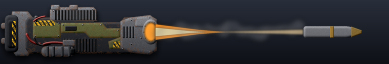](weapon-images/weapon_cannon-heavy.png) | Heavy ballistic underwater cannon | Cannon | Air+Ground | 575 | 1.8 s | 370 | armlun_cannon | LMB | cannon-heavy | 3 | 206 |
| Armada | Lunkhead | armlun | 2 |  | Depthcharge launcher | Torpedo | All | 400 | 2.0 s | 225 | armlun_depthcharge | RMB | depth-charge | 3 | 112 |
| Armada | Mace | armham | 1 |  | Light g2g plasma cannon (low trajectory) | Plasma | Ground | 380 | 1.7 s | 104 | armham_arm_ham | LMB | plasma-light | 1 | 61 |
| Armada | Maelstrom | armlship | 1 |  | Close-quarters lightning turret | Lightning | Air+Ground | 400 | 1.4 s | 35 | armlship_lightning | LMB | lightning | 2 | 25 |
| Armada | Maelstrom | armlship | 2 |  | Light g2a missile launcher | Missile | Air | 710 | 2.0 s | 138 (air) | armlship_armamph_missile | RMB | missile-medium | 2 | 69 |
| Armada | Manta | armfhlt | 1 |  | HighEnergyLaser | Beam laser | Air+Ground | 630 | 0.9 s | 210 | armfhlt_armfhlt_laser | LMB | laser-light | 1 | 233 |
| Armada | Marauder | armmar | 1 |  | Double close-quarters gauss cannon | Cannon | Air+Ground | 350 | 0.7 s | 235 | armmar_armmech_cannon | LMB | gauss | 3 | 336 |
| Armada | Marauder | armmar | 2 | [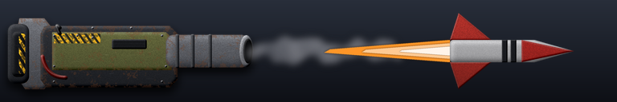](weapon-images/weapon_missile-heavy.png) | Guided g2a missile launcher | Missile | Air | 600 | 2.1 s | 90 (air) | armmar_armamph_missile | RMB | missile-heavy | 3 | 43 |
| Armada | Mauser | armmart | 1 |  | Long-range g2g plasma cannon | Plasma | Ground | 820 | 3.0 s | 260 | armmart_arm_artillery | LMB | plasma-medium | 2 | 87 |
| Armada | Meatball | armmeatball | 1 |  | Long range g2g plasma cannon | Plasma | Ground | 800 | 0.3 s | 200 | armmeatball_lrpc | LMB | plasma-heavy | 3 | 667 |
| Armada | Meatball | armmeatball | 2 |  | Guided g2a missile launcher | Missile | Air | 600 | 2.0 s | 85 (air) | armmeatball_armamph_missile | RMB | missile-heavy | 3 | 42 |
| Armada | Medium Mine | armmine2 | 1 | not shown | Crawlingbomb Dummy Weapon | Melee |  | 64 | 1.0 s | 0 | armmine2_minerange |  |  | 1 |  |
| Armada | Mercury | armmercury | 1 |  | Heavy long-range g2a guided missile launcher | Missile | Air | 2400 | 1.8 s | 750 (air) | armmercury_arm_advsam | LMB | missile-heavy | 2 | 417 |
| Armada | Mini Ragnarok | armminivulc | 1 |  | Mini Rapid-fire long-range plasma cannon | Plasma | Air+Ground | 1300 | 0.4 s | 210 | armminivulc_armminivulc_weapon | LMB | plasma-heavy | 2 | 525 |
| Armada | Moray | armatl | 1 |  | Heavy long-range homing torpedo launcher | Torpedo | All | 915 | 2.2 s | 780 | armatl_armatl_torpedo | LMB | torpedo | 2 | 355 |
| Armada | Naval Arbalest | armfflak | 1 |  | Heavy g2a flak cannon | Cannon | Air | 850 | 0.5 s | 250 (air) | armfflak_armflak_gun | LMB | flak | 2 | 500 |
| Armada | Naval Nettle | armfrt | 1 |  | Light g2a missile launcher | Missile | Air | 765 | 1.7 s | 115 (air) | armfrt_armrl_missile | LMB | missile-light | 1 | 68 |
| Armada | Nettle | armrl | 1 |  | Light g2a missile launcher | Missile | Air | 765 | 1.7 s | 115 (air) | armrl_armrl_missile | LMB | missile-light | 1 | 68 |
| Armada | Nexus | armdronecarry | 1 | not shown | HeavyCannon | Cannon |  | 1300 | 2.5 s | 0 | armdronecarry_plasma |  |  | 2 |  |
| Armada | Nexus | armdronecarry | 2 |  | Missiles | Missile | Air | 710 | 2.0 s | 138 (air) | armdronecarry_aamissile | LMB | missile-medium | 2 | 69 |
| Armada | Nexus Terra | armdronecarryland | 1 | not shown | HeavyCannon | Cannon |  | 1200 | 2.5 s | 0 | armdronecarryland_plasma |  |  | 3 |  |
| Armada | Overwatch | armhlt | 1 |  | Heavy g2g high energy laser | Beam laser | Ground | 620 | 1.8 s | 387 | armhlt_arm_laserh1 | LMB | laser-light | 1 | 215 |
| Armada | Paladin | armcrus | 1 |  | Long-range g2g gauss cannon | Cannon | Ground | 500 | 1.7 s | 220 | armcrus_gauss | RMB | gauss | 2 | 129 |
| Armada | Paladin | armcrus | 2 |  | Light close-quarters g2g laser | Beam laser | Ground | 430 | 0.3 s | 75 | armcrus_laser | LMB | laser-medium | 2 | 250 |
| Armada | Paladin | armcrus | 3 |  | Medium depthcharge launcher | Torpedo | All | 450 | 1.8 s | 225 | armcrus_depthcharge | MMB | depth-charge | 2 | 125 |
| Armada | Paralyzer | armemp | 1 |  | Heavy long-range g2g EMP starburst rocket | Starburst missile | Ground | 3650 | 2.0 s | 50000 | armemp_armemp_weapon | LMB | heavy-rocket | 2 | 25000 |
| Armada | Pawn | armpw | 1 |  | Rapid-fire close-quarters g2g plasma guns | Plasma | Ground | 180 | 0.3 s | 9 | armpw_emg | LMB | plasma-light | 1 | 30 |
| Armada | Pawn Launcher | armbotrail | 1 |  | Long range bot cannon | Cannon | Air+Ground | 5250 | 0.5 s | 10 | armbotrail_arm_botrail | LMB | cannon-light | 2 | 20 |
| Armada | Pincer | armpincer | 1 |  | Light close-quarters plasma cannon | Plasma | Air+Ground | 305 | 1.5 s | 116 | armpincer_arm_pincer_gauss | LMB | plasma-light | 1 | 77 |
| Armada | Pit Bull | armpb | 1 |  | Pop-up heavy g2g gauss cannon | Cannon | Ground | 730 | 1.6 s | 675 | armpb_armpb_weapon | LMB | gauss | 2 | 422 |
| Armada | Platypus | armamph | 1 |  | Light close-quarters laser | Beam laser | Air+Ground | 275 | 0.7 s | 80 | armamph_armamph_weapon1 | LMB | laser-medium | 2 | 114 |
| Armada | Platypus | armamph | 2 |  | Light g2a missile launcher | Missile | Air | 600 | 2.1 s | 90 (air) | armamph_armamph_missile | RMB | missile-medium | 2 | 43 |
| Armada | Possum | armmh | 1 |  | Light long-range g2g starburst rocket launcher | Starburst missile | Ground | 710 | 6.0 s | 300 | armmh_armmh_weapon | LMB | heavy-rocket | 1 | 50 |
| Armada | Puffin | armseap | 1 |  | Homing torpedo launcher | Torpedo | All | 600 | 3.0 s | 342 | armseap_armseap_weapon1 | LMB | torpedo | 1 | 114 |
| Armada | Pulsar | armanni | 1 |  | Heavy long-range g2g tachyon accelerator beam | Beam laser | Ground | 1400 | 9.9 s | 10800 | armanni_ata | LMB | laser-ultra | 2 | 1091 |
| Armada | Ragnarok | armvulc | 1 | [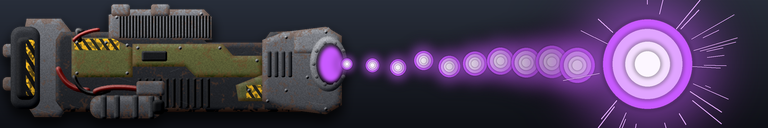](weapon-images/weapon_plasma-ultra.png) | Rapid-fire long-range plasma cannon | Plasma | Air+Ground | 5750 | 0.6 s | 1625 | armvulc_rflrpc | LMB | plasma-ultra | 2 | 2708 |
| Armada | Ratte | armrattet4 | 1 |  | Huge g2g plasma cannon | Plasma | Ground | 1000 | 1.5 s | 1200 | armrattet4_arm_bosscannon | LMB | plasma-heavy | 3 | 800 |
| Armada | Rattlesnake | armamb | 1 |  | Pop-up heavy  long range g2g plasma cannon | Plasma | Ground | 1380 | 1.8 s | 350 | armamb_armamb_gun | LMB | plasma-medium | 2 | 194 |
| Armada | Rattlesnake | armamb | 2 | [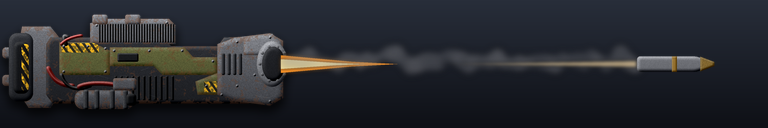](weapon-images/weapon_cannon-medium.png) | Pop-up heavy  long range g2g plasna cannon | Cannon | Ground | 1380 | 1.8 s | 350 | armamb_armamb_gun_high | RMB | cannon-medium | 2 | 194 |
| Armada | Rattlesnake | armamb | 3 | not shown | Pop-up heavy  long range g2g plasma cannon | Plasma | Ground | 1380 | 1.8 s | 0 | armamb_smart_trajectory_dummy |  |  | 2 |  |
| Armada | Razorback | armraz | 1 |  | Rapid-fire close quarters g2g armor-piercing laser | Beam laser | Ground | 475 | 0.6 s | 105 | armraz_mech_rapidlaser | LMB | laser-heavy | 3 | 175 |
| Armada | Recluse | armsptk | 1 |  | Parabolic trajectory g2g multi-rocket launcher | Missile | Ground | 575 | 3.7 s | 200 | armsptk_adv_rocket | LMB | rocket-salvo | 2 | 54 |
| Armada | Rocketeer | armrock | 1 |  | Medium g2g rocket launcher | Missile | Ground | 475 | 3.8 s | 157 | armrock_arm_bot_rocket | LMB | missile-light | 1 | 41 |
| Armada | Roughneck | armbrawl | 1 |  | Rapid-fire a2g plasma guns | Plasma | Ground | 380 | 0.6 s | 16 | armbrawl_vtol_emg | LMB | plasma-light | 2 | 27 |
| Armada | Rover | armfav | 1 |  | Light Close-Quarters g2g Laser | Beam laser | Ground | 180 | 1.0 s | 35 | armfav_arm_laser | LMB | laser-light | 1 | 35 |
| Armada | Sabre | armsaber | 1 |  | Light a2g discharge blaster | Laser | Ground | 425 | 0.9 s | 60 | armsaber_vtol_emg2 | LMB | laser-light | 1 | 67 |
| Armada | Scumbag | armfrock | 1 |  | Pop-up rapid-fire g2a missile launcher | Missile | Air | 840 | 1.7 s | 150 (air) | armfrock_aamissile | LMB | rocket-salvo | 1 | 88 |
| Armada | Seadragon | armseadragon | 1 |  | Torpedo launcher | Torpedo | All | 720 | 8.0 s | 800 | armseadragon_waterballon | LMB | torpedo | 2 | 100 |
| Armada | Seadragon | armseadragon | 2 |  | Intercontinental ballistic nuclear warhead | Starburst missile | All | 72000 | 30.0 s | 12500 | armseadragon_sdmssl | RMB | nuclear | 2 | 417 |
| Armada | Seadragon | armseadragon | 3 | not shown | Nuclear Launch | Cannon |  | 0 | 30.0 s | 0 | armseadragon_nuclear_launch |  |  | 2 |  |
| Armada | Seeker | armsh | 1 |  | Light Close-Quarters Fast-Firing g2g Laser | Beam laser | Ground | 230 | 0.6 s | 36 | armsh_armsh_weapon | LMB | laser-light | 1 | 60 |
| Armada | Sentry | armllt | 1 |  | Light g2g laser turret | Beam laser | Ground | 430 | 0.5 s | 75 | armllt_arm_lightlaser | LMB | laser-light | 1 | 150 |
| Armada | Serpent | armserp | 1 |  | Heavy guided torpedo launcher | Torpedo | All | 800 | 8.0 s | 825 | armserp_armserp_weapon | LMB | torpedo | 2 | 103 |
| Armada | Serpent | armserp | 2 |  | Heavy guided torpedo launcher | Torpedo | All | 800 | 8.0 s | 825 | armserp_armserp_weapon | LMB | torpedo | 2 | 103 |
| Armada | Sharpshooter | armsnipe | 1 |  | SniperWeapon | Cannon | Air+Ground | 900 | 10.0 s | 2500 | armsnipe_old_armsnipe_weapon | LMB | cannon-medium | 2 | 250 |
| Armada | Shellshocker | armart | 1 |  | Long-range high-trajectory g2g plasma cannon | Plasma | Ground | 710 | 4.3 s | 182 | armart_tawf113_weapon | LMB | plasma-light | 1 | 42 |
| Armada | Shockwave | armshockwave | 1 | [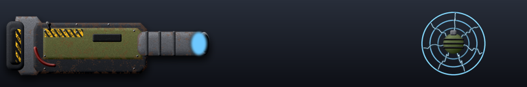](weapon-images/weapon_emp-grenade.png) | Medium EMP turret | EMP cannon | Ground | 500 | 1.3 s | 800 | armshockwave_hllt_bottom | LMB | emp-grenade | 2 | 615 |
| Armada | Shredder | armyork | 1 | not shown | Missiles | Cannon |  | 775 | 0.5 s | 0 | armyork_bogus_missile |  |  | 2 |  |
| Armada | Shredder | armyork | 2 |  | Heavy g2a flak cannon | Cannon | Air | 775 | 0.7 s | 200 (air) | armyork_mobileflak | LMB | flak | 2 | 286 |
| Armada | Skater | armpt | 1 |  | Light close-quarters laser | Beam laser | Air+Ground | 300 | 0.4 s | 24 | armpt_laser | LMB | laser-light | 1 | 60 |
| Armada | Skater | armpt | 2 |  | Light g2a missile launcher | Missile | Air | 760 | 1.4 s | 80 (air) | armpt_aamissile | RMB | missile-light | 1 | 57 |
| Armada | Sprinter | armfast | 1 |  | Rapid-firing close-quarters g2g plasma guns | Plasma | Ground | 230 | 0.5 s | 12 | armfast_arm_fast | LMB | plasma-light | 2 | 24 |
| Armada | Starlight | armmanni | 1 |  | Heavy long-range g2g tachyon beam | Beam laser | Ground | 950 | 4.7 s | 2500 | armmanni_atam | LMB | laser-ultra | 2 | 532 |
| Armada | Stiletto | armstil | 1 |  | Heavy a2g EMP warheads | Bomb | Ground | 1280 | 7.0 s | 6000 | armstil_stiletto_bomb | LMB | bomb | 2 | 857 |
| Armada | Stormbringer | armthund | 1 |  | Light a2g impulse warheads | Bomb | Ground | 1280 | 6.0 s | 110 | armthund_armbomb | LMB | bomb | 1 | 18 |
| Armada | Stout | armstump | 1 |  | Light g2g plasma cannon | Plasma | Ground | 350 | 1.2 s | 97 | armstump_arm_lightcannon | LMB | plasma-light | 1 | 81 |
| Armada | Sweeper | armah | 1 | not shown | Missiles | Cannon |  | 830 | 0.5 s | 0 | armah_bogus_missile |  |  | 1 |  |
| Armada | Sweeper | armah | 2 |  | Light g2a missile launcher | Missile | Air | 700 | 2.2 s | 62 (air) | armah_armah_weapon | LMB | missile-light | 1 | 28 |
| Armada | Thor | armthor | 1 |  | Heavy Lighting Cannon | Lightning | Air+Ground | 540 | 3.1 s | 300 | armthor_thunder | RMB | lightning | 3 | 97 |
| Armada | Thor | armthor | 2 |  | Heavy long-range g2g EMP starburst rocket | Starburst missile | Ground | 1050 | 3.0 s | 80000 | armthor_empmissile | MMB | heavy-rocket | 3 | 26667 |
| Armada | Thor | armthor | 3 |  | Long Range EMP laser | Beam laser | Air+Ground | 350 | 0.2 s | 300 | armthor_emp | LMB | laser-heavy | 3 | 1500 |
| Armada | Thor | armthor | 4 |  | Long Range EMP laser | Beam laser | Air+Ground | 350 | 0.2 s | 300 | armthor_emp | LMB | laser-heavy | 3 | 1500 |
| Armada | Tick | armflea | 1 |  | Light Close-Quarters Fast-Firing g2g Laser | Beam laser | Ground | 140 | 0.6 s | 24 | armflea_flea_laser | LMB | laser-light | 1 | 40 |
| Armada | Titan | armbanth | 1 |  | Close-quarters impulsion blaster | Laser | Air+Ground | 465 | 1.4 s | 730 | armbanth_armbantha_fire | LMB | laser-heavy | 3 | 521 |
| Armada | Titan | armbanth | 2 |  | High-energy long-range g2g/g2a lazor of DEEEEEEWWWWWWMMMMMM | Beam laser | Air+Ground | 800 | 7.5 s | 6000 | armbanth_tehlazerofdewm | RMB | laser-heavy | 3 | 800 |
| Armada | Titan | armbanth | 3 |  | Heavy g2g/g2a guided starburst missile launcher | Starburst missile | Air+Ground | 860 | 7.0 s | 900 | armbanth_bantha_rocket | MMB | heavy-rocket | 3 | 129 |
| Armada | Titan | armbanth | 4 | not shown | BanthStep | Cannon |  | 0 | 1.5 s | 0 | armbanth_banthfootstep |  |  | 3 |  |
| Armada | Torpedo Ship | armtorps | 1 |  | Torpedo | Torpedo | All | 300 | 10.0 s | 455 | armtorps_torpedo | LMB | torpedo | 1 | 46 |
| Armada | Trident | armtrident | 1 | not shown | Depth Charge Drones | Cannon | Water | 1300 | 2.5 s | 0 | armtrident_plasma |  |  | 2 |  |
| Armada | Trident | armtrident | 2 |  | Depthcharge launcher | Torpedo | All | 600 | 1.5 s | 255 | armtrident_trident_depthcharge | LMB | depth-charge | 2 | 170 |
| Armada | Tsunami | armsb | 1 |  | Medium a2g impulse warheads | Bomb | Ground | 1280 | 7.0 s | 200 | armsb_arm_seaadvbomb | LMB | bomb | 1 | 29 |
| Armada | Tumbleweed | armvader | 1 | not shown | Crawlingbomb Dummy Weapon | Melee | Water | 42 | 0.1 s | 0 | armvader_crawl_dummy |  |  | 2 |  |
| Armada | Tumbleweed | armvader | 2 |  | Self-destruction | Cannon | Air+Ground | 1 | 0.1 s | 1000 | armvader_crawl_detonator | LMB | self-destruct | 2 | 10000 |
| Armada | Turtle | armcroc | 1 |  | Medium g2g gauss-cannon | Cannon | Ground | 480 | 1.6 s | 225 | armcroc_arm_triton | LMB | gauss | 2 | 141 |
| Armada | Turtle | armcroc | 2 |  | Light g2a missile launcher | Missile | Air | 765 | 1.7 s | 60 (air) | armcroc_armcl_missile | RMB | missile-light | 2 | 35 |
| Armada | Umbrella | armscab | 1 |  | ICBM intercepting missile launcher | Starburst missile | Air+Ground | 72000 | 2.0 s | 500 | armscab_armscab_weapon |  | anti-nuke | 2 | 250 |
| Armada | units.names.armcomnew | armcomnew | 1 |  | Light close-quarters g2g/g2a laser | Beam laser | Air+Ground | 300 | 0.4 s | 75 | armcomnew_armcomlaser | LMB | laser-light | 1 | 188 |
| Armada | units.names.armcomnew | armcomnew | 2 |  | Light underwater-combat laser | Beam laser | All | 300 | 1.0 s | 200 | armcomnew_armcomsealaser | MMB | laser-light | 1 | 200 |
| Armada | units.names.armcomnew | armcomnew | 3 |  | Disintegrator | D-gun | All | 250 | 0.9 s | 99999 | armcomnew_disintegrator | RMB | d-gun | 1 | 111110 |
| Armada | units.names.armprowl | armprowl | 1 |  | Double close-quarters gauss cannon | Cannon | Air+Ground | 350 | 0.7 s | 235 | armprowl_armmech_cannon | LMB | gauss | 3 | 336 |
| Armada | units.names.armprowl | armprowl | 2 |  | Guided g2a missile launcher | Missile | Air | 600 | 2.0 s | 85 (air) | armprowl_armamph_missile | RMB | missile-heavy | 3 | 42 |
| Armada | Vanguard | armvang | 1 |  | Heavy long-range g2g plasma cannon | Plasma | Ground | 1450 | 8.0 s | 1265 | armvang_shocker_low | LMB | plasma-heavy | 3 | 158 |
| Armada | Vanguard | armvang | 2 |  | Heavy long-range g2g plasma cannon | Plasma | Ground | 1450 | 8.0 s | 1265 | armvang_shocker_high | RMB | plasma-heavy | 3 | 158 |
| Armada | Vanguard | armvang | 3 | not shown | Heavy long-range g2g plasma cannon | Plasma | Ground | 1450 | 8.0 s | 0 | armvang_smart_trajectory_dummy |  |  | 3 |  |
| Armada | Webber | armspid | 1 |  | Close-quarters light EMP laser | Beam laser | Air+Ground | 280 | 1.7 s | 850 | armspid_spider | LMB | laser-medium | 2 | 500 |
| Armada | Welder | armzeus | 1 |  | Close-quarters g2g lightning rifle | Lightning | Ground | 280 | 1.7 s | 22 | armzeus_lightning | LMB | lightning | 2 | 13 |
| Armada | Whistler | armsam | 1 |  | Light g2a missile launcher | Missile | Air | 700 | 3.3 s | 160 (air) | armsam_armtruck_aa | RMB | missile-light | 1 | 48 |
| Armada | Whistler | armsam | 2 |  | Light g2g missile launcher | Missile | Ground | 550 | 3.3 s | 86 | armsam_armtruck_missile | LMB | missile-light | 1 | 26 |
| Armada | Zapper | armzapper | 1 |  | Light EMP laser | Beam laser | Air+Ground | 220 | 1.2 s | 800 | armzapper_bladewing_lyzer | LMB | laser-medium | 1 | 667 |
| Cortex | Adjudicator | coresuppt3 | 1 | [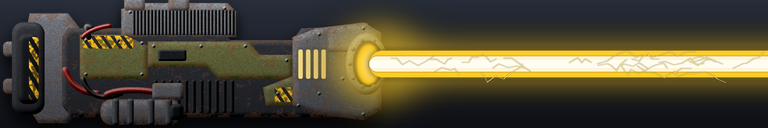](weapon-images/weapon_heatray.png) | Ultra Heavy Juggernaut-Spec Heatray | Beam laser | Air+Ground | 900 | 4.0 s | 5500 | coresuppt3_laser | LMB | heatray | 3 | 1375 |
| Cortex | Adjudicator | coresuppt3 | 2 |  | Ultra Heavy Juggernaut-Spec Heatray | Beam laser | Air+Ground | 900 | 4.0 s | 5500 | coresuppt3_laser | LMB | heatray | 3 | 1375 |
| Cortex | Advanced Exploiter | cormexp | 1 |  | High energy g2g laser | Beam laser | Ground | 650 | 0.5 s | 215 | cormexp_corsumo_weapon | LMB | laser-medium | 2 | 430 |
| Cortex | Advanced Exploiter | cormexp | 2 |  | Heavy g2g/g2a barrage missile launcher | Missile | Air+Ground | 650 | 5.9 s | 260 | cormexp_cormexp_rocket | RMB | missile-medium | 2 | 44 |
| Cortex | Aggravator | corstorm | 1 |  | Rockets | Missile | Air+Ground | 475 | 3.8 s | 157 | corstorm_cor_bot_rocket | LMB | missile-light | 1 | 41 |
| Cortex | Agitator | corpun | 1 |  | Long-range g2g plasma cannon | Plasma | Ground | 1245 | 3.2 s | 350 | corpun_plasma | LMB | plasma-light | 1 | 109 |
| Cortex | Agitator | corpun | 2 |  | Long-range g2g plasma cannon | Plasma | Ground | 1245 | 3.2 s | 350 | corpun_plasma_high | RMB | plasma-light | 1 | 109 |
| Cortex | Agitator | corpun | 3 | not shown | Long-range g2g plasma cannon | Plasma | Ground | 1245 | 3.2 s | 0 | corpun_smart_trajectory_dummy |  |  | 1 |  |
| Cortex | Alligator | corseal | 1 |  | PlasmaCannon | Plasma | Air+Ground | 440 | 0.9 s | 116 | corseal_cor_croc | LMB | plasma-medium | 2 | 129 |
| Cortex | Angler | cortitan | 1 |  | Heavy homing torpedo launcher | Torpedo | All | 400 | 8.0 s | 1200 | cortitan_heavy_torpedo | LMB | torpedo | 2 | 150 |
| Cortex | Apocalypse | corsilo | 1 |  | Intercontinental thermonuclear ballistic missile | Starburst missile | Air+Ground | 72000 | 30.0 s | 15000 | corsilo_crblmssl | LMB | nuclear | 2 | 500 |
| Cortex | Apocalypse | corsilo | 2 | not shown | Nuclear Launch | Cannon |  | 0 | 30.0 s | 0 | corsilo_nuclear_launch |  |  | 2 |  |
| Cortex | Arbiter | corhrk | 1 |  | HeavyRockets | Starburst missile | Air+Ground | 1210 | 8.0 s | 850 | corhrk_corhrk_rocket | LMB | heavy-rocket | 2 | 106 |
| Cortex | Archaic Dragon | corcrw | 1 |  | High energy a2g laser | Beam laser | Ground | 525 | 1.3 s | 250 | corcrw_krowlaser2 | LMB | laser-medium | 2 | 192 |
| Cortex | Archaic Dragon | corcrw | 2 |  | HighEnergyLaser | Beam laser | Air+Ground | 575 | 0.6 s | 90 | corcrw_krowlaser | RMB | laser-medium | 2 | 150 |
| Cortex | Archaic Dragon | corcrw | 3 |  | HighEnergyLaser | Beam laser | Air+Ground | 575 | 0.6 s | 90 | corcrw_krowlaser | RMB | laser-medium | 2 | 150 |
| Cortex | Archaic Karkinos | corkark | 1 |  | Light g2g Heat Ray | Beam laser | Ground | 360 | 2.0 s | 160 | corkark_corwar_laser | RMB | heatray | 1 | 80 |
| Cortex | Archaic Karkinos | corkark | 2 |  | RiotCannon | Cannon | Air+Ground | 220 | 5.0 s | 190 | corkark_corlevlr_weapon | LMB | cannon-light | 1 | 38 |
| Cortex | Arrow Storm | corarch | 1 | not shown | Missiles | Cannon |  | 800 | 0.5 s | 0 | corarch_bogus_missile |  |  | 2 |  |
| Cortex | Arrow Storm | corarch | 2 |  | AA2Missile | Missile | Air | 870 | 1.6 s | 125 | corarch_ga2 | RMB | missile-medium | 2 | 78 |
| Cortex | Arrow Storm | corarch | 3 |  | FlakCannon | Cannon | Air | 775 | 0.7 s | 200 (air) | corarch_mobileflak | LMB | flak | 2 | 286 |
| Cortex | Atoll | corfgate | 1 | not shown | NavalPlasmaRepulsor | Shield |  | 10 | 1.0 s | 0 | corfgate_sea_repulsor |  |  | 2 |  |
| Cortex | Attack Drone | cordrone | 1 |  | HeatRay | Beam laser | Air+Ground | 360 | 1.3 s | 60 | cordrone_heat_ray | LMB | heatray | 1 | 46 |
| Cortex | Attack Drone | cordroneold | 1 |  | HeatRay | Beam laser | Air+Ground | 360 | 4.8 s | 80 | cordroneold_heat_ray | LMB | heatray | 1 | 17 |
| Cortex | Banisher | corban | 1 |  | Banisher | Missile | Air+Ground | 800 | 7.5 s | 1000 | corban_banisher | LMB | missile-medium | 2 | 133 |
| Cortex | Basilisk | corint | 1 |  | Long-range plasma cannon | Plasma | Air+Ground | 4950 | 16.0 s | 2000 | corint_lrpc | LMB | plasma-medium | 2 | 125 |
| Cortex | Bat | corsfig | 1 |  | Guided a2a missile launcher | Missile | Air | 710 | 0.8 s | 12 | corsfig_corsfig_weapon | LMB | missile-light | 1 | 15 |
| Cortex | Bat | corsfig2 | 1 |  | Guided a2a missile launcher | Missile | Air | 710 | 0.8 s | 12 | corsfig2_corsfig_weapon | LMB | missile-light | 1 | 15 |
| Cortex | Bat | corsfig2 | 2 |  | Guided a2a missile launcher | Missile | Air | 710 | 0.8 s | 12 | corsfig2_small_weapon | RMB | missile-light | 1 | 15 |
| Cortex | Bedbug | corroach | 1 | not shown | Crawlingbomb Dummy Weapon | Melee | Water | 42 | 0.1 s | 0 | corroach_crawl_dummy |  |  | 2 |  |
| Cortex | Bedbug | corroach | 2 | not shown | Self-destruction | Cannon |  | 1 | 0.1 s | 0 | corroach_crawl_detonator |  |  | 2 |  |
| Cortex | Behemoth | corjugg | 1 |  | GaussCannon | D-gun | Air+Ground | 590 | 4.0 s | 1200 | corjugg_juggernaut_fire | RMB | d-gun | 3 | 300 |
| Cortex | Behemoth | corjugg | 2 |  | LightLaser | Beam laser | Air+Ground | 435 | 0.3 s | 75 | corjugg_juggernaut_bottom | LMB | laser-heavy | 3 | 250 |
| Cortex | Behemoth | corjugg | 3 |  | LightLaser | Beam laser | Air+Ground | 435 | 0.3 s | 75 | corjugg_juggernaut_bottom | LMB | laser-heavy | 3 | 250 |
| Cortex | Behemoth | corjugg | 4 |  | LightLaser | Beam laser | Air+Ground | 550 | 0.5 s | 150 | corjugg_juggernaut_top | MMB | laser-heavy | 3 | 300 |
| Cortex | Behemoth | corjugg | 5 | not shown | JuggStep | Cannon |  | 0 | 1.5 s | 0 | corjugg_juggfootstep |  |  | 3 |  |
| Cortex | Birdeater | corah | 1 | not shown | Missiles | Cannon |  | 800 | 0.5 s | 0 | corah_bogus_missile |  |  | 1 |  |
| Cortex | Birdeater | corah | 2 |  | Missiles | Missile | Air | 700 | 2.2 s | 62 (air) | corah_corah_weapon | LMB | missile-light | 1 | 28 |
| Cortex | Birdshot | corflak | 1 |  | Heavy g2a flak cannon | Cannon | Air | 850 | 0.5 s | 250 (air) | corflak_armflak_gun | LMB | flak | 2 | 500 |
| Cortex | Black Hydra | corblackhy | 1 |  | BattleshipCannon | Cannon | Air+Ground | 2550 | 5.5 s | 600 | corblackhy_heavyplasma | RMB | cannon-medium | 2 | 109 |
| Cortex | Black Hydra | corblackhy | 2 |  | HighEnergyLaser | Beam laser | Air+Ground | 830 | 0.9 s | 270 | corblackhy_heavylaser | LMB | laser-medium | 2 | 300 |
| Cortex | Black Hydra | corblackhy | 3 |  | Pop-up rapid-fire g2a missile launcher | Missile | Air | 840 | 1.7 s | 150 (air) | corblackhy_ferret_missile | MMB | rocket-salvo | 2 | 88 |
| Cortex | Black Hydra | corblackhy | 4 |  | HighEnergyLaser | Beam laser | Air+Ground | 830 | 0.9 s | 270 | corblackhy_heavylaser | LMB | laser-medium | 2 | 300 |
| Cortex | Black Hydra | corblackhy | 5 |  | HighEnergyLaser | Beam laser | Air+Ground | 830 | 0.9 s | 270 | corblackhy_heavylaser | LMB | laser-medium | 2 | 300 |
| Cortex | Black Hydra | corblackhy | 6 |  | Pop-up rapid-fire g2a missile launcher | Missile | Air | 840 | 1.7 s | 150 (air) | corblackhy_ferret_missile | MMB | rocket-salvo | 2 | 88 |
| Cortex | Black Prince | corprince | 1 |  | Heavy Long-Range Plasma Bombardment Cannon | Plasma | Air+Ground | 3200 | 18.0 s | 2000 | corprince_heavyplasma | RMB | plasma-medium | 2 | 111 |
| Cortex | Black Prince | corprince | 2 |  | Long-Range Plasma Bombardment Cannons | Plasma | Air+Ground | 2300 | 12.0 s | 1000 | corprince_navalplasma | LMB | plasma-medium | 2 | 83 |
| Cortex | Black Prince | corprince | 3 |  | Long-Range Plasma Bombardment Cannons | Plasma | Air+Ground | 2300 | 12.0 s | 1000 | corprince_navalplasma | LMB | plasma-medium | 2 | 83 |
| Cortex | Black Prince | corprince | 4 |  | Long-Range Plasma Bombardment Cannons | Plasma | Air+Ground | 2300 | 12.0 s | 1000 | corprince_navalplasma | LMB | plasma-medium | 2 | 83 |
| Cortex | Black Prince | corprince | 5 |  | Anti-Air Flak Cannons | Cannon | Air | 775 | 1.5 s | 200 (air) | corprince_mobileflak | MMB | flak | 2 | 133 |
| Cortex | Black Prince | corprince | 6 |  | Anti-Air Flak Cannons | Cannon | Air | 775 | 1.5 s | 200 (air) | corprince_mobileflak | MMB | flak | 2 | 133 |
| Cortex | Brimstone | corfship | 1 | [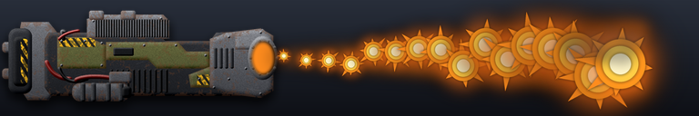](weapon-images/weapon_flamethrower.png) | Heavy long range AoE flamethrower | Flamethrower | Air+Ground | 450 | 0.1 s | 25 | corfship_dmaw | LMB | flamethrower | 2 | 250 |
| Cortex | Brimstone | corfship | 2 |  | Missiles | Missile | Air | 710 | 2.0 s | 138 (air) | corfship_aamissile | RMB | missile-medium | 2 | 69 |
| Cortex | Brute | corraid | 1 |  | LightCannon | Cannon | Air+Ground | 350 | 1.2 s | 97 | corraid_arm_lightcannon | LMB | cannon-light | 1 | 81 |
| Cortex | Buccaneer | corcrus | 1 |  | HighEnergyLaser | Beam laser | Air+Ground | 500 | 1.1 s | 200 | corcrus_cor_crus | RMB | laser-medium | 2 | 182 |
| Cortex | Buccaneer | corcrus | 2 |  | L2DeckLaser | Beam laser | Air+Ground | 430 | 0.3 s | 75 | corcrus_adv_decklaser | LMB | laser-medium | 2 | 250 |
| Cortex | Buccaneer | corcrus | 3 |  | Medium depthcharge launcher | Torpedo | All | 450 | 1.8 s | 225 | corcrus_advdepthcharge | MMB | depth-charge | 2 | 125 |
| Cortex | Bulwark | cordoom | 1 |  | Long-range g2g tachyon accelerator | Beam laser | Ground | 950 | 6.0 s | 4500 | cordoom_atadr | MMB | laser-ultra | 2 | 750 |
| Cortex | Bulwark | cordoom | 2 |  | High energy g2g laser | Beam laser | Ground | 650 | 0.5 s | 247 | cordoom_doomsday_green_laser | RMB | laser-medium | 2 | 494 |
| Cortex | Bulwark | cordoom | 3 |  | Light close-quarters g2g laser | Beam laser | Ground | 370 | 0.3 s | 40 | cordoom_doomsday_red_laser | LMB | laser-medium | 2 | 133 |
| Cortex | Calamity | corbuzz | 1 |  | Rapid-fire long-range plasma cannon | Plasma | Air+Ground | 6100 | 0.7 s | 2000 | corbuzz_rflrpc | LMB | plasma-ultra | 2 | 2857 |
| Cortex | Catalyst | cortron | 1 |  | Long range tactical g2g nuclear warheads | Starburst missile | Ground | 2250 | 2.0 s | 4000 | cortron_cortron_weapon | LMB | nuclear | 2 | 2000 |
| Cortex | Cataphract | corsok | 1 |  | Disruptor Bolt | Laser | Air+Ground | 725 | 4.5 s | 750 | corsok_corsok_laser | LMB | laser-heavy | 3 | 167 |
| Cortex | Cataphract | corsok | 2 |  | Depthcharge launcher | Torpedo | All | 400 | 2.0 s | 225 | corsok_depthcharge | RMB | depth-charge | 3 | 112 |
| Cortex | Catapult | corcat | 1 |  | CatapultRockets | Missile | Air+Ground | 1350 | 15.0 s | 450 | corcat_exp_heavyrocket | LMB | missile-medium | 3 | 30 |
| Cortex | Cayman | corsnap | 1 |  | MediumPlasmaCannon | Plasma | Air+Ground | 370 | 1.4 s | 98 | corsnap_armanac_weapon | LMB | plasma-light | 1 | 70 |
| Cortex | Cerberus | corbhmth | 1 |  | Heavy g2g barrage plasma battery | Plasma | Ground | 1650 | 4.2 s | 450 | corbhmth_corbhmth_weapon | LMB | plasma-medium | 2 | 107 |
| Cortex | Cerberus | corbhmth | 2 |  | Heavy g2g barrage plasma battery | Plasma | Ground | 1650 | 4.2 s | 450 | corbhmth_corbhmth_weapon | LMB | plasma-medium | 2 | 107 |
| Cortex | Cerberus | corbhmth | 3 |  | Heavy g2g barrage plasma battery | Plasma | Ground | 1650 | 4.2 s | 450 | corbhmth_corbhmth_weapon | LMB | plasma-medium | 2 | 107 |
| Cortex | Commander | cordecom | 1 |  | J7Laser | Beam laser | Air+Ground | 300 | 0.4 s | 75 | cordecom_armcomlaser | MMB | laser-medium | 2 | 188 |
| Cortex | Commander | cordecom | 2 |  | J7NSLaser | Beam laser | All | 260 | 1.0 s | 63 | cordecom_armcomsealaser | LMB | laser-light | 2 | 63 |
| Cortex | Commander | cordecom | 3 |  | Disintegrator | D-gun | All | 262 | 0.9 s | 40 | cordecom_disintegrator | RMB | d-gun | 2 | 44 |
| Cortex | Commando | cormando | 1 |  | CommandoBlaster | Laser | Air+Ground | 300 | 0.5 s | 100 | cormando_commando_blaster | LMB | laser-medium | 2 | 200 |
| Cortex | Coral | corfhlt | 1 |  | High energy g2g laser | Beam laser | Ground | 630 | 1.0 s | 231 | corfhlt_corfhlt_laser | LMB | laser-light | 1 | 231 |
| Cortex | Cortex Commander | corcom | 1 |  | J7Laser | Beam laser | Air+Ground | 300 | 0.4 s | 75 | corcom_corcomlaser | LMB | laser-light | 1 | 188 |
| Cortex | Cortex Commander | corcom | 2 |  | J7NSLaser | Beam laser | All | 300 | 1.0 s | 200 | corcom_corcomsealaser | MMB | laser-light | 1 | 200 |
| Cortex | Cortex Commander | corcom | 3 |  | Disintegrator | D-gun | All | 262 | 0.9 s | 99999 | corcom_disintegrator | RMB | d-gun | 1 | 111110 |
| Cortex | Cortex Commander | corcomcon | 1 |  | J7Laser | Beam laser | Air+Ground | 300 | 0.4 s | 75 | corcomcon_corcomlaser | LMB | laser-light | 1 | 188 |
| Cortex | Cortex Commander | corcomcon | 2 |  | J7NSLaser | Beam laser | All | 300 | 1.0 s | 200 | corcomcon_corcomsealaser | MMB | laser-light | 1 | 200 |
| Cortex | Cortex Commander | corcomcon | 3 |  | Disintegrator | D-gun | All | 250 | 0.9 s | 99999 | corcomcon_disintegrator | RMB | d-gun | 1 | 111110 |
| Cortex | Cortex Commander Level 10 | corcomlvl10 | 1 |  | Long range AoE flamethrower | Flamethrower | Air+Ground | 475 | 0.4 s | 120 | corcomlvl10_corcomlaser | LMB | flamethrower | 1 | 300 |
| Cortex | Cortex Commander Level 10 | corcomlvl10 | 2 |  | UWSupernovaBeam | Beam laser | All | 500 | 0.4 s | 1400 | corcomlvl10_corcomsealaser | MMB | laser-ultra | 1 | 3500 |
| Cortex | Cortex Commander Level 10 | corcomlvl10 | 3 |  | Disintegrator | D-gun | All | 250 | 0.9 s | 99999 | corcomlvl10_disintegrator | RMB | d-gun | 1 | 111110 |
| Cortex | Cortex Commander Level 10 | corcomlvl10 | 4 | not shown | PlasmaRepulsor | Shield |  | 100 | 1.0 s | 0 | corcomlvl10_repulsor |  |  | 1 |  |
| Cortex | Cortex Commander Level 10 | corcomlvl10 | 5 |  | EyeLaser | Beam laser | Air+Ground | 870 | 0.0 s | 80 | corcomlvl10_corcomeyelaser | MMB | laser-medium | 1 | 800 |
| Cortex | Cortex Commander Level 10 | corcomlvl10 | 6 | [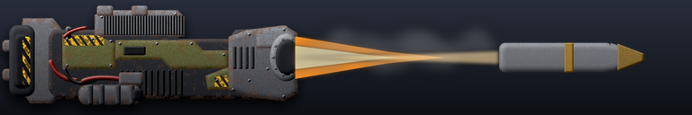](weapon-images/weapon_cannon-ultra.png) | HeavyCannon | Cannon | Air+Ground | 750 | 3.0 s | 2000 | corcomlvl10_armcannon | MMB | cannon-ultra | 1 | 667 |
| Cortex | Cortex Commander Level 10 | cordecomlvl10 | 1 |  | Long range AoE flamethrower | Flamethrower | Air+Ground | 475 | 0.4 s | 120 | cordecomlvl10_corcomlaser | LMB | flamethrower | 1 | 300 |
| Cortex | Cortex Commander Level 10 | cordecomlvl10 | 2 |  | UWSupernovaBeam | Beam laser | All | 500 | 0.4 s | 1400 | cordecomlvl10_corcomsealaser | MMB | laser-ultra | 1 | 3500 |
| Cortex | Cortex Commander Level 10 | cordecomlvl10 | 3 |  | Disintegrator | D-gun | All | 250 | 0.9 s | 40 | cordecomlvl10_disintegrator | RMB | d-gun | 1 | 44 |
| Cortex | Cortex Commander Level 10 | cordecomlvl10 | 4 | not shown | PlasmaRepulsor | Shield |  | 100 | 1.0 s | 0 | cordecomlvl10_repulsor |  |  | 1 |  |
| Cortex | Cortex Commander Level 10 | cordecomlvl10 | 5 |  | EyeLaser | Beam laser | Air+Ground | 870 | 0.0 s | 80 | cordecomlvl10_corcomeyelaser | MMB | laser-medium | 1 | 800 |
| Cortex | Cortex Commander Level 10 | cordecomlvl10 | 6 |  | HeavyCannon | Cannon | Air+Ground | 750 | 3.0 s | 2000 | cordecomlvl10_armcannon | MMB | cannon-ultra | 1 | 667 |
| Cortex | Cortex Commander Level 2 | corcomlvl2 | 1 |  | HighEnergyLaser | Beam laser | Air+Ground | 300 | 0.5 s | 215 | corcomlvl2_corcomlaser | LMB | laser-light | 1 | 430 |
| Cortex | Cortex Commander Level 2 | corcomlvl2 | 2 |  | J7NSLaser | Beam laser | All | 300 | 0.5 s | 200 | corcomlvl2_corcomsealaser | MMB | laser-light | 1 | 400 |
| Cortex | Cortex Commander Level 2 | corcomlvl2 | 3 |  | Disintegrator | D-gun | All | 250 | 0.9 s | 99999 | corcomlvl2_disintegrator | RMB | d-gun | 1 | 111110 |
| Cortex | Cortex Commander Level 2 | corcomlvl2 | 4 | not shown | PlasmaRepulsor | Shield |  | 100 | 1.0 s | 0 | corcomlvl2_repulsor |  |  | 1 |  |
| Cortex | Cortex Commander Level 2 | cordecomlvl2 | 1 |  | HighEnergyLaser | Beam laser | Air+Ground | 300 | 0.5 s | 215 | cordecomlvl2_corcomlaser | LMB | laser-light | 1 | 430 |
| Cortex | Cortex Commander Level 2 | cordecomlvl2 | 2 |  | J7NSLaser | Beam laser | All | 300 | 0.5 s | 200 | cordecomlvl2_corcomsealaser | MMB | laser-light | 1 | 400 |
| Cortex | Cortex Commander Level 2 | cordecomlvl2 | 3 |  | Disintegrator | D-gun | All | 250 | 0.9 s | 40 | cordecomlvl2_disintegrator | RMB | d-gun | 1 | 44 |
| Cortex | Cortex Commander Level 2 | cordecomlvl2 | 4 | not shown | PlasmaRepulsor | Shield |  | 100 | 1.0 s | 0 | cordecomlvl2_repulsor |  |  | 1 |  |
| Cortex | Cortex Commander Level 3 | corcomlvl3 | 1 |  | HighEnergyLaser | Beam laser | Air+Ground | 350 | 0.4 s | 380 | corcomlvl3_corcomlaser | LMB | laser-medium | 1 | 950 |
| Cortex | Cortex Commander Level 3 | corcomlvl3 | 2 |  | J7NSLaser | Beam laser | All | 450 | 0.4 s | 300 | corcomlvl3_corcomsealaser | MMB | laser-medium | 1 | 750 |
| Cortex | Cortex Commander Level 3 | corcomlvl3 | 3 |  | Disintegrator | D-gun | All | 250 | 0.9 s | 99999 | corcomlvl3_disintegrator | RMB | d-gun | 1 | 111110 |
| Cortex | Cortex Commander Level 3 | corcomlvl3 | 4 | not shown | PlasmaRepulsor | Shield |  | 100 | 1.0 s | 0 | corcomlvl3_repulsor |  |  | 1 |  |
| Cortex | Cortex Commander Level 3 | corcomlvl3 | 5 |  | Eye laser | Beam laser | Air+Ground | 435 | 0.5 s | 75 | corcomlvl3_corcomeyelaser | MMB | laser-light | 1 | 150 |
| Cortex | Cortex Commander Level 3 | cordecomlvl3 | 1 |  | HighEnergyLaser | Beam laser | Air+Ground | 350 | 0.4 s | 380 | cordecomlvl3_corcomlaser | LMB | laser-medium | 1 | 950 |
| Cortex | Cortex Commander Level 3 | cordecomlvl3 | 2 |  | J7NSLaser | Beam laser | All | 450 | 0.4 s | 300 | cordecomlvl3_corcomsealaser | MMB | laser-medium | 1 | 750 |
| Cortex | Cortex Commander Level 3 | cordecomlvl3 | 3 |  | Disintegrator | D-gun | All | 250 | 0.9 s | 40 | cordecomlvl3_disintegrator | RMB | d-gun | 1 | 44 |
| Cortex | Cortex Commander Level 3 | cordecomlvl3 | 4 | not shown | PlasmaRepulsor | Shield |  | 100 | 1.0 s | 0 | cordecomlvl3_repulsor |  |  | 1 |  |
| Cortex | Cortex Commander Level 3 | cordecomlvl3 | 5 |  | Eye laser | Beam laser | Air+Ground | 435 | 0.5 s | 75 | cordecomlvl3_corcomeyelaser | MMB | laser-light | 1 | 150 |
| Cortex | Cortex Commander Level 4 | corcomlvl4 | 1 |  | HighEnergyLaser | Beam laser | Air+Ground | 350 | 0.3 s | 550 | corcomlvl4_corcomlaser | LMB | laser-ultra | 1 | 1833 |
| Cortex | Cortex Commander Level 4 | corcomlvl4 | 2 |  | J7NSLaser | Beam laser | All | 450 | 0.4 s | 400 | corcomlvl4_corcomsealaser | MMB | laser-medium | 1 | 1000 |
| Cortex | Cortex Commander Level 4 | corcomlvl4 | 3 |  | Disintegrator | D-gun | All | 250 | 0.9 s | 99999 | corcomlvl4_disintegrator | RMB | d-gun | 1 | 111110 |
| Cortex | Cortex Commander Level 4 | corcomlvl4 | 4 | not shown | PlasmaRepulsor | Shield |  | 100 | 1.0 s | 0 | corcomlvl4_repulsor |  |  | 1 |  |
| Cortex | Cortex Commander Level 4 | corcomlvl4 | 5 |  | Eye laser | Beam laser | Air+Ground | 550 | 0.3 s | 85 | corcomlvl4_corcomeyelaser | MMB | laser-light | 1 | 283 |
| Cortex | Cortex Commander Level 4 | corcomlvl4 | 6 |  | HeavyCannon | Cannon | Air+Ground | 500 | 3.0 s | 450 | corcomlvl4_armcannon | MMB | cannon-light | 1 | 150 |
| Cortex | Cortex Commander Level 4 | cordecomlvl4 | 1 |  | HighEnergyLaser | Beam laser | Air+Ground | 350 | 0.3 s | 550 | cordecomlvl4_corcomlaser | LMB | laser-ultra | 1 | 1833 |
| Cortex | Cortex Commander Level 4 | cordecomlvl4 | 2 |  | J7NSLaser | Beam laser | All | 450 | 0.4 s | 400 | cordecomlvl4_corcomsealaser | MMB | laser-medium | 1 | 1000 |
| Cortex | Cortex Commander Level 4 | cordecomlvl4 | 3 |  | Disintegrator | D-gun | All | 250 | 0.9 s | 40 | cordecomlvl4_disintegrator | RMB | d-gun | 1 | 44 |
| Cortex | Cortex Commander Level 4 | cordecomlvl4 | 4 | not shown | PlasmaRepulsor | Shield |  | 100 | 1.0 s | 0 | cordecomlvl4_repulsor |  |  | 1 |  |
| Cortex | Cortex Commander Level 4 | cordecomlvl4 | 5 |  | Eye laser | Beam laser | Air+Ground | 550 | 0.3 s | 85 | cordecomlvl4_corcomeyelaser | MMB | laser-light | 1 | 283 |
| Cortex | Cortex Commander Level 4 | cordecomlvl4 | 6 |  | HeavyCannon | Cannon | Air+Ground | 500 | 3.0 s | 450 | cordecomlvl4_armcannon | MMB | cannon-light | 1 | 150 |
| Cortex | Cortex Commander Level 5 | corcomlvl5 | 1 |  | Anti-swarm AoE flamethrower | Flamethrower | Air+Ground | 400 | 1.1 s | 90 | corcomlvl5_corcomlaser | LMB | flamethrower | 1 | 82 |
| Cortex | Cortex Commander Level 5 | corcomlvl5 | 2 |  | UltravioletRayBeam | Beam laser | All | 475 | 0.9 s | 1200 | corcomlvl5_corcomsealaser | MMB | laser-medium | 1 | 1333 |
| Cortex | Cortex Commander Level 5 | corcomlvl5 | 3 |  | Disintegrator | D-gun | All | 250 | 0.9 s | 99999 | corcomlvl5_disintegrator | RMB | d-gun | 1 | 111110 |
| Cortex | Cortex Commander Level 5 | corcomlvl5 | 4 | not shown | PlasmaRepulsor | Shield |  | 100 | 1.0 s | 0 | corcomlvl5_repulsor |  |  | 1 |  |
| Cortex | Cortex Commander Level 5 | corcomlvl5 | 5 |  | Eye laser | Beam laser | Air+Ground | 620 | 0.2 s | 120 | corcomlvl5_corcomeyelaser | MMB | laser-light | 1 | 600 |
| Cortex | Cortex Commander Level 5 | corcomlvl5 | 6 |  | HeavyCannon | Cannon | Air+Ground | 600 | 3.0 s | 450 | corcomlvl5_armcannon | MMB | cannon-light | 1 | 150 |
| Cortex | Cortex Commander Level 5 | cordecomlvl5 | 1 |  | Anti-swarm AoE flamethrower | Flamethrower | Air+Ground | 400 | 1.1 s | 90 | cordecomlvl5_corcomlaser | LMB | flamethrower | 1 | 82 |
| Cortex | Cortex Commander Level 5 | cordecomlvl5 | 2 |  | UltravioletRayBeam | Beam laser | All | 475 | 0.9 s | 1200 | cordecomlvl5_corcomsealaser | MMB | laser-medium | 1 | 1333 |
| Cortex | Cortex Commander Level 5 | cordecomlvl5 | 3 |  | Disintegrator | D-gun | All | 250 | 0.9 s | 40 | cordecomlvl5_disintegrator | RMB | d-gun | 1 | 44 |
| Cortex | Cortex Commander Level 5 | cordecomlvl5 | 4 | not shown | PlasmaRepulsor | Shield |  | 100 | 1.0 s | 0 | cordecomlvl5_repulsor |  |  | 1 |  |
| Cortex | Cortex Commander Level 5 | cordecomlvl5 | 5 |  | Eye laser | Beam laser | Air+Ground | 620 | 0.2 s | 120 | cordecomlvl5_corcomeyelaser | MMB | laser-light | 1 | 600 |
| Cortex | Cortex Commander Level 5 | cordecomlvl5 | 6 |  | HeavyCannon | Cannon | Air+Ground | 600 | 3.0 s | 450 | cordecomlvl5_armcannon | MMB | cannon-light | 1 | 150 |
| Cortex | Cortex Commander Level 6 | corcomlvl6 | 1 |  | Anti-swarm AoE flamethrower | Flamethrower | Air+Ground | 400 | 0.9 s | 90 | corcomlvl6_corcomlaser | LMB | flamethrower | 1 | 100 |
| Cortex | Cortex Commander Level 6 | corcomlvl6 | 2 |  | UltravioletRayBeam | Beam laser | All | 475 | 0.7 s | 1200 | corcomlvl6_corcomsealaser | MMB | laser-ultra | 1 | 1714 |
| Cortex | Cortex Commander Level 6 | corcomlvl6 | 3 |  | Disintegrator | D-gun | All | 250 | 0.9 s | 99999 | corcomlvl6_disintegrator | RMB | d-gun | 1 | 111110 |
| Cortex | Cortex Commander Level 6 | corcomlvl6 | 4 | not shown | PlasmaRepulsor | Shield |  | 100 | 1.0 s | 0 | corcomlvl6_repulsor |  |  | 1 |  |
| Cortex | Cortex Commander Level 6 | corcomlvl6 | 5 |  | EyeLaser | Beam laser | Air+Ground | 730 | 0.0 s | 26 | corcomlvl6_corcomeyelaser | MMB | laser-light | 1 | 260 |
| Cortex | Cortex Commander Level 6 | corcomlvl6 | 6 |  | HeavyCannon | Cannon | Air+Ground | 600 | 3.0 s | 675 | corcomlvl6_armcannon | MMB | cannon-light | 1 | 225 |
| Cortex | Cortex Commander Level 6 | cordecomlvl6 | 1 |  | Anti-swarm AoE flamethrower | Flamethrower | Air+Ground | 400 | 0.9 s | 90 | cordecomlvl6_corcomlaser | LMB | flamethrower | 1 | 100 |
| Cortex | Cortex Commander Level 6 | cordecomlvl6 | 2 |  | UltravioletRayBeam | Beam laser | All | 475 | 0.7 s | 1200 | cordecomlvl6_corcomsealaser | MMB | laser-ultra | 1 | 1714 |
| Cortex | Cortex Commander Level 6 | cordecomlvl6 | 3 |  | Disintegrator | D-gun | All | 250 | 0.9 s | 40 | cordecomlvl6_disintegrator | RMB | d-gun | 1 | 44 |
| Cortex | Cortex Commander Level 6 | cordecomlvl6 | 4 | not shown | PlasmaRepulsor | Shield |  | 100 | 1.0 s | 0 | cordecomlvl6_repulsor |  |  | 1 |  |
| Cortex | Cortex Commander Level 6 | cordecomlvl6 | 5 |  | EyeLaser | Beam laser | Air+Ground | 730 | 0.0 s | 26 | cordecomlvl6_corcomeyelaser | MMB | laser-light | 1 | 260 |
| Cortex | Cortex Commander Level 6 | cordecomlvl6 | 6 |  | HeavyCannon | Cannon | Air+Ground | 600 | 3.0 s | 675 | cordecomlvl6_armcannon | MMB | cannon-light | 1 | 225 |
| Cortex | Cortex Commander Level 7 | corcomlvl7 | 1 |  | Anti-swarm AoE flamethrower | Flamethrower | Air+Ground | 400 | 0.8 s | 90 | corcomlvl7_corcomlaser | LMB | flamethrower | 1 | 112 |
| Cortex | Cortex Commander Level 7 | corcomlvl7 | 2 |  | UltravioletRayBeam | Beam laser | All | 500 | 0.5 s | 1200 | corcomlvl7_corcomsealaser | MMB | laser-ultra | 1 | 2400 |
| Cortex | Cortex Commander Level 7 | corcomlvl7 | 3 |  | Disintegrator | D-gun | All | 250 | 0.9 s | 99999 | corcomlvl7_disintegrator | RMB | d-gun | 1 | 111110 |
| Cortex | Cortex Commander Level 7 | corcomlvl7 | 4 | not shown | PlasmaRepulsor | Shield |  | 100 | 1.0 s | 0 | corcomlvl7_repulsor |  |  | 1 |  |
| Cortex | Cortex Commander Level 7 | corcomlvl7 | 5 |  | EyeLaser | Beam laser | Air+Ground | 730 | 0.0 s | 34 | corcomlvl7_corcomeyelaser | MMB | laser-light | 1 | 340 |
| Cortex | Cortex Commander Level 7 | corcomlvl7 | 6 |  | HeavyCannon | Cannon | Air+Ground | 700 | 3.0 s | 900 | corcomlvl7_armcannon | MMB | cannon-medium | 1 | 300 |
| Cortex | Cortex Commander Level 7 | cordecomlvl7 | 1 |  | Anti-swarm AoE flamethrower | Flamethrower | Air+Ground | 400 | 0.8 s | 90 | cordecomlvl7_corcomlaser | LMB | flamethrower | 1 | 112 |
| Cortex | Cortex Commander Level 7 | cordecomlvl7 | 2 |  | UltravioletRayBeam | Beam laser | All | 500 | 0.5 s | 1200 | cordecomlvl7_corcomsealaser | MMB | laser-ultra | 1 | 2400 |
| Cortex | Cortex Commander Level 7 | cordecomlvl7 | 3 |  | Disintegrator | D-gun | All | 250 | 0.9 s | 40 | cordecomlvl7_disintegrator | RMB | d-gun | 1 | 44 |
| Cortex | Cortex Commander Level 7 | cordecomlvl7 | 4 | not shown | PlasmaRepulsor | Shield |  | 100 | 1.0 s | 0 | cordecomlvl7_repulsor |  |  | 1 |  |
| Cortex | Cortex Commander Level 7 | cordecomlvl7 | 5 |  | EyeLaser | Beam laser | Air+Ground | 730 | 0.0 s | 34 | cordecomlvl7_corcomeyelaser | MMB | laser-light | 1 | 340 |
| Cortex | Cortex Commander Level 7 | cordecomlvl7 | 6 |  | HeavyCannon | Cannon | Air+Ground | 700 | 3.0 s | 900 | cordecomlvl7_armcannon | MMB | cannon-medium | 1 | 300 |
| Cortex | Cortex Commander Level 8 | corcomlvl8 | 1 |  | Long range AoE flamethrower | Flamethrower | Air+Ground | 475 | 0.4 s | 80 | corcomlvl8_corcomlaser | LMB | flamethrower | 1 | 200 |
| Cortex | Cortex Commander Level 8 | corcomlvl8 | 2 |  | UWSupernovaBeam | Beam laser | All | 500 | 0.5 s | 1400 | corcomlvl8_corcomsealaser | MMB | laser-ultra | 1 | 2800 |
| Cortex | Cortex Commander Level 8 | corcomlvl8 | 3 |  | Disintegrator | D-gun | All | 250 | 0.9 s | 99999 | corcomlvl8_disintegrator | RMB | d-gun | 1 | 111110 |
| Cortex | Cortex Commander Level 8 | corcomlvl8 | 4 | not shown | PlasmaRepulsor | Shield |  | 100 | 1.0 s | 0 | corcomlvl8_repulsor |  |  | 1 |  |
| Cortex | Cortex Commander Level 8 | corcomlvl8 | 5 |  | EyeLaser | Beam laser | Air+Ground | 800 | 0.0 s | 42 | corcomlvl8_corcomeyelaser | MMB | laser-light | 1 | 420 |
| Cortex | Cortex Commander Level 8 | corcomlvl8 | 6 |  | HeavyCannon | Cannon | Air+Ground | 700 | 3.0 s | 1050 | corcomlvl8_armcannon | MMB | cannon-medium | 1 | 350 |
| Cortex | Cortex Commander Level 8 | cordecomlvl8 | 1 |  | Long range AoE flamethrower | Flamethrower | Air+Ground | 475 | 0.4 s | 80 | cordecomlvl8_corcomlaser | LMB | flamethrower | 1 | 200 |
| Cortex | Cortex Commander Level 8 | cordecomlvl8 | 2 |  | UWSupernovaBeam | Beam laser | All | 500 | 0.5 s | 1400 | cordecomlvl8_corcomsealaser | MMB | laser-ultra | 1 | 2800 |
| Cortex | Cortex Commander Level 8 | cordecomlvl8 | 3 |  | Disintegrator | D-gun | All | 250 | 0.9 s | 40 | cordecomlvl8_disintegrator | RMB | d-gun | 1 | 44 |
| Cortex | Cortex Commander Level 8 | cordecomlvl8 | 4 | not shown | PlasmaRepulsor | Shield |  | 100 | 1.0 s | 0 | cordecomlvl8_repulsor |  |  | 1 |  |
| Cortex | Cortex Commander Level 8 | cordecomlvl8 | 5 |  | EyeLaser | Beam laser | Air+Ground | 800 | 0.0 s | 42 | cordecomlvl8_corcomeyelaser | MMB | laser-light | 1 | 420 |
| Cortex | Cortex Commander Level 8 | cordecomlvl8 | 6 |  | HeavyCannon | Cannon | Air+Ground | 700 | 3.0 s | 1050 | cordecomlvl8_armcannon | MMB | cannon-medium | 1 | 350 |
| Cortex | Cortex Commander Level 9 | corcomlvl9 | 1 |  | Long range AoE flamethrower | Flamethrower | Air+Ground | 475 | 0.4 s | 96 | corcomlvl9_corcomlaser | LMB | flamethrower | 1 | 240 |
| Cortex | Cortex Commander Level 9 | corcomlvl9 | 2 |  | UWSupernovaBeam | Beam laser | All | 500 | 0.4 s | 1400 | corcomlvl9_corcomsealaser | MMB | laser-ultra | 1 | 3500 |
| Cortex | Cortex Commander Level 9 | corcomlvl9 | 3 |  | Disintegrator | D-gun | All | 250 | 0.9 s | 99999 | corcomlvl9_disintegrator | RMB | d-gun | 1 | 111110 |
| Cortex | Cortex Commander Level 9 | corcomlvl9 | 4 | not shown | PlasmaRepulsor | Shield |  | 100 | 1.0 s | 0 | corcomlvl9_repulsor |  |  | 1 |  |
| Cortex | Cortex Commander Level 9 | corcomlvl9 | 5 |  | EyeLaser | Beam laser | Air+Ground | 870 | 0.0 s | 58 | corcomlvl9_corcomeyelaser | MMB | laser-light | 1 | 580 |
| Cortex | Cortex Commander Level 9 | corcomlvl9 | 6 |  | HeavyCannon | Cannon | Air+Ground | 750 | 3.0 s | 1350 | corcomlvl9_armcannon | MMB | cannon-medium | 1 | 450 |
| Cortex | Cortex Commander Level 9 | cordecomlvl9 | 1 |  | Long range AoE flamethrower | Flamethrower | Air+Ground | 475 | 0.4 s | 96 | cordecomlvl9_corcomlaser | LMB | flamethrower | 1 | 240 |
| Cortex | Cortex Commander Level 9 | cordecomlvl9 | 2 |  | UWSupernovaBeam | Beam laser | All | 500 | 0.4 s | 1400 | cordecomlvl9_corcomsealaser | MMB | laser-ultra | 1 | 3500 |
| Cortex | Cortex Commander Level 9 | cordecomlvl9 | 3 |  | Disintegrator | D-gun | All | 250 | 0.9 s | 40 | cordecomlvl9_disintegrator | RMB | d-gun | 1 | 44 |
| Cortex | Cortex Commander Level 9 | cordecomlvl9 | 4 | not shown | PlasmaRepulsor | Shield |  | 100 | 1.0 s | 0 | cordecomlvl9_repulsor |  |  | 1 |  |
| Cortex | Cortex Commander Level 9 | cordecomlvl9 | 5 |  | EyeLaser | Beam laser | Air+Ground | 870 | 0.0 s | 58 | cordecomlvl9_corcomeyelaser | MMB | laser-light | 1 | 580 |
| Cortex | Cortex Commander Level 9 | cordecomlvl9 | 6 |  | HeavyCannon | Cannon | Air+Ground | 750 | 3.0 s | 1350 | cordecomlvl9_armcannon | MMB | cannon-medium | 1 | 450 |
| Cortex | Cutlass | corcut | 1 |  | RiotCannon | Cannon | Air+Ground | 430 | 1.3 s | 47 | corcut_vtol_rocket2 | LMB | cannon-light | 1 | 36 |
| Cortex | Cyclops | cornavaldefturret | 1 |  | Heavy Plasma Blast Cannon | Plasma | Air+Ground | 720 | 3.0 s | 495 | cornavaldefturret_t1_heavy_plasma_cannon | LMB | plasma-light | 1 | 165 |
| Cortex | Dam Buster | corsb | 1 |  | CorSeaAdvancedBombs | Bomb | Air+Ground | 1280 | 8.0 s | 50 | corsb_cor_seaadvbomb | LMB | bomb | 1 | 6 |
| Cortex | Deadeye | cordeadeye | 1 |  | HeavyBlaster | Laser | Air+Ground | 850 | 12.0 s | 834 | cordeadeye_cor_burst_laser | LMB | laser-light | 2 | 70 |
| Cortex | Demon | cordemon | 1 |  | Demon's Maw, Heavy long range AoE flamethrower | Flamethrower | Air+Ground | 500 | 0.4 s | 48 | cordemon_newdmaw | LMB | flamethrower | 3 | 120 |
| Cortex | Demon | cordemon | 2 |  | ShoulderRockets | Missile | Air | 700 | 0.6 s | 100 | cordemon_karg_shoulder | RMB | missile-heavy | 3 | 167 |
| Cortex | Depth Charge Drone | cortdrone | 1 |  | Depthcharge launcher | Torpedo | All | 200 | 6.0 s | 255 | cortdrone_cotd_depthcharge | LMB | depth-charge | 1 | 42 |
| Cortex | Desolator | cordesolator | 1 |  | Torpedo launcher | Torpedo | All | 750 | 8.0 s | 850 | cordesolator_waterballon | LMB | torpedo | 2 | 106 |
| Cortex | Desolator | cordesolator | 2 |  | Intercontinental thermonuclear ballistic missile | Starburst missile | All | 72000 | 30.0 s | 15000 | cordesolator_crblmssl | RMB | nuclear | 2 | 500 |
| Cortex | Desolator | cordesolator | 3 | not shown | Nuclear Launch | Cannon |  | 0 | 30.0 s | 0 | cordesolator_nuclear_launch |  |  | 2 |  |
| Cortex | Despot | corbats | 1 |  | BattleshipCannon | Cannon | Air+Ground | 950 | 4.0 s | 450 | corbats_cor_bats | RMB | cannon-medium | 2 | 112 |
| Cortex | Despot | corbats | 2 |  | BattleshipCannon | Cannon | Air+Ground | 950 | 4.0 s | 450 | corbats_cor_bats | RMB | cannon-medium | 2 | 112 |
| Cortex | Despot | corbats | 3 |  | BattleshipCannon | Cannon | Air+Ground | 950 | 4.0 s | 450 | corbats_cor_bats | RMB | cannon-medium | 2 | 112 |
| Cortex | Despot | corbats | 4 |  | HighEnergyLaser | Beam laser | Air+Ground | 700 | 0.9 s | 300 | corbats_cor_batslaser | LMB | laser-medium | 2 | 333 |
| Cortex | Devastator | corfdoom | 1 |  | Medium-range g2g plasma cannon | Plasma | Ground | 900 | 2.1 s | 420 | corfdoom_cortoast_gun | MMB | plasma-medium | 2 | 200 |
| Cortex | Devastator | corfdoom | 2 |  | High energy g2g laser | Beam laser | Ground | 630 | 1.0 s | 231 | corfdoom_doomsday_green_laser | RMB | laser-medium | 2 | 231 |
| Cortex | Devastator | corfdoom | 3 |  | Light close-quarters g2g laser | Beam laser | Ground | 370 | 0.3 s | 40 | corfdoom_doomsday_red_laser | LMB | laser-medium | 2 | 133 |
| Cortex | Disgruntler | cords | 1 |  | AK Bomb | Bomb | Air+Ground | 1280 | 10.0 s | 100 | cords_corbomb | LMB | bomb | 1 | 10 |
| Cortex | Disperser | cordronecarry | 1 | not shown | HeavyCannon | Cannon |  | 1300 | 2.5 s | 0 | cordronecarry_plasma |  |  | 2 |  |
| Cortex | Disperser | cordronecarry | 2 |  | Missiles | Missile | Air | 710 | 2.0 s | 138 (air) | cordronecarry_aamissile | LMB | missile-medium | 2 | 69 |
| Cortex | Disperser Omni | cordronecarryair | 1 | not shown | HeavyCannon | Cannon |  | 1200 | 2.5 s | 0 | cordronecarryair_plasma |  |  | 3 |  |
| Cortex | Dragon | corcrwh | 1 |  | Dragon's Maw: heavy medium range AoE flamethrower | Flamethrower | Air+Ground | 450 | 0.4 s | 6 | corcrwh_dragonmawh | LMB | flamethrower | 2 | 15 |
| Cortex | Dragon | corcrwh | 2 |  | Advanced d2a rapid missile launcher | Missile | Air | 840 | 0.8 s | 76 (air) | corcrwh_dragon_missileh | MMB | missile-medium | 2 | 95 |
| Cortex | Dragon | corcrwh | 3 |  | HighEnergyLaser | Beam laser | Air+Ground | 575 | 0.8 s | 90 | corcrwh_krowlaserh | RMB | laser-medium | 2 | 112 |
| Cortex | Dragon | corcrwh | 4 |  | HighEnergyLaser | Beam laser | Air+Ground | 575 | 0.8 s | 90 | corcrwh_krowlaserh | RMB | laser-medium | 2 | 112 |
| Cortex | Dragon | corcrwh | 5 |  | HighEnergyLaser | Beam laser | Air+Ground | 575 | 0.8 s | 90 | corcrwh_krowlaserh | RMB | laser-medium | 2 | 112 |
| Cortex | Dragon | corcrwh | 6 |  | HighEnergyLaser | Beam laser | Air+Ground | 575 | 0.8 s | 90 | corcrwh_krowlaserh | RMB | laser-medium | 2 | 112 |
| Cortex | Dragon's Maw | cormaw | 1 |  | Pop-up anti-swarm AoE flamethrower | Flamethrower | Air+Ground | 410 | 1.1 s | 22 | cormaw_dmaw | LMB | flamethrower | 1 | 20 |
| Cortex | Dragon's Rage | cormwall | 1 |  | CatapultRockets | Missile | Air+Ground | 675 | 15.0 s | 450 | cormwall_exp_heavyrocket | LMB | missile-light | 2 | 30 |
| Cortex | Duck | coramph | 1 |  | Torpedo | Torpedo | All | 400 | 6.0 s | 250 | coramph_coramph_weapon1 | RMB | torpedo | 2 | 42 |
| Cortex | Duck | coramph | 2 |  | HighEnergyLaser | Beam laser | Air+Ground | 300 | 1.1 s | 150 | coramph_coramph_weapon2 | LMB | laser-medium | 2 | 136 |
| Cortex | Epic Bulwark | cordoomt3 | 1 |  | Armageddon Heat Ray | Beam laser | Air+Ground | 1350 | 4.0 s | 7500 | cordoomt3_armagmheat | MMB | heatray | 3 | 1875 |
| Cortex | Epic Bulwark | cordoomt3 | 2 |  | Long-range g2g tachyon accelerator | Beam laser | Ground | 950 | 6.0 s | 4500 | cordoomt3_armageddon_blue_laser | RMB | laser-ultra | 3 | 750 |
| Cortex | Epic Bulwark | cordoomt3 | 3 |  | High energy g2g laser | Beam laser | Ground | 650 | 0.2 s | 247 | cordoomt3_armageddon_green_laser | LMB | laser-heavy | 3 | 1235 |
| Cortex | Epic Commander - Final Boss | corcomboss | 1 |  | J8Laser | Beam laser | Air+Ground | 1250 | 0.0 s | 200 | corcomboss_corcomlaserboss | LMB | laser-ultra | 4 | 2000 |
| Cortex | Epic Commander - Final Boss | corcomboss | 2 |  | J8NSLaser | Beam laser | All | 1250 | 0.0 s | 200 | corcomboss_corcomsealaserboss | MMB | laser-ultra | 4 | 2000 |
| Cortex | Epic Commander - Final Boss | corcomboss | 3 |  | Darkmatter Photon-Disruptor | D-gun | Air+Ground | 750 | 5.0 s | 999999 | corcomboss_disintegratorxl | RMB | d-gun | 4 | 200000 |
| Cortex | Epic Commando | cormandot4 | 1 |  | Close-quarters EMP Scattergun | Beam laser | Air+Ground | 250 | 2.2 s | 2000 | cormandot4_commando_stunner | LMB | laser-heavy | 2 | 909 |
| Cortex | Epic Commando | cormandot4 | 2 |  | Disintegrator | D-gun | All | 250 | 0.9 s | 2400 | cormandot4_commando_back_cannon | RMB | d-gun | 2 | 2667 |
| Cortex | Epic Dragon | corcrwt4 | 1 |  | Demon's Maw, Heavy long range AoE flamethrower | Flamethrower | Air+Ground | 500 | 0.4 s | 40 | corcrwt4_kmaw | LMB | flamethrower | 3 | 100 |
| Cortex | Epic Dragon | corcrwt4 | 2 |  | Advanced Rapid-Fire Anti-Air Missile Launcher | Missile | Air | 840 | 0.4 s | 400 (air) | corcrwt4_edragon_missile | MMB | aa-missile | 3 | 1000 |
| Cortex | Epic Dragon | corcrwt4 | 3 |  | Ultra HighEnergyLaser | Beam laser | Air+Ground | 625 | 2.5 s | 2000 | corcrwt4_krowbosslaser | RMB | laser-ultra | 3 | 800 |
| Cortex | Epic Dragon | corcrwt4 | 4 |  | Ultra HighEnergyLaser | Beam laser | Air+Ground | 625 | 2.5 s | 2000 | corcrwt4_krowbosslaser | RMB | laser-ultra | 3 | 800 |
| Cortex | Epic Dragon | corcrwt4 | 5 |  | Ultra HighEnergyLaser | Beam laser | Air+Ground | 625 | 2.5 s | 2000 | corcrwt4_krowbosslaser | RMB | laser-ultra | 3 | 800 |
| Cortex | Epic Dragon | corcrwt4 | 6 |  | Ultra HighEnergyLaser | Beam laser | Air+Ground | 625 | 2.5 s | 2000 | corcrwt4_krowbosslaser | RMB | laser-ultra | 3 | 800 |
| Cortex | Epic Grunt | corakt4 | 1 |  | Laser | Beam laser | Air+Ground | 600 | 0.1 s | 100 | corakt4_gator_laser | LMB | laser-medium | 1 | 1000 |
| Cortex | Epic Karganeth | corkarganetht4 | 1 | [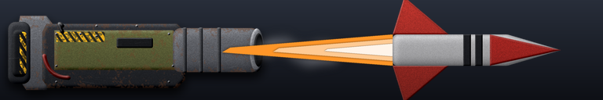](weapon-images/weapon_missile-ultra.png) | KarganethMissiles | Missile | Air+Ground | 750 | 0.4 s | 700 | corkarganetht4_super_missile | LMB | missile-ultra | 3 | 1750 |
| Cortex | Epic Karganeth | corkarganetht4 | 2 |  | ShoulderRockets | Missile | Air | 1050 | 10.0 s | 750 (air) | corkarganetht4_karg_shoulder | RMB | missile-heavy | 3 | 75 |
| Cortex | Epic Tzar | corgolt4 | 1 |  | Huge g2g plasma cannon | Plasma | Ground | 1000 | 4.5 s | 8000 | corgolt4_corlevlr_weapon | RMB | plasma-ultra | 3 | 1778 |
| Cortex | Epic Tzar | corgolt4 | 2 |  | HighEnergyLaser | Beam laser | Air+Ground | 475 | 0.8 s | 750 | corgolt4_corgol_sidelaser | LMB | laser-heavy | 3 | 938 |
| Cortex | Epic Tzar | corgolt4 | 3 |  | HighEnergyLaser | Beam laser | Air+Ground | 475 | 0.8 s | 750 | corgolt4_corgol_sidelaser | LMB | laser-heavy | 3 | 938 |
| Cortex | Eradicator | corerad | 1 |  | Long-range rapid-fire g2a missile launcher | Missile | Air | 1200 | 1.6 s | 250 (air) | corerad_cor_erad | LMB | rocket-salvo | 1 | 156 |
| Cortex | Exploiter | corexp | 1 |  | Light close-quarters g2g laser turret | Beam laser | Ground | 435 | 0.5 s | 75 | corexp_hllt_bottom | LMB | laser-light | 1 | 150 |
| Cortex | Fiend | corpyro | 1 |  | FlameThrower | Flamethrower | Air+Ground | 230 | 1.1 s | 17 | corpyro_flamethrower | LMB | flamethrower | 2 | 15 |
| Cortex | Flying Black Hydra | corfblackhyt4 | 1 |  | BattleshipCannon | Cannon | Air+Ground | 2550 | 5.5 s | 600 | corfblackhyt4_heavyplasma | RMB | cannon-heavy | 3 | 109 |
| Cortex | Flying Black Hydra | corfblackhyt4 | 2 |  | HighEnergyLaser | Beam laser | Air+Ground | 830 | 0.9 s | 270 | corfblackhyt4_heavylaser | LMB | laser-heavy | 3 | 300 |
| Cortex | Flying Black Hydra | corfblackhyt4 | 3 |  | Pop-up rapid-fire g2a missile launcher | Missile | Air | 840 | 1.7 s | 150 (air) | corfblackhyt4_ferret_missile | MMB | rocket-salvo | 3 | 88 |
| Cortex | Flying Black Hydra | corfblackhyt4 | 4 |  | HighEnergyLaser | Beam laser | Air+Ground | 830 | 0.9 s | 270 | corfblackhyt4_heavylaser | LMB | laser-heavy | 3 | 300 |
| Cortex | Flying Black Hydra | corfblackhyt4 | 5 |  | HighEnergyLaser | Beam laser | Air+Ground | 830 | 0.9 s | 270 | corfblackhyt4_heavylaser | LMB | laser-heavy | 3 | 300 |
| Cortex | Flying Black Hydra | corfblackhyt4 | 6 |  | Pop-up rapid-fire g2a missile launcher | Missile | Air | 840 | 1.7 s | 150 (air) | corfblackhyt4_ferret_missile | MMB | rocket-salvo | 3 | 88 |
| Cortex | Forge | corforge | 1 |  | FlameThrower | Flamethrower | Air+Ground | 410 | 1.1 s | 5 | corforge_flamethrower_ce | LMB | flamethrower | 2 | 5 |
| Cortex | Fury | corsent | 1 | not shown | Missiles | Cannon |  | 800 | 0.5 s | 0 | corsent_bogus_missile |  |  | 2 |  |
| Cortex | Fury | corsent | 2 |  | FlakCannon | Cannon | Air | 775 | 0.7 s | 200 (air) | corsent_mobileflak | LMB | flak | 2 | 286 |
| Cortex | Garpike | corgarp | 1 |  | PincerCannon | Cannon | Air+Ground | 305 | 1.5 s | 116 | corgarp_arm_pincer_gauss | LMB | cannon-light | 1 | 77 |
| Cortex | Goon | corsh | 1 |  | Light Close-Quarters Fast-Firing g2g Laser | Beam laser | Ground | 230 | 0.6 s | 36 | corsh_armsh_weapon | LMB | laser-light | 1 | 60 |
| Cortex | Grunt | corak | 1 |  | Laser | Beam laser | Air+Ground | 215 | 0.5 s | 37 | corak_gator_laser | LMB | laser-light | 1 | 74 |
| Cortex | Guard | corllt | 1 |  | Light g2g laser | Beam laser | Ground | 435 | 0.5 s | 75 | corllt_cor_lightlaser | LMB | laser-light | 1 | 150 |
| Cortex | Gun Platform | corgplat | 1 |  | Light g2g plasma cannon | Plasma | Ground | 520 | 0.5 s | 97 | corgplat_gun | LMB | plasma-light | 1 | 194 |
| Cortex | Hailstorm | corhurc | 1 |  | Heavy a2g incinerating warheads | Bomb | Ground | 1280 | 7.0 s | 333 | corhurc_coradvbomb | LMB | bomb | 2 | 48 |
| Cortex | Halberd | corhal | 1 |  | HighEnergyLaser | Beam laser | Air+Ground | 300 | 0.8 s | 275 | corhal_cor_canlaser | LMB | laser-light | 1 | 344 |
| Cortex | Heat Tiger | corftiger | 1 |  | HeatRay | Beam laser | Air+Ground | 410 | 0.7 s | 15 | corftiger_cor_tiger_laser | LMB | heatray | 2 | 21 |
| Cortex | Heavy Mine | corfmine3 | 1 | not shown | Crawlingbomb Dummy Weapon | Melee |  | 64 | 1.0 s | 0 | corfmine3_minerange |  |  | 1 |  |
| Cortex | Heavy Mine | cormine3 | 1 | not shown | Crawlingbomb Dummy Weapon | Melee |  | 64 | 1.0 s | 0 | cormine3_minerange |  |  | 1 |  |
| Cortex | Herring | corpt | 1 |  | Light g2a missile launcher | Missile | Air | 750 | 2.0 s | 120 (air) | corpt_cortruck_aa | RMB | missile-light | 1 | 60 |
| Cortex | Herring | corpt | 2 |  | Missiles | Missile | Air+Ground | 650 | 2.0 s | 47 | corpt_cortruck_missile | LMB | missile-light | 1 | 24 |
| Cortex | Incisor | corgator | 1 |  | Laser | Beam laser | Air+Ground | 230 | 0.8 s | 75 | corgator_gator_laserx | LMB | laser-light | 1 | 94 |
| Cortex | Janitor | corfrock | 1 |  | Advanced g2a rapid missile launcher | Missile | Air | 840 | 0.4 s | 76 (air) | corfrock_aamissile | LMB | missile-medium | 1 | 190 |
| Cortex | Jellyfish | cordl | 1 |  | Depthcharge launcher | Torpedo | All | 600 | 1.5 s | 225 | cordl_coax_depthcharge | LMB | depth-charge | 1 | 150 |
| Cortex | Juggernaut | corkorg | 1 |  | GaussCannon | Cannon | Air+Ground | 590 | 1.4 s | 165 | corkorg_corkorg_fire | LMB | gauss | 3 | 118 |
| Cortex | Juggernaut | corkorg | 2 |  | Experimental g2g Eradicator Heat Ray | Beam laser | Ground | 900 | 4.0 s | 5500 | corkorg_corkorg_laser | RMB | heatray | 3 | 1375 |
| Cortex | Juggernaut | corkorg | 3 |  | HeavyRockets | Starburst missile | Air+Ground | 950 | 6.0 s | 1000 | corkorg_corkorg_rocket | MMB | heavy-rocket | 3 | 167 |
| Cortex | Juggernaut | corkorg | 4 | not shown | KrogCrush | Cannon | Air+Ground | 55 | 0.2 s | 150 | corkorg_krogkick |  |  | 3 |  |
| Cortex | Juggernaut | corkorg | 5 | not shown | KrogCrush | Cannon | Air+Ground | 55 | 0.2 s | 150 | corkorg_krogkick |  |  | 3 |  |
| Cortex | Juggernaut | corkorg | 6 | not shown | KrogStep | Cannon |  | 0 | 1.5 s | 0 | corkorg_krogfootstep |  |  | 3 |  |
| Cortex | Juggernaut | corkorg | 7 | not shown | KrogAim | Cannon |  | 10 | 1.0 s | 0 | corkorg_krogweaponaim |  |  | 3 |  |
| Cortex | Juggernaut | corkorg | 8 | not shown | KrogRestore | Cannon |  | 10 | 1.0 s | 0 | corkorg_krogweaponrestore |  |  | 3 |  |
| Cortex | Juno | corjuno | 1 | not shown | Anti radar/minefield/jammer magnetic impulse rocket | Starburst missile |  | 32000 | 2.0 s | 0 | corjuno_juno_pulse |  |  | 1 |  |
| Cortex | Karganeth | corkarg | 1 |  | KarganethMissiles | Missile | Air+Ground | 600 | 0.3 s | 180 | corkarg_super_missile | LMB | missile-heavy | 3 | 600 |
| Cortex | Karganeth | corkarg | 2 |  | ShoulderRockets | Missile | Air | 700 | 0.6 s | 100 | corkarg_karg_shoulder | RMB | missile-heavy | 3 | 167 |
| Cortex | Kraken | corssub | 1 |  | AdvTorpedo | Torpedo | All | 850 | 8.0 s | 1650 | corssub_armserp_weapon | LMB | torpedo | 2 | 206 |
| Cortex | Lamprey | coratl | 1 |  | Long-range advanced torpedo launcher | Torpedo | All | 890 | 3.0 s | 1100 | coratl_coratl_torpedo | LMB | torpedo | 2 | 367 |
| Cortex | Laser Tiger | corgatreap | 1 |  | High energy g2g laser | Beam laser | Ground | 620 | 0.8 s | 261 | corgatreap_cor_laserh1 | LMB | laser-medium | 2 | 326 |
| Cortex | Lasher | cormist | 1 |  | Light g2a missile launcher | Missile | Air | 700 | 2.5 s | 120 (air) | cormist_cortruck_aa | RMB | missile-light | 1 | 48 |
| Cortex | Lasher | cormist | 2 |  | Light g2g missile launcher | Missile | Ground | 575 | 2.5 s | 63 | cormist_cortruck_missile | LMB | missile-light | 1 | 25 |
| Cortex | Leviathan | corslrpc | 1 |  | Heavy long range g2g AoE plasma cannon | Plasma | Ground | 4950 | 16.0 s | 2000 | corslrpc_cor_intimidator | LMB | plasma-heavy | 3 | 125 |
| Cortex | Light Mine | cormine1 | 1 | not shown | Crawlingbomb Dummy Weapon | Melee |  | 64 | 1.0 s | 0 | cormine1_minerange |  |  | 1 |  |
| Cortex | Mammoth | corsumo | 1 |  | HighEnergyLaser | Beam laser | Air+Ground | 650 | 0.6 s | 302 | corsumo_corsumo_weapon | LMB | laser-medium | 2 | 503 |
| Cortex | Mammoth | corsumo | 2 | not shown | Laserroar | Cannon |  | 10 | 1.0 s | 0 | corsumo_sumohvylaserroar |  |  | 2 |  |
| Cortex | Mangonel | cormh | 1 |  | Rocket | Starburst missile | Air+Ground | 700 | 9.0 s | 550 | cormh_cormh_weapon | LMB | heavy-rocket | 1 | 61 |
| Cortex | Manticore | coraak | 1 |  | Missiles | Missile | Air | 1300 | 1.4 s | 250 (air) | coraak_coraabot_missile1 | RMB | missile-heavy | 2 | 179 |
| Cortex | Manticore | coraak | 2 |  | Heavy g2a flak cannon | Cannon | Air | 775 | 5.5 s | 300 (air) | coraak_botflak | LMB | flak | 2 | 55 |
| Cortex | Medium Mine | cormine2 | 1 | not shown | Crawlingbomb Dummy Weapon | Melee |  | 64 | 1.0 s | 0 | cormine2_minerange |  |  | 1 |  |
| Cortex | Medium Mine | cormine4 | 1 | not shown | Crawlingbomb Dummy Weapon | Melee |  | 64 | 1.0 s | 0 | cormine4_minerange |  |  | 1 |  |
| Cortex | Messenger | cormship | 1 |  | Heavy long-range g2g starburst rocket launcher | Cannon | Ground | 1550 | 8.0 s | 1100 | cormship_rocket | LMB | heavy-rocket | 2 | 138 |
| Cortex | Messenger | cormship | 2 |  | Medium Range g2a AA Missiles | Missile | Air | 710 | 2.0 s | 138 (air) | cormship_missile | RMB | aa-missile | 2 | 69 |
| Cortex | Mini Calamity | corminibuzz | 1 |  | Mini Rapid-fire long-range plasma cannon | Plasma | Air+Ground | 1450 | 0.4 s | 210 | corminibuzz_corminibuzz_weapon | LMB | plasma-heavy | 2 | 525 |
| Cortex | Monsoon | corseap | 1 |  | Homing torpedo launcher | Torpedo | All | 600 | 4.0 s | 342 | corseap_armseap_weapon1 | LMB | torpedo | 1 | 86 |
| Cortex | Naval Birdshot | corenaa | 1 |  | Heavy g2a flak cannon | Cannon | Air | 850 | 0.5 s | 250 (air) | corenaa_armflak_gun | LMB | flak | 2 | 500 |
| Cortex | Negotiator | corvroc | 1 |  | Rocket | Starburst missile | Air+Ground | 1310 | 15.0 s | 1700 | corvroc_cortruck_rocket | LMB | heavy-rocket | 2 | 113 |
| Cortex | Nighthawk | corvamp | 1 |  | Guided a2a/a2g missile launcher | Missile | Air+Ground | 690 | 1.0 s | 24 | corvamp_corvtol_advmissile | LMB | missile-light | 2 | 24 |
| Cortex | Oasis | corantiship | 1 |  | ICBM intercepting missile launcher | Starburst missile | Air+Ground | 72000 | 2.0 s | 1500 | corantiship_amd_rocket |  | anti-nuke | 2 | 750 |
| Cortex | Oasis | corcarry | 1 |  | ICBM intercepting missile launcher | Starburst missile | Air+Ground | 72000 | 2.0 s | 1500 | corcarry_fmd_rocket |  | anti-nuke | 2 | 750 |
| Cortex | Obligator | corobligator | 1 |  | Long range missile battery | Missile | Air+Ground | 1145 | 3.0 s | 255 | corobligator_obligator_missile | RMB | missile-medium | 2 | 85 |
| Cortex | Obligator | corobligator | 2 |  | Heavy vertical rocket pod | Starburst missile | Air+Ground | 948 | 11.5 s | 671 | corobligator_obligator_rocket | LMB | heavy-rocket | 2 | 58 |
| Cortex | Onager | coronager | 1 |  | Medium long-range s2g missile launcher | Starburst missile | Ground | 600 | 9.0 s | 360 | coronager_stoa_missile | LMB | heavy-rocket | 2 | 40 |
| Cortex | Oppressor | corroy | 1 |  | HeavyCannon | Cannon | Air+Ground | 710 | 2.5 s | 385 | corroy_plasma | LMB | cannon-light | 1 | 154 |
| Cortex | Oppressor | corroy | 2 |  | Depthcharge launcher | Torpedo | All | 400 | 1.9 s | 225 | corroy_depthcharge | RMB | depth-charge | 1 | 118 |
| Cortex | Orca | corsub | 1 |  | Light torpedo launcher | Torpedo | All | 500 | 2.5 s | 342 | corsub_torpedo | LMB | torpedo | 1 | 137 |
| Cortex | Orthrus | coranavaldefturret | 1 |  | Disruptor Bolt | Laser | Air+Ground | 950 | 4.0 s | 900 | coranavaldefturret_cortex_medium_energy_blaster | RMB | laser-medium | 2 | 225 |
| Cortex | Orthrus | coranavaldefturret | 2 |  | Heavy Plasma Blast Cannon | Plasma | Air+Ground | 750 | 1.5 s | 525 | coranavaldefturret_t1_heavy_plasma_cannon | LMB | plasma-medium | 2 | 350 |
| Cortex | Overlord | corhltfus | 1 |  | High energy g2g laser | Beam laser | Ground | 630 | 0.7 s | 750 | corhltfus_corfhlt_laser | LMB | laser-heavy | 2 | 1071 |
| Cortex | Overseer | corgate | 1 | not shown | PlasmaRepulsor | Shield |  | 10 | 1.0 s | 0 | corgate_repulsor |  |  | 2 |  |
| Cortex | Persecutor | cortoast | 1 |  | Pop-up long-range heavy g2g plasma cannon | Plasma | Ground | 1390 | 2.1 s | 420 | cortoast_cortoast_gun | LMB | plasma-medium | 2 | 200 |
| Cortex | Persecutor | cortoast | 2 |  | Pop-up long-range heavy g2g plasma cannon | Plasma | Ground | 1390 | 2.1 s | 420 | cortoast_cortoast_gun_high | RMB | plasma-medium | 2 | 200 |
| Cortex | Persecutor | cortoast | 3 | not shown | Pop-up long-range heavy g2g plasma cannon | Plasma | Ground | 1390 | 2.1 s | 0 | cortoast_smart_trajectory_dummy |  |  | 2 |  |
| Cortex | Poison Arrow | corparrow | 1 |  | PoisonArrowCannon | Cannon | Air+Ground | 575 | 1.8 s | 370 | corparrow_cor_parrow | LMB | cannon-medium | 2 | 206 |
| Cortex | Pounder | corlevlr | 1 |  | RiotCannon | Cannon | Air+Ground | 315 | 1.8 s | 190 | corlevlr_corlevlr_weapon | LMB | cannon-light | 1 | 106 |
| Cortex | Predator | corshark | 1 |  | Rapid armor-piercing torpedoes | Torpedo | All | 400 | 2.2 s | 350 | corshark_armsmart_torpedo | LMB | torpedo | 2 | 159 |
| Cortex | Prevailer | corfmd | 1 |  | ICBM intercepting missile launcher | Starburst missile | Air+Ground | 72000 | 2.0 s | 1500 | corfmd_fmd_rocket |  | anti-nuke | 2 | 750 |
| Cortex | Quad Guard | corhllllt | 1 |  | Close-quarters light g2g laser | Beam laser | Ground | 475 | 0.2 s | 75 | corhllllt_hllt_1 | LMB | laser-medium | 2 | 375 |
| Cortex | Quad Guard | corhllllt | 2 |  | Close-quarters light g2g laser | Beam laser | Ground | 475 | 0.3 s | 75 | corhllllt_hllt_2 | RMB | laser-medium | 2 | 250 |
| Cortex | Quad Guard | corhllllt | 3 |  | Close-quarters light g2g laser | Beam laser | Ground | 475 | 0.4 s | 75 | corhllllt_hllt_3 | MMB | laser-medium | 2 | 188 |
| Cortex | Quad Guard | corhllllt | 4 |  | Close-quarters light g2g laser | Beam laser | Ground | 475 | 0.5 s | 75 | corhllllt_hllt_4 | MMB | laser-medium | 2 | 150 |
| Cortex | Quaker | cormart | 1 |  | PlasmaCannon | Plasma | Air+Ground | 800 | 5.0 s | 420 | cormart_cor_artillery | LMB | plasma-medium | 2 | 84 |
| Cortex | Rascal | corfav | 1 |  | Light Close-Quarters g2g Laser | Beam laser | Ground | 180 | 1.1 s | 35 | corfav_cor_laser | LMB | laser-light | 1 | 32 |
| Cortex | Riptide | corpship | 1 |  | LightCannon | Cannon | Air+Ground | 480 | 0.8 s | 96 | corpship_plasma | LMB | cannon-light | 1 | 120 |
| Cortex | Salamander | corsala | 1 |  | Medium g2g Heat Ray | Beam laser | Ground | 340 | 1.1 s | 18 | corsala_cor_heat_laser | LMB | heatray | 2 | 16 |
| Cortex | SAM | cormadsam | 1 |  | Advanced g2a rapid missile launcher | Missile | Air | 950 | 0.4 s | 90 (air) | cormadsam_madsam_missile | LMB | missile-medium | 1 | 225 |
| Cortex | Sanctuary | corgatet3 | 1 | not shown | PlasmaRepulsor | Shield |  | 825 | 1.0 s | 0 | corgatet3_repulsor |  |  | 3 |  |
| Cortex | Saviour | cormabm | 1 |  | ICBM intercepting missile launcher | Starburst missile | Air+Ground | 72000 | 2.0 s | 500 | cormabm_cormabm_weapon |  | anti-nuke | 2 | 250 |
| Cortex | Scorpion | corvipe | 1 |  | Heavy g2g sabot rocket launcher | Missile | Ground | 730 | 2.0 s | 825 | corvipe_vipersabot | LMB | missile-heavy | 2 | 412 |
| Cortex | Screamer | corscreamer | 1 |  | Long-range heavy g2a missile launcher | Missile | Air | 2400 | 1.8 s | 750 (air) | corscreamer_cor_advsam | LMB | missile-heavy | 2 | 417 |
| Cortex | Sentinel | corsentinel | 1 | not shown | Depth Charge Drones | Cannon | Water | 1300 | 2.5 s | 0 | corsentinel_plasma |  |  | 2 |  |
| Cortex | Sentinel | corsentinel | 2 |  | Depthcharge launcher | Torpedo | All | 600 | 1.5 s | 255 | corsentinel_sentinel_depthcharge | LMB | depth-charge | 2 | 170 |
| Cortex | Sheldon | cormort | 1 |  | PlasmaCannon | Plasma | Air+Ground | 850 | 1.6 s | 105 | cormort_cor_mort | LMB | plasma-medium | 2 | 66 |
| Cortex | Shiva | corshiva | 1 |  | HeavyCannon | Cannon | Air+Ground | 650 | 2.0 s | 600 | corshiva_shiva_gun | LMB | cannon-heavy | 3 | 300 |
| Cortex | Shiva | corshiva | 2 |  | HeavyRockets | Starburst missile | Air+Ground | 800 | 7.0 s | 750 | corshiva_shiva_rocket | RMB | heavy-rocket | 3 | 107 |
| Cortex | Shuriken | corbw | 1 |  | Light EMP laser | Beam laser | Air+Ground | 220 | 1.2 s | 600 | corbw_bladewing_lyzer | LMB | laser-light | 1 | 500 |
| Cortex | Siegebreaker | corsiegebreaker | 1 |  | Overcharged Dreadshot Ion Accelerator | Beam laser | Air+Ground | 910 | 8.0 s | 4000 | corsiegebreaker_dreadovercharge | LMB | laser-ultra | 2 | 500 |
| Cortex | Skuttle | corsktl | 1 | not shown | Crawlingbomb Dummy Weapon | Melee | Water | 42 | 0.1 s | 0 | corsktl_crawl_dummy |  |  | 2 |  |
| Cortex | Skuttle | corsktl | 2 | not shown | Mine Detonator | Cannon |  | 1 | 0.1 s | 0 | corsktl_crawl_detonator |  |  | 2 |  |
| Cortex | Slingshot | corfrt | 1 |  | Light g2a missile launcher | Missile | Air | 765 | 1.7 s | 115 (air) | corfrt_corrl_missile | LMB | missile-light | 1 | 68 |
| Cortex | Spectre | corspy | 1 | not shown | Dummy Weapon | Melee | Water | 100 | 0.1 s | 0 | corspy_crawl_dummy |  |  | 2 |  |
| Cortex | Sumo | corcan | 1 |  | HighEnergyLaser | Beam laser | Air+Ground | 275 | 0.8 s | 275 | corcan_cor_canlaser | LMB | laser-medium | 2 | 344 |
| Cortex | Sumo | corcan | 2 | not shown | Laserroar | Cannon |  | 10 | 1.0 s | 0 | corcan_canhvylaserroar |  |  | 2 |  |
| Cortex | Supporter | coresupp | 1 |  | LightLaser | Beam laser | Air+Ground | 280 | 0.9 s | 41 | coresupp_laser | LMB | laser-light | 1 | 46 |
| Cortex | Supporter | coresupp | 2 |  | LightLaser | Beam laser | Air+Ground | 280 | 0.9 s | 41 | coresupp_laser | LMB | laser-light | 1 | 46 |
| Cortex | Termite | cortermite | 1 |  | HeatRay | Beam laser | Air+Ground | 340 | 0.8 s | 265 | cortermite_cor_termite_laser | LMB | heatray | 2 | 331 |
| Cortex | Thermite | corthermite | 1 |  | Thermite Heatray | Beam laser | Air+Ground | 900 | 4.0 s | 2000 | corthermite_thermite_laser | RMB | heatray | 3 | 500 |
| Cortex | Thermite | corthermite | 2 |  | Thermite heavy medium range AoE flamethrower | Flamethrower | Air+Ground | 350 | 0.4 s | 30 | corthermite_tmaw | LMB | flamethrower | 3 | 75 |
| Cortex | Thistle | corrl | 1 |  | Light g2a missile launcher | Missile | Air | 765 | 1.7 s | 115 (air) | corrl_corrl_missile | LMB | missile-light | 1 | 68 |
| Cortex | Thug | corthud | 1 |  | PlasmaCannon | Plasma | Air+Ground | 380 | 1.7 s | 104 | corthud_arm_ham | LMB | plasma-light | 1 | 61 |
| Cortex | Tiger | correap | 1 |  | PlasmaCannon | Plasma | Air+Ground | 410 | 0.8 s | 120 | correap_cor_reap | LMB | plasma-medium | 2 | 150 |
| Cortex | Torch | cortorch | 1 |  | Flamethrower | Missile | Air+Ground | 280 | 0.7 s | 85 | cortorch_flame_thrower | LMB | missile-light | 1 | 121 |
| Cortex | Trapper | cormlv | 1 |  | Seismic charge | Cannon | Air+Ground | 220 | 3.0 s | 15 | cormlv_minesweep | LMB | cannon-light | 1 | 5 |
| Cortex | Trasher | corcrash | 1 |  | Missiles | Missile | Air | 760 | 2.0 s | 110 (air) | corcrash_corbot_missile | LMB | missile-light | 1 | 55 |
| Cortex | Tremor | cortrem | 1 | [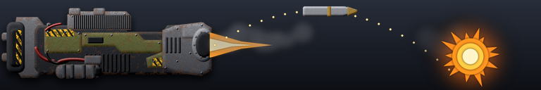](weapon-images/weapon_artillery.png) | RapidArtillery | Artillery | Air+Ground | 1470 | 0.5 s | 200 | cortrem_tremor_spread_fire | LMB | artillery | 2 | 400 |
| Cortex | Twin Guard | corhllt | 1 |  | Close-quarters light g2g laser | Beam laser | Ground | 490 | 0.5 s | 75 | corhllt_hllt_top | RMB | laser-light | 1 | 150 |
| Cortex | Twin Guard | corhllt | 2 |  | Close-quarters light g2g laser | Beam laser | Ground | 400 | 0.5 s | 75 | corhllt_hllt_bottom | LMB | laser-light | 1 | 150 |
| Cortex | Tzar | corgol | 1 |  | HeavyCannon | Cannon | Air+Ground | 650 | 3.5 s | 900 | corgol_cor_gol | LMB | cannon-heavy | 2 | 257 |
| Cortex | Urchin | cortl | 1 |  | Torpedo launcher | Torpedo | All | 500 | 1.5 s | 280 | cortl_torpedo | LMB | torpedo | 1 | 187 |
| Cortex | Valiant | corveng | 1 |  | Light guided a2a missile launcher | Missile | Air | 680 | 0.9 s | 12 | corveng_corvtol_missile | LMB | missile-light | 1 | 13 |
| Cortex | Vesuvius | corves | 1 |  | Huge g2g plasma cannon | Plasma | Ground | 1000 | 4.5 s | 8000 | corves_corlevlr_weapon | RMB | plasma-ultra | 3 | 1778 |
| Cortex | Vesuvius | corves | 2 |  | Banisher | Missile | Air+Ground | 800 | 7.5 s | 1000 | corves_banisher | MMB | missile-heavy | 3 | 133 |
| Cortex | Vesuvius | corves | 3 |  | Banisher | Missile | Air+Ground | 800 | 7.5 s | 1000 | corves_banisher | MMB | missile-heavy | 3 | 133 |
| Cortex | Vesuvius | corves | 4 |  | Demon's Maw, Heavy long range AoE flamethrower | Flamethrower | Air+Ground | 400 | 0.4 s | 48 | corves_flamethrower | LMB | flamethrower | 3 | 120 |
| Cortex | Warden | corhlt | 1 |  | High energy g2g laser | Beam laser | Ground | 620 | 1.2 s | 261 | corhlt_cor_laserh1 | LMB | laser-light | 1 | 218 |
| Cortex | Wasp | corape | 1 |  | Heavy a2g shrapnel rockets | Missile | Ground | 410 | 1.1 s | 122 | corape_vtol_rocket | LMB | missile-medium | 2 | 111 |
| Cortex | Whirlwind | corshad | 1 |  | Medium a2g incinerating warheads | Bomb | Ground | 1280 | 6.0 s | 112 | corshad_corbomb | LMB | bomb | 1 | 19 |
| Cortex | Wolverine | corwolv | 1 |  | LightArtillery | Artillery | Air+Ground | 710 | 7.1 s | 300 | corwolv_corwolv_gun | LMB | artillery | 1 | 42 |
| Legion | Aegis | legabm | 1 |  | ICBM intercepting missile launcher | Starburst missile | Air+Ground | 72000 | 2.0 s | 1500 | legabm_fmd_rocket |  | anti-nuke | 2 | 750 |
| Legion | Aesacus | legatorpbomber | 1 |  | Medium Homing Torpedo Launcher | Torpedo | All | 400 | 7.0 s | 750 | legatorpbomber_legair_torp | LMB | torpedo | 2 | 107 |
| Legion | Aesacus | legatorpbomber | 2 |  | Medium Homing Torpedo Launcher | Torpedo | All | 400 | 7.0 s | 750 | legatorpbomber_legair_torp | LMB | torpedo | 2 | 107 |
| Legion | Ajax | legafigdef | 1 |  | Heavy A2A Gatling Guns | Laser | Air | 600 | 1.0 s | 80 (air) | legafigdef_leggun | LMB | laser-light | 2 | 80 |
| Legion | Alaris | leghades | 1 | [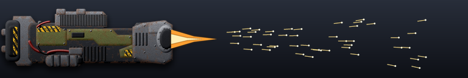](weapon-images/weapon_shotgun.png) | Dual-Feed Medium Shotgun | Laser | Air+Ground | 211 | 1.2 s | 10 | leghades_legion_shotgun | LMB | shotgun | 1 | 8 |
| Legion | Alpheus | legah | 1 |  | Light G2A Gatling Gun | Laser | Air | 700 | 0.4 s | 5 | legah_aagun | LMB | laser-light | 1 | 12 |
| Legion | Amputator | legcluster | 1 |  | Long-Range g2g Cluster Plasma Cannon | Plasma | Ground | 1000 | 6.0 s | 300 | legcluster_plasma | LMB | plasma-light | 1 | 50 |
| Legion | Amputator | legcluster | 2 |  | Long-Range g2g Cluster Plasma Cannon | Plasma | Ground | 1000 | 6.0 s | 300 | legcluster_plasma_high | RMB | plasma-light | 1 | 50 |
| Legion | Amputator | legcluster | 3 | not shown | Long-Range g2g Cluster Plasma Cannon | Plasma | Ground | 1000 | 4.0 s | 0 | legcluster_smart_trajectory_dummy |  |  | 1 |  |
| Legion | Apollyon | legapollyon | 1 | [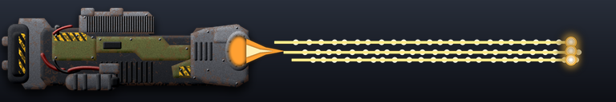](weapon-images/weapon_machine-gun-heavy.png) | Heavy rotary cannon | Laser | Air+Ground | 750 | 0.4 s | 50 | legapollyon_legapollyon_gatling_big | RMB | machine-gun-heavy | 3 | 125 |
| Legion | Apollyon | legapollyon | 2 |  | Heavy rotary cannon | Laser | Air+Ground | 750 | 0.4 s | 50 | legapollyon_legapollyon_gatling_big | RMB | machine-gun-heavy | 3 | 125 |
| Legion | Apollyon | legapollyon | 3 |  | Heavy rotary cannon | Laser | Air+Ground | 750 | 0.4 s | 50 | legapollyon_legapollyon_gatling_big | RMB | machine-gun-heavy | 3 | 125 |
| Legion | Apollyon | legapollyon | 4 |  | Heavy rotary cannon | Laser | Air+Ground | 750 | 0.4 s | 50 | legapollyon_legapollyon_gatling_big | RMB | machine-gun-heavy | 3 | 125 |
| Legion | Apollyon | legapollyon | 5 |  | Heavy rotary cannon | Laser | Air+Ground | 450 | 0.4 s | 20 | legapollyon_legapollyon_gatling_small | LMB | machine-gun-heavy | 3 | 50 |
| Legion | Apollyon | legapollyon | 6 |  | Heavy rotary cannon | Laser | Air+Ground | 450 | 0.4 s | 20 | legapollyon_legapollyon_gatling_small | LMB | machine-gun-heavy | 3 | 50 |
| Legion | Apollyon | legapollyon | 7 |  | Dual Rotary Microflak Cannons | Cannon | Air | 800 | 0.2 s | 58 (air) | legapollyon_legapollyon_gatling_aa | MMB | flak | 3 | 290 |
| Legion | Apollyon | legapollyon | 8 |  | Dual Rotary Microflak Cannons | Cannon | Air | 800 | 0.2 s | 58 (air) | legapollyon_legapollyon_gatling_aa | MMB | flak | 3 | 290 |
| Legion | Apollyon | legapollyon | 9 |  | CatapultRockets | Missile | Air+Ground | 1200 | 8.0 s | 465 | legapollyon_legapollyon_missile | MMB | missile-heavy | 3 | 58 |
| Legion | Apollyon | legapollyon | 10 |  | CatapultRockets | Missile | Air+Ground | 1200 | 8.0 s | 465 | legapollyon_legapollyon_missile | MMB | missile-heavy | 3 | 58 |
| Legion | Aquilon | legadvaabot | 1 |  | Rotary Microflak Cannon | Cannon | Air | 700 | 0.4 s | 40 (air) | legadvaabot_leg_t2_microflak_mobile | LMB | flak | 2 | 100 |
| Legion | Aquilon | legadvaabot | 2 |  | Light Anti-Air Railgun | Laser | Air | 1151 | 3.0 s | 225 (air) | legadvaabot_aa_railgun | RMB | railgun | 2 | 75 |
| Legion | Archaic Sol Invictus | legeheatraymech_old | 1 | not shown | Targeting System | Cannon |  | 750 | 2.5 s | 0 | legeheatraymech_old_aimhull |  |  | 3 |  |
| Legion | Archaic Sol Invictus | legeheatraymech_old | 2 |  | Experimental Thermal Ordnance Generators | Beam laser | Air+Ground | 800 | 0.0 s | 33 | legeheatraymech_old_heatray1 | LMB | laser-heavy | 3 | 330 |
| Legion | Archaic Sol Invictus | legeheatraymech_old | 3 |  | Experimental Thermal Ordnance Generators | Beam laser | Air+Ground | 800 | 0.0 s | 33 | legeheatraymech_old_heatray1 | LMB | laser-heavy | 3 | 330 |
| Legion | Archaic Sol Invictus | legeheatraymech_old | 4 |  | Experimental Thermal Ordnance Generators | Beam laser | Air+Ground | 800 | 0.0 s | 33 | legeheatraymech_old_heatray1 | LMB | laser-heavy | 3 | 330 |
| Legion | Archaic Sol Invictus | legeheatraymech_old | 5 |  | Experimental Thermal Ordnance Generators | Beam laser | Air+Ground | 800 | 0.0 s | 33 | legeheatraymech_old_heatray1 | LMB | laser-heavy | 3 | 330 |
| Legion | Archaic Sol Invictus | legeheatraymech_old | 6 |  | Anti-Air Flak Cannon | Cannon | Air | 700 | 0.9 s | 190 (air) | legeheatraymech_old_legflak_gun | RMB | flak | 3 | 211 |
| Legion | Archaic Sol Invictus | legeheatraymech_old | 7 | not shown | Footsteps | Cannon |  | 0 | 1.5 s | 0 | legeheatraymech_old_bigfootstep |  |  | 3 |  |
| Legion | Architeuthis | leganavybattlesub | 1 |  | Packhound Torpedo System | Torpedo | All | 600 | 2.5 s | 150 | leganavybattlesub_torpedo_swarm | LMB | torpedo | 2 | 60 |
| Legion | Argonaut | legnavyfrigate | 1 |  | Deck Torpedo Launcher | Torpedo | All | 460 | 1.3 s | 140 | legnavyfrigate_leg_torpedo_launcher | LMB | torpedo | 1 | 108 |
| Legion | Argonaut | legnavyfrigate | 2 |  | Deck Torpedo Launcher | Torpedo | All | 460 | 1.3 s | 140 | legnavyfrigate_leg_alt_torpedo_launcher | RMB | torpedo | 1 | 108 |
| Legion | Arquebus | legsrail | 1 |  | Railgun | Laser | Air+Ground | 850 | 7.0 s | 850 | legsrail_railgunt2 | LMB | railgun | 2 | 121 |
| Legion | Astraeus | legelrpcmech | 1 |  | Long-Range g2g Heavy Cluster Plasma Cannon | Plasma | Ground | 3100 | 14.4 s | 600 | legelrpcmech_shocker_low | LMB | plasma-medium | 3 | 42 |
| Legion | Astrapios | legspfighter | 1 |  | Light Salvo Missile Launcher | Missile | Air | 760 | 0.8 s | 37 (air) | legspfighter_leg_light_antiair_missile | LMB | rocket-salvo | 1 | 46 |
| Legion | Ballista | legbal | 1 |  | Rockets | Missile | Air+Ground | 460 | 5.5 s | 250 | legbal_leg_bot_rocket | LMB | missile-light | 1 | 45 |
| Legion | Barrage | legbar | 1 |  | Napalm Launcher | Cannon | Air+Ground | 535 | 5.0 s | 60 | legbar_clusternapalm | LMB | cannon-light | 1 | 12 |
| Legion | Bastion | legbastion | 1 |  | Heavy Sustained Sweepfire Heat Ray | Beam laser | Air+Ground | 1100 | 3.0 s | 155 | legbastion_t2heatray | LMB | heatray | 2 | 52 |
| Legion | Belcher | legbart | 1 |  | Heavy Napalm Launcher | Cannon | Air+Ground | 625 | 4.0 s | 60 | legbart_clusternapalm | LMB | cannon-light | 2 | 15 |
| Legion | Blindfold | legcib | 1 | not shown | Anti radar/minefield/jammer magnetic impulse bomb | Missile |  | 450 | 10.0 s | 0 | legcib_juno_pulse_mini |  |  | 1 |  |
| Legion | Bombardier | legbombard | 1 |  | Pop-up heavy g2g grenade launcher | Cannon | Ground | 750 | 3.0 s | 375 | legbombard_bombardier_weapon | LMB | cannon-medium | 2 | 125 |
| Legion | Boreas | legavroc | 1 |  | Heavy Long-Range g2g High-Trajectory Starburst Rocket Launcher | Starburst missile | Ground | 1300 | 18.0 s | 2000 | legavroc_armtruck_rocket | LMB | heavy-rocket | 2 | 111 |
| Legion | Bramble | legrl | 1 |  | Light g2a Missile Launcher | Missile | Air | 765 | 1.7 s | 115 (air) | legrl_legrl_missile | LMB | missile-light | 1 | 68 |
| Legion | Cacophony | legmg | 1 |  | Heavy Rapid-fire Machine Gun | Laser | Air+Ground | 575 | 0.4 s | 17 | legmg_armmg_weapon | LMB | machine-gun-light | 1 | 42 |
| Legion | Cardea | legcar | 1 |  | Medium Shotgun | Laser | Air+Ground | 321 | 2.0 s | 40 | legcar_shot | LMB | shotgun | 1 | 20 |
| Legion | Cetus | legamphtank | 1 |  | Light Close-quarters Gauss Cannon | Cannon | Air+Ground | 305 | 1.5 s | 116 | legamphtank_leg_amph_gauss | LMB | gauss | 1 | 77 |
| Legion | Charon | legvflak | 1 |  | Dual Rotary Microflak Cannons | Cannon | Air | 800 | 0.2 s | 40 (air) | legvflak_leg_t2_microflak_mobile | LMB | flak | 2 | 200 |
| Legion | Charybdis | legehovertank | 1 |  | Heavy Sweepfire Heatray | Beam laser | Air+Ground | 425 | 3.0 s | 25 | legehovertank_heat_ray | LMB | heatray | 3 | 8 |
| Legion | Charybdis | legehovertank | 2 |  | Depthcharge Launcher | Torpedo | All | 400 | 2.0 s | 225 | legehovertank_depthcharge | RMB | depth-charge | 3 | 112 |
| Legion | Charybdis | legehovertank | 3 |  | Parabolic Trajectory Multi-Rocket Launcher | Missile | Air+Ground | 500 | 6.0 s | 100 | legehovertank_parabolic_rockets | RMB | rocket-salvo | 3 | 17 |
| Legion | Charybdis | legehovertank | 4 |  | Parabolic Trajectory Multi-Rocket Launcher | Missile | Air+Ground | 500 | 6.0 s | 100 | legehovertank_parabolic_rockets | RMB | rocket-salvo | 3 | 17 |
| Legion | Chimera | legapopupdef | 1 |  | Heavy Riot Blast Cannon | Cannon | Air+Ground | 730 | 1.7 s | 280 | legapopupdef_advanced_riot_cannon | RMB | cannon-medium | 2 | 165 |
| Legion | Chimera | legapopupdef | 2 | [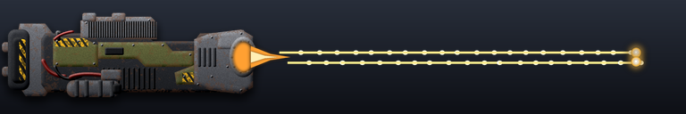](weapon-images/weapon_machine-gun-medium.png) | Dual Rotary Machine Guns | Laser | Air+Ground | 600 | 0.4 s | 10 | legapopupdef_standard_minigun | LMB | machine-gun-medium | 2 | 25 |
| Legion | Chimera | legapopupdef | 3 |  | Dual Rotary Machine Guns | Laser | Air+Ground | 600 | 0.4 s | 10 | legapopupdef_standard_minigun | LMB | machine-gun-medium | 2 | 25 |
| Legion | Cleaver | legamcluster | 1 |  | Long-range g2g plasma cannon | Plasma | Ground | 930 | 7.2 s | 300 | legamcluster_cluster_artillery | LMB | plasma-light | 2 | 42 |
| Legion | Combat Commander | legcomt2com | 1 |  | Rapid-fire a2g machine guns | Laser | Ground | 400 | 0.2 s | 20 | legcomt2com_armmg_weapon | RMB | machine-gun-medium | 1 | 100 |
| Legion | Combat Commander | legcomt2com | 2 |  | Level1TorpedoLauncher | Torpedo | All | 400 | 1.5 s | 250 | legcomt2com_torpedo | MMB | torpedo | 1 | 167 |
| Legion | Combat Commander | legcomt2com | 3 |  | EMP Grenade | EMP cannon | Air+Ground | 300 | 8.0 s | 10000 | legcomt2com_disintegrator | LMB | emp-grenade | 1 | 1250 |
| Legion | Combat Commander | legcomt2com | 4 |  | Pop-up rapid-fire g2a missile launcher | Missile | Air | 450 | 0.8 s | 150 (air) | legcomt2com_ferret_missile | MMB | rocket-salvo | 1 | 188 |
| Legion | Combat Commander | legcomt2com | 5 |  | Parabolic trajectory g2g multi-rocket launcher | Missile | Ground | 600 | 1.2 s | 200 | legcomt2com_adv_rocket | MMB | rocket-salvo | 1 | 167 |
| Legion | Corinth | leganavyartyship | 1 |  | Dual Quad-Barrelled Long-Range Cluster Plasma Cannon | Plasma | Air+Ground | 2100 | 8.4 s | 350 | leganavyartyship_leg_mobile_cluster_lrpc_cannon | RMB | plasma-light | 2 | 42 |
| Legion | Corinth | leganavyartyship | 2 |  | Heavy Artillery Cluster Plasma Cannon | Plasma | Air+Ground | 1600 | 2.8 s | 250 | leganavyartyship_leg_mobile_cluster_plasma | LMB | artillery | 2 | 89 |
| Legion | Corinth | leganavyartyship | 3 |  | Heavy Artillery Cluster Plasma Cannon | Plasma | Air+Ground | 1600 | 2.8 s | 250 | leganavyartyship_leg_mobile_cluster_plasma | LMB | artillery | 2 | 89 |
| Legion | Corinth | leganavyartyship | 4 |  | Heavy Artillery Cluster Plasma Cannon | Plasma | Air+Ground | 1600 | 2.8 s | 250 | leganavyartyship_leg_mobile_cluster_plasma | LMB | artillery | 2 | 89 |
| Legion | Daedalus | legerailtank | 1 |  | Siege Rail Accelerator | Laser | Air+Ground | 1000 | 3.0 s | 800 | legerailtank_t3_rail_accelerator | LMB | railgun | 3 | 267 |
| Legion | Daedalus | legerailtank | 2 |  | Siege Rail Accelerator | Laser | Air+Ground | 1000 | 3.0 s | 800 | legerailtank_t3_rail_accelerator | LMB | railgun | 3 | 267 |
| Legion | Daedalus | legerailtank | 3 |  | Siege Rail Accelerator | Laser | Air+Ground | 1000 | 3.0 s | 800 | legerailtank_t3_rail_accelerator | LMB | railgun | 3 | 267 |
| Legion | Decurion | leggat | 1 |  | Rapid-fire Machine Gun | Laser | Air+Ground | 361 | 0.4 s | 12 | leggat_armmg_weapon | LMB | machine-gun-light | 1 | 30 |
| Legion | Delphinus | leganavaltorpturret | 1 |  | Long-range advanced torpedo launcher | Torpedo | All | 890 | 3.0 s | 1100 | leganavaltorpturret_leganavaltorpturret_torpedo | LMB | torpedo | 2 | 367 |
| Legion | Dragon's Claw | legdtl | 1 |  | Close-quarters g2g lightning turret | Lightning | Ground | 440 | 1.1 s | 21 | legdtl_dclaw | LMB | lightning | 1 | 19 |
| Legion | Dragon's Constitution | legrwall | 1 |  | Compact Railgun | Laser | Air+Ground | 950 | 4.5 s | 1000 | legrwall_railgunt2 | LMB | railgun | 2 | 222 |
| Legion | Dragon's Jaw | legdtr | 1 |  | Area Control Riot Cannon | Cannon | Air+Ground | 400 | 2.0 s | 240 | legdtr_corlevlr_weapon | LMB | cannon-light | 1 | 120 |
| Legion | Dragon's Maw | legdtf | 1 |  | Pop-up anti-swarm AoE flamethrower | Flamethrower | Air+Ground | 410 | 1.1 s | 16 | legdtf_dmaw | LMB | flamethrower | 1 | 15 |
| Legion | Dragon's Tail | legdtm | 1 |  | Rocket | Starburst missile | Air+Ground | 500 | 5.0 s | 550 | legdtm_cormh_weapon | LMB | heavy-rocket | 1 | 110 |
| Legion | Economy Commander | legcomecon | 1 |  | RiotCannon | Cannon | Air+Ground | 280 | 2.4 s | 190 | legcomecon_corlevlr_weapon | LMB | cannon-light | 1 | 79 |
| Legion | Economy Commander | legcomecon | 2 |  | Level1TorpedoLauncher | Torpedo | All | 300 | 2.0 s | 250 | legcomecon_torpedo | MMB | torpedo | 1 | 125 |
| Legion | Economy Commander | legcomecon | 3 |  | EMP Grenade | EMP cannon | Air+Ground | 300 | 8.0 s | 10000 | legcomecon_disintegrator | RMB | emp-grenade | 1 | 1250 |
| Legion | Economy Commander | legcomecon | 4 |  | Pop-up rapid-fire g2a missile launcher | Missile | Air | 450 | 1.2 s | 150 (air) | legcomecon_ferret_missile | MMB | rocket-salvo | 1 | 125 |
| Legion | Eidolon | legaspy | 1 | not shown | coconut.jpg | Melee | Water | 100 | 0.1 s | 0 | legaspy_crawl_dummy |  |  | 2 |  |
| Legion | Elysium | leggatet3 | 1 | not shown | PlasmaRepulsor | Shield |  | 710 | 1.0 s | 0 | leggatet3_repulsor |  |  | 3 |  |
| Legion | Enyo | legspsurfacegunship | 1 |  | Area Control Riot Cannon | Cannon | Air+Ground | 400 | 3.5 s | 200 | legspsurfacegunship_leg_riot_cannon | LMB | cannon-light | 1 | 57 |
| Legion | Epic Arquebus | legsrailt4 | 1 |  | Railgun | Laser | Air+Ground | 1600 | 4.0 s | 6000 | legsrailt4_railgunt2 | LMB | railgun | 3 | 1500 |
| Legion | Epic Goblin | leggobt3 | 1 |  | Rapid-fire close quarters machine guns | Laser | Air+Ground | 475 | 0.6 s | 224 | leggobt3_semiauto | LMB | machine-gun-medium | 1 | 373 |
| Legion | Epic Mosquito | legmost3 | 1 |  | CatapultRockets | Missile | Air+Ground | 700 | 3.0 s | 200 | legmost3_exp_heavyrocket | LMB | missile-light | 1 | 67 |
| Legion | Epic Tyrannus | legfortt4 | 1 |  | PlasmaCannon | Plasma | Air+Ground | 1200 | 1.0 s | 480 | legfortt4_plasma | RMB | plasma-heavy | 3 | 480 |
| Legion | Epic Tyrannus | legfortt4 | 2 |  | PlasmaCannon | Plasma | Air+Ground | 1200 | 1.0 s | 480 | legfortt4_plasma | RMB | plasma-heavy | 3 | 480 |
| Legion | Epic Tyrannus | legfortt4 | 3 |  | scav rapid fire plasma gun | Laser | Air+Ground | 800 | 0.1 s | 50 | legfortt4_semiauto | LMB | plasma-heavy | 3 | 500 |
| Legion | Epic Tyrannus | legfortt4 | 4 |  | scav rapid fire plasma gun | Laser | Air+Ground | 800 | 0.1 s | 50 | legfortt4_semiauto | LMB | plasma-heavy | 3 | 500 |
| Legion | Epic Tyrannus | legfortt4 | 5 |  | scav rapid fire plasma gun | Laser | Air+Ground | 800 | 0.1 s | 50 | legfortt4_semiauto | LMB | plasma-heavy | 3 | 500 |
| Legion | Epic Tyrannus | legfortt4 | 6 |  | Advanced d2a rapid missile launcher | Starburst missile | Air | 1240 | 0.2 s | 154 (air) | legfortt4_aa_missiles | MMB | heavy-rocket | 3 | 770 |
| Legion | Euryale | legctl | 1 |  | Homing Torpedo Launcher | Torpedo | All | 600 | 1.5 s | 225 | legctl_torplauncher | LMB | torpedo | 1 | 150 |
| Legion | Eviscerator | legacluster | 1 |  | Pop-Up Long-range g2g Cluster Plasma Cannon | Plasma | Ground | 1380 | 3.5 s | 414 | legacluster_plasma | LMB | plasma-medium | 2 | 118 |
| Legion | Eviscerator | legacluster | 2 |  | Pop-Up Long-range g2g Cluster Plasma Cannon | Plasma | Ground | 1380 | 3.5 s | 414 | legacluster_plasma_high | RMB | plasma-medium | 2 | 118 |
| Legion | Eviscerator | legacluster | 3 | not shown | Pop-Up Long-range g2g Cluster Plasma Cannon | Plasma | Ground | 1380 | 2.6 s | 0 | legacluster_smart_trajectory_dummy |  |  | 2 |  |
| Legion | Fulmen | leganavalaaturret | 1 |  | Dual Rotary Microflak Cannons | Cannon | Air | 875 | 0.2 s | 58 (air) | leganavalaaturret_leg_t2_microflak | LMB | flak | 2 | 290 |
| Legion | Gelasma | legfmg | 1 |  | Rapid-Fire Gatling Gun | Laser | Air+Ground | 575 | 0.4 s | 18 | legfmg_gatling_gun | LMB | laser-light | 1 | 45 |
| Legion | Gladiator | legaskirmtank | 1 |  | Heavy Rotary Plasma Cannon | Plasma | Air+Ground | 600 | 2.0 s | 70 | legaskirmtank_legmgplasma | LMB | machine-gun-medium | 2 | 35 |
| Legion | Glaucus | legsh | 1 |  | Light Close-Quarters g2g Heat Ray | Beam laser | Ground | 260 | 1.0 s | 60 | legsh_heat_ray | LMB | heatray | 1 | 60 |
| Legion | Goblin | leggob | 1 |  | Rapid-fire a2g machine guns | Laser | Ground | 261 | 0.9 s | 12 | leggob_semiauto | LMB | machine-gun-light | 1 | 13 |
| Legion | Harbinger | legmineb | 1 | not shown | LegionMineBomb | Bomb |  | 1600 | 10.0 s | 0 | legmineb_cor_seaadvbomb |  |  | 2 |  |
| Legion | Heavy Mine | legmine3 | 1 | not shown | BOOM | Melee |  | 64 | 1.0 s | 0 | legmine3_minerange |  |  | 1 |  |
| Legion | Hecate | leganavyantinukecarrier | 1 | not shown | Multi-Drone Control Matrix | Cannon |  | 1300 | 2.5 s | 0 | leganavyantinukecarrier_leg_drone_controller |  |  | 2 |  |
| Legion | Hecate | leganavyantinukecarrier | 2 |  | ICBM intercepting missile launcher | Starburst missile | Air+Ground | 72000 | 2.0 s | 1500 | leganavyantinukecarrier_amd_rocket |  | anti-nuke | 2 | 750 |
| Legion | Hecatoncheir | legspcarrier | 1 | not shown | Drone Targeting System | Cannon |  | 1000 | 2.5 s | 0 | legspcarrier_leg_drone_controller |  |  | 1 |  |
| Legion | Helios | leghelios | 1 |  | Light g2g Heat Ray | Beam laser | Ground | 320 | 1.3 s | 135 | leghelios_heat_ray | LMB | heatray | 1 | 104 |
| Legion | Hera | legavantinuke | 1 |  | ICBM Interceptor Missile Launcher | Starburst missile | Air+Ground | 72000 | 2.0 s | 500 | legavantinuke_legavantinuke_weapon |  | anti-nuke | 2 | 250 |
| Legion | Hippocampus | legnavyscout | 1 |  | Twin Rapid-fire Machine Guns | Laser | Air+Ground | 351 | 0.4 s | 12 | legnavyscout_mg_guns | LMB | machine-gun-light | 1 | 30 |
| Legion | Hive | leghive | 1 | not shown | HeavyCannon | Cannon |  | 1100 | 2.5 s | 0 | leghive_plasma |  |  | 1 |  |
| Legion | Hoplite | legstr | 1 |  | Twin Rapid-fire Machine Guns | Laser | Air+Ground | 280 | 0.4 s | 8 | legstr_armmg_weapon | LMB | machine-gun-light | 2 | 20 |
| Legion | Iapetus | legnavyaaship | 1 |  | Advanced g2a Salvo Missile Launcher | Missile | Air | 760 | 0.6 s | 24 (air) | legnavyaaship_light_antiair_missile | LMB | rocket-salvo | 1 | 40 |
| Legion | Incinerator | leginc | 1 |  | Heavy g2g Sustained Heat Ray | Beam laser | Ground | 725 | 0.0 s | 33 | leginc_heatraylarge | LMB | heatray | 2 | 330 |
| Legion | Inferno | leginf | 1 |  | Heavy Burst-Fire Napalm Artillery Tri-Cannons | Artillery | Air+Ground | 1200 | 7.0 s | 60 | leginf_rapidnapalm | LMB | artillery | 2 | 9 |
| Legion | Infestor | leginfestor | 1 |  | Close-Quarters Light Heat Ray | Beam laser | Air+Ground | 300 | 1.0 s | 120 | leginfestor_festorbeam | LMB | heatray | 2 | 120 |
| Legion | Ionia | leganavaldefturret | 1 |  | Dual Rotary Heavy-Calibre Machine Guns | Laser | Air+Ground | 700 | 0.4 s | 24 | leganavaldefturret_legion_heavy_minigun | RMB | machine-gun-medium | 2 | 60 |
| Legion | Ionia | leganavaldefturret | 2 |  | Dual Heavy Assault Kinetic Shotgun | Laser | Air+Ground | 501 | 1.2 s | 30 | leganavaldefturret_advanced_shotgun | LMB | shotgun | 2 | 25 |
| Legion | Javelin | legjav | 1 |  | Twin Rapid-fire Machine Guns | Laser | Air+Ground | 450 | 0.4 s | 12 | legjav_mg_guns | LMB | machine-gun-heavy | 3 | 30 |
| Legion | Javelin | legjav | 2 |  | Light AA Rotary Gun | Laser | Air | 700 | 0.4 s | 10 (air) | legjav_aa_gun | RMB | machine-gun-heavy | 3 | 25 |
| Legion | Juno | legjuno | 1 | not shown | Anti-Radar/Jammer/Mine Electromagnetic Payload | Starburst missile |  | 32000 | 2.0 s | 0 | legjuno_juno_pulse |  |  | 1 |  |
| Legion | Karkinos | legkark | 1 |  | Light g2g Heat Ray | Beam laser | Ground | 360 | 1.8 s | 160 | legkark_heat_ray | RMB | heatray | 1 | 89 |
| Legion | Karkinos | legkark | 2 |  | Dual-Feed Medium Shotgun | Laser | Air+Ground | 251 | 2.0 s | 20 | legkark_legion_shotgun | LMB | shotgun | 1 | 10 |
| Legion | Keres | legkeres | 1 |  | Heavy riot cannon | Cannon | Air+Ground | 450 | 1.7 s | 400 | legkeres_legkeres_cannon | LMB | cannon-heavy | 3 | 235 |
| Legion | Keres | legkeres | 2 |  | Heavy rotary cannon | Laser | Air+Ground | 481 | 0.4 s | 10 | legkeres_legkeres_gatling | RMB | machine-gun-heavy | 3 | 25 |
| Legion | Keres | legkeres | 3 |  | Heavy rotary cannon | Laser | Air+Ground | 481 | 0.4 s | 10 | legkeres_legkeres_gatling | RMB | machine-gun-heavy | 3 | 25 |
| Legion | Ketea | legnavysub | 1 |  | Submerged Torpedo Launcher | Torpedo | All | 400 | 1.5 s | 140 | legnavysub_leg_torpedo_launcher | LMB | torpedo | 1 | 93 |
| Legion | Ladon | legsptorpgunship | 1 |  | VTOL Torpedo Launcher | Torpedo | All | 460 | 4.5 s | 140 | legsptorpgunship_leg_torpedo_launcher | LMB | torpedo | 1 | 31 |
| Legion | Lance | legrail | 1 |  | Railgun | Laser | Air+Ground | 650 | 7.5 s | 200 | legrail_railgun | LMB | railgun | 1 | 27 |
| Legion | Lance | legrail | 2 |  | Railgun | Laser | Air | 750 | 4.0 s | 300 (air) | legrail_aa_railgun | RMB | railgun | 1 | 75 |
| Legion | Legion Commander | legcom | 1 |  | Close-Quarters Heatray | Beam laser | Air+Ground | 300 | 0.8 s | 175 | legcom_legcomlaser | LMB | heatray | 1 | 219 |
| Legion | Legion Commander | legcom | 2 |  | Underwater Torpedo Launcher | Torpedo | All | 300 | 2.0 s | 250 | legcom_torpedo | MMB | torpedo | 1 | 125 |
| Legion | Legion Commander | legcom | 3 |  | Disintegrator | D-gun | All | 250 | 0.9 s | 99999 | legcom_disintegrator | RMB | d-gun | 1 | 111110 |
| Legion | Legion Commander | legcom | 4 |  | Anti-Air Missile Launcher | Missile | Air | 300 | 1.2 s | 150 (air) | legcom_aa_missile | MMB | aa-missile | 1 | 125 |
| Legion | Legion Commander | legdecom | 1 |  | Close-Quarters Heatray | Beam laser | Air+Ground | 300 | 0.8 s | 175 | legdecom_legcomlaser | LMB | heatray | 2 | 219 |
| Legion | Legion Commander | legdecom | 2 |  | Underwater Torpedo Launcher | Torpedo | All | 300 | 2.0 s | 250 | legdecom_torpedo | MMB | torpedo | 2 | 125 |
| Legion | Legion Commander | legdecom | 3 |  | Disintegrator | D-gun | All | 262 | 0.9 s | 40 | legdecom_disintegrator | RMB | d-gun | 2 | 44 |
| Legion | Legion Commander | legdecom | 4 |  | Anti-Air Missile Launcher | Missile | Air | 450 | 1.2 s | 150 (air) | legdecom_aa_missile | MMB | aa-missile | 2 | 125 |
| Legion | Legion Commander Level 10 | legcomlvl10 | 1 |  | Rapid-Fire Plasma Cannon | Plasma | Air+Ground | 500 | 0.3 s | 500 | legcomlvl10_armmg_weapon | LMB | plasma-ultra | 1 | 1667 |
| Legion | Legion Commander Level 10 | legcomlvl10 | 2 |  | MK-X Torpedo Launcher | Torpedo | All | 600 | 0.8 s | 400 | legcomlvl10_torpedo | MMB | torpedo | 1 | 500 |
| Legion | Legion Commander Level 10 | legcomlvl10 | 3 |  | Disintegrator | D-gun | All | 250 | 0.9 s | 99999 | legcomlvl10_disintegrator | RMB | d-gun | 1 | 111110 |
| Legion | Legion Commander Level 10 | legcomlvl10 | 4 |  | Railgun | Laser | Air+Ground | 950 | 2.0 s | 500 | legcomlvl10_railgunt2 | MMB | railgun | 1 | 250 |
| Legion | Legion Commander Level 10 | legcomlvl10 | 5 | not shown | Long range bot cannon | Cannon |  | 700 | 0.9 s | 0 | legcomlvl10_botcannon |  |  | 1 |  |
| Legion | Legion Commander Level 10 | legdecomlvl10 | 1 |  | Rapid-Fire Plasma Cannon | Plasma | Air+Ground | 500 | 0.3 s | 500 | legdecomlvl10_armmg_weapon | LMB | plasma-ultra | 1 | 1667 |
| Legion | Legion Commander Level 10 | legdecomlvl10 | 2 |  | MK-X Torpedo Launcher | Torpedo | All | 600 | 0.8 s | 400 | legdecomlvl10_torpedo | MMB | torpedo | 1 | 500 |
| Legion | Legion Commander Level 10 | legdecomlvl10 | 3 |  | Disintegrator | D-gun | All | 250 | 0.9 s | 40 | legdecomlvl10_disintegrator | RMB | d-gun | 1 | 44 |
| Legion | Legion Commander Level 10 | legdecomlvl10 | 4 |  | Railgun | Laser | Air+Ground | 950 | 2.0 s | 500 | legdecomlvl10_railgunt2 | MMB | railgun | 1 | 250 |
| Legion | Legion Commander Level 10 | legdecomlvl10 | 5 | not shown | Long range bot cannon | Cannon |  | 700 | 0.9 s | 0 | legdecomlvl10_botcannon |  |  | 1 |  |
| Legion | Legion Commander Level 2 | legcomlvl2 | 1 |  | Rapid-Fire Machine Gun | Laser | Air+Ground | 300 | 0.4 s | 25 | legcomlvl2_armmg_weapon | LMB | machine-gun-light | 1 | 62 |
| Legion | Legion Commander Level 2 | legcomlvl2 | 2 |  | MK-II Torpedo Launcher | Torpedo | All | 350 | 1.6 s | 250 | legcomlvl2_torpedo | MMB | torpedo | 1 | 156 |
| Legion | Legion Commander Level 2 | legcomlvl2 | 3 |  | Disintegrator | D-gun | All | 250 | 0.9 s | 99999 | legcomlvl2_disintegrator | RMB | d-gun | 1 | 111110 |
| Legion | Legion Commander Level 2 | legcomlvl2 | 4 |  | Anti-Air Missile Launcher | Missile | Air | 450 | 1.2 s | 150 (air) | legcomlvl2_aa_missile | MMB | aa-missile | 1 | 125 |
| Legion | Legion Commander Level 2 | legdecomlvl2 | 1 |  | Rapid-Fire Machine Gun | Laser | Air+Ground | 300 | 0.4 s | 25 | legdecomlvl2_armmg_weapon | LMB | machine-gun-light | 1 | 62 |
| Legion | Legion Commander Level 2 | legdecomlvl2 | 2 |  | MK-II Torpedo Launcher | Torpedo | All | 350 | 1.6 s | 250 | legdecomlvl2_torpedo | MMB | torpedo | 1 | 156 |
| Legion | Legion Commander Level 2 | legdecomlvl2 | 3 |  | Disintegrator | D-gun | All | 250 | 0.9 s | 40 | legdecomlvl2_disintegrator | RMB | d-gun | 1 | 44 |
| Legion | Legion Commander Level 2 | legdecomlvl2 | 4 |  | Anti-Air Missile Launcher | Missile | Air | 450 | 1.2 s | 150 (air) | legdecomlvl2_aa_missile | MMB | aa-missile | 1 | 125 |
| Legion | Legion Commander Level 3 | legcomlvl3 | 1 |  | Rapid-Fire Machine Gun | Laser | Air+Ground | 350 | 0.4 s | 30 | legcomlvl3_armmg_weapon | LMB | machine-gun-light | 1 | 75 |
| Legion | Legion Commander Level 3 | legcomlvl3 | 2 |  | MK-III Torpedo Launcher | Torpedo | All | 500 | 1.2 s | 250 | legcomlvl3_torpedo | MMB | torpedo | 1 | 208 |
| Legion | Legion Commander Level 3 | legcomlvl3 | 3 |  | Disintegrator | D-gun | All | 250 | 0.9 s | 99999 | legcomlvl3_disintegrator | RMB | d-gun | 1 | 111110 |
| Legion | Legion Commander Level 3 | legcomlvl3 | 4 |  | Anti-Air Missile Launcher | Missile | Air | 400 | 1.2 s | 150 (air) | legcomlvl3_aa_missile | MMB | aa-missile | 1 | 125 |
| Legion | Legion Commander Level 3 | legcomlvl3 | 5 | not shown | Long range bot cannon | Cannon |  | 400 | 0.9 s | 0 | legcomlvl3_botcannon |  |  | 1 |  |
| Legion | Legion Commander Level 3 | legdecomlvl3 | 1 |  | Rapid-Fire Machine Gun | Laser | Air+Ground | 350 | 0.4 s | 30 | legdecomlvl3_armmg_weapon | LMB | machine-gun-light | 1 | 75 |
| Legion | Legion Commander Level 3 | legdecomlvl3 | 2 |  | MK-III Torpedo Launcher | Torpedo | All | 500 | 1.2 s | 250 | legdecomlvl3_torpedo | MMB | torpedo | 1 | 208 |
| Legion | Legion Commander Level 3 | legdecomlvl3 | 3 |  | Disintegrator | D-gun | All | 250 | 0.9 s | 40 | legdecomlvl3_disintegrator | RMB | d-gun | 1 | 44 |
| Legion | Legion Commander Level 3 | legdecomlvl3 | 4 |  | Anti-Air Missile Launcher | Missile | Air | 400 | 1.2 s | 150 (air) | legdecomlvl3_aa_missile | MMB | aa-missile | 1 | 125 |
| Legion | Legion Commander Level 3 | legdecomlvl3 | 5 | not shown | Long range bot cannon | Cannon |  | 400 | 0.9 s | 0 | legdecomlvl3_botcannon |  |  | 1 |  |
| Legion | Legion Commander Level 4 | legcomlvl4 | 1 |  | Rapid-Fire Machine Gun | Laser | Air+Ground | 350 | 0.4 s | 40 | legcomlvl4_armmg_weapon | LMB | machine-gun-medium | 1 | 100 |
| Legion | Legion Commander Level 4 | legcomlvl4 | 2 |  | MK-IV Torpedo Launcher | Torpedo | All | 450 | 0.8 s | 250 | legcomlvl4_torpedo | MMB | torpedo | 1 | 312 |
| Legion | Legion Commander Level 4 | legcomlvl4 | 3 |  | Disintegrator | D-gun | All | 250 | 0.9 s | 99999 | legcomlvl4_disintegrator | RMB | d-gun | 1 | 111110 |
| Legion | Legion Commander Level 4 | legcomlvl4 | 4 |  | Railgun | Laser | Air+Ground | 550 | 2.7 s | 250 | legcomlvl4_railgunt2 | MMB | railgun | 1 | 93 |
| Legion | Legion Commander Level 4 | legcomlvl4 | 5 | not shown | Long range bot cannon | Cannon |  | 500 | 0.9 s | 0 | legcomlvl4_botcannon |  |  | 1 |  |
| Legion | Legion Commander Level 4 | legdecomlvl4 | 1 |  | Rapid-Fire Machine Gun | Laser | Air+Ground | 350 | 0.4 s | 40 | legdecomlvl4_armmg_weapon | LMB | machine-gun-medium | 1 | 100 |
| Legion | Legion Commander Level 4 | legdecomlvl4 | 2 |  | MK-IV Torpedo Launcher | Torpedo | All | 450 | 0.8 s | 250 | legdecomlvl4_torpedo | MMB | torpedo | 1 | 312 |
| Legion | Legion Commander Level 4 | legdecomlvl4 | 3 |  | Disintegrator | D-gun | All | 250 | 0.9 s | 40 | legdecomlvl4_disintegrator | RMB | d-gun | 1 | 44 |
| Legion | Legion Commander Level 4 | legdecomlvl4 | 4 |  | Railgun | Laser | Air+Ground | 550 | 2.7 s | 250 | legdecomlvl4_railgunt2 | MMB | railgun | 1 | 93 |
| Legion | Legion Commander Level 4 | legdecomlvl4 | 5 | not shown | Long range bot cannon | Cannon |  | 500 | 0.9 s | 0 | legdecomlvl4_botcannon |  |  | 1 |  |
| Legion | Legion Commander Level 5 | legcomlvl5 | 1 |  | Rapid-Fire Machine Gun | Laser | Air+Ground | 350 | 0.4 s | 50 | legcomlvl5_armmg_weapon | LMB | machine-gun-medium | 1 | 125 |
| Legion | Legion Commander Level 5 | legcomlvl5 | 2 |  | MK-V Torpedo Launcher | Torpedo | All | 500 | 0.8 s | 250 | legcomlvl5_torpedo | MMB | torpedo | 1 | 312 |
| Legion | Legion Commander Level 5 | legcomlvl5 | 3 |  | Disintegrator | D-gun | All | 250 | 0.9 s | 99999 | legcomlvl5_disintegrator | RMB | d-gun | 1 | 111110 |
| Legion | Legion Commander Level 5 | legcomlvl5 | 4 |  | Railgun | Laser | Air+Ground | 620 | 2.7 s | 250 | legcomlvl5_railgunt2 | MMB | railgun | 1 | 93 |
| Legion | Legion Commander Level 5 | legcomlvl5 | 5 | not shown | Long range bot cannon | Cannon |  | 600 | 0.9 s | 0 | legcomlvl5_botcannon |  |  | 1 |  |
| Legion | Legion Commander Level 5 | legdecomlvl5 | 1 |  | Rapid-Fire Machine Gun | Laser | Air+Ground | 350 | 0.4 s | 50 | legdecomlvl5_armmg_weapon | LMB | machine-gun-medium | 1 | 125 |
| Legion | Legion Commander Level 5 | legdecomlvl5 | 2 |  | MK-V Torpedo Launcher | Torpedo | All | 500 | 0.8 s | 250 | legdecomlvl5_torpedo | MMB | torpedo | 1 | 312 |
| Legion | Legion Commander Level 5 | legdecomlvl5 | 3 |  | Disintegrator | D-gun | All | 250 | 0.9 s | 40 | legdecomlvl5_disintegrator | RMB | d-gun | 1 | 44 |
| Legion | Legion Commander Level 5 | legdecomlvl5 | 4 |  | Railgun | Laser | Air+Ground | 620 | 2.7 s | 250 | legdecomlvl5_railgunt2 | MMB | railgun | 1 | 93 |
| Legion | Legion Commander Level 5 | legdecomlvl5 | 5 | not shown | Long range bot cannon | Cannon |  | 600 | 0.9 s | 0 | legdecomlvl5_botcannon |  |  | 1 |  |
| Legion | Legion Commander Level 6 | legcomlvl6 | 1 |  | Rapid-Fire Plasma Cannon | Plasma | Air+Ground | 425 | 0.3 s | 360 | legcomlvl6_armmg_weapon | LMB | plasma-medium | 1 | 1200 |
| Legion | Legion Commander Level 6 | legcomlvl6 | 2 |  | MK-VI Torpedo Launcher | Torpedo | All | 500 | 0.8 s | 300 | legcomlvl6_torpedo | MMB | torpedo | 1 | 375 |
| Legion | Legion Commander Level 6 | legcomlvl6 | 3 |  | Disintegrator | D-gun | All | 250 | 0.9 s | 99999 | legcomlvl6_disintegrator | RMB | d-gun | 1 | 111110 |
| Legion | Legion Commander Level 6 | legcomlvl6 | 4 |  | Railgun | Laser | Air+Ground | 730 | 2.7 s | 250 | legcomlvl6_railgunt2 | MMB | railgun | 1 | 93 |
| Legion | Legion Commander Level 6 | legcomlvl6 | 5 | not shown | Long range bot cannon | Cannon |  | 600 | 0.9 s | 0 | legcomlvl6_botcannon |  |  | 1 |  |
| Legion | Legion Commander Level 6 | legdecomlvl6 | 1 |  | Rapid-Fire Plasma Cannon | Plasma | Air+Ground | 425 | 0.3 s | 360 | legdecomlvl6_armmg_weapon | LMB | plasma-medium | 1 | 1200 |
| Legion | Legion Commander Level 6 | legdecomlvl6 | 2 |  | MK-VI Torpedo Launcher | Torpedo | All | 500 | 0.8 s | 300 | legdecomlvl6_torpedo | MMB | torpedo | 1 | 375 |
| Legion | Legion Commander Level 6 | legdecomlvl6 | 3 |  | Disintegrator | D-gun | All | 250 | 0.9 s | 40 | legdecomlvl6_disintegrator | RMB | d-gun | 1 | 44 |
| Legion | Legion Commander Level 6 | legdecomlvl6 | 4 |  | Railgun | Laser | Air+Ground | 730 | 2.7 s | 250 | legdecomlvl6_railgunt2 | MMB | railgun | 1 | 93 |
| Legion | Legion Commander Level 6 | legdecomlvl6 | 5 | not shown | Long range bot cannon | Cannon |  | 600 | 0.9 s | 0 | legdecomlvl6_botcannon |  |  | 1 |  |
| Legion | Legion Commander Level 7 | legcomlvl7 | 1 |  | Rapid-Fire Plasma Cannon | Plasma | Air+Ground | 425 | 0.3 s | 400 | legcomlvl7_armmg_weapon | LMB | plasma-medium | 1 | 1333 |
| Legion | Legion Commander Level 7 | legcomlvl7 | 2 |  | MK-VII Torpedo Launcher | Torpedo | All | 550 | 0.8 s | 300 | legcomlvl7_torpedo | MMB | torpedo | 1 | 375 |
| Legion | Legion Commander Level 7 | legcomlvl7 | 3 |  | Disintegrator | D-gun | All | 250 | 0.9 s | 99999 | legcomlvl7_disintegrator | RMB | d-gun | 1 | 111110 |
| Legion | Legion Commander Level 7 | legcomlvl7 | 4 |  | Railgun | Laser | Air+Ground | 730 | 2.6 s | 250 | legcomlvl7_railgunt2 | MMB | railgun | 1 | 96 |
| Legion | Legion Commander Level 7 | legcomlvl7 | 5 | not shown | Long range bot cannon | Cannon |  | 700 | 0.9 s | 0 | legcomlvl7_botcannon |  |  | 1 |  |
| Legion | Legion Commander Level 7 | legdecomlvl7 | 1 |  | Rapid-Fire Plasma Cannon | Plasma | Air+Ground | 425 | 0.3 s | 400 | legdecomlvl7_armmg_weapon | LMB | plasma-medium | 1 | 1333 |
| Legion | Legion Commander Level 7 | legdecomlvl7 | 2 |  | MK-VII Torpedo Launcher | Torpedo | All | 550 | 0.8 s | 300 | legdecomlvl7_torpedo | MMB | torpedo | 1 | 375 |
| Legion | Legion Commander Level 7 | legdecomlvl7 | 3 |  | Disintegrator | D-gun | All | 250 | 0.9 s | 40 | legdecomlvl7_disintegrator | RMB | d-gun | 1 | 44 |
| Legion | Legion Commander Level 7 | legdecomlvl7 | 4 |  | Railgun | Laser | Air+Ground | 730 | 2.6 s | 250 | legdecomlvl7_railgunt2 | MMB | railgun | 1 | 96 |
| Legion | Legion Commander Level 7 | legdecomlvl7 | 5 | not shown | Long range bot cannon | Cannon |  | 700 | 0.9 s | 0 | legdecomlvl7_botcannon |  |  | 1 |  |
| Legion | Legion Commander Level 8 | legcomlvl8 | 1 |  | Rapid-Fire Plasma Cannon | Plasma | Air+Ground | 500 | 0.2 s | 475 | legcomlvl8_armmg_weapon | LMB | plasma-ultra | 1 | 2375 |
| Legion | Legion Commander Level 8 | legcomlvl8 | 2 |  | MK-VIII Torpedo Launcher | Torpedo | All | 550 | 0.8 s | 350 | legcomlvl8_torpedo | MMB | torpedo | 1 | 438 |
| Legion | Legion Commander Level 8 | legcomlvl8 | 3 |  | Disintegrator | D-gun | All | 250 | 0.9 s | 99999 | legcomlvl8_disintegrator | RMB | d-gun | 1 | 111110 |
| Legion | Legion Commander Level 8 | legcomlvl8 | 4 |  | Railgun | Laser | Air+Ground | 800 | 2.4 s | 300 | legcomlvl8_railgunt2 | MMB | railgun | 1 | 125 |
| Legion | Legion Commander Level 8 | legcomlvl8 | 5 | not shown | Long range bot cannon | Cannon |  | 700 | 0.9 s | 0 | legcomlvl8_botcannon |  |  | 1 |  |
| Legion | Legion Commander Level 8 | legdecomlvl8 | 1 |  | Rapid-Fire Plasma Cannon | Plasma | Air+Ground | 500 | 0.2 s | 475 | legdecomlvl8_armmg_weapon | LMB | plasma-ultra | 1 | 2375 |
| Legion | Legion Commander Level 8 | legdecomlvl8 | 2 |  | MK-VIII Torpedo Launcher | Torpedo | All | 550 | 0.8 s | 350 | legdecomlvl8_torpedo | MMB | torpedo | 1 | 438 |
| Legion | Legion Commander Level 8 | legdecomlvl8 | 3 |  | Disintegrator | D-gun | All | 250 | 0.9 s | 40 | legdecomlvl8_disintegrator | RMB | d-gun | 1 | 44 |
| Legion | Legion Commander Level 8 | legdecomlvl8 | 4 |  | Railgun | Laser | Air+Ground | 800 | 2.4 s | 300 | legdecomlvl8_railgunt2 | MMB | railgun | 1 | 125 |
| Legion | Legion Commander Level 8 | legdecomlvl8 | 5 | not shown | Long range bot cannon | Cannon |  | 700 | 0.9 s | 0 | legdecomlvl8_botcannon |  |  | 1 |  |
| Legion | Legion Commander Level 9 | legcomlvl9 | 1 |  | Rapid-Fire Plasma Cannon | Plasma | Air+Ground | 500 | 0.4 s | 500 | legcomlvl9_armmg_weapon | LMB | plasma-medium | 1 | 1250 |
| Legion | Legion Commander Level 9 | legcomlvl9 | 2 |  | MK-IX Torpedo Launcher | Torpedo | All | 550 | 0.8 s | 350 | legcomlvl9_torpedo | MMB | torpedo | 1 | 438 |
| Legion | Legion Commander Level 9 | legcomlvl9 | 3 |  | Disintegrator | D-gun | All | 250 | 0.9 s | 99999 | legcomlvl9_disintegrator | RMB | d-gun | 1 | 111110 |
| Legion | Legion Commander Level 9 | legcomlvl9 | 4 |  | Railgun | Laser | Air+Ground | 870 | 2.2 s | 400 | legcomlvl9_railgunt2 | MMB | railgun | 1 | 182 |
| Legion | Legion Commander Level 9 | legcomlvl9 | 5 | not shown | Long range bot cannon | Cannon |  | 700 | 0.9 s | 0 | legcomlvl9_botcannon |  |  | 1 |  |
| Legion | Legion Commander Level 9 | legdecomlvl9 | 1 |  | Rapid-Fire Plasma Cannon | Plasma | Air+Ground | 500 | 0.4 s | 500 | legdecomlvl9_armmg_weapon | LMB | plasma-medium | 1 | 1250 |
| Legion | Legion Commander Level 9 | legdecomlvl9 | 2 |  | MK-IX Torpedo Launcher | Torpedo | All | 550 | 0.8 s | 350 | legdecomlvl9_torpedo | MMB | torpedo | 1 | 438 |
| Legion | Legion Commander Level 9 | legdecomlvl9 | 3 |  | Disintegrator | D-gun | All | 250 | 0.9 s | 40 | legdecomlvl9_disintegrator | RMB | d-gun | 1 | 44 |
| Legion | Legion Commander Level 9 | legdecomlvl9 | 4 |  | Railgun | Laser | Air+Ground | 870 | 2.2 s | 400 | legdecomlvl9_railgunt2 | MMB | railgun | 1 | 182 |
| Legion | Legion Commander Level 9 | legdecomlvl9 | 5 | not shown | Long range bot cannon | Cannon |  | 700 | 0.9 s | 0 | legdecomlvl9_botcannon |  |  | 1 |  |
| Legion | Legion Drone | legdrone | 1 |  | Burst-fire Machine Gun | Laser | Air+Ground | 300 | 0.9 s | 12 | legdrone_semiauto | LMB | machine-gun-light | 1 | 13 |
| Legion | Legion Heavy Drone | legheavydrone | 1 |  | a2g Heat Ray | Beam laser | Ground | 430 | 0.8 s | 10 | legheavydrone_heat_ray | LMB | heatray | 1 | 12 |
| Legion | Legion Heavy Drone | legheavydronesmall | 1 |  | a2g Heat Ray | Beam laser | Ground | 430 | 0.8 s | 10 | legheavydronesmall_heat_ray | LMB | heatray | 1 | 12 |
| Legion | Legionnaire | legionnaire | 1 |  | Rapid-fire dual A2A machine guns | Laser | Air | 600 | 1.0 s | 80 (air) | legionnaire_leggun | LMB | machine-gun-medium | 2 | 80 |
| Legion | Leocampus | leganavyantiswarm | 1 |  | Medium Blast Riot Cannon | Cannon | Air+Ground | 350 | 1.1 s | 210 | leganavyantiswarm_legion_riot_cannon_t2 | LMB | cannon-medium | 2 | 191 |
| Legion | Leocampus | leganavyantiswarm | 2 |  | Advanced g2a Salvo Missile Launcher | Missile | Air | 760 | 1.2 s | 24 (air) | leganavyantiswarm_light_antiair_missile | RMB | rocket-salvo | 2 | 20 |
| Legion | Light Mine | legmine1 | 1 | not shown | BOOM | Melee |  | 64 | 1.0 s | 0 | legmine1_minerange |  |  | 1 |  |
| Legion | Lupara | leglupara | 1 |  | Medium g2a Flak Blunderbuss | Cannon | Air | 1200 | 1.8 s | 255 (air) | leglupara_legflak_gun | LMB | flak | 1 | 142 |
| Legion | Mantis | legvcarry | 1 | not shown | Drone Targeting System | Cannon |  | 1000 | 2.5 s | 0 | legvcarry_targeting |  |  | 2 |  |
| Legion | Martyr | legkam | 1 | not shown | Martyr trigger | Laser |  | 500 | 10.0 s | 0 | legkam_trigger |  |  | 1 |  |
| Legion | Martyr | legkam | 2 |  | Mine Detonator | Cannon | Air | 1 | 0.5 s | 1000 (air) | legkam_crawl_detonator | RMB | self-destruct | 1 | 2000 |
| Legion | Martyr | legkam | 3 |  | Crawlingbomb Dummy Weapon | Bomb | Air+Ground | 500 | 10.0 s | 440 | legkam_martyrbomb | LMB | self-destruct | 1 | 44 |
| Legion | Medium Mine | legmine2 | 1 | not shown | BOOM | Melee |  | 64 | 1.0 s | 0 | legmine2_minerange |  |  | 1 |  |
| Legion | Medusa | legmed | 1 | not shown | Targeting System | Beam laser |  | 1000 | 0.1 s | 0 | legmed_laser |  |  | 2 |  |
| Legion | Medusa | legmed | 2 |  | Hexaburst Homing Siege Rockets | Starburst missile | Air+Ground | 1000 | 12.0 s | 500 | legmed_legmed_missile | LMB | heavy-rocket | 2 | 42 |
| Legion | Mini Starfall | legministarfall | 1 |  | Long-Range High-Trajectory 63-Salvo Plasma Launcher | Plasma | Air+Ground | 1400 | 7.0 s | 125 | legministarfall_starfire | LMB | plasma-light | 2 | 18 |
| Legion | Mini Starfall | legministarfall | 2 | not shown | Mini Plasma Volley Energy Charger (supplies energy to Mini Starfall cannon) | Plasma |  | 1 | 1.0 s | 0 | legministarfall_energycharger |  |  | 2 |  |
| Legion | Mosquito | legmos | 1 |  | Rockets | Missile | Air+Ground | 380 | 0.8 s | 44 | legmos_cor_bot_rocket | LMB | missile-light | 1 | 55 |
| Legion | Mukade | legpede | 1 |  | Rapid-fire a2g machine guns | Laser | Ground | 575 | 0.4 s | 21 | legpede_armmg_weapon | LMB | machine-gun-heavy | 3 | 52 |
| Legion | Mukade | legpede | 2 |  | Railgun | Laser | Air+Ground | 850 | 4.5 s | 500 | legpede_railgunt2 | RMB | railgun | 3 | 111 |
| Legion | Mukade | legpede | 3 |  | Parabolic trajectory g2g multi-rocket launcher | Missile | Ground | 600 | 3.7 s | 200 | legpede_adv_rocket | MMB | rocket-salvo | 3 | 54 |
| Legion | Mukade | legpede | 4 |  | Parabolic trajectory g2g multi-rocket launcher | Missile | Ground | 600 | 3.7 s | 200 | legpede_adv_rocket | MMB | rocket-salvo | 3 | 54 |
| Legion | Mukade | legpede | 5 |  | Railgun | Laser | Air+Ground | 850 | 4.5 s | 500 | legpede_railgunt2 | RMB | railgun | 3 | 111 |
| Legion | Mukade | legpede | 6 |  | Rapid-fire a2g machine guns | Laser | Ground | 575 | 0.4 s | 21 | legpede_armmg_weapon | LMB | machine-gun-heavy | 3 | 52 |
| Legion | Myrmidon | legeallterrainmech | 1 |  | Heavy Long-Range Cluster Plasma Cannon | Plasma | Air+Ground | 1100 | 2.3 s | 345 | legeallterrainmech_plasma_low | LMB | plasma-heavy | 3 | 150 |
| Legion | Myrmidon | legeallterrainmech | 2 |  | Heavy Long-Range High-Trajectory Cluster Plasma Cannon | Plasma | Air+Ground | 1100 | 2.3 s | 345 | legeallterrainmech_plasma_high | RMB | plasma-heavy | 3 | 150 |
| Legion | Myrmidon | legeallterrainmech | 3 | not shown | Smart Artillery Targeting System | Artillery |  | 1380 | 2.6 s | 0 | legeallterrainmech_smart_trajectory_dummy |  |  | 3 |  |
| Legion | Myrmidon | legeallterrainmech | 4 |  | Advanced g2a Salvo Missile Launcher | Missile | Air | 760 | 2.0 s | 37 (air) | legeallterrainmech_light_antiair_missile | MMB | rocket-salvo | 3 | 18 |
| Legion | Myrmidon | legeallterrainmech | 5 | not shown | Dual-Unit Heatray-Drone Control Matrix | Cannon |  | 1300 | 2.5 s | 0 | legeallterrainmech_drone_controller |  |  | 3 |  |
| Legion | Naval Hive | legfhive | 1 | not shown | HeavyCannon | Cannon |  | 1100 | 2.5 s | 0 | legfhive_plasma |  |  | 1 |  |
| Legion | Neptune | leganavyflagship | 1 | not shown | Targeting System | Cannon |  | 700 | 2.5 s | 0 | leganavyflagship_targeting_system |  |  | 2 |  |
| Legion | Neptune | leganavyflagship | 2 |  | Dual Experimental Thermal Ordnance Generators | Beam laser | Air+Ground | 700 | 0.0 s | 33 | leganavyflagship_leg_experimental_heatray | LMB | laser-medium | 2 | 330 |
| Legion | Neptune | leganavyflagship | 3 |  | Dual Experimental Thermal Ordnance Generators | Beam laser | Air+Ground | 700 | 0.0 s | 33 | leganavyflagship_leg_experimental_heatray | LMB | laser-medium | 2 | 330 |
| Legion | Neptune | leganavyflagship | 4 |  | Dual Naval-Series Rail Accelerators | Laser | Air+Ground | 1000 | 3.0 s | 800 | leganavyflagship_leg_experimental_railgun | RMB | railgun | 2 | 267 |
| Legion | Neptune | leganavyflagship | 5 |  | Dual Naval-Series Rail Accelerators | Laser | Air+Ground | 1000 | 3.0 s | 800 | leganavyflagship_leg_experimental_railgun | RMB | railgun | 2 | 267 |
| Legion | Neptune | leganavyflagship | 6 |  | Dual Naval-Series Rail Accelerators | Laser | Air+Ground | 1000 | 3.0 s | 800 | leganavyflagship_leg_experimental_railgun | RMB | railgun | 2 | 267 |
| Legion | Neptune | leganavyflagship | 7 |  | Dual Naval-Series Rail Accelerators | Laser | Air+Ground | 1000 | 3.0 s | 800 | leganavyflagship_leg_experimental_railgun | RMB | railgun | 2 | 267 |
| Legion | Nereus | legner | 1 |  | Medium g2g plasma cannon | Plasma | Ground | 370 | 0.9 s | 55 | legner_legner_weapon | LMB | plasma-light | 1 | 61 |
| Legion | Noctua | legfig | 1 |  | Burst-Fire A2A Machine Gun | Laser | Air | 600 | 0.6 s | 36 (air) | legfig_semiauto | LMB | machine-gun-light | 1 | 60 |
| Legion | Notus | leganavyaaship | 1 |  | Dual Rotary Microflak Cannons | Cannon | Air | 800 | 0.2 s | 40 (air) | leganavyaaship_leg_t2_microflak_mobile | LMB | flak | 2 | 200 |
| Legion | Notus | leganavyaaship | 2 |  | Advanced Salvo Anti-Air Missile Launcher | Missile | Air | 860 | 1.0 s | 20 (air) | leganavyaaship_light_antiair_missile | RMB | aa-missile | 2 | 20 |
| Legion | Notus | leganavyaaship | 3 |  | Advanced Salvo Anti-Air Missile Launcher | Missile | Air | 860 | 1.0 s | 20 (air) | leganavyaaship_light_antiair_missile | RMB | aa-missile | 2 | 20 |
| Legion | Octeres | legnavyartyship | 1 |  | Long-Range Naval Cluster Artillery Cannon | Artillery | Air+Ground | 960 | 10.1 s | 300 | legnavyartyship_leg_cluster_artillery_cannon | LMB | artillery | 1 | 30 |
| Legion | Octeres | legnavyartyship | 2 |  | Long-Range Naval Cluster Artillery Cannon | Artillery | Air+Ground | 960 | 10.0 s | 300 | legnavyartyship_leg_cluster_artillery_cannon_2 | RMB | artillery | 1 | 30 |
| Legion | Offensive Commander | legcomoff | 1 |  | Rapid-fire a2g machine guns | Laser | Ground | 400 | 0.4 s | 26 | legcomoff_armmg_weapon | RMB | machine-gun-light | 1 | 65 |
| Legion | Offensive Commander | legcomoff | 2 |  | Level1TorpedoLauncher | Torpedo | All | 300 | 2.0 s | 250 | legcomoff_torpedo | MMB | torpedo | 1 | 125 |
| Legion | Offensive Commander | legcomoff | 3 |  | EMP Grenade | EMP cannon | Air+Ground | 300 | 8.0 s | 10000 | legcomoff_disintegrator | LMB | emp-grenade | 1 | 1250 |
| Legion | Offensive Commander | legcomoff | 4 |  | Pop-up rapid-fire g2a missile launcher | Missile | Air | 450 | 1.2 s | 150 (air) | legcomoff_ferret_missile | MMB | rocket-salvo | 1 | 125 |
| Legion | Olympus | leglrpc | 1 |  | Long-Range g2g Heavy Cluster Plasma Cannon | Plasma | Ground | 4800 | 18.0 s | 600 | leglrpc_lrpc | LMB | plasma-light | 2 | 33 |
| Legion | Perdition | legperdition | 1 |  | Long-Range Tactical Hellfire Napalm Shell | Cannon | Air+Ground | 2300 | 2.0 s | 1200 | legperdition_napalmmissile | LMB | cannon-ultra | 2 | 600 |
| Legion | Phalanx | legshot | 1 |  | Medium Blast Riot Cannon | Cannon | Air+Ground | 280 | 2.0 s | 210 | legshot_legion_riot_cannon_t2 | LMB | cannon-medium | 2 | 105 |
| Legion | Pharos | leglht | 1 |  | Light g2g Heat Ray | Beam laser | Ground | 430 | 1.1 s | 200 | leglht_heat_ray | LMB | heatray | 1 | 182 |
| Legion | Phobos | legcen | 1 |  | Close-quarters g2g gauss-cannon | Cannon | Ground | 180 | 1.4 s | 75 | legcen_gauss | LMB | gauss | 1 | 54 |
| Legion | Phoenix | legphoenix | 1 | not shown | Targeting System | Bomb |  | 1280 | 7.0 s | 0 | legphoenix_legphtarg |  |  | 2 |  |
| Legion | Phoenix | legphoenix | 2 |  | Heavy a2g Phoenix Flame Heat Ray | Beam laser | Ground | 950 | 8.0 s | 145 | legphoenix_skybeam | LMB | heatray | 2 | 18 |
| Legion | Phoenix | legphoenix | 3 | not shown | PhoenixBlast | Cannon |  | 10 | 1.0 s | 0 | legphoenix_legphsound |  |  | 2 |  |
| Legion | Phorcys | legnavaldefturret | 1 |  | Dual-Salvo Medium Rocket Launcher | Missile | Air+Ground | 720 | 2.5 s | 95 | legnavaldefturret_leg_med_anti_naval_salvo_rocket | LMB | rocket-salvo | 1 | 38 |
| Legion | Pilum | legbunk | 1 | not shown | Targeting System | Cannon |  | 650 | 0.1 s | 0 | legbunk_aimhull |  |  | 3 |  |
| Legion | Pilum | legbunk | 2 |  | Hard-Plasma Mining Tool | D-gun | All | 150 | 2.0 s | 300 | legbunk_piledriver | RMB | d-gun | 3 | 150 |
| Legion | Pilum | legbunk | 3 |  | Snub-Nose Railgun | Laser | Air+Ground | 650 | 3.0 s | 475 | legbunk_railgunt2 | LMB | railgun | 3 | 158 |
| Legion | Pluto | legflak | 1 |  | Dual Rotary Microflak Cannons | Cannon | Air | 875 | 0.2 s | 58 (air) | legflak_leg_t2_microflak | LMB | flak | 2 | 290 |
| Legion | Polybolos | legfrl | 1 |  | Light g2a Missile Launcher | Missile | Air | 765 | 1.7 s | 115 (air) | legfrl_legrl_missile | LMB | missile-light | 1 | 68 |
| Legion | Praetorian | legeshotgunmech | 1 | not shown | Targeting System | Cannon |  | 420 | 2.5 s | 0 | legeshotgunmech_aimhull |  |  | 3 |  |
| Legion | Praetorian | legeshotgunmech | 2 |  | Dual Heavy Assault Kinetic Shotgun | Laser | Air+Ground | 420 | 0.9 s | 60 | legeshotgunmech_shotgun | LMB | shotgun | 3 | 67 |
| Legion | Praetorian | legeshotgunmech | 3 |  | Parabolic Trajectory Multi-Rocket Launcher | Missile | Air+Ground | 700 | 6.0 s | 150 | legeshotgunmech_adv_rocket | RMB | rocket-salvo | 3 | 25 |
| Legion | Praetorian | legeshotgunmech | 4 |  | Rotary Microflak Cannon | Cannon | Air | 800 | 0.2 s | 30 (air) | legeshotgunmech_leg_t2_microflak_mobile | RMB | flak | 3 | 150 |
| Legion | Prometheus | legaheattank | 1 |  | Heavy g2g Cleansing Heat Ray | Beam laser | Ground | 450 | 0.0 s | 25 | legaheattank_heat_ray | LMB | heatray | 2 | 250 |
| Legion | Pyrphoros | legspbomber | 1 |  | Advanced Scatterfire Warheads | Bomb | Air+Ground | 1280 | 8.0 s | 50 | legspbomber_leg_seaplane_bomb | LMB | bomb | 1 | 6 |
| Legion | Quickshot | legmrv | 1 |  | Two-Round Burst Fire Plasma Cannon | Plasma | Air+Ground | 240 | 1.2 s | 72 | legmrv_quickshot_cannon | LMB | plasma-light | 2 | 60 |
| Legion | Rampart | legrampart | 1 |  | ICBM intercepting missile launcher | Starburst missile | Air+Ground | 72000 | 2.0 s | 1500 | legrampart_fmd_rocket |  | anti-nuke | 2 | 750 |
| Legion | Rampart | legrampart | 2 | not shown | HeavyCannon | Cannon |  | 1600 | 2.5 s | 0 | legrampart_plasma |  |  | 2 |  |
| Legion | Rhapsis | legrhapsis | 1 |  | Advanced g2a Salvo Missile Launcher | Missile | Air | 950 | 0.5 s | 15 (air) | legrhapsis_burst_aa_missile | LMB | rocket-salvo | 1 | 30 |
| Legion | Salacia | legmh | 1 |  | Rocket | Starburst missile | Air+Ground | 700 | 7.5 s | 400 | legmh_legmh_weapon | LMB | heavy-rocket | 1 | 53 |
| Legion | Sapper | legmlv | 1 |  | Seismic charge | Cannon | Air+Ground | 220 | 3.0 s | 15 | legmlv_minesweep | LMB | cannon-light | 1 | 5 |
| Legion | Satyr | leglob | 1 |  | Forwards Plasma Cannon | Plasma | Air+Ground | 400 | 2.5 s | 75 | leglob_close_plasma | LMB | plasma-light | 1 | 30 |
| Legion | Scylla | leganavybattleship | 1 |  | Heavy long-range g2g plasma cannon | Plasma | Ground | 750 | 2.7 s | 270 | leganavybattleship_burst_plasma_t2 | MMB | plasma-medium | 2 | 100 |
| Legion | Scylla | leganavybattleship | 2 |  | Heavy long-range g2g plasma cannon | Plasma | Ground | 700 | 2.4 s | 300 | leganavybattleship_burst_plasma_t2_land | RMB | plasma-medium | 2 | 125 |
| Legion | Scylla | leganavybattleship | 3 |  | Medium Shotgun | Laser | Air+Ground | 500 | 2.0 s | 20 | leganavybattleship_legion_shotgun | LMB | shotgun | 2 | 10 |
| Legion | Scylla | leganavybattleship | 4 |  | Medium Shotgun | Laser | Air+Ground | 500 | 2.0 s | 20 | leganavybattleship_legion_shotgun | LMB | shotgun | 2 | 10 |
| Legion | Snapper | legsnapper | 1 | not shown | Crawlingbomb Dummy Weapon | Melee | Water | 42 | 0.1 s | 0 | legsnapper_crawl_dummy |  |  | 2 |  |
| Legion | Snapper | legsnapper | 2 | not shown | Self-destruction | Cannon |  | 1 | 0.1 s | 0 | legsnapper_crawl_detonator |  |  | 2 |  |
| Legion | Sol Invictus | legeheatraymech | 1 | not shown | Targeting System | Cannon |  | 700 | 2.5 s | 0 | legeheatraymech_aimhull |  |  | 3 |  |
| Legion | Sol Invictus | legeheatraymech | 2 |  | Experimental Thermal Ordnance Generators | Beam laser | Air+Ground | 800 | 0.0 s | 33 | legeheatraymech_heatray1 | RMB | laser-heavy | 3 | 330 |
| Legion | Sol Invictus | legeheatraymech | 3 |  | Experimental Thermal Ordnance Generators | Beam laser | Air+Ground | 800 | 0.0 s | 33 | legeheatraymech_heatray1 | RMB | laser-heavy | 3 | 330 |
| Legion | Sol Invictus | legeheatraymech | 4 |  | Ultra Heavy Riot Autocannon | Cannon | Air+Ground | 550 | 1.2 s | 420 | legeheatraymech_ultraheavyriotcannon | LMB | cannon-heavy | 3 | 350 |
| Legion | Sol Invictus | legeheatraymech | 5 |  | Ultra Heavy Riot Autocannon | Cannon | Air+Ground | 550 | 1.2 s | 420 | legeheatraymech_ultraheavyriotcannon | LMB | cannon-heavy | 3 | 350 |
| Legion | Sol Invictus | legeheatraymech | 6 |  | Anti-Air Flak Cannon | Cannon | Air | 700 | 1.8 s | 190 (air) | legeheatraymech_legflak_gun | MMB | flak | 3 | 106 |
| Legion | Sol Invictus | legeheatraymech | 7 | not shown | Footsteps | Cannon |  | 0 | 1.5 s | 0 | legeheatraymech_bigfootstep |  |  | 3 |  |
| Legion | Soteria | legdeflector | 1 | not shown | PlasmaRepulsor | Shield |  | 10 | 1.0 s | 0 | legdeflector_repulsor |  |  | 2 |  |
| Legion | Sphyrna | leganavyheavysub | 1 |  | Long-Range Heavy Torpedo | Torpedo | All | 850 | 8.0 s | 1650 | leganavyheavysub_torpedo_large | LMB | torpedo | 2 | 206 |
| Legion | Starfall | legstarfall | 1 |  | Very Long-Range High-Trajectory 63-Salvo Plasma Launcher | Plasma | Air+Ground | 6100 | 14.0 s | 600 | legstarfall_starfire | LMB | plasma-light | 2 | 43 |
| Legion | Starfall | legstarfall | 2 | not shown | Plasma Volley Energy Charger (supplies energy to Starfall cannon) | Plasma |  | 1 | 1.0 s | 0 | legstarfall_energycharger |  |  | 2 |  |
| Legion | Stheno | legtl | 1 |  | Torpedo Launcher | Torpedo | All | 500 | 1.5 s | 280 | legtl_torpedo | LMB | torpedo | 1 | 187 |
| Legion | Stronghold | legstronghold | 1 |  | Medium Shotgun | Laser | Air+Ground | 450 | 1.6 s | 30 | legstronghold_shotgun | LMB | shotgun | 2 | 19 |
| Legion | Supernova | legsilo | 1 |  | Intercontinental Thermonuclear Ballistic Missile | Starburst missile | Air+Ground | 72000 | 30.0 s | 15000 | legsilo_legicbm | LMB | nuclear | 2 | 500 |
| Legion | Supernova | legsilo | 2 | not shown | Nuclear Launch | Cannon |  | 0 | 30.0 s | 0 | legsilo_nuclear_launch |  |  | 2 |  |
| Legion | Syracusia | legnavydestro | 1 |  | Medium Sweepfire Heatray | Beam laser | Air+Ground | 700 | 2.4 s | 410 | legnavydestro_leg_medium_heatray | LMB | heatray | 1 | 171 |
| Legion | Syracusia | legnavydestro | 2 | not shown | Dual Ballistics Drone Control Matrix | Cannon |  | 700 | 2.5 s | 0 | legnavydestro_drone_control_matrix |  |  | 1 |  |
| Legion | Tactical Defense Commander | legcomt2def | 1 |  | RiotCannon | Cannon | Air+Ground | 315 | 1.8 s | 190 | legcomt2def_corlevlr_weapon | RMB | cannon-light | 1 | 106 |
| Legion | Tactical Defense Commander | legcomt2def | 2 |  | Level1TorpedoLauncher | Torpedo | All | 400 | 1.5 s | 250 | legcomt2def_torpedo | MMB | torpedo | 1 | 167 |
| Legion | Tactical Defense Commander | legcomt2def | 3 |  | EMP Grenade | EMP cannon | Air+Ground | 300 | 8.0 s | 10000 | legcomt2def_empgrenade | LMB | emp-grenade | 1 | 1250 |
| Legion | Tactical Defense Commander | legcomt2def | 4 |  | Pop-up rapid-fire g2a missile launcher | Missile | Air | 450 | 0.8 s | 150 (air) | legcomt2def_ferret_missile | MMB | rocket-salvo | 1 | 188 |
| Legion | Tactical Defense Commander | legcomt2def | 5 | not shown | PlasmaRepulsor | Shield |  | 150 | 1.0 s | 0 | legcomt2def_repulsor |  |  | 1 |  |
| Legion | Tactical Offense Commander | legcomt2off | 1 |  | Rapid-fire a2g machine guns | Laser | Ground | 400 | 0.4 s | 26 | legcomt2off_armmg_weapon | RMB | machine-gun-light | 1 | 65 |
| Legion | Tactical Offense Commander | legcomt2off | 2 |  | Level1TorpedoLauncher | Torpedo | All | 400 | 1.5 s | 250 | legcomt2off_torpedo | MMB | torpedo | 1 | 167 |
| Legion | Tactical Offense Commander | legcomt2off | 3 |  | EMP Grenade | EMP cannon | Air+Ground | 300 | 8.0 s | 10000 | legcomt2off_disintegrator | LMB | emp-grenade | 1 | 1250 |
| Legion | Tactical Offense Commander | legcomt2off | 4 |  | Pop-up rapid-fire g2a missile launcher | Missile | Air | 450 | 0.8 s | 150 (air) | legcomt2off_ferret_missile | MMB | rocket-salvo | 1 | 188 |
| Legion | Telchine | legamph | 1 |  | Heavy g2g Cleansing Heat Ray | Beam laser | Ground | 450 | 0.0 s | 33 | legamph_heat_ray | LMB | heatray | 2 | 330 |
| Legion | Telchine | legamph | 2 |  | Depthcharge launcher | Torpedo | All | 600 | 3.0 s | 350 | legamph_coax_depthcharge | RMB | depth-charge | 2 | 117 |
| Legion | Thalassa | leganavycruiser | 1 |  | Twin Rapid-fire Machine Guns | Laser | Air+Ground | 500 | 0.4 s | 24 | leganavycruiser_mg_guns | LMB | machine-gun-medium | 2 | 60 |
| Legion | Thalassa | leganavycruiser | 2 |  | Medium depthcharge launcher | Torpedo | All | 450 | 1.8 s | 225 | leganavycruiser_advdepthcharge | RMB | depth-charge | 2 | 125 |
| Legion | Thanatos | leghrk | 1 |  | CatapultRockets | Missile | Air+Ground | 1200 | 8.0 s | 150 | leghrk_rocket_barrage | LMB | missile-light | 2 | 19 |
| Legion | Toxotai | legaabot | 1 |  | Advanced g2a Salvo Missile Launcher | Missile | Air | 760 | 2.0 s | 37 (air) | legaabot_light_antiair_missile | LMB | rocket-salvo | 1 | 18 |
| Legion | Triton | legfloat | 1 |  | Medium g2g gauss cannon | Cannon | Ground | 550 | 2.5 s | 250 | legfloat_legfloat_gauss | RMB | gauss | 2 | 100 |
| Legion | Triton | legfloat | 2 |  | Rapid-fire machine gun | Laser | Air+Ground | 400 | 0.4 s | 7 | legfloat_legfloat_gatling | LMB | machine-gun-light | 2 | 18 |
| Legion | Tyrannus | legfort | 1 |  | PlasmaCannon | Plasma | Air+Ground | 915 | 1.7 s | 166 | legfort_plasma | RMB | plasma-medium | 2 | 98 |
| Legion | Tyrannus | legfort | 2 |  | PlasmaCannon | Plasma | Air+Ground | 915 | 1.7 s | 166 | legfort_plasma | RMB | plasma-medium | 2 | 98 |
| Legion | Tyrannus | legfort | 3 |  | Burst-fire Machine Gun | Laser | Air+Ground | 650 | 0.9 s | 36 | legfort_semiauto | LMB | machine-gun-medium | 2 | 40 |
| Legion | Tyrannus | legfort | 4 |  | Burst-fire Machine Gun | Laser | Air+Ground | 650 | 0.9 s | 36 | legfort_semiauto | LMB | machine-gun-medium | 2 | 40 |
| Legion | Tyrannus | legfort | 5 |  | Burst-fire Machine Gun | Laser | Air+Ground | 650 | 0.9 s | 36 | legfort_semiauto | LMB | machine-gun-medium | 2 | 40 |
| Legion | Tyrannus | legfort | 6 |  | Advanced d2a rapid missile launcher | Starburst missile | Air | 840 | 0.8 s | 76 (air) | legfort_aa_missiles | MMB | heavy-rocket | 2 | 95 |
| Legion | Ultor | leganavymissileship | 1 |  | Heavy Long-Range Vertical Salvo Rocket Launcher | Cannon | Air+Ground | 1550 | 9.0 s | 450 | leganavymissileship_leg_salvo_vertical_rocket | LMB | rocket-salvo | 2 | 50 |
| Legion | Ultor | leganavymissileship | 2 |  | Salvo Anti-Air Missile Launcher | Missile | Air | 760 | 2.0 s | 20 (air) | leganavymissileship_leg_light_aa_missile | RMB | aa-missile | 2 | 10 |
| Legion | Venator | legvenator | 1 |  | Birdshot Cannon | Cannon | Air+Ground | 700 | 2.5 s | 24 | legvenator_birdshot | LMB | cannon-light | 2 | 10 |
| Legion | Wheelie | legscout | 1 |  | Burst-fire Machine Gun | Laser | Ground | 169 | 1.4 s | 11 | legscout_gun | LMB | machine-gun-light | 1 | 8 |
| Legion | Wildfire | legnap | 1 |  | Heavy a2g napalm warheads | Bomb | Ground | 1280 | 10.0 s | 50 | legnap_napalmbombs | LMB | bomb | 2 | 5 |
| Legion | Xyston | leglraa | 1 |  | Heavy Anti-Air Railgun | Laser | Air | 2000 | 5.0 s | 700 (air) | leglraa_railgunt2 | LMB | railgun | 2 | 140 |
<!-- END TABLE -->
