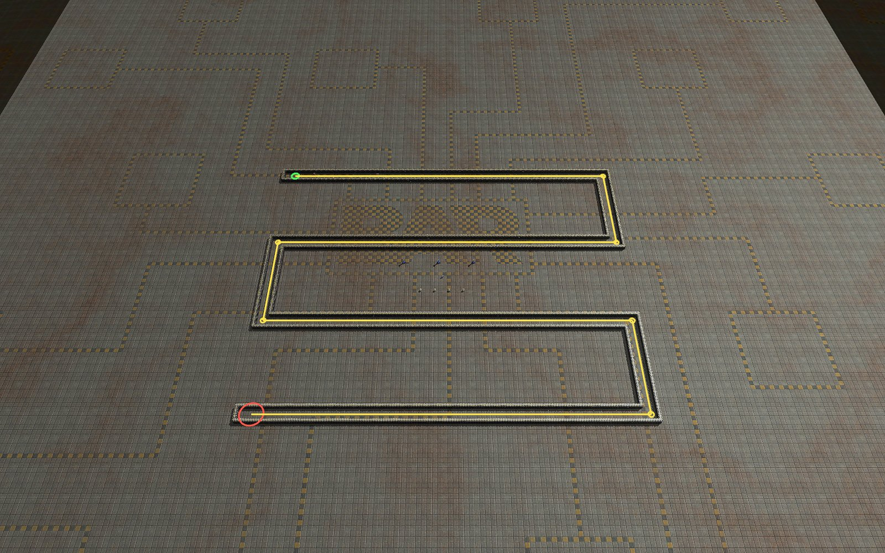

# Tower Defense

[Level Editor manual](../README.md) · [Specification](../SPECIFICATION.md) (section 11a) · [Scenario builder](../scenario/README.md) · [Start page](../../README.md)

Waves of enemy land units walk from a spawn point along a route to a goal. The player builds towers next to the route.

## In short

- **Menu:** click the button **TD** in the button column at the right edge of the editor (below **P** and **G**)
- Tick **Tower Defense** to mark the level (the button turns green)
- Draw the corridor, set spawn and goal, define the waves
- **Start test** runs it in the editor, a scenario package lets others play it
- Demo level: `demo_td_serpentine` (zigzag corridor, 10 waves)

## Build the level

**Walls**
- Material: **Teeth** or **Walls**
- **Single**: click or hold and move
- **Corridor**: **Line** (click points, right click builds both sides) or **Free** (draw with the mouse)
- Width: 32, 64, 128 (default), 160 or 192 Elmo
- Corners are closed automatically, **Ctrl+Z** undoes a corridor
- Wall pieces are indestructible and cannot be reclaimed

**Route**
- **Spawn** (green) and **Goal** (red): click on the map
- **Waypoint**: every click adds one, right click ends
- **Alt + drag** moves a point, **Del** removes a waypoint

**Waves**
- Per wave: factions, tech T1–T3, type (**V** vehicles, **B** bots, **H** hover), count, gap in seconds, **HP %**
- Units are picked at random among all that match
- **Enemies allowed through**: more leaks = lost

**Restrictions**
- Red **X** on a tower forbids it for the player
- **Economy** on: extractors, power plants and storage are allowed
- **Fog of war** on: radars are allowed, the map is hidden
- The list is the same as in the Place menu

## Test and play

- **Start test**: runs the waves; the commander is removed, resources come from the level
- **Stop** / **Reset**: brings the level back as before
- Kills pay the unit's cost; all waves beaten = won
- Scenario package (start menu key `3`): waves, route, restrictions and walls are packed
- The waves run in the gadget `td_waves.lua`
