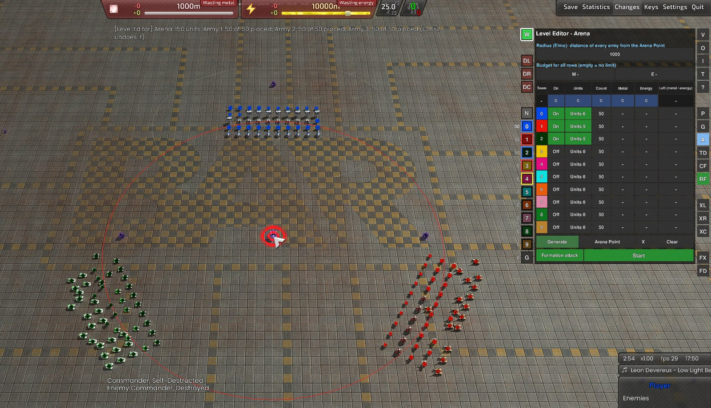
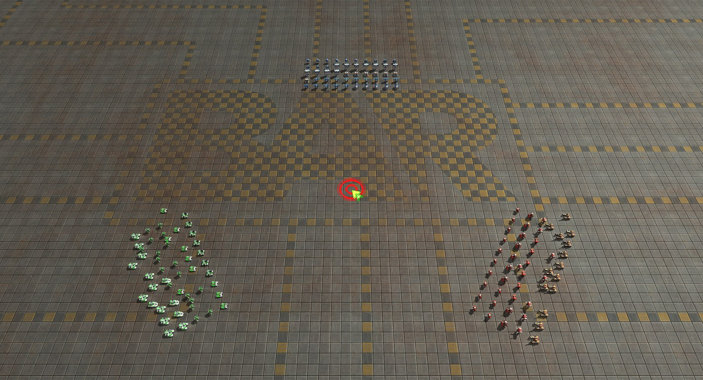

# Arena

[Level Editor manual](../README.md) · [Specification](../../specs/arena.md) · [Start page](../../README.md)

Let armies of different teams fight each other and watch: 100 Behemoths against 100 Juggernauts, long range against plasma cannons, anything. A tool like **G**, not a game mode: nothing is won or lost.

## In short

- **Menu:** the button **A** in the button column at the right edge of the editor (between **G** and **TD**)
- Set the **radius**, switch the players on, choose the **units** of each army and a **count** or a **budget**
- **Generate** and click on the map: the armies stand around that point, each facing it
- **Start**: the armies march to the **Arena Point** in their formation and fight on the way. **Stop**: everything is back as before

## Set up the armies

- **Radius:** how far every army stands from the Arena Point (default 1000 Elmo)
- **Table:** one row per team (same numbers as the team buttons at the left). The first two rows are on. A row that is off is not generated and does not fight. The editor game has ten teams (teams 2 to 9 start empty). A gray number is a team that the game does not have (a game started another way): nothing is generated for it
- **Copy a row:** click the **team number** of a row, then choose the target team in the menu "Copy to": on / off, count, budget and allowed units of that row go to the other team
- **Units:** the button is green and shows how many unit types are allowed. A new army allows nothing. Click it and the Place menu opens next to the page: a click on a unit (its **green check** at the upper right) allows it for this army. The checks at faction, group and tech allow all of them at once. The window starts with a row in the color of the team ("Team 0: allowed units"). **Clear Allowed Units** empties the list, the reddish **Close** closes it. The 3D preview and the info text appear as in the Place menu. A faction, group or tech button has a light green shade when some of its units are allowed, a stronger one when all are
- **Count** (default 50): how many units each **Generate** adds. **Budget:** Metal and Energy, each can be left empty (unlimited). The first limit that is reached ends the army. The last column shows what is left of the budget (it counts all units of the team, also the ones you placed by hand, and it can be negative)
- **Budget for all rows** (M, E) and the **C** buttons under the column heads: one value for everybody (budget fields, or the first team for On, Count and Units), then adjust single rows
- Units are drawn at random from the allowed ones. Only units that move and turrets are offered, no factories or other buildings

## Place and fight

- **Generate:** press the button, then click on the map (the Arena Point hangs at the mouse pointer meanwhile). The point is set there and every army of a row that is on is placed around it. It is one click: press Generate again for another round. A unit that does not fit its spot goes to the nearest free ground. An army outside the map is pushed onto it (100 Elmo from the edge)
- **Arena Point:** a thick red circle. **Arena Point** button: click the map to set or move it. **Alt + drag** moves only the point, **Shift + Alt + drag** the whole setup, **Del** or **X** removes it
- **Clear:** removes the units that Generate placed, and the point. Units you placed yourself stay
- **Start** needs an Arena Point. All units of the rows that are on walk straight ahead, every army as a rectangle, so that its center ends on the point (a front, not a heap), and they fight on the way. With **Formation attack** on (the green button left of Start) they walk at the speed of the slowest unit of all armies (so the armies meet at the same time) until the center of the army is at a quarter of its first distance from the point, then at full speed. With it off every unit runs as fast as it can. All units fight their way (a unit attacks everything that comes into the range of its weapons, artillery fires from far away) to 250 Elmo in front of the Arena Point and then patrol to 250 Elmo behind it (through the other army) and back until nothing is left. **Stop** loads the state before the start (the units are as before), so you can run it again; what you changed on the pages meanwhile (units list, count, budget, teams, Formation attack) stays
- **Ctrl+Z** undoes every step
- You can also place units with the normal Place menu, set an Arena Point and press **Start**
