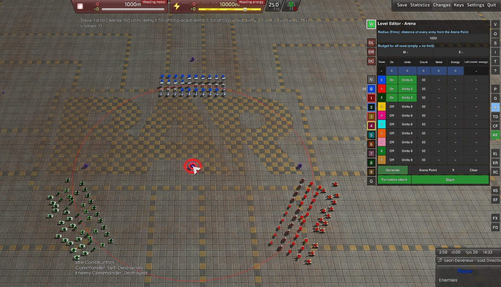
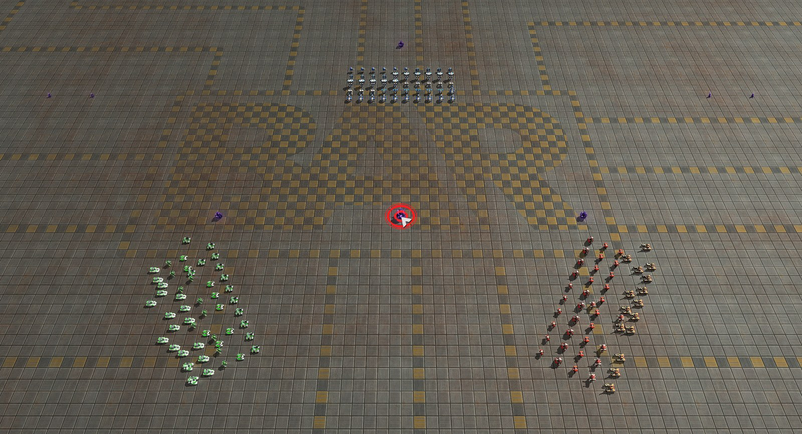

# Arena

[Level Editor manual](../README.md) · [Specification](../../specs/arena.md) · [Start page](../../README.md)

Let armies of different teams fight each other and watch: 100 Behemoths against 100 Juggernauts, long range against plasma cannons, anything. A tool like **G**, not a game mode: nothing is won or lost.

## In short

1. Press **A** in the button column at the right edge of the editor (between **G** and **TD**).
2. Set the **radius**, switch the teams on, choose the **units** of each army and a **count** or a **budget**.
3. **Generate** and click on the map: the armies stand around that point, each facing it.
4. **Start**: the armies march to the **Arena Point** in formation and fight. **Stop**: everything is back as before.

## Set up the armies

One row per team (the same numbers as the team buttons at the left). The first two rows are on.

| Field | What it sets |
|---|---|
| **Radius** | how far every army stands from the Arena Point (default 1000 Elmo) |
| **On** | a row that is off is not generated and does not fight |
| **Units** | which unit types the army may have; the button shows how many |
| **Count** | how many units each **Generate** adds (default 50) |
| **Budget** (Metal, Energy) | a limit for the army; empty = unlimited |
| last column | what is left of the budget |

- **Units:** a new army allows nothing. Click the button and the Place menu opens next to the page.
  - A click on a unit (its **green check**) allows it for this army.
  - The checks at faction, group and tech allow all units behind them.
  - A faction, group or tech button is light green when some of its units are allowed, stronger when all are.
  - **Clear Allowed Units** empties the list, **Close** closes the window.
- Units are drawn at random from the allowed ones. Only units that move and turrets are offered, no factories or other buildings.
- **Count and budget:** the first limit that is reached ends the army. The budget counts all units of the team, also the ones you placed by hand, so what is left can be negative.
- **One value for everybody:** the fields **Budget for all rows** (M, E) and the **C** buttons under the column heads (C copies the first team's On, Count or Units).
- **Copy a row:** click the **team number** of a row, then choose the target team in the menu "Copy to".
- A gray team number is a team this game does not have: nothing is generated for it.

## Place

- **Generate:** press the button, then click on the map. The Arena Point is set there and every army that is on is placed around it.
  - Press Generate again for another round.
  - A unit that does not fit its spot goes to the nearest free ground; an army outside the map is pushed onto it.
- **Arena Point** (a thick red circle): the button **Arena Point** and a click on the map set or move it.

| Action | How |
|---|---|
| Move only the point | **Alt + drag** |
| Move the whole setup | **Shift + Alt + drag** |
| Remove the point | **Del** or **X** |
| Remove the generated units and the point | **Clear** (units you placed yourself stay) |
| Undo | **Ctrl+Z**, for every step |

- You can also place units with the normal Place menu, set an Arena Point and press **Start**.

## Fight

- **Start** needs an Arena Point.
- Every army walks straight ahead as a rectangle, so that its center ends on the point: a front, not a heap.
- The units fight on the way: a unit attacks everything that comes into the range of its weapons, artillery fires from far away.
- They go to 250 Elmo in front of the Arena Point, then patrol to 250 Elmo behind it (through the other army) and back until nothing is left.
- **Formation attack** (the green button left of Start):
  - On: all armies walk at the speed of the slowest unit, so they meet at the same time. At a quarter of the first distance they go to full speed.
  - Off: every unit runs as fast as it can.
- **Stop** brings the units back as they were before the start, so you can run it again. What you changed on the pages meanwhile stays.
