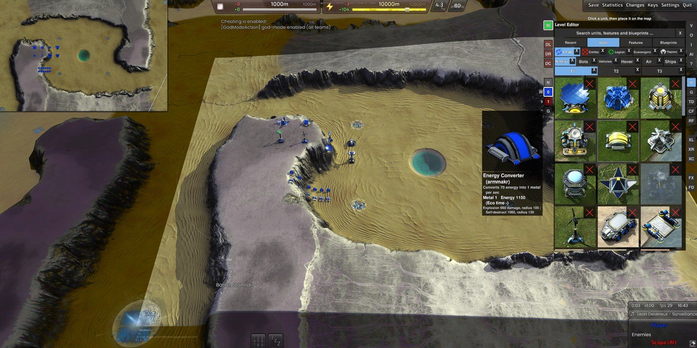
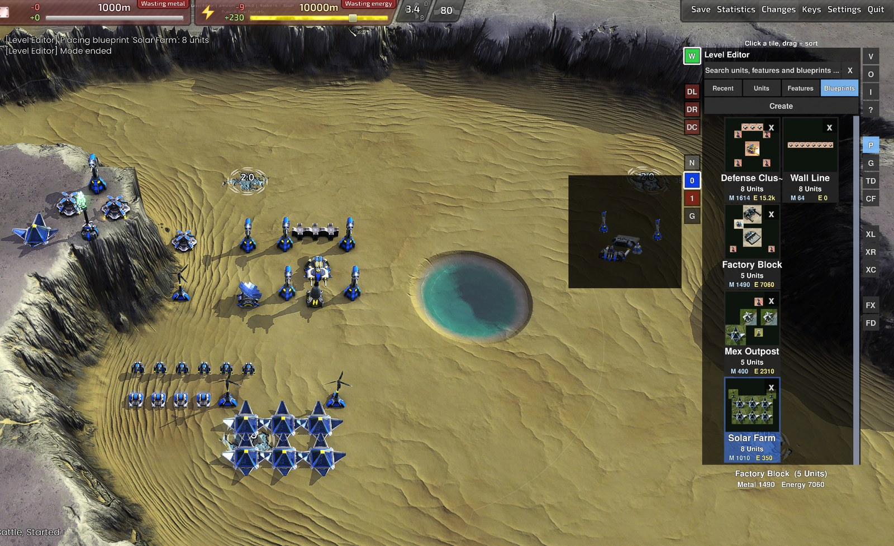
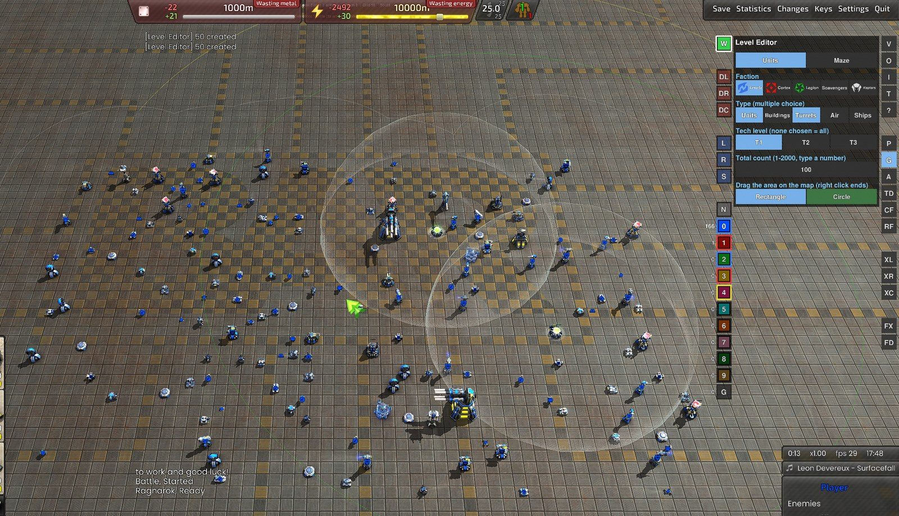
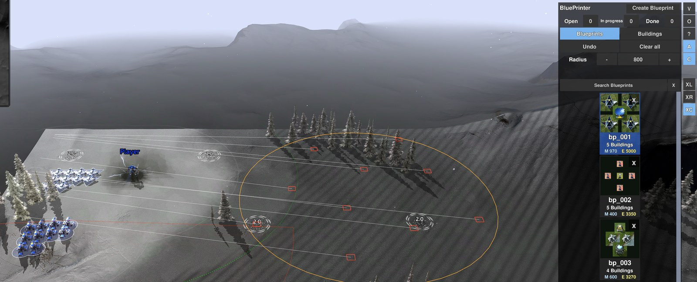

# BAR Level Editor

A level editor for [Beyond All Reason](https://www.beyondallreason.info/) (BAR). Place units, buildings, trees, rocks and wrecks on any map with the mouse, generate whole armies or mazes in one drag, build **tower defense** levels, and turn the result into a ready-to-play **scenario** that others can start with their own BAR.

**Contents**

- [Installation (Windows)](#installation-windows)
- [Quick start](#quick-start)
- [Features](#features)
- [Scenario builder](#scenario-builder)
- [Tower Defense](#tower-defense)
- [BluePrinter (for the official game)](#blueprinter-for-the-official-game)
- [Experimental: area attacks](#experimental-area-attacks-xl-xr-xc)
- [Documentation](#documentation)
- [Notes](#notes)

The editor runs inside BAR as an extra game ("Level Editor") that builds on the official one. Everything is free and finished instantly, no `/cheat` needed. The official game is not changed. This repository also contains **BluePrinter**, a small widget for normal games that queues saved building layouts as build plans, and the code both share.

## Installation (Windows)

You need Windows and Beyond All Reason, started once through its launcher.

1. [Download the repository as a ZIP](https://github.com/Ralf1108/BARLevelEditor/archive/refs/heads/main.zip) and unpack it, or clone it. Keep the folders `LevelEditor` and `shared` next to each other.
2. Run `LevelEditor\install_editor.bat`. It finds your BAR installation, builds the extra game and creates a desktop shortcut **BAR Level Editor**.
3. Start the shortcut. The start menu offers: `1` new level (choose a map), `2` load a level, `0` continue where you left off, `3` build a scenario package, `4` start a scenario you built.

After a BAR update or a change of the code nothing has to be done: the start script updates the extra game by itself. `LevelEditor\uninstall_editor.bat` removes everything it installed (your levels and blueprints stay). The editor needs the repository folder to stay where it is.

What the setup does exactly

`install_editor.bat` starts the PowerShell script `install_editor.ps1` with `-ExecutionPolicy Bypass` (only for this script, your system setting stays untouched). It builds the extra game `LevelEditorMod.sdz` in your BAR `data\games` folder, creates folder junctions in the BAR data folder (`LevelEditor` and `LevelEditorBlueprints`, pointing to the `levels` and `blueprints` folders of this repository), writes `start_level_editor.bat` and puts a shortcut on your desktop. The official game files are not modified. Read the scripts first if you want to be sure; `uninstall_editor.bat` undoes everything.

**BluePrinter (optional, for normal games):** run `BluePrinter\install_blueprinter.bat`, then enable *Allow user widgets* in the game settings and switch **BluePrinter** on in the widget list (F11). `BluePrinter\uninstall_blueprinter.bat` removes it again (your blueprints stay).

## Quick start

All buttons are in the **button column at the right edge** (V, O, I, ?, P, G, TD ...) and in the **strip left of the menu** (W, DL, DR, DC, L, R, S, N and the teams). The **?** button shows all keys and controls on screen; every button has a tooltip.

| | |
|---|---|
| Place a unit | **P** (Place) → **Units** → pick a unit → left click on the map. Right click ends. |
| Place many | Hold the left mouse button and move: one is placed after every footprint. **Shift + drag** places a row, **Shift + Alt + drag** a rectangle, **Shift + mouse wheel** changes the spacing, **[** and **]** rotate. The button **W** decides whether occupied spots are overwritten (default) or left free. |
| Random army | **G** (Generate) → choose faction / type / tech / count, press *Rectangle* or *Circle* and drag on the map. |
| Maze | **G → Maze**, choose the material and the corridor width, press *Rectangle* or *Circle*, drag on the map. |
| Tower Defense | **TD** → build walls and corridors, set **Spawn**, **Waypoint**s and **Goal**, define waves and restrictions → **Start test**. See [Tower Defense](#tower-defense). |
| Delete | **Del** on the selection or under the mouse; **DL / DR / DC** delete along a line, in a rectangle or in a circle. |
| Copy, cut, paste | **Ctrl+C**, **Ctrl+X**, **Ctrl+V** (pastes at the mouse). |
| Undo / redo | **Ctrl+Z** / **Ctrl+Y** for everything (placing, deleting, moving, generating ...). |
| Save a layout | Select units, **P → Blueprints → Create**. |
| Save the level | **Ctrl+S** (the editor also autosaves when you leave). **O** lists and loads saved levels. |
| Make a scenario | **I** (information) opens the scenario info; then start menu key **3**. See [Scenario builder](#scenario-builder). |

## Features

- **Place** units of all factions (Armada, Cortex, Legion), features (trees, rocks, wrecks) and blueprints, with a 3D preview at the mouse.
- **One search** over recent items, units, features and blueprints.
- **Painting, rows and rectangles** with the mouse; **W** decides whether placing overwrites what is in the way.
- **Blueprints:** save selected units as a tile with a preview and place the layout again anywhere; drag tiles to sort them.
- **Generate** random units, buildings, turrets, air or ships in a rectangle or circle, or a **random maze** of dragon teeth or walls.
- **Copy, paste, move, rotate and mirror**, with undo and redo for everything.
- **Delete** along a line, in a rectangle or in a circle; **FX / FD** make buildings indestructible or destructible again.
- **Teams:** pick the team (and neutral) next to the menu, with a live unit count per team; up to 32,000 units.
- **Save and load** levels with Ctrl+S, autosave when you leave.
- **Scenario builder:** turns a level into a ZIP with a start script, briefing, AI opponents and win condition that others play with their own BAR.
- **Tower Defense:** walls that guide waves of enemies along a route, rules for what the player may build, a test run in the editor, and export as a scenario.
- **Capture the Flag:** flag points, a collection point per team and a reward in metal, for human against human.

| Blueprints | Generate: units |
|---|---|
|  |  |

## Scenario builder

A level you built can become a **scenario** that others play with their own, unmodified Beyond All Reason:

1. Build the level (units, buildings, trees, wrecks, a maze ...) and save it with **Ctrl+S**. For a Tower Defense scenario set up the **TD** page first.
2. Click **I** (information) and fill in the scenario info: title, author, summary, briefing, the role of every team (player, allied AI, enemy AI), the allowed tech levels per team, AI behavior, win condition, start metal and energy, an optional grace period and an ID. It is stored in the level with the next Ctrl+S.
3. Start **BAR Level Editor** again and press **3** (*create a scenario package*), then choose the level. The script then:
   - lists the **values stored in the level**,
   - asks for the **title** (Enter keeps it) and the **name** of the scenario (its ID: Enter takes it, or type another; an existing scenario of that name is only overwritten after a question),
   - builds the package: `LevelEditor\scenario\scenarios\<id>.zip` (and the same as a folder).
4. Pass the zip on. The other person unpacks it, double-clicks `Start Scenario.bat` and plays with their own BAR (it asks before it downloads a missing map). Key **4** in the start menu starts a scenario you built yourself.

Details are in the [scenario builder readme](LevelEditor/scenario/README.md).

## Tower Defense

Waves of enemy land units walk from a spawn point through waypoints to a goal; the player builds towers next to the route. Switch it on with the **TD** button and build the level on that page:

- **Walls and corridors:** single wall pieces (*Single*: click or drag) or a corridor with walls on both sides, along clicked points (*Line*) or freehand (*Free*), made of dragon teeth or walls, 32 to 192 Elmo wide (Elmo is BAR's unit of length; a building square is 16 Elmo). Corners are closed. The pieces are **indestructible**. What stands in the way is overwritten while **W** is on.
- **Route:** *Spawn*, *Goal* and any number of *Waypoints*. A waypoint on the drawn line is inserted there, Alt + drag moves a waypoint, the spawn or the goal (like units), Del removes it. Everything can be undone with Ctrl+Z.
- **Waves:** per wave the factions, tech levels and types (vehicles, bots, hovercraft), count, gap in seconds and strength in percent. Every kill pays the unit's metal and energy. How many enemies may get through is set too: more and the level is lost, all waves beaten and it is won.
- **Restrictions:** what the player may build. Towers always; **Economy** (extractors, power plants, storage) and **Fog of war** (radars) can be switched on or off. A red X on a tower forbids it, a red X on T1, T2 or T3 forbids every structure of that tech level. The player has no commander, the builders come from the level.
- **Start test** runs the waves in the editor; **Stop** brings the level back to the state before.
- **As a scenario:** a level with Tower Defense switched on becomes a Tower Defense scenario with everything above (see [Scenario builder](#scenario-builder)); the recipient's starter builds a small extra game that only adds the wave script.

Details are in the [Level Editor manual](LevelEditor/README.md#tower-defense) and the [specification](LevelEditor/SPECIFICATION.md).

## Capture the Flag

Flags (the silver pods of the scavengers) lie on the map; units pick them up by getting close, carry them to the collection point of their team and earn metal for it. Switch it on with the **CF** button:

- **Own flags per team** (the other teams steal them) or **Neutral flags** (everybody takes every flag).
- **Income:** metal *per second* for every flag that lies at the collection point of a team. A delivered flag stays there and other teams can steal it; a carried flag pays nothing. If the carrier is destroyed the flag is dropped where it died.
- Any number of **flag points** and one **collection point** per team, placed with a click on the map; capture radius, return time of a dropped flag and the number of flags that win are settings of the page.
- **Start test** runs it in the editor; as a scenario it is packed with the level. For human against human; computer opponents do not play it.

Details are in the [Level Editor manual](LevelEditor/README.md#capture-the-flag) and the [specification](LevelEditor/SPECIFICATION.md).

## BluePrinter (for the official game)

A second, much smaller widget for the **official** Beyond All Reason that brings the blueprints to normal games. It works with **buildings only** (placing units is only possible in the Level Editor):

- **Blueprints** (the layouts saved in the Level Editor, or new ones made from your selection) and single buildings from a catalog are **queued as build plans** on the map, shown with a 3D ghost and a number.
- **Your builders help on their own:** idle builders and the commander nearby take the plans and build them with normal build orders (cost and build time apply as usual, no cheat). Choose the radius, switch auto-build and the commander on or off with the buttons next to the menu, or send selected builders to one plan with a right click.
- Painting, rows and rectangles, rotating, undo and a search field work as in the Level Editor. Because automatic building may count as automation in ranked games, auto-build can be switched off (button **A**).

| Blueprints | Buildings |
|---|---|
|  |  |

Install it with `BluePrinter\install_blueprinter.bat` (see [Installation](#installation-windows)) and read the [BluePrinter manual](BluePrinter/README.md).

## Experimental: area attacks (XL, XR, XC)

Three buttons in the Level Editor and in the BluePrinter spread the bombs and shots of all selected units evenly over an area you choose, which is awkward by hand with many units. It works with bombers, artillery, rocket launchers and nuclear silos.

| Button | What it does |
|---|---|
| **XL** | Line (carpet attack): drag a line, every unit gets a piece of it. |
| **XR** | Rectangle: drag two corners, the units spread over the whole area. |
| **XC** | Circle: press at the center and drag outwards. |

Select the units, press a button and drag the shape on the map. A preview shows one frame per unit as its target; releasing the mouse gives the orders, a right click cancels. The **bombers form up side by side first** and, once all are in position, attack at the same moment as a front, with the front targets hit first. Nukes need loaded missiles. In the BluePrinter, Ctrl+Alt+K is the same as XL and `/bp_carpet [line|rect|circle]` works too.

## Documentation

- [Level Editor](LevelEditor/README.md) and its [specification](LevelEditor/SPECIFICATION.md)
- [Scenario builder](LevelEditor/scenario/README.md)
- [BluePrinter](BluePrinter/README.md) and its [specification](BluePrinter/SPECIFICATION.md)
- [Shared code](shared/README.md) and its [specification](shared/SPECIFICATION.md)

## Notes

- Windows only for now (the setup uses PowerShell and junctions).
- Not an official Beyond All Reason project.
- This project was created with the help of [Claude Code](https://claude.com/claude-code) (Anthropic's AI coding assistant). The code was written and tested together with it; please report anything that does not work as described.
