# BAR Level Editor

A level editor and a building helper for [Beyond All Reason](https://www.beyondallreason.info/) (BAR). Build levels on any map with the mouse, turn them into ready-to-play scenarios, and queue saved building layouts in normal games.

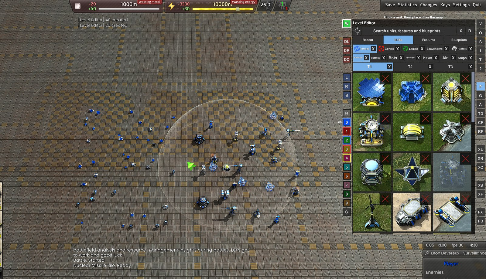

**Contents**

- [Level Editor](#level-editor)
- [Game modes](#game-modes)
- [Sandbox](#sandbox)
- [BluePrinter](#blueprinter)
- [LAN Play](#lan-play)
- [Experimental Attacks](#experimental-attacks)
- [Installation (Windows)](#installation-windows)
- [Documentation](#documentation)
- [Other useful links](#other-useful-links)
- [AI assistance](#ai-assistance)

## Level Editor

**Build**
- Place units of all factions (Armada, Cortex, Legion, Scavengers, Raptors), trees, rocks and wrecks, with a 3D preview and a search
- Paint, rows and rectangles; copy, cut, paste, move (units and trees, rocks, wrecks), rotate, mirror; undo and redo for everything
- Delete along a line, in a rectangle or in a circle; make buildings indestructible
- Generate random armies, turrets, air or ships, or a random maze of walls and dragon teeth
- **Arena**: armies of up to ten teams (units, count or budget) stand around a point and fight each other
- Blueprints: save a selection as a tile and place the layout again anywhere
- Ten teams plus neutral (3150 units per team, 32,000 in all), a live unit count per team
- **Teams**: alliances (a colored frame around the team button), human or AI per team, start resources

**Play it**
- Select and command units of every team, with the cheat and god mode switched on for you
- An AI of your choice for every team (BARb, CircuitAI, Simple AIs, Scavengers, Raptors)
- Restrictions: restrict units, factions or tech levels for the player
- Test a level at once: single player, host, join or split screen

**Share it**
- Scenario builder: a level becomes a ZIP with briefing, AI opponents and win condition that others start with their own BAR

| Blueprints | Generate: units | Generate: maze |
|---|---|---|
| 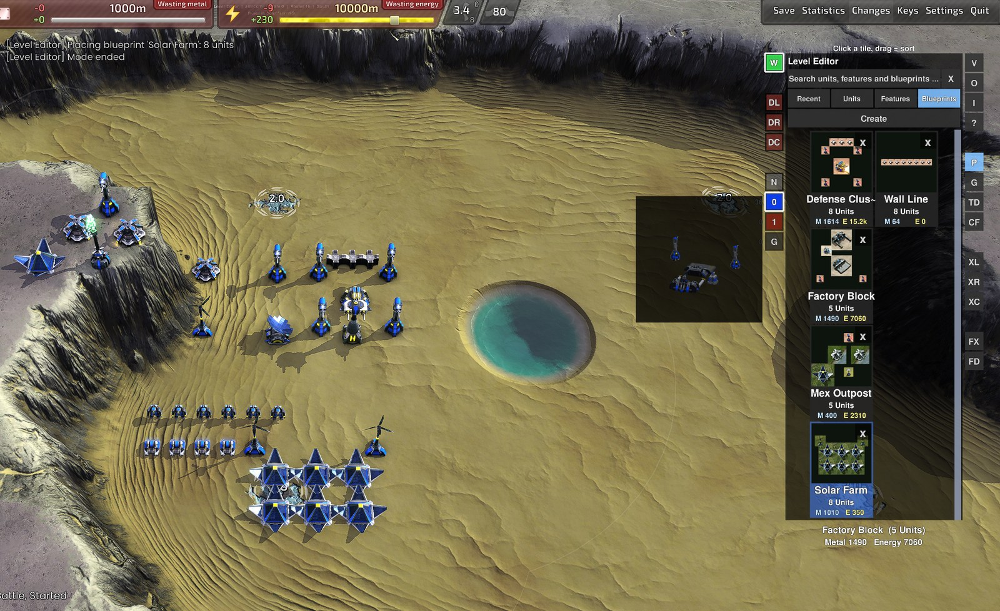 | 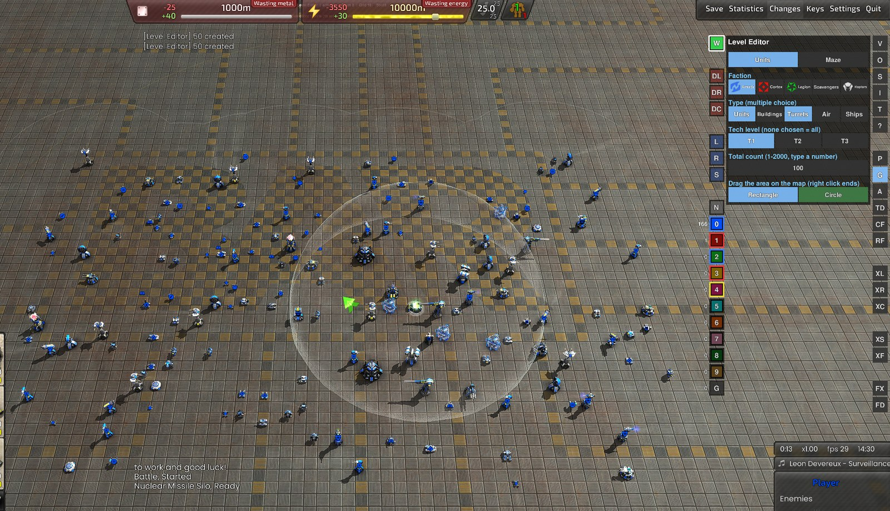 | 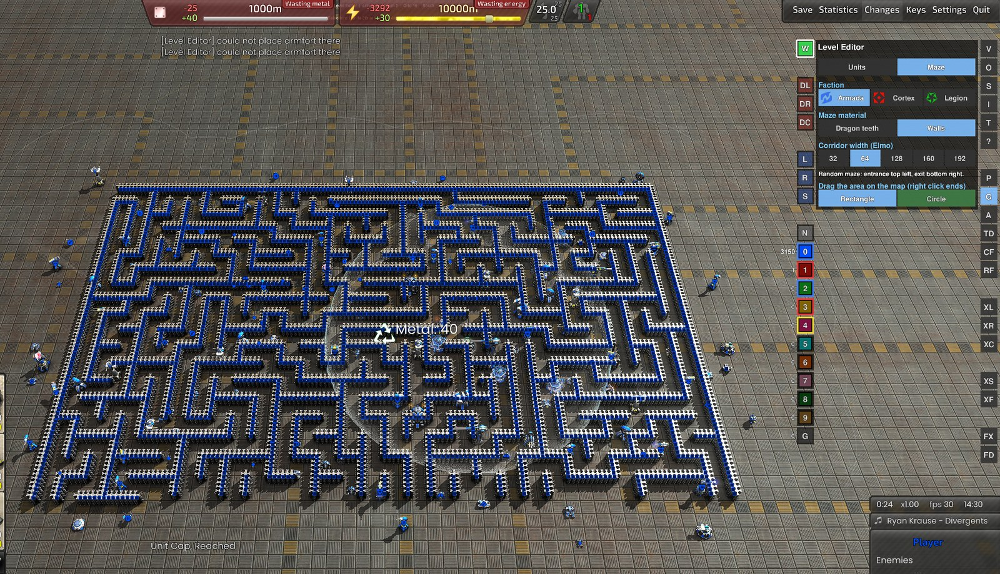 |

## Game modes

Three modes of a level, each with its own page, a test run and export as a scenario, and **Evolution**, a mode of LAN Play on any map:

| [Tower Defense](LevelEditor/game-modes/tower-defense.md) | [Capture the Flag](LevelEditor/game-modes/capture-the-flag.md) | [Reclaim the Fame](LevelEditor/game-modes/reclaim-the-fame.md) | [Evolution](LevelEditor/game-modes/evolution.md) |
|---|---|---|---|
| [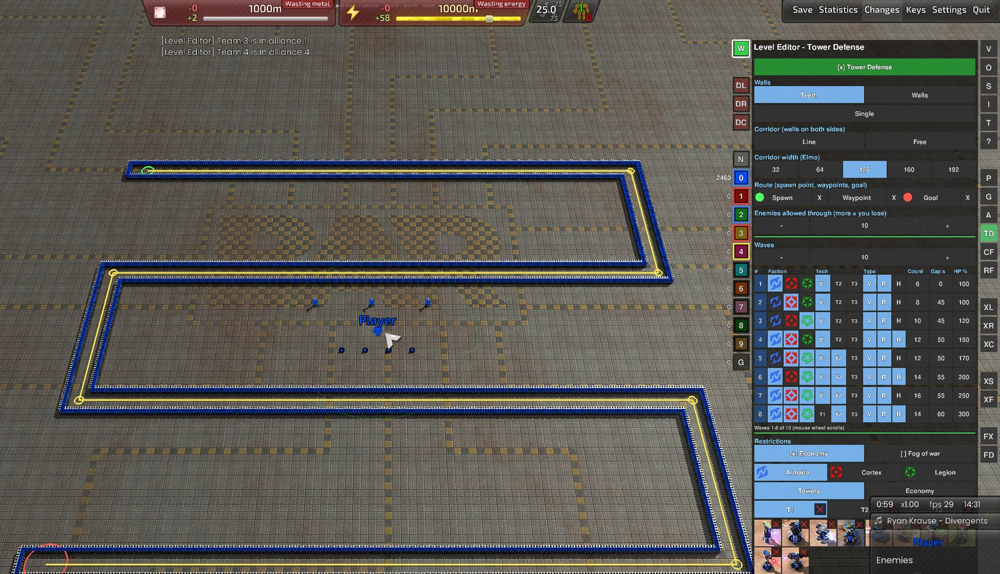](LevelEditor/game-modes/tower-defense.md) | [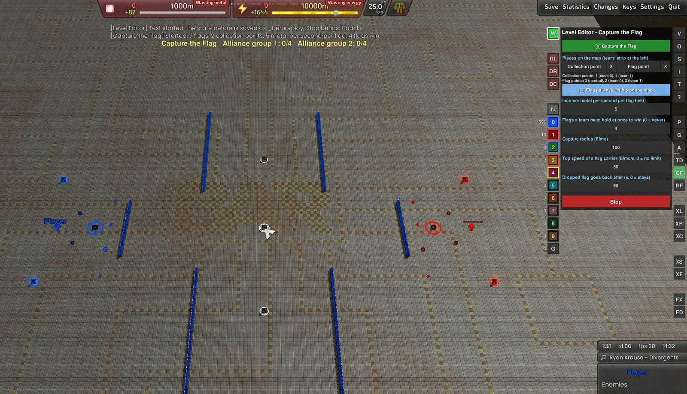](LevelEditor/game-modes/capture-the-flag.md) | [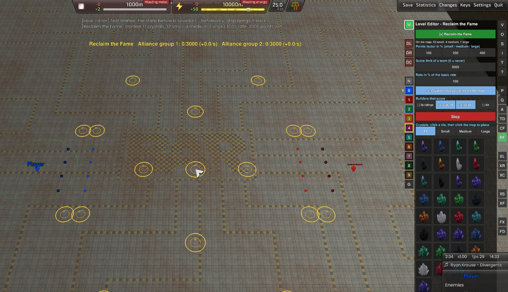](LevelEditor/game-modes/reclaim-the-fame.md) | [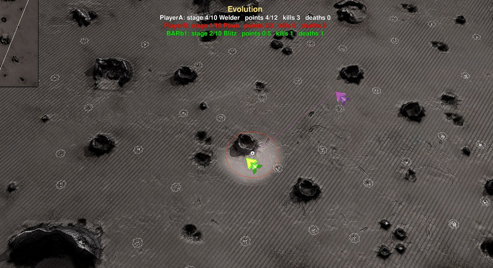](LevelEditor/game-modes/evolution.md) |
| Waves walk along a route you build; the player builds towers | Carry flags to your collection point and earn metal | Reclaim crystals for points; first at the score limit wins | One unit each; kills evolve it through 10 levels up to a tier 3 giant, power-ups, regeneration, a gift and **Armageddon** at level 10; settings in the room (unit multiplier, unit health, regeneration, long range, all be gods). LAN Play: **LAN Play** > **Evolution**, any map |
| 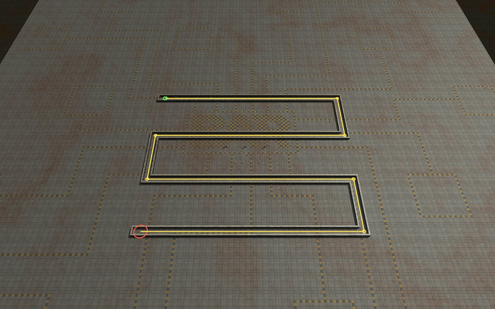 | 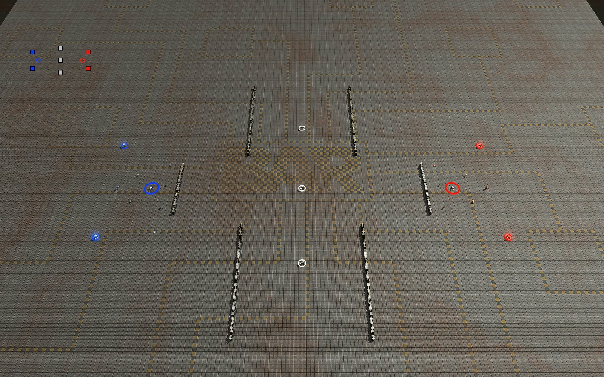 | 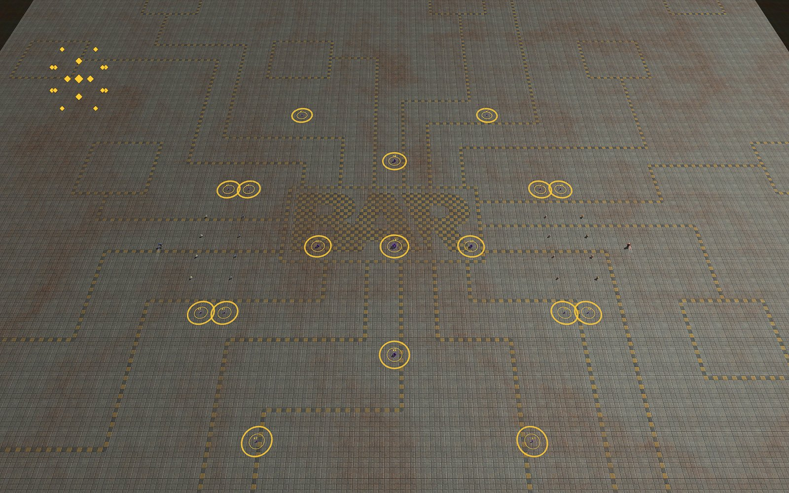 | 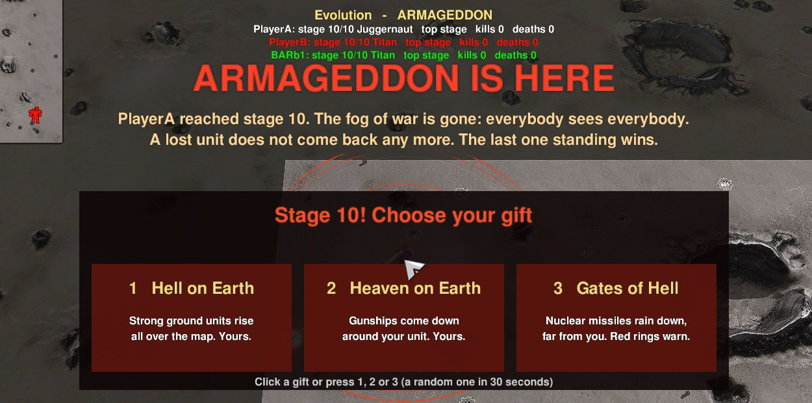 |
| Demo level *Serpentine* | Demo level *Crossroads* | Demo level *Crystal Fields* | Armageddon: the gift of level 10, *Comet Catcher Remake* |

One demo level per mode comes with the editor (`LevelEditor\levels\demo_*.lua`, flat metal map Full Metal Plate): load it with start menu key `2`.

## Sandbox

Tools to try things out, not a game with a winner:

| [Arena](LevelEditor/sandbox/arena.md) |
|---|
| [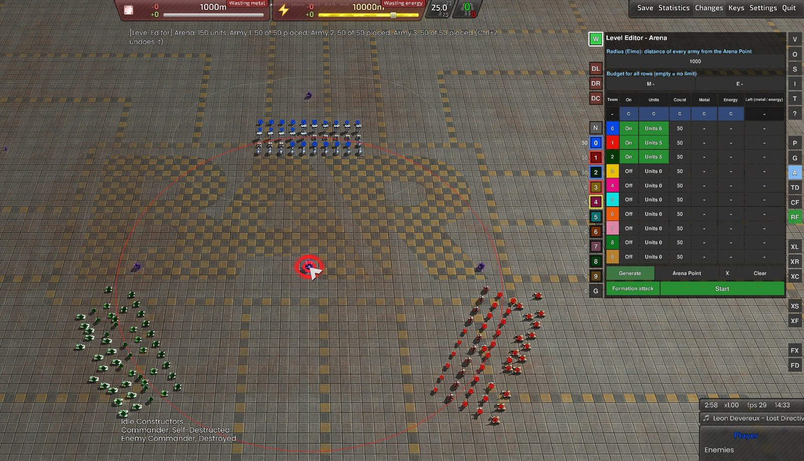](LevelEditor/sandbox/arena.md) |
| Armies of up to ten teams stand around a point and fight each other: choose units, count or budget, press Generate and Start |
| 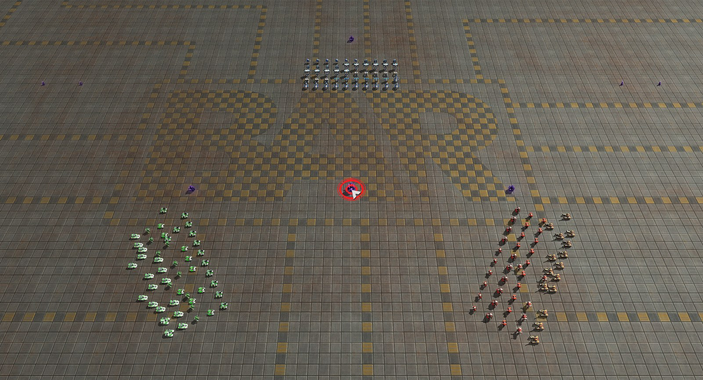 |
| Three armies after Generate |

## BluePrinter

A small widget for the **official** game that brings blueprints to normal matches (buildings only):

- Queue blueprints and single buildings from a catalog as build plans, with a 3D ghost and a number
- Idle builders and the commander help on their own, with normal costs and build times
- Select, remove, rotate and reorder plans; a new placement replaces plans below it; undo for every step
- Painting, rows, rectangles and search as in the Level Editor
- Cost, build time and **Eco time** (how long your income needs to pay for it) of every building and blueprint
- Auto-build can be switched off (it may count as automation in ranked games)
- Experimental attacks (XL, XR, XC, XS, XF): give many units an order for a whole area or for the enemies in a circle, see [Experimental Attacks](#experimental-attacks) *(experimental)*

| Blueprints | Buildings |
|---|---|
| 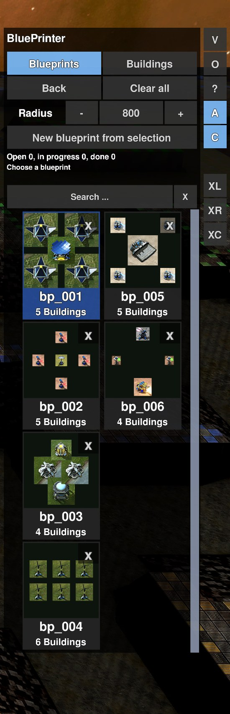 | 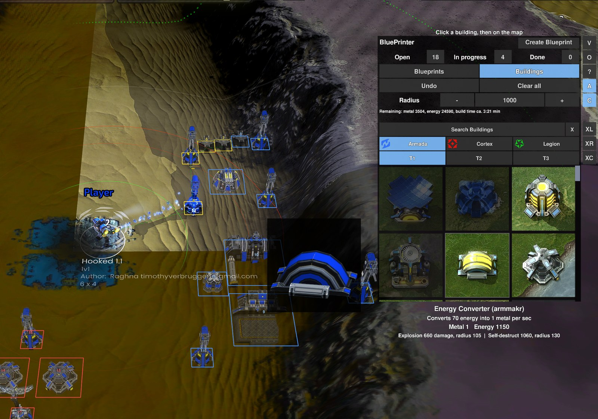 |

## LAN Play

Play with computers in the same network, no account and no server in the cloud. A new entry **LAN Play** in the main menu of the game, right below Multiplayer, opens the normal battle room (map, options, AIs, teams, chat); the normal Multiplayer is not touched.

- **Host a LAN game**, or pick a game that shows up in the list by itself, or type the host's address
- **Custom Scenario**: the host picks a scenario built with the Level Editor; map and teams are set and the other players get the scenario's game file automatically
- **Copilot**: two or more people of a team play **one** player together, for example one fights and one builds
- **Evolution**: a game mode on any map: every player starts with one weak unit, kills evolve it through 10 levels, level 10 brings Armageddon; settings in the room: unit multiplier, unit health, regeneration, long range, all be gods, debug mode; quick start for testing: `LevelEditor\start_evolution.bat`; see [Evolution](LevelEditor/game-modes/evolution.md)
- **[Renegade](LevelEditor/game-modes/renegade.md)** (first test): you steer one original unit in the first person view or, with Shift, in the third person view (mouse = look, W A S D = walk, aircraft fly with a limited height and drop their bombs themselves, left / right / middle mouse button = short range weapons / long range weapons / missiles, fired where the crosshair points (also into the sky); units that shoot in an arc show where the shell lands, units with a limited turret angle say when you have to turn the vehicle, the Rattlesnake and its kind have a direct and a vertical shot). The panel in the bottom left corner shows every weapon as a card with its name, a picture of its kind (laser, plasma, cannon, missile, torpedo and so on, in light, medium, heavy and ultra) and range, shots per second, damage and damage per second, sorted by range; the weapons that fire by themselves (anti-nuke) are a grey AUTO row. Around it: the list of the players with kills and deaths, an altimeter (0 to 500 m above the sea level, the ground in yellow), a compass (the way the vehicle drives and where its weapons point) with a speedometer, and **binoculars** (mouse wheel forward: zoom in, back: out) for units with a range of 600 or more. The key next to Shift (or Insert) switches between Renegade and the normal game. Which weapon is on which button, the pictures, their categories and the flight heights are tables you can change in Excel: [weapon table](LevelEditor/game-modes/renegade-weapons.md) (with the categories and the picture of every weapon), [weapon categories](LevelEditor/game-modes/renegade-weapon-categories.md) (all pictures and their limits), [cruise altitudes](LevelEditor/game-modes/renegade-cruise.md); quick start `LevelEditor\start_renegade.bat` (all units, also Legion, extra and Scavenger / Raptor units, are loaded; add `quick` as the fourth parameter for a faster start without them; Hooked 1.1 against 3 computer Peewees that hunt you; Tab and the debug buttons open the unit menu of the Level Editor: pick any unit or turret and turn into it or spawn it as an enemy). Not finished: a proof of concept, see [specs/renegade.md](specs/renegade.md).
- The buttons of LAN Play (Custom Scenario, Copilot, Evolution) are in the menu of a green button **LAN Play** in the title row of the room
- **Play the Scavengers or Raptors yourself**: put a Scavengers or Raptors computer into a team with a human player and the computer stops commanding its units, the humans of the team do (the official game does not allow that); the room tells everybody when this starts and ends
- **Raptor Brood Chamber**: with a Raptors computer in the room the Raptor healers can build a brood chamber that grows raptors like a factory
- **Raptors against Scavengers (as a gimmick)**: a Raptors computer in one team and a Scavengers computer in the other, each with a human player in its team: both hordes spawn and fight each other, each human commands the units of its computer (the official game refuses this combination: nothing spawns)
- **Rejoin and late join**: a player whose game crashed comes back into the room with the same name and presses Rejoin (same team, catches up); with `!latejoin on` before the start, players who come later can join the running game as players
- A missing map is fetched from the host over the network and checked against the list of official maps; different versions of LAN Play are reported with a warning
- Installed together with the Level Editor. Only computers of the local network (or a VPN such as Tailscale or Hamachi) can join

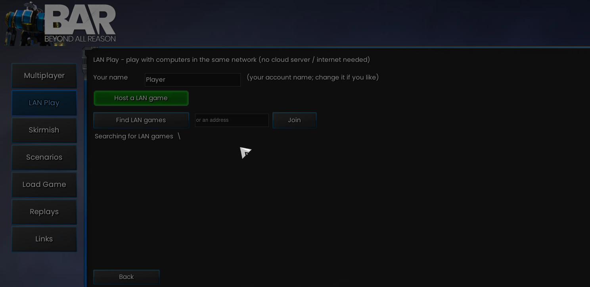

More in [LAN Play](docs/lan-play.md).

## Experimental Attacks

Five buttons in the BluePrinter and in the Level Editor give many units one order for a whole area or for the enemies in a circle (select armed units of any kind, press the button, drag the shape on the map):

| [Area attacks](docs/experimental-attacks.md#area-attacks-xl-xr-xc) | [Split attack](docs/experimental-attacks.md#split-attack-xs) | [Focus attack](docs/experimental-attacks.md#focus-attack-xf) |
|---|---|---|
| [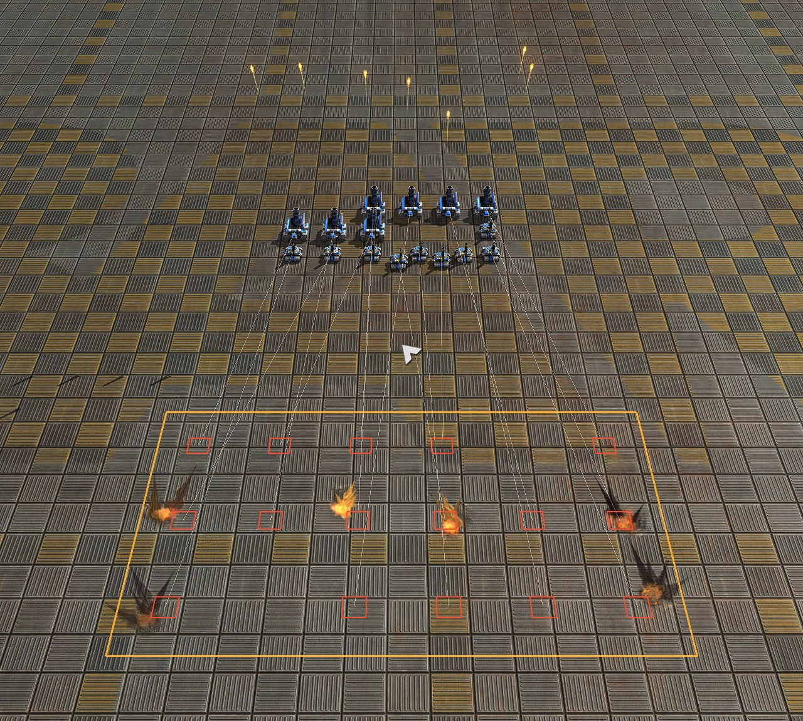](docs/experimental-attacks.md#area-attacks-xl-xr-xc) | [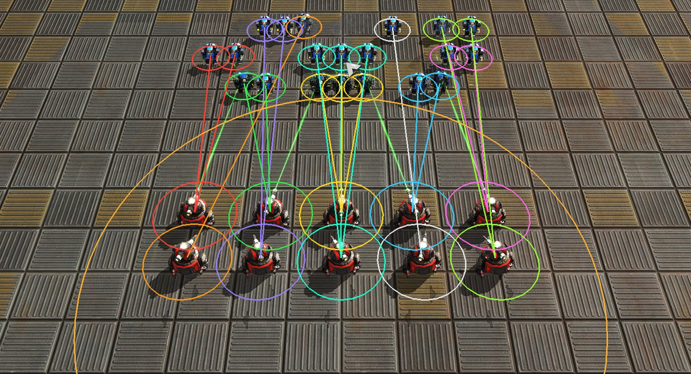](docs/experimental-attacks.md#split-attack-xs) | [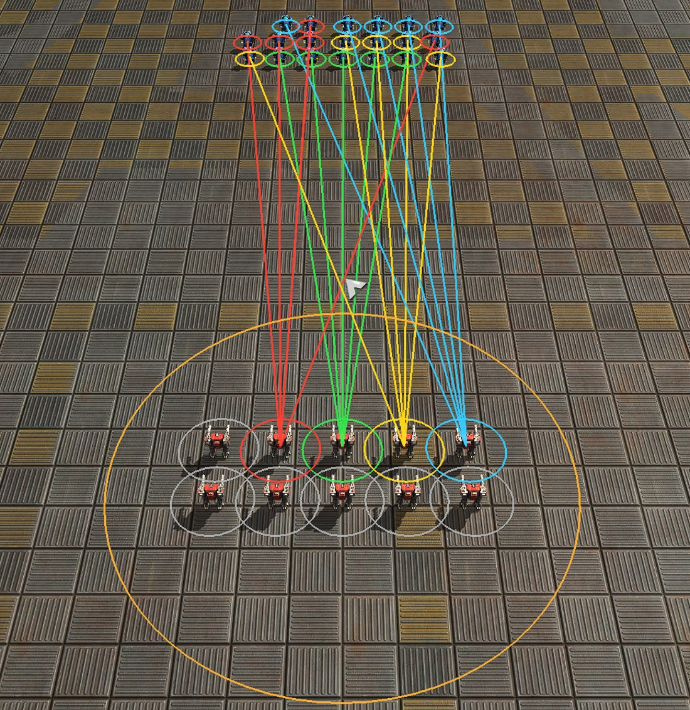](docs/experimental-attacks.md#focus-attack-xf) |
| **XL**, **XR**, **XC**: spread the units over a line, rectangle or circle; every unit gets its own target, bombers attack together | **XS**: spread the damage per second of the units evenly over the visible enemies in a circle (two on each enemy) | **XF**: kill the enemies in a circle one after the other, the most dangerous first, with as many units as each needs |

Details, rules and pictures: [Experimental Attacks](docs/experimental-attacks.md).

## Installation (Windows)

1. Install Beyond All Reason and start it at least once through its launcher.
2. Get the Level Editor. There are two ways:
   - **`git clone` (recommended):** `git clone https://github.com/Ralf1108/BARLevelEditor.git`. Updating is easy later: a `git pull` and you are up to date again.
   - **Download the repository as a ZIP:** [main.zip](https://github.com/Ralf1108/BARLevelEditor/archive/refs/heads/main.zip), then unpack it. To update, download it again.
3. Run `LevelEditor\install_editor.bat`, then start the desktop shortcut **BAR Level Editor**.
4. Optional, for normal games: run `BluePrinter\install_blueprinter.bat`.

## Documentation

- **[Using the Level Editor](docs/level-editor-usage.md)**: installation details, keys and controls, scenario builder, game modes
- **[Using the BluePrinter](docs/blueprinter-usage.md)**: installation, what it does
- **[Experimental Attacks](docs/experimental-attacks.md)**: area attacks (XL, XR, XC), split attack (XS), focus attack (XF)
- **[LAN Play](docs/lan-play.md)** and Copilot
- [Level Editor](LevelEditor/README.md), [Scenario builder](LevelEditor/scenario/README.md), [BluePrinter](BluePrinter/README.md)
- Game modes: [Tower Defense](LevelEditor/game-modes/tower-defense.md), [Capture the Flag](LevelEditor/game-modes/capture-the-flag.md), [Reclaim the Fame](LevelEditor/game-modes/reclaim-the-fame.md), [Evolution](LevelEditor/game-modes/evolution.md), [Renegade](LevelEditor/game-modes/renegade.md)
- Sandbox: [Arena](LevelEditor/sandbox/arena.md)
- Specifications (for development): [specs](specs/README.md)

Windows only for now. Not an official Beyond All Reason project. Please report anything that does not work as described.

## Other useful links

- [Map Generator](https://eclipseforeverbeyond.com/)

## AI assistance

- Most of the code and the documents in this repository were written with [Claude Code](https://claude.com/claude-code) (Anthropic)
- The maintainer designs the features, tests them in the game and decides what goes in
- Commits written with Claude carry a `Co-Authored-By: Claude` line. The working rules for the agent are in [CLAUDE.md](CLAUDE.md)
- If you send changes to the Beyond All Reason project itself, follow its AI policy (disclosure and testing by a human)
