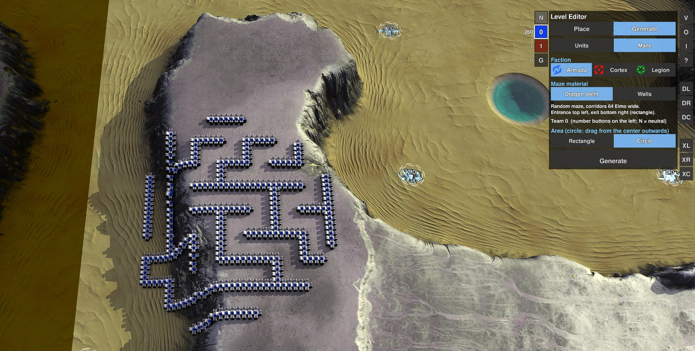
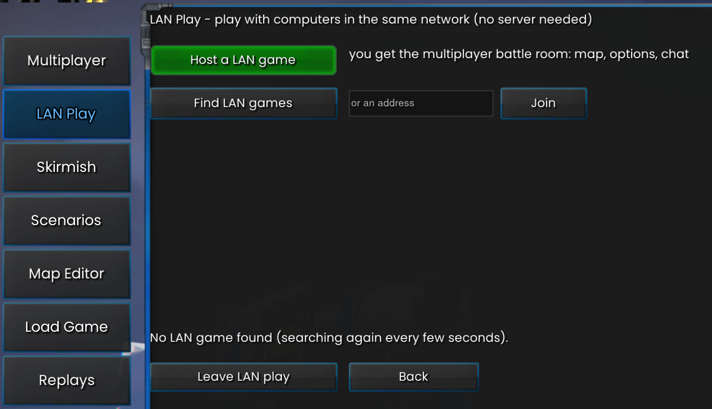
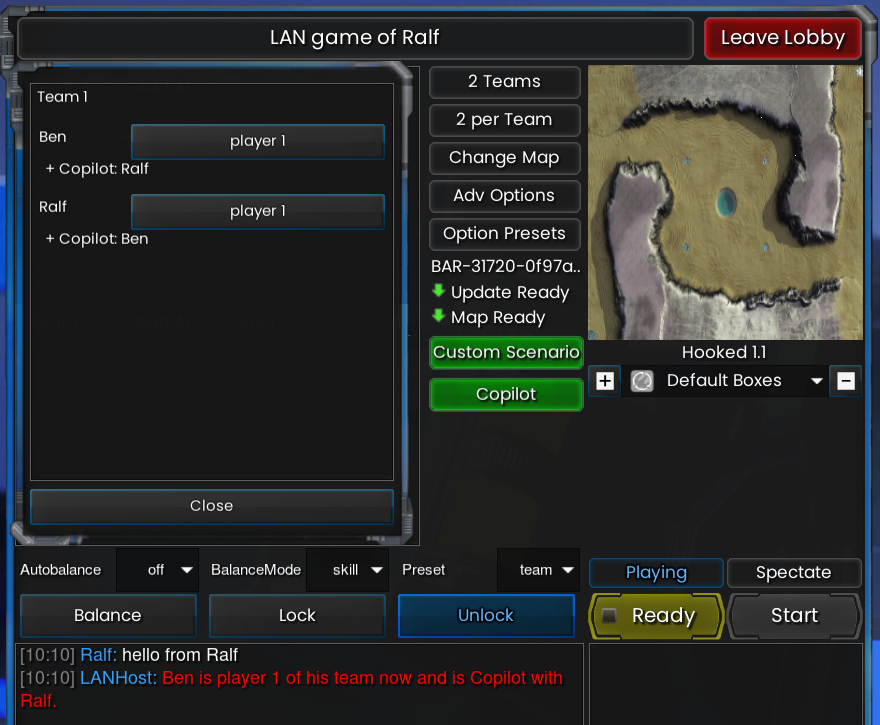

# BAR Level Editor

A level editor for [Beyond All Reason](https://www.beyondallreason.info/) (BAR). Place units, buildings, trees, rocks and wrecks on any map with the mouse, generate whole armies or mazes in one drag, build **tower defense**, **capture the flag** or **reclaim the fame** levels, and turn the result into a ready-to-play **scenario** that others can start with their own BAR.

**Contents**

- [Installation (Windows)](#installation-windows)
- [Quick start](#quick-start)
- [Features](#features)
- [Scenario builder](#scenario-builder)
- [Game modes](#game-modes)
- [LAN Play](#lan-play)
- [BluePrinter (for the official game)](#blueprinter-for-the-official-game)
- [Experimental: area attacks](#experimental-area-attacks-xl-xr-xc)
- [Documentation](#documentation)
- [Notes](#notes)

The editor runs inside BAR as an extra game ("Level Editor") that builds on the official one. Everything is free and finished instantly, no `/cheat` needed. The official game is not changed. This repository also contains **BluePrinter**, a small widget for normal games that queues saved building layouts as build plans, and the code both share.

## Installation (Windows)

You need Windows and Beyond All Reason, started once through its launcher.

1. [Download the repository as a ZIP](https://github.com/Ralf1108/BARLevelEditor/archive/refs/heads/main.zip) and unpack it, or clone it. Keep the folders `LevelEditor` and `shared` next to each other.
2. Run `LevelEditor\install_editor.bat`. It finds your BAR installation, builds the extra game and creates a desktop shortcut **BAR Level Editor**.
3. Start the shortcut. The start menu offers: `1` new level (choose a map), `2` load a level, `0` continue where you left off, `3` build a scenario package, `4` start a scenario you built.

After a BAR update or a change of the code nothing has to be done: the start script updates the extra game by itself. `LevelEditor\uninstall_editor.bat` removes everything it installed (your levels and blueprints stay). The editor needs the repository folder to stay where it is.

What the setup does exactly

`install_editor.bat` starts the PowerShell script `scripts\install_editor.ps1` with `-ExecutionPolicy Bypass` (only for this script, your system setting stays untouched). It builds the extra game `LevelEditorMod.sdz` in your BAR `data\games` folder, creates folder junctions in the BAR data folder (`LevelEditor` and `LevelEditorBlueprints`, pointing to the `levels` and `blueprints` folders of this repository), writes `start_level_editor.bat` and puts a shortcut on your desktop. The official game files are not modified. Read the scripts first if you want to be sure; `uninstall_editor.bat` undoes everything.

**BluePrinter (optional, for normal games):** run `BluePrinter\install_blueprinter.bat`, then enable *Allow user widgets* in the game settings and switch **BluePrinter** on in the widget list (F11). `BluePrinter\uninstall_blueprinter.bat` removes it again (your blueprints stay).

## Quick start

All buttons are in the **button column at the right edge** (V, O, I, ?, P, G, TD ...) and in the **strip left of the menu** (W, DL, DR, DC, L, R, S, N and the teams). The **?** button shows all keys and controls on screen; every button has a tooltip.

| | |
|---|---|
| Place a unit | **P** (Place) → **Units** → pick a unit → left click on the map. Right click ends. |
| Place many | Hold the left mouse button and move: one is placed after every footprint. **Shift + drag** places a row, **Shift + Alt + drag** a rectangle, **Shift + mouse wheel** changes the spacing, **[** and **]** rotate. The button **W** decides whether occupied spots are overwritten (default) or left free. |
| Random army | **G** (Generate) → choose faction / type / tech / count, press *Rectangle* or *Circle* and drag on the map. |
| Maze | **G → Maze**, choose the material and the corridor width, press *Rectangle* or *Circle*, drag on the map. |
| Select, order | Click or drag a rectangle: units of **every team** are selected like your own (the editor switches on the god mode for it), the command menu appears and the right click orders them (move, attack ...). A left click on the ground clears the selection. |
| Forbid units | The small **X** on a unit picture, a faction, a group or a tech button (Place menu, Units) forbids it for the player in the game (Start test, scenario). The editor itself can always place everything. |
| Tower Defense | **TD** → build walls and corridors, set **Spawn**, **Waypoint**s and **Goal**, define waves and restrictions → **Start test**. See [Tower Defense](LevelEditor/game-modes/tower-defense.md). |
| Capture the Flag | **CF** → choose a team in the strip at the left, place its **collection points** and **flag points**, set the income → **Start test**. See [Capture the Flag](LevelEditor/game-modes/capture-the-flag.md). |
| Reclaim the Fame | **RF** → place **crystals** with the tiles at the bottom of the page, set the points factors and the score limit → **Start test**. See [Reclaim the Fame](LevelEditor/game-modes/reclaim-the-fame.md). |
| Move | **Alt + drag** on a selected unit moves the selection; the arrow keys move it by one grid step. |
| Delete | **Del** on the selection or under the mouse; **DL / DR / DC** delete along a line, in a rectangle or in a circle. |
| Copy, cut, paste | **Ctrl+C**, **Ctrl+X**, **Ctrl+V** (pastes at the mouse). |
| Undo / redo | **Ctrl+Z** / **Ctrl+Y** for everything (placing, deleting, moving, generating ...). |
| Save a layout | Select units, **P → Blueprints → Create**. |
| Save the level | **Ctrl+S** (the editor also autosaves when you leave). **O** lists and loads saved levels. |
| Make a scenario | **I** (information) opens the scenario info; then start menu key **3**. See [Scenario builder](#scenario-builder). |

## Features

- **Place** units of all factions (Armada, Cortex, Legion), features (trees, rocks, wrecks) and blueprints, with a 3D preview at the mouse.
- **One search** over recent items, units, features and blueprints.
- **Painting, rows and rectangles** with the mouse; **W** decides whether placing overwrites what is in the way.
- **Blueprints:** save selected units as a tile with a preview and place the layout again anywhere; drag tiles to sort them.
- **Generate** random units, buildings, turrets, air or ships in a rectangle or circle, or a **random maze** of dragon teeth or walls.
- **Copy, paste, move, rotate and mirror**, with undo and redo for everything.
- **Delete** along a line, in a rectangle or in a circle; **FX / FD** make buildings indestructible or destructible again.
- **Teams:** pick the team (and neutral or Gaia) next to the menu, with a live unit count per team; up to 32,000 units (Gaia has at most 500: the engine fixes it, use neutral for many neutral units).
- **Select and command units of every team:** the editor switches on the cheat and god mode for all teams, so enemies are selected like your own, the game's command menu appears and the right click gives orders.
- **Restrictions:** one list of what the player may not build, set with small X marks in the Place menu (on units, factions, groups, tech levels), shared with the Tower Defense page, enforced in every mode.
- **Save and load** levels with Ctrl+S, autosave when you leave.
- **Scenario builder:** turns a level into a ZIP with a start script, briefing, AI opponents and win condition that others play with their own BAR.
- **Tower Defense:** walls that guide waves of enemies along a route, rules for what the player may build, a test run in the editor, and export as a scenario.
- **Capture the Flag:** flag points, collection points for every team and an income in metal, for human against human. It excludes Tower Defense in the same level.
- **Reclaim the Fame:** crystals on the map that give **points** to the construction units that reclaim them (1 point per second for every 100 build power, more for bigger crystals); the first team at the score limit wins. For human against human. It excludes the other two game modes in the same level.
- **Copilot:** in a LAN game two or more people of a team can play **one** player together (one fights at the front, another builds the base): give them the same number in the lobby (key **N** in the console lobby, button **Copilot** in the LAN room).

| Blueprints | Generate: units | Generate: maze |
|---|---|---|
|  |  |  |

## Scenario builder

A level you built can become a **scenario** that others play with their own, unmodified Beyond All Reason:

1. Build the level (units, buildings, trees, wrecks, a maze ...) and save it with **Ctrl+S**. For a Tower Defense or Capture the Flag scenario set up the **TD**, **CF** or **RF** page first (a level has one of them, not two). Forbidden units (the X marks of the Place menu) are packed too.
2. Click **I** (information) and fill in the scenario info: title, author, summary, briefing, the role of every team (player, allied AI, enemy AI), the allowed tech levels per team, AI behavior, win condition, start metal and energy, an optional grace period and an ID. It is stored in the level with the next Ctrl+S.
3. Start **BAR Level Editor** again and press **3** (*create a scenario package*), then choose the level. The script then:
   - lists the **values stored in the level**,
   - asks for the **title** (Enter keeps it) and the **name** of the scenario (its ID: Enter takes it, or type another; an existing scenario of that name is only overwritten after a question),
   - builds the package: `LevelEditor\scenario\scenarios\<id>.zip` (and the same as a folder).
4. Pass the zip on. The other person unpacks it, double-clicks `Start Scenario.bat` and plays with their own BAR (it asks before it downloads a missing map). For several players in the same network the same folder has `Host Game.bat` (one player: a lobby with a box per team in which he distributes the players who join) and `Join Game.bat` (the others only enter the address); the start menu key **4** of the Level Editor also offers a split screen with all games on one computer. Key **4** in the start menu starts a scenario you built yourself.

Details are in the [scenario builder readme](LevelEditor/scenario/README.md).

## Game modes

A level can be one of three game modes (they exclude each other). Each has its own page in the editor, a test run, and becomes a scenario that others play with their own BAR. Click a picture for the full description with all settings:

| [Tower Defense](LevelEditor/game-modes/tower-defense.md) | [Capture the Flag](LevelEditor/game-modes/capture-the-flag.md) | [Reclaim the Fame](LevelEditor/game-modes/reclaim-the-fame.md) |
|---|---|---|
|  |  |  |
| Waves of enemy land units walk along a route you build to a goal, and the player builds towers next to it. Rules for what may be built, a test run in the editor and export as a scenario. | Flags lie on the map; units carry them to the collection point of their team and earn metal for it. For human against human. | Crystals on the map pay points to the construction units that reclaim them; the first team at the score limit wins. Defend your builders, hunt the enemy's. For human against human. |
| **Button TD** | **Button CF** | **Button RF** |

## LAN Play

**LAN Play** lets you play with computers in the same network without a server in the cloud. It is a small widget for the lobby of the game: the main menu gets an entry **LAN Play** right below Multiplayer (the normal Multiplayer stays as it is). One player hosts a game, the others find it on the LAN Play page (it looks for games by itself) and join with a click. You get the official multiplayer battle room: map, game options, AIs, teams and chat. The host can also pick a scenario you built with the Level Editor (button **Custom Scenario**); the extra game it needs is passed on to the other players before the start.

The entry **LAN Play** is in the menu on the left; **Host a LAN game** opens the battle room, **Find LAN games** (or the address field and **Join**) joins a game of another computer.

**Copilot:** the host can let two or more humans of a team play **one** player together (button **Copilot**; in the console lobby of *Host Game* the key **N**): one fights at the front, another builds the base. The same number inside a team means one player; the lobby marks it.

The buttons **Custom Scenario** (choose a scenario you built) and **Copilot** sit in the middle of the room under *Map Ready* and follow the size of the window. **Copilot** opens a list of the humans of the room: the host clicks a player to give him the next number of his team (the tooltip says so), and humans with the same number play one player together (Ben and Ralf are both **player 1** in the picture). The other players see the same list, read only (without the button Custom Scenario).

`LevelEditor\install_editor.bat` installs it together with the editor (the game must be closed; it only needs TCP ports 8453 and 8452 between the computers). It is a prototype, so far tested with two lobbies on one computer.

Details, the protocol and what is still open: [LAN Play readme](LevelEditor/lan_lobby/README.md).

## BluePrinter (for the official game)

A second, much smaller widget for the **official** Beyond All Reason that brings the blueprints to normal games. It works with **buildings only** (placing units is only possible in the Level Editor):

- **Blueprints** (the layouts saved in the Level Editor, or new ones made from your selection) and single buildings from a catalog are **queued as build plans** on the map, shown with a 3D ghost and a number.
- **Your builders help on their own:** idle builders and the commander nearby take the plans and build them with normal build orders (cost and build time apply as usual, no cheat). Choose the radius, switch auto-build and the commander on or off with the buttons next to the menu, or send selected builders to one plan with a right click.
- Painting, rows and rectangles, rotating, undo and a search field work as in the Level Editor. Because automatic building may count as automation in ranked games, auto-build can be switched off (button **A**).

| Blueprints | Buildings |
|---|---|
|  |  |

Install it with `BluePrinter\install_blueprinter.bat` (see [Installation](#installation-windows)) and read the [BluePrinter manual](BluePrinter/README.md).

## Experimental: area attacks (XL, XR, XC)

Three buttons in the Level Editor and in the BluePrinter spread the bombs and shots of all selected units evenly over an area you choose, which is awkward by hand with many units. It works with bombers, artillery, rocket launchers and nuclear silos.

| Button | What it does |
|---|---|
| **XL** | Line (carpet attack): drag a line, every unit gets a piece of it. |
| **XR** | Rectangle: drag two corners, the units spread over the whole area. |
| **XC** | Circle: press at the center and drag outwards. |

Select the units, press a button and drag the shape on the map. A preview shows one frame per unit as its target; releasing the mouse gives the orders, a right click cancels. The **bombers form up side by side first** and, once all are in position, attack at the same moment as a front, with the front targets hit first. Nukes need loaded missiles. In the BluePrinter, Ctrl+Alt+K is the same as XL and `/bp_carpet [line|rect|circle]` works too.

## Documentation

- [Level Editor](LevelEditor/README.md) and its [specification](LevelEditor/SPECIFICATION.md)
- Game modes: [Tower Defense](LevelEditor/game-modes/tower-defense.md), [Capture the Flag](LevelEditor/game-modes/capture-the-flag.md), [Reclaim the Fame](LevelEditor/game-modes/reclaim-the-fame.md)
- [Scenario builder](LevelEditor/scenario/README.md)
- [LAN Play](LevelEditor/lan_lobby/README.md)
- [BluePrinter](BluePrinter/README.md) and its [specification](BluePrinter/SPECIFICATION.md)
- [Shared code](shared/README.md) and its [specification](shared/SPECIFICATION.md)

## Notes

- Windows only for now (the setup uses PowerShell and junctions).
- Not an official Beyond All Reason project.
- This project was created with the help of [Claude Code](https://claude.com/claude-code) (Anthropic's AI coding assistant). The code was written and tested together with it; please report anything that does not work as described.
