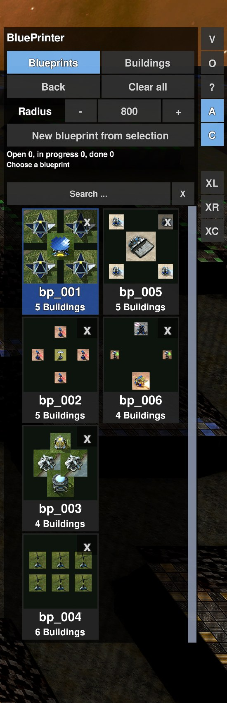
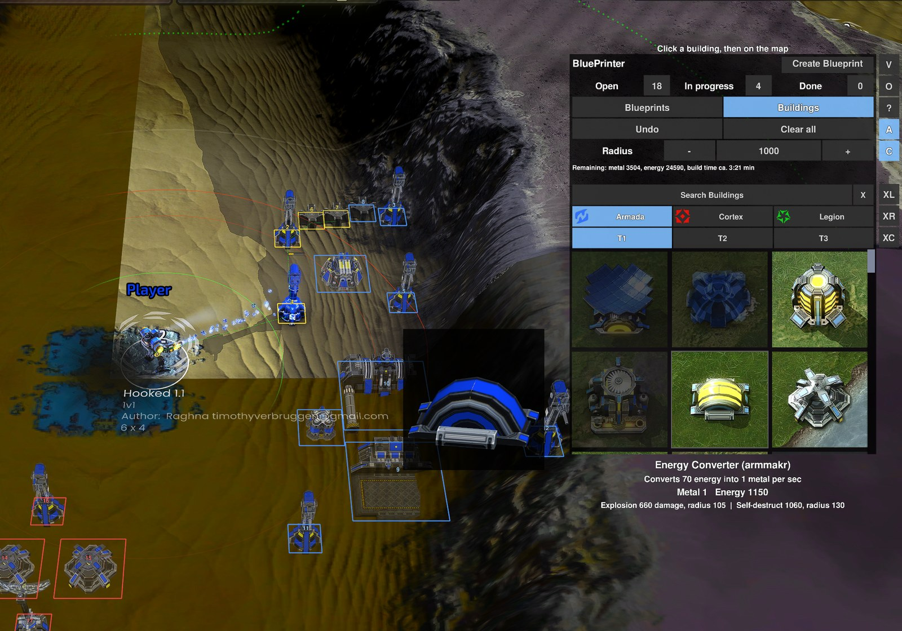
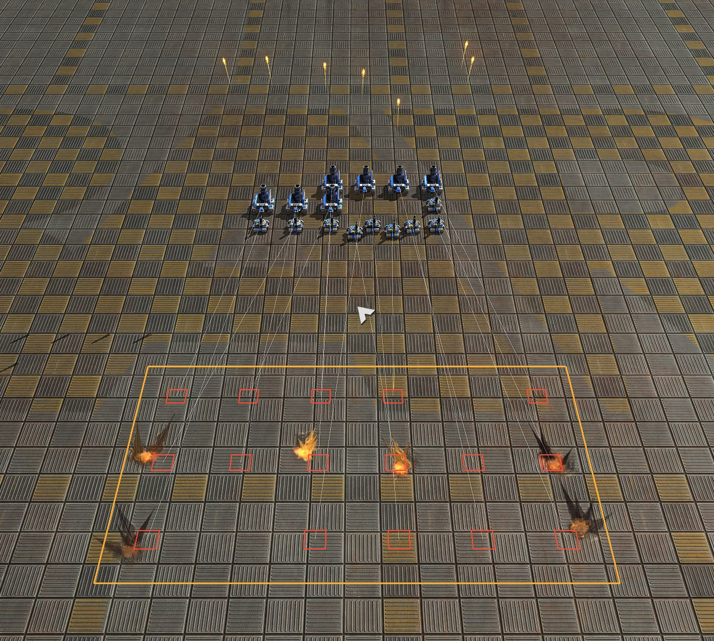
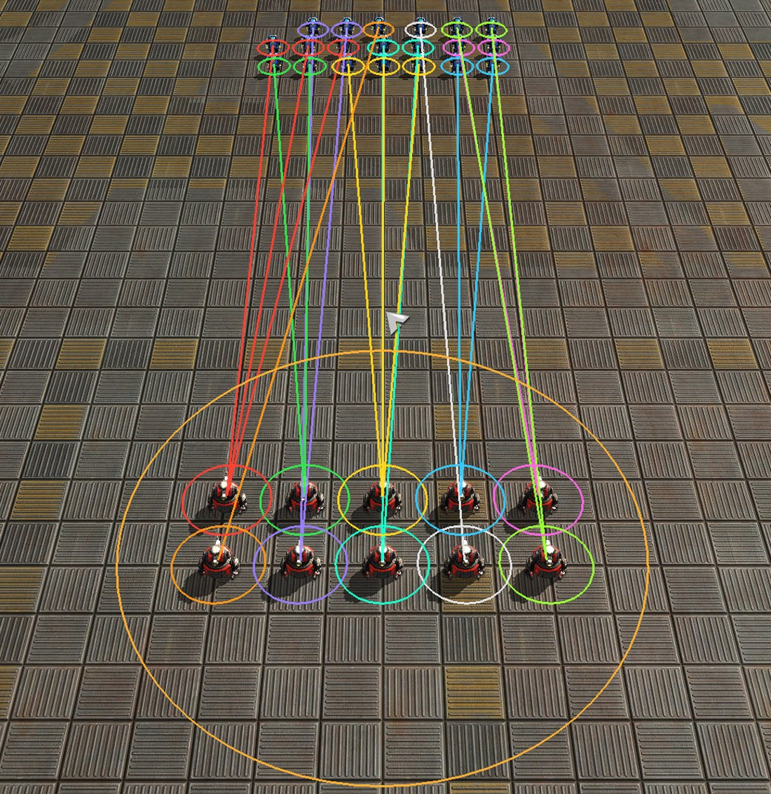
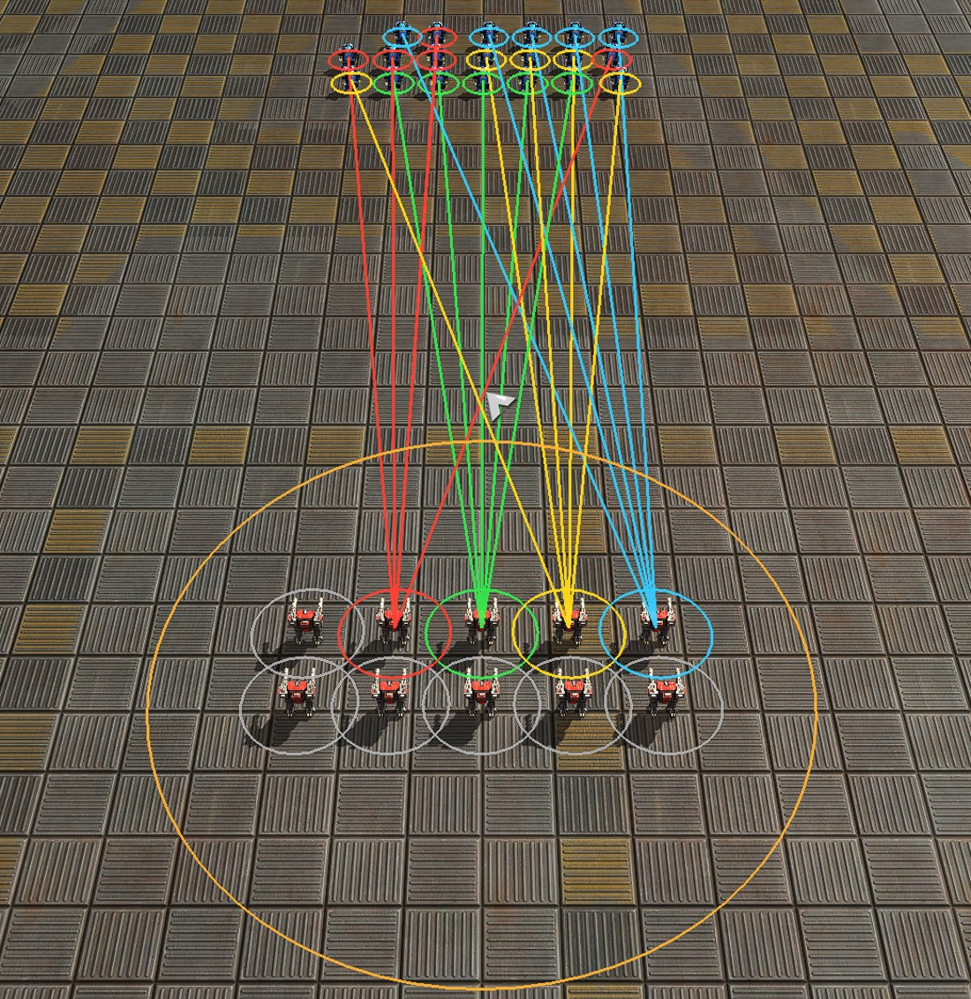

# Using the BluePrinter

[Start page](../README.md) · [Level Editor](level-editor-usage.md) · [LAN Play](lan-play.md)

A widget for the **official** game: queues blueprints and buildings as build plans (buildings only).

## Installation

- Run `BluePrinter\install_blueprinter.bat`
- In the game: enable *Allow user widgets*, switch **BluePrinter** on in the widget list (F11)
- `BluePrinter\start_blueprinter.bat`: updates to the newest version and starts BAR
- `BluePrinter\start_blueprinter_test.bat`: starts a small test game instead
- `BluePrinter\uninstall_blueprinter.bat` removes it (blueprints stay)

## Use

- Pick a blueprint or building in the menu, left click on the map to queue it
- Paint, rows and rectangles, rotate and undo as in the Level Editor
- Idle builders and the commander build the plans themselves
- Right click with selected builders sends them to one plan
- Buttons next to the menu: radius, auto-build (**A**), commander, **Q** (build in queue order)
- A new placement replaces open plans below it

**Manage plans**
- Click a plan to select it, double click selects the whole blueprint, **Shift** adds, **Ctrl + drag** draws a rectangle
- **Del** removes, **[** / **]** rotate
- **Page up / down**, **Home / End**: change the queue order
- **Undo** takes back every step

| Blueprints | Buildings |
|---|---|
|  |  |

## Area attacks (experimental)

Spread the shots or bombs of all selected units over an area (bombers, artillery, rockets, nukes).

- **XL**: line (carpet), **XR**: rectangle, **XC**: circle
- Select units, press the button, drag the shape; release gives the orders, right click cancels
- Bombers form up first and attack together

## Split attack and focus attack (experimental)

Use the firepower of the selected units against the enemies in a circle.

- Select armed units, press **XS** or **XF** (below the area attack buttons), drag a circle from the center outwards over the enemies you see
- **XS (split attack)** spreads the firepower **evenly**: every enemy gets about the damage it needs to die (health + 15 %), all at the same time
- **XF (focus attack)** kills **as fast as possible**: nearest enemy first, with as many units as it needs; the others go on to the next one
- Mobile enemies first, buildings after them; units that are not needed keep shooting at what is left; when all enemies in the circle are dead your units stop
- Only the enemies in the circle at the moment you release the mouse button count; right click cancels

*XS: 20 light units against 10 heavier ones, just after the order: every enemy has a color and the units aimed at it carry the same color, two or three on each. (The colors were drawn for the picture; in the game the selected units show their orders as thin lines.)*

*XF: 20 light units against 10 heavier ones that need about five of them each: four enemies get five units each (colors), the other six (gray) come next.*

## More

- [BluePrinter manual](../BluePrinter/README.md), [specification](../specs/blueprinter.md)
