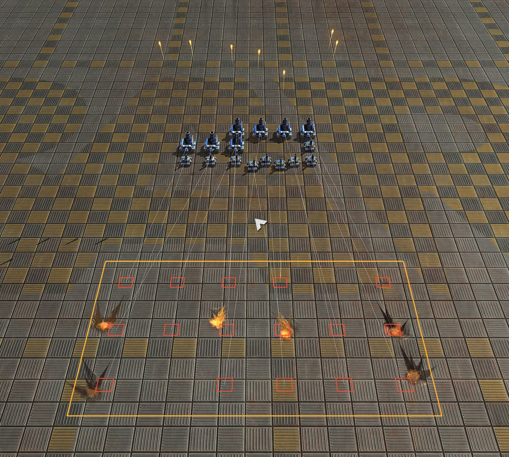
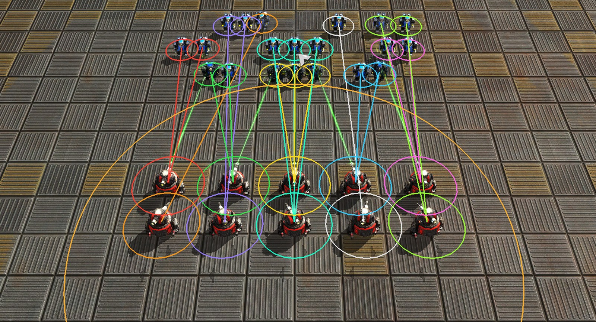
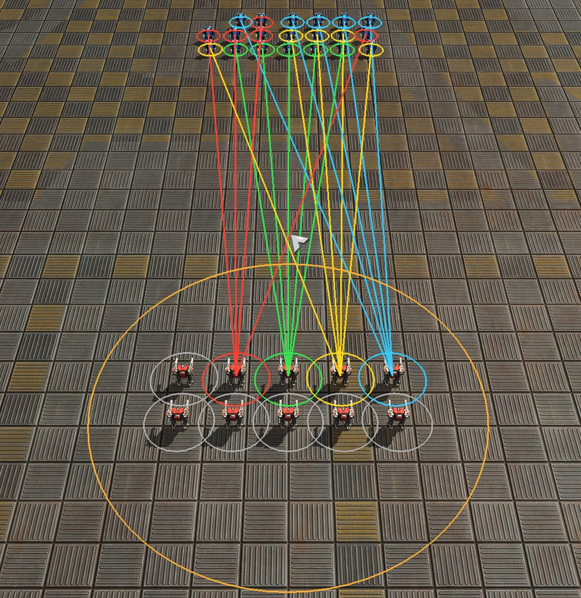

# Experimental Attacks

Five buttons give your units an order for a whole area or a group of enemies at once. They belong to the **BluePrinter** (for normal matches of the official game) and to the **Level Editor**, they look and work the same in both, and they are **experimental**: they may change.

| [Area attacks](#area-attacks-xl-xr-xc) | [Split attack](#split-attack-xs) | [Focus attack](#focus-attack-xf) |
|---|---|---|
| **XL**, **XR**, **XC**: spread the units over a line, rectangle or circle | **XS**: spread the damage per second evenly over the enemies in a circle | **XF**: kill the enemies in a circle one after the other, the most dangerous first |
|  |  |  |

## How it works for all of them

1. Select your **armed units** (any kind: tanks, bots, ships, aircraft, artillery, rocket launchers, ...).
2. Press the button in the column at the right edge of the menu: **XL**, **XR**, **XC** (area attacks), below them with a gap **XS** (split attack) and **XF** (focus attack). The button is lit while the mode is on.
3. Drag the shape on the map with the left mouse button (a line, a rectangle, or a circle from its center outwards). A preview shows the shape and where the units will go.
4. Let go of the mouse button: the orders are given and the mode is over. **Right click** cancels at any time.

Units that cannot shoot at all (builders) or only shoot at aircraft are left out. A unit that gets another order from you afterwards leaves the attack and does what you told it.

## Area attacks (XL, XR, XC)

Spread your units evenly over an area: **XL** a line, **XR** a rectangle, **XC** a circle. Every unit gets **its own target point** inside the shape, so a group of tanks covers a whole field, a line of artillery shells a long strip, and bombers lay a carpet.

- **Tanks, bots, ships, gunships, artillery, rocket launchers, nukes:** walk into range of their point and fire at it.
- **Bombers:** first fly to a starting point beside the shape (for a line: beside it, facing it) and form up. When all are in position they attack **at the same moment as a front**. The front targets are bombed first.
- Units are paired with points by their position, so the paths cross as little as possible.
- Also: **Ctrl+Alt+K** (= XL) and the chat command `/bp_carpet [line|rect|circle]` in the BluePrinter.

*An area attack with a rectangle (XR): 16 artillery tanks and long range rocket launchers, every unit gets its own target point (red squares) inside the rectangle. The shells have hit, more rockets are on their way. (The orange rectangle, the red squares and the thin lines were drawn for the picture.)*

## Split attack (XS)

Use the **damage per second** of your units against the enemies you see in a circle, and spread it **evenly**: every enemy gets the same share, whatever its health. 20 units against 10 enemies means two units on each enemy.

- Drag a circle from the center outwards over the enemies. Only the **visible** enemies in the circle at the moment you let go count (neutral units do not).
- The damage per second of a unit is taken **against the armor of the enemy**. Weapons that cannot hit the enemy (anti-air against ground units) and paralyzer weapons are not counted; the commander's D-Gun and area damage are not either.
- The units nearest to an enemy take it. With fewer units than enemies the nearest enemies get one unit each; the others come as soon as units are free.
- Every unit gets a second target behind its own, so none stands idle while an enemy lives. When a unit has nothing left to do, the units are assigned again. When all enemies in the circle are dead, your units stop.

*20 light units against 10 heavier ones, just after the order: every enemy has a color, the units aimed at it carry the same color, two on each. (The colors were drawn for the picture; in the game the selected units show their orders as thin lines.)*

## Focus attack (XF)

Kill the enemies in the circle **as fast as possible**: one after the other, with as many units as each needs, and the **most dangerous enemy first**.

- **Order:** every enemy gets a value: its **damage per second** against your units, divided by the **time it takes to get rid of it** (the way there at the speed of your units, plus its health + 15 % against the damage per second of all your units). The highest value comes first. A nearly dead enemy with a big gun comes before the same enemy at full health; an enemy far away comes after a near one; enemies that do no damage (builders, walls) come last.
- **Distribution:** the nearest units take an enemy until their damage within about 3 seconds is enough to kill it. A weak enemy gets a single unit, a strong one many. The units that are left go on to the next enemy. When there are not enough units for the next ones, the whole group concentrates on one enemy after the other.
- **New plan:** when an enemy dies, the units are assigned again with the current health, so a weak enemy never gets the whole group.
- When all enemies in the circle are dead, your units stop.

*20 light units against 10 heavier ones that need about five of them each: four enemies get five units each (colors), the other six (gray) come next.*

## Good to know

- Only enemies **you** see count, also those that only other units of yours see. Radar blips are not enough: the type and the health must be known. Your own units and those of your allies are never targets.
- At most **150 enemies** (the nearest to the center of the circle) and **300 units** take part in a split or focus attack. The attack ends after 10 minutes at the latest.
- Not in the calculation: shields, repair, enemies that run away or hide, the spread and flight time of shots. Some shots are wasted anyway; the 15 % buffer of the focus attack absorbs part of it.
- In the **Level Editor** the enemies are the units of teams that are neither the team of the selected units nor allied to it ([teams](../LevelEditor/README.md)).
- The tooltips of the buttons and the help (**?**) in both widgets describe the modes too.
