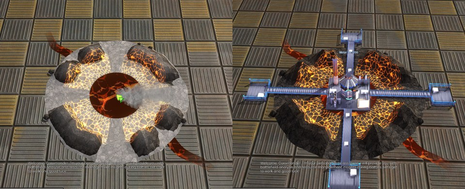
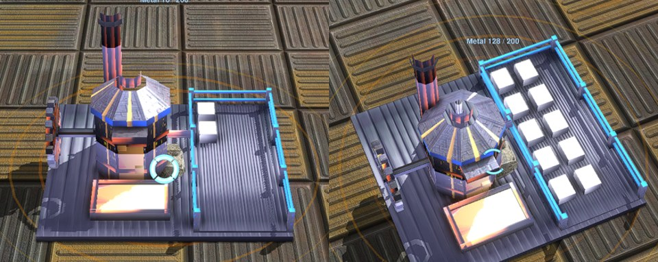
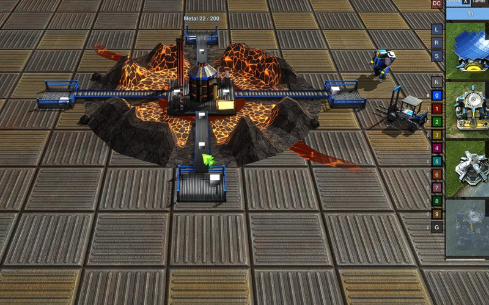
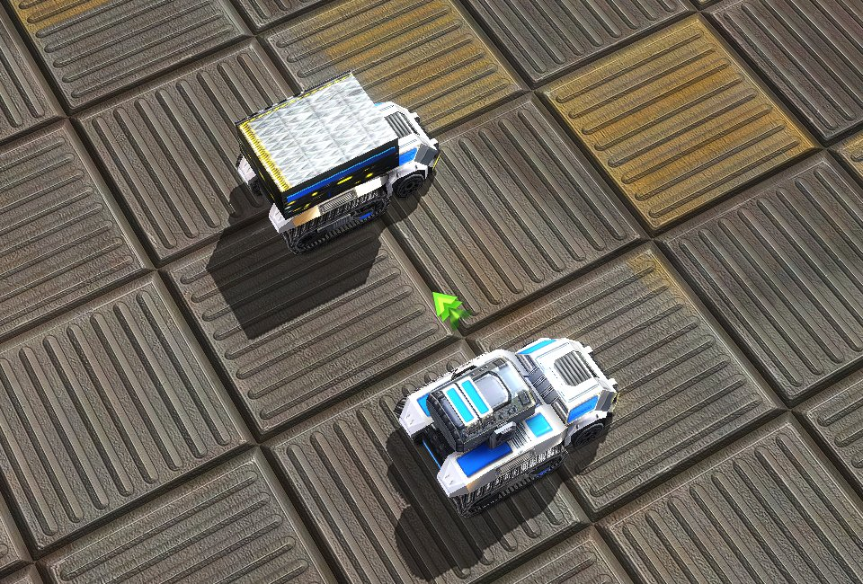
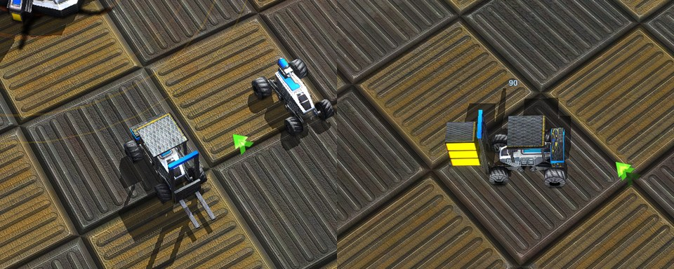

# Experimental Units

[Start page](../README.md) · [Level Editor](../LevelEditor/README.md) · [LAN Play](lan-play.md) · [Specification](../specs/lava.md)

A proof of concept: a **Volcano** on the map, a **Lava Extractor** that makes energy and metal on it, and three vehicles that haul the metal to a factory.

| Thing | Where you get it | What it does |
|---|---|---|
| **Volcano** | Level Editor: Place > Features, kind **Volcano** | the place a Lava Extractor is built on |
| **Lava Extractor** | Armada, Cortex, Legion: **Buildings**, T1; built by constructors and the commander | 200 energy per second, fills a metal stock |
| **Carrier** | **Bots**, T1; built in the bot lab | hauls 20 metal per trip |
| **Cargo Truck** | Armada, **Vehicles**, T1; built in the vehicle plant | hauls 60 metal per trip in 6 crates |
| **Forklift** | Armada, **Vehicles**, T1; built in the vehicle plant | slow; hauls up to 3 boxes of 30 metal |

## Try it

- `LevelEditor\start_experimental.bat` starts a game on Full Metal Plate.
  - Next to your start: a Volcano with a Lava Extractor, a Carrier, a Cargo Truck and a Forklift side by side, a vehicle plant behind them.
  - Select a vehicle and right-click the Lava Extractor.
  - Other map: `start_experimental.bat "Map name"`.
- **Level Editor:** place a Volcano and the units like anything else.
- **LAN Play:** on an official map the units are only there with **LAN Play** > **Experimental Units: On**; scenarios always have them. Volcanoes come only with a scenario of the Level Editor.

## Volcano

- A crater of dark rock with a small lake of lava in the middle.
- Lava flows out through two breaches.
- Four passes of cooled rock (north, east, south, west) carry the belts of a Lava Extractor.
- Smoke rises while nothing stands on it.
- A normal geothermal plant on a Volcano makes its normal energy.

## Lava Extractor

- It stands in the middle of the lake and can only be built on a Volcano; anywhere else it makes nothing.
- It looks like a steam engine mine: lava runs down its furnace into a glowing pool, a gear wheel turns, pistons move.
- It gives **200 energy per second** at once.
- It fills its **metal stock** with 2 metal per second, up to 200 (shown above it).
- **Conveyor belts** carry crates out through the four passes to four **storage pads** outside the Volcano.
  - The pads show the stock: up to 6 metal blocks on each (all pads show the same stock).
  - When a vehicle takes metal, blocks go away.
- The metal reaches you only when a vehicle brings it to a factory.

## Hauling

| You do | The vehicle does |
|---|---|
| right-click a Lava Extractor (order **Haul**) | goes back and forth by itself, to the nearest factory |
| right-click a factory | delivers there instead |
| any other order | stops hauling; the load stays |

- **Loading:** at the nearest storage pad, outside the Volcano. A vehicle never drives into the crater or over the lava.
- **Queue:** each pad has three loading spots side by side; whoever came first is served first.
- **On its own** (move state **Maneuver** or **Roam**, the default):
  - an idle vehicle hauls again from its last Lava Extractor after a Move or another order;
  - a new one from the factory takes the nearest Lava Extractor (up to 1200 away).
- **Hold Position**, or after **Stop**: it waits for your order Haul.

## The vehicles

**Carrier**

- A light bot without weapons; 20 metal per trip.
- It still has a stand-in look.

**Cargo Truck**

- 60 metal per trip in 6 crates.
- At the storage pad it turns, backs up to the pad and opens its tailgate; the crates slide in one by one.
- At the factory it unloads them one by one.

**Forklift**

- Slow; up to 3 boxes of 30 metal, shown on its fork.
- At the Lava Extractor it loads a box every half second while the stock has one.
- It leaves when it has 3 boxes or the stock is empty.

## Not yet there

- A model of its own for the Carrier; trucks for Cortex and Legion.
- The Cargo Truck stays level while it backs up on a slope.
