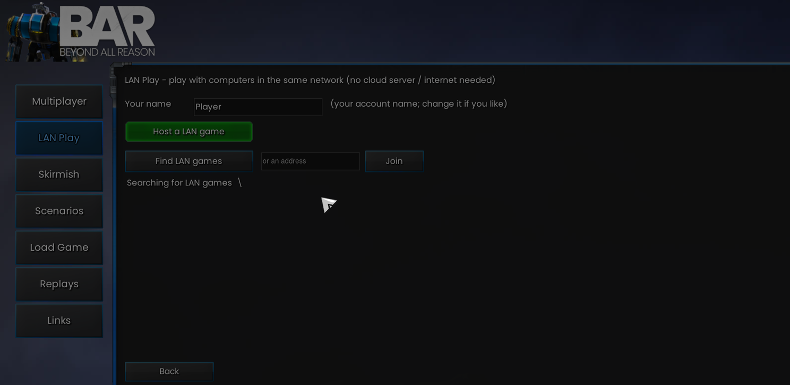
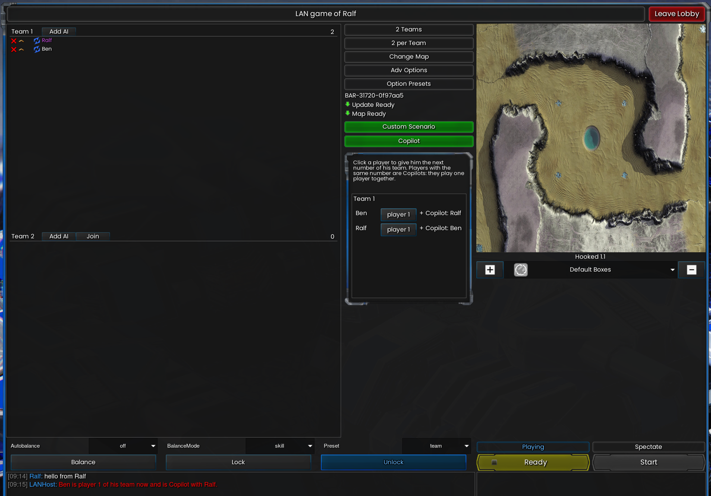

# LAN Play

[Start page](../README.md) · [Level Editor](level-editor-usage.md) · [BluePrinter](blueprinter-usage.md)

Play with computers in the same network. No account, no server in the cloud.

## Play

- Installed together with the Level Editor (close the game first)
- New entry **LAN Play** in the main menu, below Multiplayer. Normal Multiplayer is not touched
- **Host a LAN game** opens the normal battle room: map, options, AIs, colours, teams, chat. Press Start when everybody is in
- **Teams:** the buttons "N teams" and "N per team" of the room work as on the official server: the teams of the room change at once, the players are spread over the teams, and the **start boxes** of the map for that number of teams are shown on the map and used in the game (a map without boxes gets left/right for two teams, corners for four, otherwise boxes round the middle)
- Joining: games in your network show up in a list by themselves, a click joins. Or type the host's address and press **Join**
- The field "Your name" starts with your lobby name. Two players cannot have the same name in one game
- **Leave LAN play** (the button only shows while you host or play a LAN game; or leave the room) brings you back to the normal lobby. **Close** (red, like the close buttons of the lobby's lists) only closes the page. A turning bar under **Find LAN games** shows that the search for games is running
- Only computers of the local network (or of a VPN such as Tailscale or Hamachi) can join. Your firewall may ask once: allow it (ports 8453 for the lobby and 8452 for the game)

## Game modes

- **Official maps:** just play, like any room
- **Custom Scenario:** the host picks a scenario built with the Level Editor. Map and teams are set, all humans play the scenario's team together. The other players get the scenario's game file automatically

- **Join a running game as a player:** the host types `!latejoin on` in the room chat before the start. Players who come into the room later press **Rejoin** and join a team of the running game (the one with the fewest humans, together with its players as in Copilot). They catch up with the game first.
- **Raptors against Scavengers:** put a Raptors computer into one team and a Scavengers computer into the other (each with a human player in its team): both play at the same time, each human commands the units of its computer. The game normally refuses this combination (no units spawn and it says "leave the match"); LAN Play plays with a changed copy of the game's files.
- **Rejoin:** if your game crashes or you close it while the others play on, start the game again, open **LAN Play**, join the room with the same name and press **Rejoin**. You come back to your team and catch up with the game.
- **Scavengers / Raptors played by humans:** add a Scavengers or Raptors computer to a team and put a human player into the same team. The computer then only spawns (waves, beacons, queens as in the official game); its own orders to its units are ignored and the humans of that team command the units. The room writes a message into the chat when the first human comes into the team of such a computer, and again when the last one leaves (then the computer commands its units itself again). A Scavengers / Raptors computer alone in its team plays as in the official game. All players need the same extra game of the scenarios (LAN Play fetches it like a scenario's game file)

## Copilot

- Two or more people of a team play **one** player: one fights, one builds
- Host: button **Copilot**, click a player to give the next number of their team (console lobby: key **N**)
- The same number means the same player; the other players see the list read only

## Same version for everybody

- When you join, your LAN Play is compared with the host's. If they differ, you get one message with both version numbers and who is newer. You can still play
- To get the same version: `git pull` on all computers, or copy the Level Editor folder to the other computers and run `install_editor.bat`

## Missing map

- If you do not have the host's map, you get it automatically over the LAN. The host's file is checked against the list of official maps that the setup saved, so no download from the internet is needed
- If the map is not in the list, or its checksum differs, a window asks: **From the host** or **Online** (the lobby downloads the official map)
- The game starts for you when the map is there

## Status

- Tested with two game instances on one computer: Capture the Flag, Reclaim the Fame, Tower Defense, Copilot, scenario transfer, map transfer, version warning
- Not tested yet: two real computers, three or more players

Technical details: [LAN Play specification](../specs/lan-play.md)
