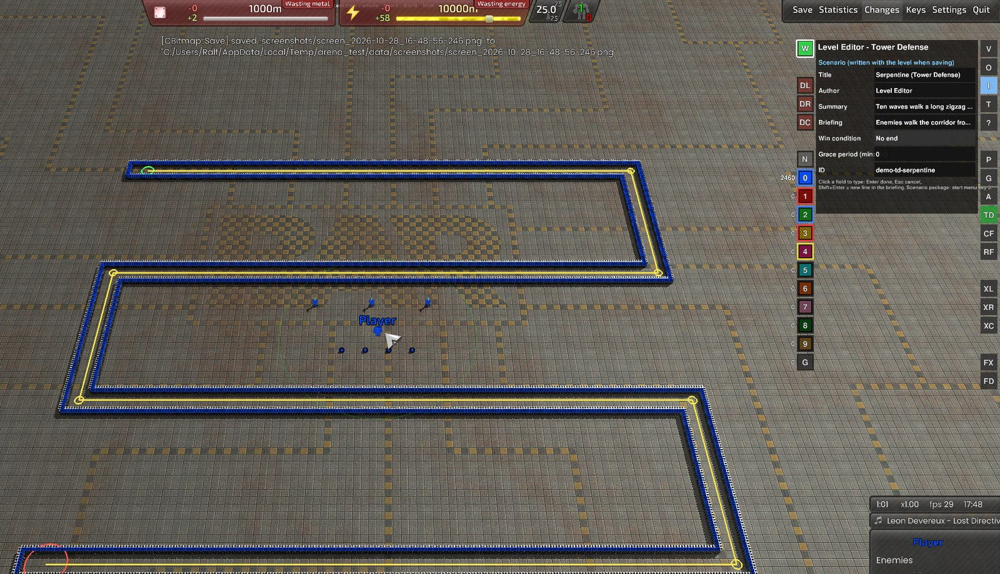
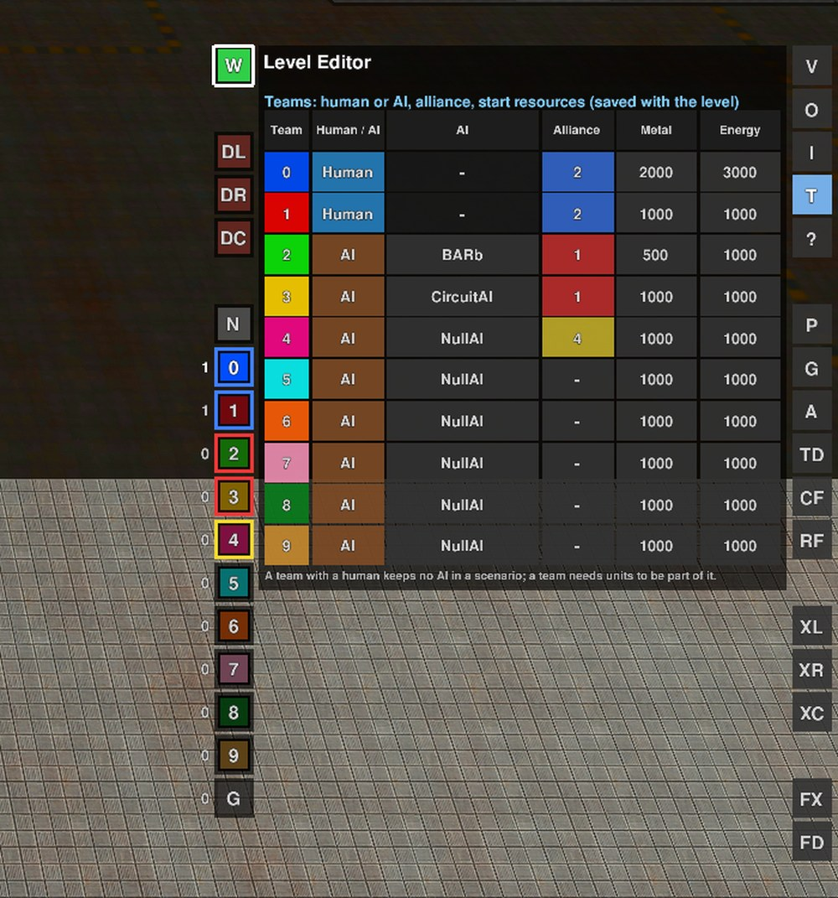
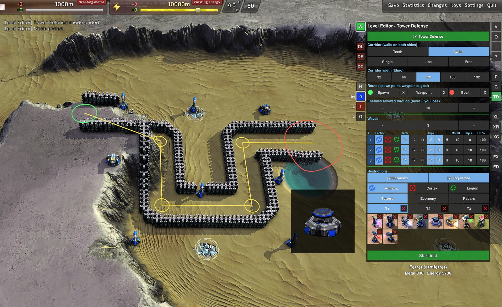
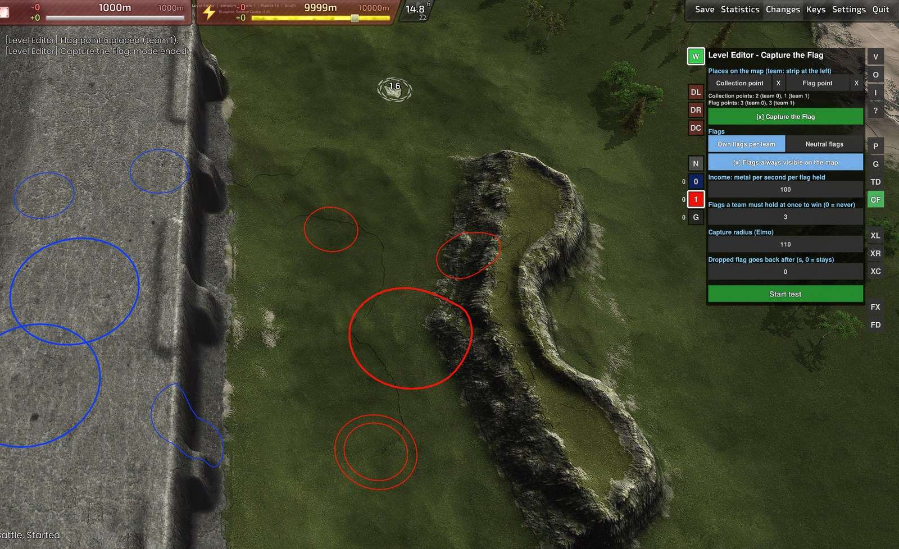
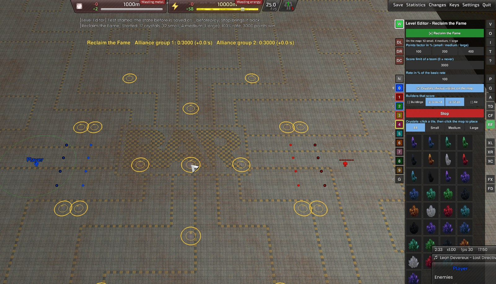

# Using the Level Editor

[Start page](../README.md) · [BluePrinter](blueprinter-usage.md) · [LAN Play](lan-play.md)

## Installation (Windows)

- Needs Windows and Beyond All Reason (started once through its launcher)
- [Download the ZIP](https://github.com/Ralf1108/BARLevelEditor/archive/refs/heads/main.zip) and unpack it; keep the folders `LevelEditor` and `shared` together
- Run `LevelEditor\install_editor.bat`: it builds the extra game and puts a shortcut **BAR Level Editor** on the desktop
- After a BAR update nothing has to be done, the start script updates itself
- `LevelEditor\uninstall_editor.bat` removes everything again (levels and blueprints stay)

**Start menu keys**
- `1` new level, `2` load, `0` continue
- `3` build a scenario package, `4` start a scenario, `5` rebuild a package
- `6` play a level at once (single player, host, join, split screen)
- `7` Scavenger/Raptor units on or off, `8` clean up (own levels and scenarios into a trash folder, what came from other players)

## Controls

All buttons are in the column at the right edge and in the strip left of the menu. **?** shows all keys on screen, every button has a tooltip.

**Place**
- **P** → Units → pick a unit → left click; right click ends
- Hold the left button and move to paint
- **Shift + drag**: row, **Shift + Alt + drag**: rectangle
- **Shift + wheel**: spacing, **[** / **]**: rotate
- **W**: overwrite occupied spots or leave them free

**Generate**
- **G** → faction, type, tech, count → *Rectangle* or *Circle* → drag on the map
- **G → Maze**: material and corridor width, then drag

**Edit**
- Click or drag to select units of any team, right click gives orders
- **Alt + drag** or arrow keys: move
- **Del**: delete; **DL / DR / DC**: delete along a line, in a rectangle or a circle
- **Ctrl+C / X / V**: copy, cut, paste
- **Ctrl+Z / Y**: undo, redo for everything

**Save**
- **Ctrl+S** saves the level (autosave when you leave), **O** loads
- Select units → **P → Blueprints → Create** saves a layout

**Restrictions and AI**
- **X** on a unit, faction, group or tech button: forbids it for the player in the game
- **AI**: pick an AI for each team 0–10, applies at the next start

## Scenario builder

Turns a level into a ZIP that others play with their own BAR.

1. Build the level and save it (**Ctrl+S**)
2. **I**: fill in title, briefing, win condition. **T**: human or AI, alliance and start resources of the teams
3. Start menu key **3**, choose the level, confirm title and name
4. Pass on `LevelEditor\scenario\scenarios\<name>.zip`
5. The other person unpacks it and starts `Start Scenario.bat`
6. Same network: `Host Game.bat` and `Join Game.bat`

Details: [scenario builder](../LevelEditor/scenario/README.md)

## Game modes

One per level; each has its own page, a test run (**Start test**) and export as a scenario.

| [Tower Defense](../LevelEditor/game-modes/tower-defense.md) | [Capture the Flag](../LevelEditor/game-modes/capture-the-flag.md) | [Reclaim the Fame](../LevelEditor/game-modes/reclaim-the-fame.md) |
|---|---|---|
|  |  |  |
| **TD**: walls, spawn, waypoints, goal, waves | **CF**: collection and flag points, income | **RF**: crystals, points, score limit |

## Sandbox

| [Arena](../LevelEditor/sandbox/arena.md) |
|---|
|  |
| **A**: armies of several teams fight each other |

## Demo levels

One playable level per game mode comes with the editor (start menu key `2`, then `demo_...`). All three are on the flat metal map *Full Metal Plate 1.7*.

- `demo_td_serpentine`: Tower Defense, 4 lanes of walls in a zigzag (19,000 Elmo), 10 waves, towers go into the strips between the lanes
- `demo_ctf_crossroads`: Capture the Flag, two bases, 3 neutral flags in the middle behind chicanes, 2 flags per base, hold 4 flags to win
- `demo_rtf_crystal_fields`: Reclaim the Fame, a large crystal in the middle, medium and small ones around it, first to 3000 points
- Generated by `LevelEditor\test-data\tools\make_demo_levels.py` (run it again to rebuild them; change the script to change the levels)

## More

- [Level Editor readme](../LevelEditor/README.md), [specification](../LevelEditor/SPECIFICATION.md)
- [Test data](../LevelEditor/test-data/README.md)
- [Notes on the screenshots](screenshots.md) (what each picture shows, to take them again)
